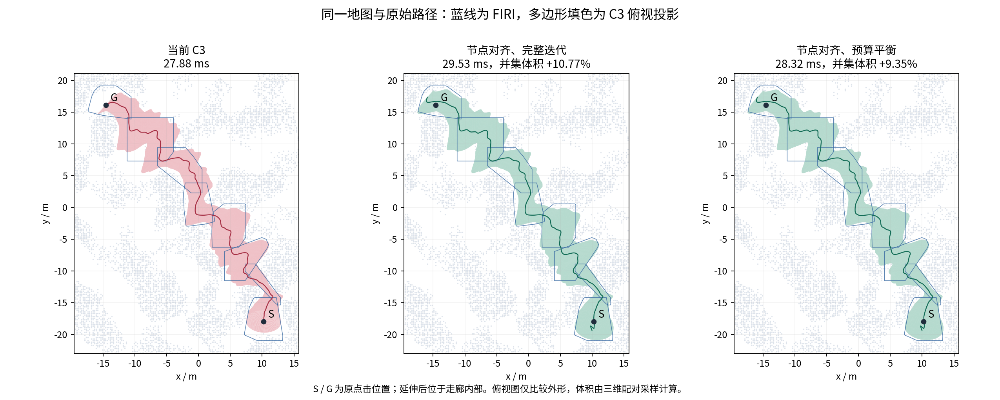
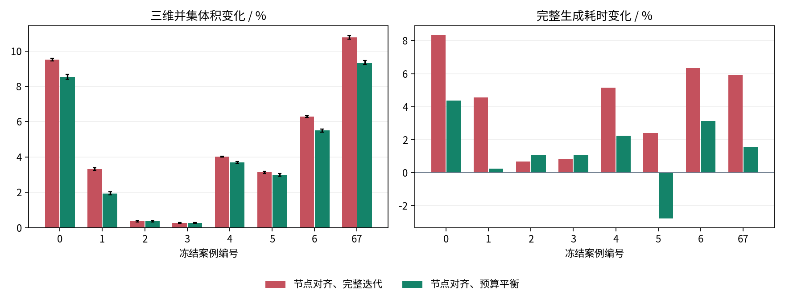

# C3 走廊空间膨胀：第一轮实验

本页保留第一轮特化方案的历史结果。当前实现已替换为[统一自由边界优化](C3自由边界自然膨胀实验.md)，下述“默认入口未切换”等表述对应当时的实验状态。

## 结论

端部扩张是本轮最明确的体积来源。保留原路径的物理节点位置后，延伸对中段的扰动明显减小，也避免了开发集中一次额外 Jacobian 修复。按控制点数分配 Newton 预算，可以进一步降低生成耗时；其代价是部分路径中段体积略有下降。

局部五变量膨胀、加大分离面尺度、额外体积修正和截面投影面积目标均已实现并完成消融。它们尚未形成同时改善体积、耗时和平滑性的通用替代方案。正式头文件库和 RViz 默认入口未切换。

最新点击路径为 45.76 m。以下时间均为复用 BVH 的完整生成时间中位数，包含端部处理与重试；FIRI 使用原来的四轮实现和相同实体障碍模型。

| 方法 | 生成 / ms | 并集体积 / m³ | 原路径区间边界弯曲能量 |
|---|---:|---:|---:|
| 当前 C3 | 27.88 | 575.22 | 381.47 |
| 节点对齐、完整迭代 | 29.53 | 637.20 | 347.74 |
| 节点对齐、预算平衡 | 28.32 | 628.98 | 322.07 |
| FIRI | 29.55 | 601.52 | — |

这条路径中，预算平衡版相对当前 C3 增加约 9.35% 总体积，耗时增加约 0.44 ms；相对 FIRI 的体积约高 4.57%，耗时约低 4.17%。这是单例结果，不能代表所有场景。

| 端部方案 | 起点外 / 终点外延伸 / m | 原路径区间体积变化 | 端部净新增体积 / m³（95% 区间半宽） |
|---|---:|---:|---:|
| 节点对齐、完整迭代 | 1.89 / 1.80 | -0.002% | 61.61 ± 0.22 |
| 节点对齐、预算平衡 | 1.89 / 1.80 | -1.304% | 60.77 ± 0.21 |

中段与端部采用各自的配对采样域，因此估计值相加会有小幅采样差异。节点对齐的完整迭代版几乎保留了本例中段体积；预算平衡版中段减少约 1.30%，用更低计算成本换取稍小的最终走廊。

## 公平性与输入

基线来自 `ros2` 的 `4a210a1`，包含当时工作区已有的交互演示改动。C3 生成头文件未改动；实验复制到私有目录后注入策略。最新路径的基线系数与交互导出逐字节一致。

共同设置：0.25 m 体素外接球、机器人半径 0.20 m、安全距离 0.05 m、认证余量 0.002 m、扩张范围 3 m、初始间距 0.4 m、长边切分 7 m、标架平滑 1.5。所有输入记录 SHA256。

端部扩张仍受**原种子路径的首末扩张盒**限制。点击的起终点作为必须包含的内部点，扩张结果检查包含关系；失败重试的时间保留。原路径区间与端部体积单独计算，端部重叠部分不重复计数。

开发集 8 条路径，每配置预热 1 次、重复 7 次；另 60 条冻结路径用于扩展回归，每配置预热 1 次、重复 3 次。扩展集包含 Perlin、迷宫、S 弯、变截面管道、螺旋、竖直路径和两个失败对照。同地图的多条路径是回归覆盖，不视为独立地图统计样本。

## 八例消融

表中耗时、并集体积和弯曲能量的变化均为逐场景配对百分比的中位数；体积范围保留最差和最好案例。耗时为正表示变慢，弯曲能量为负表示更平滑。

| 配置 | 耗时变化 | 并集体积变化 | 并集体积变化范围 | 边界弯曲能量变化 |
|---|---:|---:|---:|---:|
| 延长路径重生成 | +4.67% | +3.69% | -0.00%～+9.86% | -33.9% |
| 固定原曲面追加 | +3.22% | +0.02% | +0.00%～+0.86% | +0.0% |
| 局部条件椭圆膨胀 | +10.90% | +0.16% | -1.22%～+1.84% | -1.0% |
| 0.5 m 分离面尺度 | -3.91% | -0.74% | -2.48%～+0.01% | -13.6% |
| 1.0 m 分离面尺度 | -4.10% | -4.46% | -8.47%～-2.83% | -12.0% |
| 额外局部体积修正 | +3.34% | +0.01% | +0.00%～+0.03% | +0.0% |
| 截面投影面积目标 | +3.09% | +0.35% | -0.06%～+1.17% | +12.1% |
| 截面积＋尺度＋端部 | +5.43% | +3.05% | -0.96%～+10.35% | -41.9% |
| 截面积＋局部追加 | +6.19% | +0.39% | -0.04%～+3.03% | +12.1% |
| 尺度＋端部 | +0.34% | +2.96% | -1.83%～+10.00% | -47.2% |
| 保留原节点的端部延伸 | +4.77% | +3.67% | +0.26%～+10.77% | -32.4% |
| 对齐节点、固定 7 步 | +0.40% | +3.34% | -1.39%～+9.35% | -41.3% |
| 对齐节点、工作量预算 | +1.64% | +3.34% | +0.26%～+9.35% | -35.9% |

### 端部延伸

直接追加 C² 三次曲面可以保持旧曲面完全不变，但旧端点的一二阶导数经常限制可延伸长度。重新生成延长后的路径能获得更大的端部空间，却会改变原节点采样位置。`caps_aligned` 保留原物理节点，仅在两端增加节点，解决了这个不必要的扰动。

`caps_balanced` 用控制点数与 Newton 步数的乘积近似求解工作量。设原、新控制点数为 N0、N1，首阶段次数为 `clamp(round(14*N0/N1 - 6), 7, 8)`；后两阶段仍各三次。它不按案例编号挑选参数。体积增加主要来自端部，中段变化见完整 CSV 和各例的 `core_union` 字段。

### 局部椭圆膨胀

每个控制节点的五变量问题保留所有关联区间的 SOC 支撑约束与进度锥。有限差分、完整目标梯度/Hessian 对照均通过，C² 由控制空间直接保证。额外局部求解成本尚未被减少的全局迭代抵消，体积收益也不稳定。此前独立截面的 7.75% 面积潜力没有直接转化为连续走廊收益，说明连续耦合与可实现性必须纳入判断。

### 分离面尺度与目标函数

加大分离面代理椭球的纵向尺度能够减少部分计算和边界起伏，但经常损失体积。本轮没有把它作为默认改进。

`area` 优化的是实际截面位置上、固定参考标架投影并对称化后的 SPD 面积代理，不是精确三维截面面积。梯度、Hessian、步长域和线搜索一起更新，仍保持凸子问题和原来的带宽。它带来了小幅体积变化，但额外成本与边界起伏使它暂不适合替换基线。

额外局部体积修正的并集体积变化约为 0.003%–0.025%，远小于端部扩张；部分差异接近采样误差，其成本不值得默认引入。

## 另 60 条路径的回归

以下结果保留失败案例，并对基线和候选共同成功的路径计算配对指标。最后一列列出配对差的 95% 区间完全小于零的案例；这是逐例采样误差区间，未作多重比较校正。

| 配置 | 生成成功 | 耗时变化中位数 | 并集体积变化中位数 | 体积变化范围 | 弯曲能量变化中位数 | 下降区间低于零的案例 |
|---|---:|---:|---:|---:|---:|---|
| 节点对齐、完整迭代 | 58/60 | +4.83% | +4.38% | -0.20%～+19.96% | -22.2% | [17] |
| 节点对齐、预算平衡 | 58/60 | +1.74% | +3.72% | -0.20%～+19.96% | -22.7% | [17] |

基线同样成功 58/60；失败对照为折返尖点和 0.03 m 窄口。案例 8、17 使用四倍采样复核：案例 8 的体积变化约 −0.008% ± 0.023%，尚不能区分与零的差别；案例 17 为 −0.195% ± 0.031%，扩张增加的端部空间未完全补回中段损失。

早期未限制加密的端部方案在案例 25、32、33 中初始化失败，并执行了六轮全局加密后才回退。案例 33 的单次诊断约为 1788 ms，其中扩张尝试约 1728 ms。限制端部候选加密后，三例回退总耗时分别约 46、60、81 ms；原走廊几何保持不变。案例 33 仍有约 21 ms 的失败尝试成本，后续局部端部求解需要继续降低这项开销。表中使用限制加密后的版本。

## 验证与资源

所有成功输出均通过连续支撑与全截面 Jacobian 认证。局部目标梯度误差约 3.33e-11，Hessian 误差约 1.27e-10；另有与完整目标的导数一致性、截面面积代理导数、精确线搜索差值和曲面裁剪测试。全部记录的最大 C² 接缝误差为 8.43e-08，按原路径长度对导数归一化。

并集体积使用独立三维求交、Sobol 采样和 8 次随机数字平移，每次 65,536 点；每对配置共 524,288 点。扩展集案例 8、17 提高到每次 262,144 点，共 2,097,152 点。所有测量的未决反求根计数为零。完整数据保留配对差和 95% 区间，不能只凭微小点估计宣布提升。边界弯曲能量使用原路径弧长参数，在原路径区间计算。

补充了贴近世界边界时延伸长度趋零的测试：路径插点和 knot 向量使用同一阈值。修正后重放 68 条输入、3 个配置，204 个状态一致；198 个成功输出的完整曲面、原路径区间曲面及支撑平面均逐字节一致。

所有计算串行，固定 CPU 2，数值线程为 1，进程地址空间上限 4 GiB。生成阶段观测到的峰值 RSS 为 30.9 MiB。BVH 构建时间另列，冷启动应加上该项。没有运行轨迹优化。

### 阶段计时

以下为最新路径打开计时后的单次诊断，单位 ms，用于定位成本，不替代前面的七次统计。部分字段属于嵌套阶段，不应直接相加；正常性能测量关闭高频阶段时钟。

| 配置 | 障碍覆盖 | 求解构造 | Hessian 组装 | 线性求解 | 线搜索 | 求解器认证 | 额外局部膨胀 |
|---|---:|---:|---:|---:|---:|---:|---:|
| 当前 C3 | 11.83 | 2.76 | 6.59 | 2.34 | 3.24 | 0.39 | 0.00 |
| 局部条件椭圆膨胀 | 10.82 | 2.62 | 5.84 | 2.02 | 2.85 | 0.39 | 4.58 |
| 截面投影面积目标 | 10.44 | 2.64 | 7.23 | 2.78 | 3.34 | 0.47 | 0.00 |
| 节点对齐、预算平衡 | 11.36 | 2.75 | 6.45 | 2.39 | 3.17 | 0.52 | 0.00 |

## 下一步

优先研究端部局部重优化：允许首末几个控制块重新分配形状和导数，同时固定远处中段，复用原有覆盖与带状结构。它针对本轮暴露的矛盾：完全固定端点 jet 会限制扩张，全路径重生成又为新增端部支付了过多计算。

中段空间利用率的下一步应围绕活跃约束定位展开，区分真正的 Jacobian 限制、控制凸包限制和椭圆截面自身的角落损失。当前结果不支持直接增加全局迭代数或统一放大分离面尺度。

本轮特化实现已移出源码；历史源码保存在 [压缩归档](validation/inflation_round1/experiment_sources.tar.gz)。后续实现见 `SweepCorridor/experiments/free_boundary/`。数据：[逐例 CSV](validation/inflation_round1/comparison.csv)，完整计时、输入摘要与压缩系数保存在同目录。
