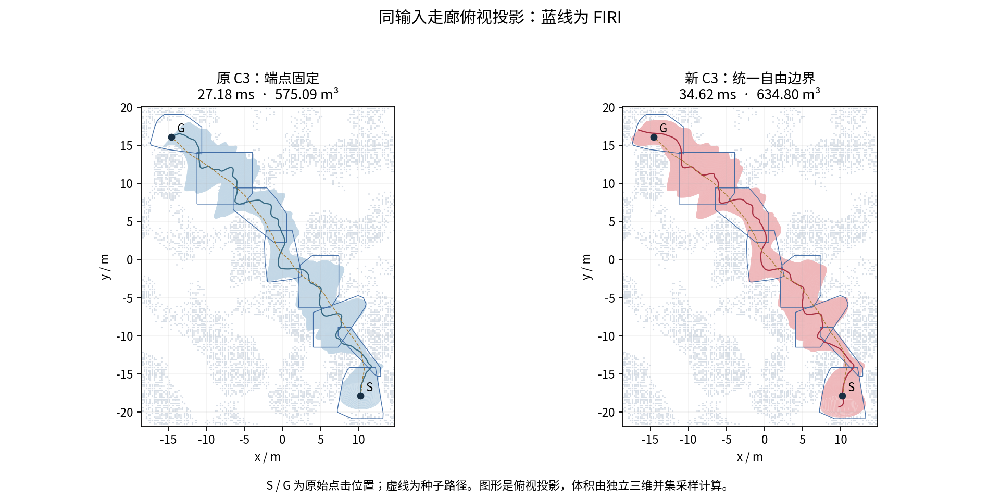
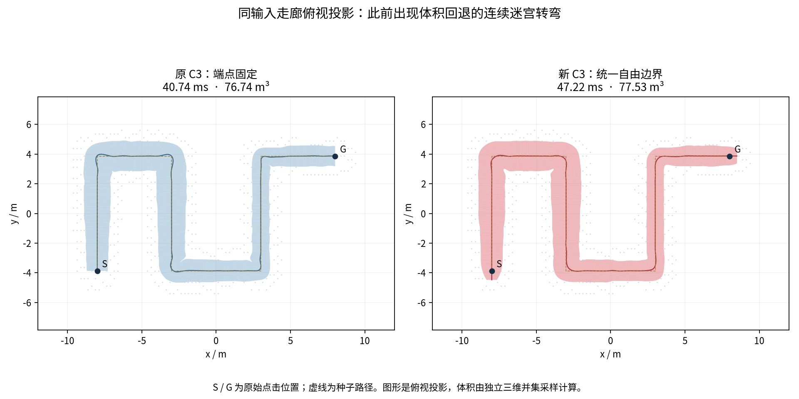
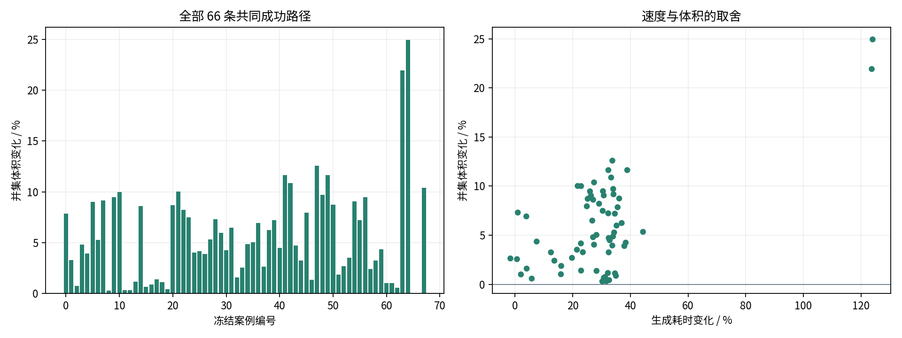

# C3 自由边界自然膨胀实验

当前生成器已改为统一的六变量 C3 模型：中心可以沿三维方向移动，原始起终点作为必须包含的锚点，走廊的两端由优化决定。手工延长种子路径、追加封端和按新增节点调整预算的代码已移出源码，历史实现与结果保留在[上一轮归档](validation/inflation_round1/README.md)。

这轮保持三次表示、节点数、地图安全模型和两轮膨胀流程不变，增加了体积目标、起终点包含约束及纵向间距正则。66 条共同成功路径的并集体积均增加，生成耗时的配对中位数增加约 30%。

## 同输入效果

最新截图路径的结果如下。时间为预热后七次完整生成的中位数，复用已建立的障碍 BVH；FIRI 使用同一地图、原始种子、3 m 扩张范围和实体障碍安全模型。

| 方法 | 生成耗时 / ms | 三维并集体积 / m³ |
|---|---:|---:|
| 原 C3，固定端点 | 27.18 | 575.09 |
| 新 C3，自由边界 | 34.62 | 634.80 |
| FIRI 辅助参考 | 30.74 | 600.85 |

新 C3 相对原版增加 **10.38%** 并集体积，配对增量为 **59.70 ± 0.69 m³**。相对 FIRI 的点估计体积约高 5.65%，耗时约高 12.65%。FIRI 与 C3 的辅助测量另用一组配对采样域，因此其绝对体积与 C3 新旧比较存在小幅采样差异。

起终端面的中心分别移动约 1.55 m、2.18 m。这是三维位移的模长，并非预设的延伸长度。原点击位置对应的参数变为约 `0.0183` 和 `0.9846`，仍位于走廊内。

只统计原点击点所在截面之间的空间，该例体积增加约 **0.30%**。本例的总增量主要来自两端释放；不能据此认为所有中段都同样扩大。

## 统一参数化与目标

沿用扫掠模型：

\[
F(u,z)=c(u)+M(u)z,\qquad \|z\|_2\leq1.
\]

第 \(i\) 个三次 B 样条控制块为

\[
C_i=r_i+d_i,\quad d_i\in\mathbb R^3,\qquad
D_i=F_iS_i,\quad S_i\in\operatorname{Sym}^+(2).
\]

每个块有三个中心变量和三个形状变量。包括两端在内的所有控制块参与同一个优化，参考标架 \(F_i\) 与原路径扩张盒固定。没有增加种子点，也没有为端部添加 knot。

优化目标为

\[
E(c,M)-0.1\sum_i w_i\log\det S_i-\log V
-\frac{0.01}{N}\sum_k\log\Delta_k+\text{可行域障碍项},
\]

其中中心与形状的二阶导数能量权重均为 `3e-5`，中心位移正则为 `0.001`。扫掠体积为

\[
V=\pi\int_0^1 (M_0\times M_1)^Tc'(u)\,du.
\]

被积函数最高八次，五点 Gauss 可以精确积分。该量对远距离扫掠重叠重复计数，因此实验的最终空间指标使用独立三维并集体积。

\(\Delta_k=t_k^2-\|r_k\|^2\) 是现有局部进度锥的 Lorentz 行列式。它度量沿参考法向推进时，整个截面的纵向间距。将这项保留为固定正则后，即使可行域障碍参数逐渐减小，优化也不会轻易把局部间距压到接近零。它作用于整条走廊，复用原有约束遍历、梯度、Hessian 和线搜索。

## 起终点如何保持在走廊里

对原始起点和终点 \(p\)，求解局部截面平面方程

\[
n(u)^T[p-c(u)]=0,\qquad n=M_0\times M_1,
\]

然后计算

\[
z=(M^TM)^{-1}M^T[p-c(u)],\qquad \|z\|<1.
\]

原始点不再要求等于 `section(0).center` 或 `section(1).center`。求根消去了额外的 \(u,z\) 变量，隐函数求导把包含约束的梯度传播到该区间的四个控制块，节点间不产生全局稠密连接。每个锚点的局部根缓存跨迭代和两轮膨胀复用，并保持起点参数小于终点参数。

端面法向由固定端部标架确定。两个线性闭域不等式允许端面保持在原始点上，或向外移动。它们用小型活动集求解器处理，没有指定端面位置、延伸距离或针对窄口的单独策略。

## 连续安全与计算结构

三次 Bézier 控制截面的支撑约束仍为

\[
n^TC_j+\|D_j^Tn\|\leq b.
\]

分离面固定时，这部分是凸 SOC 约束。中心变为三维自由变量后，冗余支撑裁剪的可达域界也同步改为完整三维偏移界。每个接受步都通过全截面 Jacobian 连续认证，原始起终点通过包含约束。

完整问题包含体积和隐式求根，因此是非线性问题。支撑、形状、位移和进度正则使用解析梯度与 Hessian；体积保留精确梯度及正半定秩一曲率，锚点项使用隐函数梯度与 Gauss–Newton 曲率。没有将这些近似曲率称为完整精确 Hessian。

六变量控制块使标量半带宽从 19 增至 23。体积的秩一更新通过 Sherman–Morrison 处理，不构造稠密矩阵；沿搜索方向的体积变化直接计算为三次多项式。线搜索复用已有的对数项上界，只有必要时计算精确对数差。

每轮仍为 `8+3+3` 次迭代预算，共两轮分离面更新。记录中的 `iteration_limit` 表示预算结束，不等同于目标已完全收敛。正常生成关闭内部阶段时钟。

## 八条开发路径

下表的“中段”指原始起终点所在截面之间的空间。“参数弯曲能量”使用原路径长度归一化参数下的二阶导数积分。

| 案例 | 原 C3 / ms | 新 C3 / ms | 并集体积变化 | 中段体积变化 | 参数弯曲能量变化 |
|---|---:|---:|---:|---:|---:|
| 0 | 23.16 | 31.39 | +7.85% | +0.53% | −57.25% |
| 1 | 45.77 | 56.52 | +3.27% | +2.40% | −30.42% |
| 2 | 28.95 | 37.99 | +0.74% | +0.26% | −21.56% |
| 3 | 42.33 | 53.79 | +4.80% | +3.84% | −44.00% |
| 4 | 21.17 | 28.31 | +3.95% | +0.98% | −59.33% |
| 5 | 21.54 | 27.21 | +9.04% | +0.54% | −67.45% |
| 6 | 24.97 | 33.55 | +5.28% | +0.10% | −50.35% |
| 67，最新截图 | 27.18 | 34.62 | +10.38% | +0.30% | −49.99% |

## 扩展回归与平滑性

开发集预热一次、正式七次；另外 60 条路径预热一次、正式三次，覆盖 Perlin、迷宫、S 弯、变截面管道、螺旋、空旷直线和竖直路径。同地图的多条路径作为回归覆盖，不当作独立地图样本。

| 指标 | 8 条开发路径 | 60 条扩展回归 |
|---|---:|---:|
| 原版与新版成功数 | 均为 8/8 | 均为 58/60 |
| 并集体积增幅中位数 | +5.04% | +4.79% |
| 并集体积增幅范围 | +0.74%～+10.38% | +0.30%～+24.95% |
| 生成耗时变化中位数 | +29.31% | +30.43% |
| 中段体积变化中位数 | +0.54% | +0.46% |
| 参数弯曲能量变化中位数 | −50.17% | −31.92% |
| 侧壁曲面弯曲能量变化中位数，数值估计 | −37.71% | −25.07% |

全部 66 条共同成功路径的配对体积差区间均高于零。两个失败对照仍为折返尖点和 0.03 m 窄口，没有新增失败。

曲面指标采用 \(\int(k_1^2+k_2^2)\,dA\)，其中 \(k_1,k_2\) 为主曲率，仅积分原起终点区间的侧壁。它与纵向参数的分配无关。报告同时保留纵向边界曲线的曲率能量，避免只用参数二阶导数解释视觉平滑性。曲率数据是数值积分，默认每段 24 点 Gauss、48 个角度；尖锐代表例的加密复核见[分辨率记录](validation/free_boundary/curvature_resolution.json)。

9 个代表例加密到每段 96 点 Gauss、192 个角度后，新版曲面弯曲能量的最大相对变化约 0.011%。原版部分尖峰的积分仍随分辨率明显变化，尚未收敛；表中的曲率百分比用于统一分辨率下的比较，不能当作这些尖峰的高精度能量比值。

整体增益不表示逐处增大或逐例更平滑。扩展集的中段体积最差约 −3.15%；侧壁曲面弯曲能量的最大增幅约 +25.21%。原来出现体积回退的三个连续迷宫转弯例，最终总并集体积改为约 +1.03%、+1.00%、+0.58%，其中段分别约 −0.37%、−1.15%、−1.66%。

## 为什么保留纵向间距正则

直接释放中心并优化总体积时，局部参数区间可能被挤得很短。Jacobian 仍然为正，按参数计算的二阶导数能量也可能下降，但实际边界会产生较大的曲率。

先将弯曲权重从 `1e-5` 增至 `3e-5`，能改善参数弯曲能量，但不能单独消除这个现象。加入持续的进度锥对数正则后，在没有增加迭代数的情况下，局部压缩受到抑制，开发集的曲面弯曲指标全部下降，三个迷宫例的总体积回退也得到修正。`0.003` 与 `0.01` 两档对照的原始结果均已归档，正式实现只保留 `0.01`。

## 耗时来源与验证

最新路径打开阶段计时后的单次诊断如下，单位 ms。阶段计时包含嵌套关系，线搜索已经包含其中的 Jacobian 认证，不应将所有列直接相加。

| 方法 | 障碍覆盖 | 求解构造 | 梯度/Hessian 组装 | 线性求解 | 线搜索 | 其中 Jacobian 认证 |
|---|---:|---:|---:|---:|---:|---:|
| 原 C3 | 10.47 | 2.56 | 6.57 | 2.35 | 2.79 | 0.46 |
| 自由边界 C3 | 10.16 | 2.67 | 11.20 | 3.88 | 5.53 | 0.80 |

新增成本主要来自六变量带状系统、更完整的进度约束、体积梯度和锚点反求。BVH 构建另需约 35 ms；冷启动应把它加入生成时间。空旷短路径的相对耗时增长更明显，不能用复杂地图的约 30% 概括所有输入。

有限差分最大误差：锚点隐函数导数约 `2.43e-10`，体积梯度约 `4.70e-10`，支撑与正则目标梯度约 `5.18e-11`，对应 Hessian 约 `9.62e-12`。另通过精确线搜索差值、三次体积增量、闭端面活动集 KKT、近世界边界扩张和圆柱曲率解析测试。

所有成功输出在计时外重新检查连续支撑、全截面 Jacobian、起终点包含和 C² 接缝，最大归一化 C² 接缝误差约 `7.47e-13`。并集测量使用 8 次随机数字平移，每次 65,536 个 Sobol 样本，所有未决反求根计数为零。库测试、安装后的外部消费项目、体积测试、路径搜索测试及 Perlin/迷宫 ROS 发布检查均通过。本轮没有运行轨迹优化。

构建与实验串行，固定 CPU 2，数值库线程数为 1，进程地址空间上限 4 GiB；生成进程观测峰值 RSS 约 31 MiB。

## 当前边界

这是在现有三次扫掠表示内的自由边界优化。参考标架、原种子路径关联的局部扩张盒和椭圆截面形式仍然存在，不能保证填满任意非椭圆自由空间；连续局部 Jacobian 正定也不排除远处扫掠重叠。当前固定预算解不保证是最大体积解。

下一步值得研究的是在保持稀疏结构的同时调整参考标架和局部覆盖关系，提高中段空间利用率；当前结果已经把端部释放、几何正则和中段增益分开量化。

代码与复现入口：[实验说明](../SweepCorridor/experiments/free_boundary/README.md)。完整数值、输入摘要、代表例系数和验证日志见[数据归档](validation/free_boundary/README.md)。
