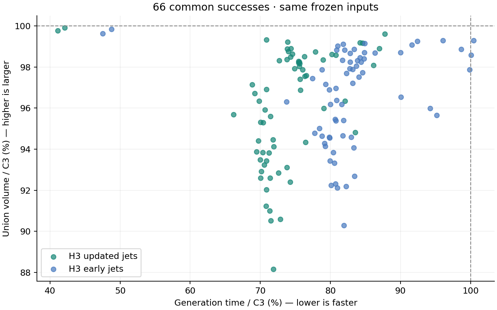
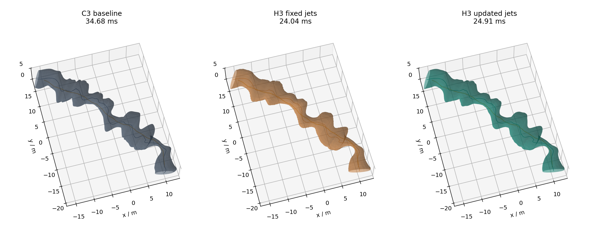
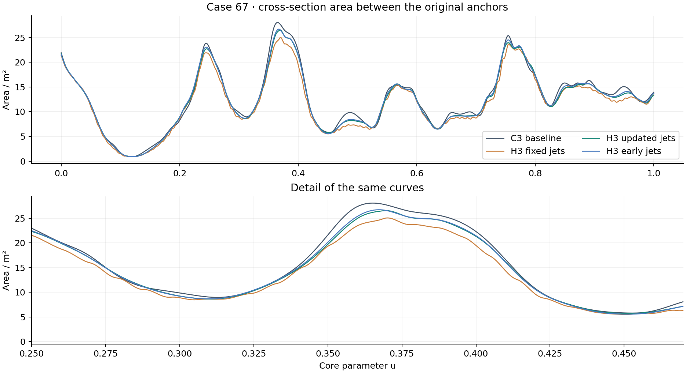

# H3 三次 Hermite 走廊实验

2026-11-05 · 分支 `experiment/h3-local-hermite` · C3 基线 `7d4fc603607f131a1d282247c3e523c11da5d06e`。

本轮得到一个专门利用两节点结构的 C¹ 三次 Hermite 生成器。68 个冻结输入中，C3、H3 默认候选和提前更新候选均有 66 个成功，两个失败输入一致。对 66 个共同成功输入，默认 H3 的配对耗时比中位数为 **0.738**，即减少 **26.2%**；并集体积比中位数为 **0.969**，即减少 **3.1%**。曲面弯曲能量比中位数为 **0.882**。

目前 H3 提供了明确的生成速度收益，但尚未在体积上追平 C3。实验代码保留在独立目录，主库和 RViz2 默认仍使用 C3。

RViz2 已增加 `corridor:=h3` 点选入口：

```bash
/home/zdp/ForCodex/GCOPTER/gcopter/tools/run_direct_demo.sh corridor:=h3 scene:=perlin
# 迷宫：将 scene:=perlin 改为 scene:=maze
```

界面标注 **H3 · C¹**，红色为 H3，蓝色为同输入 FIRI；左侧可切换图层并查看各自生成耗时。使用顶部 **2D Goal Pose** 依次选择起点、终点。H3 使用每轮膨胀后更新共享导数的默认方案，只运行走廊生成。

Perlin 和迷宫的 ROS 点选集成测试均通过。两次 H3 生成分别为 22.29 ms、29.67 ms；将实际搜索得到的地图与种子快照送入离线 H3 程序，导出的全部 Bézier 系数数值完全一致。C3 两种场景的原入口也通过回归。这些单次时间用于验证演示功能，不作为新的性能排名。记录见 [RViz2 集成验证](validation/h3/rviz.json)。



图中每个点对应一组相同地图、种子路径和安全设置。失败输入仍保留在原始统计中；图中展示的是共同成功的 66 组。空旷直线、竖直线的速度收益更大，不能用它们代替复杂地图的结果。

## 实现和数学结构

所有方法使用同一个几何模型：

$$F(u,z)=c(u)+M(u)z,\qquad \|z\|_2\le 1.$$

H3 的节点值写成 $Y_i=[c_i,\operatorname{vec}(M_i)]\in\mathbb R^9$。每个节点优化三个世界中心偏移与三个对称形状变量。共享世界一阶导数 $V_i$ 在一轮节点优化中固定：

$$B_0=Y_i,\quad B_1=Y_i+\frac{h_i}{3}V_i,\quad
B_2=Y_{i+1}-\frac{h_i}{3}V_{i+1},\quad B_3=Y_{i+1}.$$

这不是把 H5 的次数常量改为 3。实现针对下面的结构进行了处理。

| 结构 | 当前原生 C3 | 本次 H3 |
|---|---|---|
| 单段依赖的节点值 | 4 个、24 维 | 2 个、12 维 |
| 普通支撑控制截面 | 多节点组合 | 未细分时只关联一个 6 维节点 |
| Hessian 局部结构 | 块半带宽 3 | 6×6 块三对角 |
| 导数 Bézier 控制量 | 三组可变 | 两组固定，只保留中间一组可变进度锥 |
| 端点反求的局部梯度 | 24 维 | 12 维 |
| 体积积分 | 五点 Gauss，八次精确 | 同样精确，预缓存权重及固定导数偏置 |
| 连续性 | C² | 共享一阶导数保证 C¹ |
| 全截面 Jacobian 证书次数 | 8 | 8 |

从归档 H5 `archive/h5-sweep-corridor@bd6d81f` 借用了节点分组、块三对角 Schur 消元、尺度平衡和共享导数提议的思路。保留当前 C3 的自由端面、原起终点的隐式包含约束、真实扫掠体积目标和全截面 Jacobian 接受条件。

单节点支撑行直接组装六维梯度与 Hessian，避免先组装九维世界 Hessian 再回传；真正经过细分的行仍只关联两个节点。线性系统因子在体积秩一修正和自由端面两个额外右端项之间复用。H3 与 C3 都输出三次 Bézier，单次查询与证书的多项式次数相同，不能把生成器提速归因于查询降阶。

固定分离平面和共享导数时，支撑锥、形状正定域及二次正则的梯度与 Hessian 是解析计算。与基线一致，真实体积的非凸 Hessian 使用正秩一部分，隐式锚点使用 Gauss–Newton 曲率；没有声称整个问题是凸问题。

## 共享导数如何更新

直接固定初始化导数会在截面扩大后产生明显起伏。默认候选在每轮膨胀后，对当前九维节点值求自然三次的导数提议。九个通道共用一套三对角分解，然后逐节点限制更新幅度：

1. 一个节点导数只改变左段的 $B_2$ 和右段的 $B_1$，因此只扫描这两段已有的支持平面。
2. 对原有细分区间求精确的二次锥线搜索可行步长。
3. 重新认证这两段的全截面 Jacobian，并更新原起终点的截面反求。
4. 接受降低这两段弯曲能量的更新。进入下一轮节点优化后，再将导数固定。

导数并非一边随节点变量变化、一边忽略其梯度；它们属于明确的外层更新。初值来自一个未优化的小截面参考的精确基变换，没有隐藏一次完整 C3 走廊生成，全部初始化成本计入 H3。

共享支持冗余证明也做了一个必要扩展：H3 控制截面带有固定形状偏置 $D_{\mathrm{ref}}$，残差方向 $r$ 的可达域上界必须增加 $\|D_{\mathrm{ref}}^T r\|$。测试中构造了忽略该项会错误删除约束的反例。原生 C3 通过编译期分支保持原计算路径。

## 相同输入的结果

开发集八例，每种方法预热一次、正式重复七次。下表的时间为单例中位数；体积和曲面能量变化均为默认更新导数 H3 相对 C3。

| 输入 | C3 / ms | H3 更新导数 / ms | H3 提前更新 / ms | 并集体积变化 | 曲面弯曲能量变化 |
|---|---:|---:|---:|---:|---:|
| 0 / perlin | 31.76 | 22.34 | 24.92 | -6.15% | -3.6% |
| 1 / perlin | 56.41 | 41.09 | 46.40 | -9.40% | -44.1% |
| 2 / maze | 38.46 | 28.69 | 31.84 | -1.37% | -7.5% |
| 3 / perlin | 54.43 | 39.52 | 45.37 | -7.16% | -29.4% |
| 4 / perlin | 28.35 | 19.51 | 22.34 | -2.86% | -27.1% |
| 5 / maze | 27.15 | 20.55 | 22.34 | -2.60% | -8.2% |
| 6 / perlin | 36.89 | 24.40 | 27.20 | -4.32% | -11.3% |
| 67 / rviz_latest | 34.68 | 24.91 | 28.02 | -5.54% | -21.5% |

曲面弯曲能量使用侧壁上的 $\int(k_1^2+k_2^2)\,dA$，越低代表该指标下边界起伏越少。另行保存边界母线的几何曲率积分、截面面积和 C² 二阶导数跳变量。积分采用几何度量，而不是仅用参数二阶导数判断平滑。



上图黄色线为同一条种子路径，曲面直接取自导出的 Bézier 系数。中间的固定导数版本虽快，但边界起伏明显；右侧为外层更新导数后的版本。



面积曲线只比较两个原始锚点之间的区域，横轴为该区域重新归一化后的参数 $u$。总体并集体积另外包含自由端部扩张，二者分别存储。

其余 60 例每种方法预热一次、正式重复三次，包括 Perlin、迷宫、S 弯、变半径通道、螺旋、迷宫急转弯、空旷直线及竖直线。全部 68 例的成功率均为 **66/68**；回折尖点 `65` 和窄口 `66` 三种方法均报告初始化失败。

| 66 个共同成功输入的配对指标 | H3 更新导数 | H3 提前更新 |
|---|---:|---:|
| 耗时比中位数 | 0.738 | 0.820 |
| 耗时比范围 | 0.411–0.878 | 0.475–1.004 |
| 并集体积比中位数 | 0.969 | 0.973 |
| 并集体积比范围 | 0.882–0.999 | 0.903–0.998 |
| 曲面弯曲能量比中位数 | 0.882 | 0.863 |
| 最大 C¹ 接缝误差 | 2.93e-14 | 3.18e-14 |
| 生成进程峰值 RSS / MiB | 33.9 | 38.9 |

默认 H3 在 56/66 个输入上的曲面能量低于 C3，其余 10 例略高，最大增幅约 16%。这项改进不是逐例支配。空旷直线的基线母线弯曲能量接近零，因此该指标的比值会被极小分母放大，原始绝对值也一起保存。

也保存包含失败输入的配对耗时统计。数据中多条路径属于同一地图，因此这些汇总是当前测试集的描述统计，没有把它们当作 68 个独立地图来推断泛化置信区间。

## 阶段耗时和消融

以下为输入 67 单独开启阶段计时后的三次中位数。总速度排名使用关闭阶段计时的运行；线搜索列已经包含 Jacobian 认证时间，不能再把证书时间相加。

| 方法 | 覆盖 / ms | 构造 / ms | 组装 / ms | 求解 / ms | 线搜索 / ms | 导数更新 / ms |
|---|---:|---:|---:|---:|---:|---:|
| H3 early jets | 10.46 | 5.04 | 6.02 | 1.17 | 3.33 | 1.03 |
| H3 updated jets | 10.11 | 2.53 | 5.94 | 1.17 | 3.34 | 0.51 |
| C3 baseline | 10.19 | 2.58 | 11.20 | 3.87 | 5.53 | 0.00 |

初测另外比较了三种预算方案：把每轮初始 Newton 从 8 步增加到 12 步、三轮较短膨胀、平滑后追加三步再膨胀。增加预算可在部分路径收回少量体积，但耗时增长更明显；三轮较短膨胀还能降低边界能量，却未改善体积。原始结果保存在 `pilot_budget` 与 `pilot_polish`，没有据此替换默认候选。

单节点六维组装还单独与九维回传版本比较，其他算法与预算保持一致。两种二进制可以通过 `--targets benchmark,world` 分别构建。三条路径的 QMC 并集体积完全相同，完整生成耗时再下降约 10%，系数最大差异低于 $6\times10^{-10}$。

| 输入 | 九维回传 / ms | 六维直接组装 / ms | 完整生成耗时减少 | 最大系数差 |
|---|---:|---:|---:|---:|
| 0 | 24.57 | 22.10 | 10.0% | 6.33e-13 |
| 2 | 31.58 | 28.48 | 9.8% | 6.14e-12 |
| 67 | 27.60 | 24.79 | 10.2% | 5.04e-10 |

该优化已包含在最终结果中，原始数据位于 `assembly_ablation`。

## 安全、数值验证与复现

所有方法使用 0.25 m 体素的外接闭球、0.20 m 机器人半径、0.05 m 安全距离、0.002 m 证书余量、3.0 m 局部扩张范围、0.40 m 初始间距及相同冻结路径。连续认证标准没有改变。每次正式运行在计时结束后独立复核全部支持平面、全截面 Jacobian、C¹ 接缝及原起终点包含关系。

并集体积使用八组随机平移，每组 65,536 个同序列 QMC 样本，同时给出配对差值误差区间；全部反求未判定计数为零。输出同时记录解析扫掠体积，后者有重叠时会重复计数，不作为并集体积替代。曲率积分采用 48 阶纵向积分与 96 个周向样本；开发集及人工场景的 24/48 阶对比最大相对变化约 0.020%，记录保存在 `curvature_resolution.json`。

数值测试包括非均匀节点的精确重构、C¹ 接缝、自然导数完整接受时的 C² 恢复、单节点与细分支撑行的梯度/Hessian、解析体积梯度、体积线搜索多项式、隐式反求梯度、块求解的稠密参考、自由端面 KKT、近墙端部及固定偏置冗余界反例。有限差分误差约为 $10^{-10}$。详细测试输出与原始终止状态在结果归档中。主库测试通过，当前 C3 在开发集八例的完整几何、核心区间几何及支持平面与冻结提交逐字节一致。

C¹ 并不妨碍节点空间中的解析 Hessian。关于空间查询，接缝处的一阶梯度连续，涉及 $u$ 的二阶几何导数通常有跳变；没有把这种走廊当作 C² 发布。本轮没有运行轨迹优化，也不推断其后端耗时或质量。

全部构建与数值实验串行执行，固定 CPU 2、数值库线程数为 1、地址空间上限 4 GiB。冷热计时分别保留：表格比较复用 BVH 的生成热路径，原始行记录一次 BVH 构建时间。H3 默认仍使用 28 个节点 Newton 步的预算，多数结果的终止状态为 `iteration_limit`；成功状态表示得到已认证走廊。

复现命令见 [实验目录 README](../SweepCorridor/experiments/h3/README.md)。本目录的 `paired.csv`、`aggregate.json`、`results.json.gz`、`geometry.tar.gz` 和 `artifacts.json` 分别保存逐例配对数据、汇总、原始运行及测试、代表性几何、源码与文件哈希。

## 后续方向

下一步优先解决导数优化与节点膨胀脱节带来的体积损失。当前自然导数目标只考虑弯曲能量，并不主动增加体积；安全裁剪后再固定导数，也限制了体积优化的方向。可以试验中心导数、形状导数各一个局部幅度变量，在保持两节点结构的前提下，把体积梯度直接传播到这两个自由度，再比较增加块尺寸后的实际成本。

其次应检查体积差较大的 Perlin 路径：区分自由端部扩张不足、当前分离面方向与 Bézier 支撑凸包的保守性。用局部认证缺口选择细分区间，而不是统一增加节点或统一增加迭代。只有在这些诊断证明有收益后，才考虑把 H3 接入默认演示。
