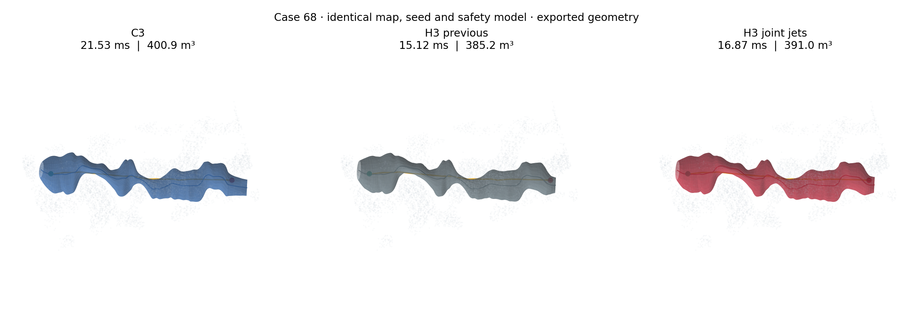
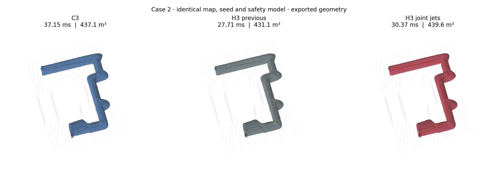
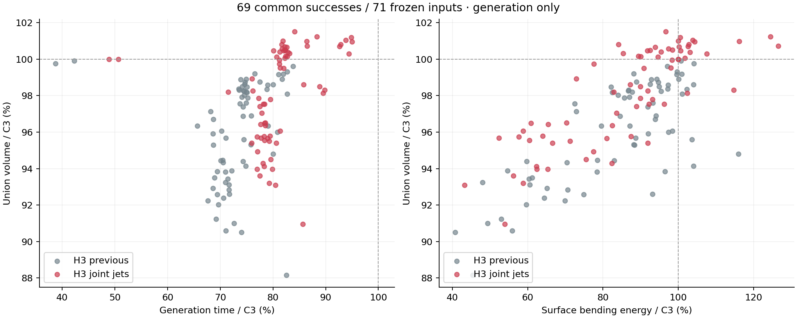
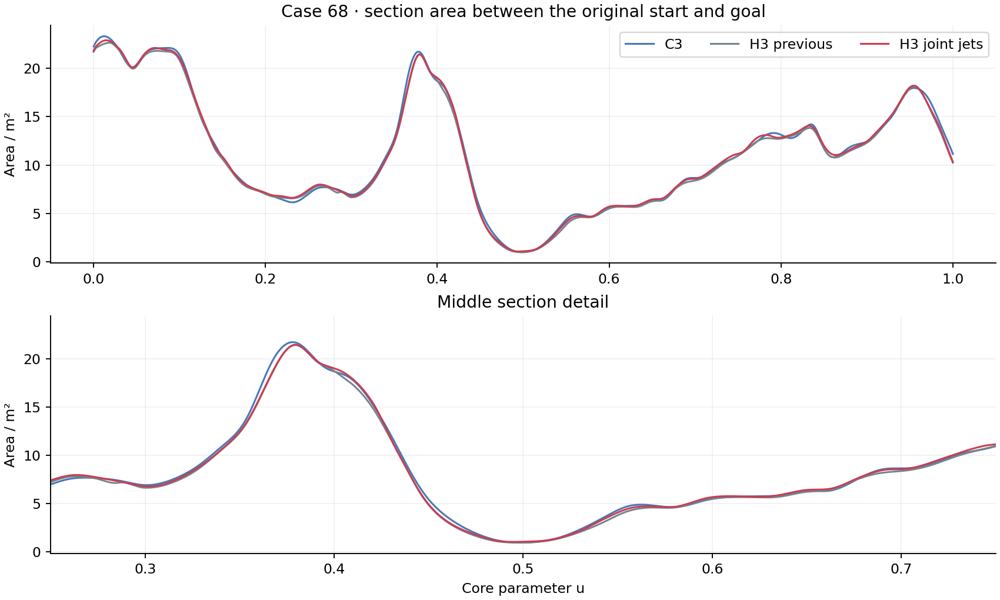

# H3 共享导数体积优化

2026-11-05 · `experiment/h3-local-hermite` · C3 基线 `7d4fc60` · 旧 H3 基线 `d1e0ad6`。

本轮把共享一阶导数纳入体积优化，并保留 H3 原有的六维块三对角主求解器。71 个冻结输入中，三种方法都成功 69 个，相同的两个输入初始化失败。新 H3 在全部 69 个成功输入上增大了旧 H3 的并集体积，配对增幅中位数为 **2.18%**，同时全部快于 C3，耗时比中位数为 **0.807**。

相对 C3，整体并集体积比中位数由 **0.967 提高到 0.985**。只比较原始起终点之间的核心区域，体积比中位数为 **0.9998**。体积差距已明显缩小，但复杂转弯和自由端部仍有改进空间。



图中是这次 RViz 截图对应的冻结路径 `68`，三幅图使用同一地图、种子路径和安全模型，曲面直接由导出的三次 Bézier 系数绘制。黄色为种子路径，点标记原始起终点。

| 69 个共同成功输入，配对比值中位数 | 旧 H3 / C3 | 新 H3 / C3 |
|---|---:|---:|
| 完整走廊生成耗时 | 0.741 | **0.807** |
| 去重并集体积，包含自由端部 | 0.967 | **0.985** |
| 曲面弯曲能量 | 0.882 | **0.900** |
| 生成进程峰值 RSS | 34.0 MiB | 37.2 MiB |

新 H3 相比旧 H3 的耗时中位数增加 **10.8%**，曲面弯曲能量中位数增加 **4.2%**。这是用一部分原有速度和平滑性余量换取空间利用率；相对 C3，仍保留约 **19.3%** 的生成时间优势和约 **10.0%** 的曲面能量优势。

新 H3 有 26 例并集体积超过 C3，其中 25 例的配对差超过 QMC 误差区间；52 例的曲面能量低于 C3。最差体积比仍为 0.910，最大曲面能量比为 1.265。完整逐例结果包含这些情况。

## 为什么需要同时优化节点值和导数

三次 Hermite 的节点几何记为

$$Y_i=[c_i,\operatorname{vec}(M_i)]\in\mathbb R^9,\qquad V_i=Y'_i.$$

一个区间的控制量为

$$B_0=Y_i,\quad B_1=Y_i+\frac h3V_i,\quad
B_2=Y_{i+1}-\frac h3V_{i+1},\quad B_3=Y_{i+1}.$$

旧 H3 在主膨胀时固定 $V_i$，之后用自然三次导数提议降低弯曲能量。这个过程擅长消除起伏，却不会主动寻找能增加体积的导数。只移动 $Y_i$ 时，$B_0$ 和 $B_1$ 必须一起移动；一个贴近障碍的内侧控制截面可能限制另一个仍有扩张余量的截面。

仅释放九维导数的实验改善很小：若固定节点值，只推动内部两个控制量，能够使用的安全余量有限。联合移动节点值和导数后，控制截面可以协调避让和扩张，体积增益更稳定。

当前流程为：

1. 复用原有安全初始化、两轮覆盖膨胀与自然导数更新。
2. 正向扫描节点，每个节点联合优化六个节点变量和九个世界导数变量，最多两步。
3. 反向再扫描一次，让后一节点的更新能反馈到前一节点。
4. 每次接受更新前，保持支持约束、原始锚点包含和相邻两段的全截面 Jacobian 证书。

主求解仍为六维块三对角；新增阶段是 **15 维局部块坐标修正**，不是把全部节点和导数放进一个大规模联合 Newton 系统。共享导数始终由相邻两段共同使用，所以输出保持 C¹。

## 用于加速的数学结构

### 体积线搜索是精确三次多项式

全截面 Jacobian 保持正号时，扫掠体积积分为

$$V=\pi\int (M_0\times M_1)^Tc'\,du.$$

局部变量沿一个方向变化时，$M_0,M_1,c'$ 都关于步长 $\alpha$ 仿射，因此

$$V(\alpha)=V_0+v_1\alpha+v_2\alpha^2+v_3\alpha^3.$$

五点 Gauss 对每段最高八次的积分精确。每个搜索方向只构造一次这三个系数，随后用标量多项式和 `log1p` 求目标变化，避免每次回退重新遍历完整几何与目标函数。

仅调整一个共享导数时还能降为精确二次：增量具有 $b(u)\Delta V$ 的共同因子，$b$ 在区间两端为零，三次项积分包含

$$\int b^2b'\,du=\left[\frac{b^3}{3}\right]_{u_i}^{u_{i+1}}=0.$$

这个二次结构用于仅导数消融；最终联合方案使用一般的三次线模型。

### 支持约束的可行步长也能直接求

对固定平面，控制截面的约束是

$$n^TC+\|D^Tn\|_2<b.$$

沿搜索方向，令 $r(\alpha)=b-n^TC(\alpha)$、$q(\alpha)=D(\alpha)^Tn$，则

$$r(\alpha)>0,\qquad r(\alpha)^2-\|q(\alpha)\|^2>0.$$

后者是二次多项式。二维形状正定域的行列式和中心偏移球的余量也是二次多项式。求第一个正根即可得到可行步长上界，再进行目标下降与局部 Jacobian 检查。

与逐次减半相比，这既减少回退，也避免接受远小于边界的步长。相同迭代预算下，解析线搜索还会获得更多体积。输入 67 的最终阶段计时中，464 个局部接受步没有额外减半回退。

### Hermite 弯曲能量使用闭式矩阵

对单个标量通道，令 $\Delta Y=Y_{i+1}-Y_i$：

$$\int_{u_i}^{u_{i+1}}|Y''|^2du
=\frac{12}{h^3}|\Delta Y|^2
-\frac{12}{h^2}\Delta Y(V_i+V_{i+1})
+\frac4h(V_i^2+V_iV_{i+1}+V_{i+1}^2).$$

九个世界通道共享这套系数。局部 Hessian 由节点块、对角导数块和交叉块组成；等间距内部节点的节点—导数交叉弯曲项相互抵消。代码直接构造这些标量系数和小矩阵，避免逐积分点执行通用的 9×15 矩阵乘法。

节点增量到世界通道的映射具有固定稀疏结构，几何更新只需要“节点权重 × 世界节点增量 + 导数权重 × 世界导数增量”。不再为每个控制量保存和乘以通用的 9×15 Jacobian。

### 支持分组和构造缓存

同一 Bézier 控制截面的平面先在九维世界空间累加梯度与 Hessian，再统一回传到局部变量；不用逐平面回传完整矩阵。正反扫描之间复用基函数、支持关联和能量 Hessian，只更新当前几何及其梯度。

最终修正直接借用主求解器已经构造的支持分组。这里复用的是 **全部支持行**，不使用主求解阶段的冗余裁剪前缀：原裁剪证明包含“导数固定”的假设，释放导数后不能沿用。相同法向的精确平面合并仍然有效。

局部方向采用能量及约束的解析 Hessian，加上 $-\log V$ 的正秩一项，并进行尺度平衡和小阻尼；省略体积的非凸二阶项。该方向是正定近似，最终接受依据精确目标变化和连续证书。释放导数没有把整个几何问题变成凸优化。

## 相同输入的详细结果

重点 11 例预热一次、正式运行七次；其余 60 例预热一次、正式运行三次。下表时间均为完整生成热路径中位数，包含初始化、覆盖、优化和连续认证，地图索引构造另行记录。

| 输入 | C3 / ms | 旧 H3 / ms | 新 H3 / ms | 旧 H3 并集 / C3 | 新 H3 并集 / C3 |
|---|---:|---:|---:|---:|---:|
| 0 · Perlin | 31.17 | 21.63 | 24.41 | 93.85% | 95.76% |
| 1 · Perlin | 56.45 | 40.10 | 44.73 | 90.60% | 93.21% |
| 2 · 迷宫 | 37.15 | 27.71 | 30.37 | 98.63% | 100.58% |
| 3 · Perlin | 53.54 | 38.36 | 42.43 | 92.84% | 95.51% |
| 4 · Perlin | 28.20 | 19.23 | 21.43 | 97.14% | 98.93% |
| 5 · 迷宫 | 26.76 | 19.88 | 21.76 | 97.40% | 99.52% |
| 6 · Perlin | 33.44 | 23.75 | 26.59 | 95.68% | 97.79% |
| 67 · 既有 RViz 路径 | 34.52 | 24.33 | 27.10 | 94.46% | 96.37% |
| 68 · 本次截图 | 21.53 | 15.12 | 16.87 | 96.06% | 97.53% |
| 69 · 本次 RViz 路径 | 25.88 | 18.14 | 20.10 | 94.44% | 96.42% |
| 70 · 本次 RViz 路径 | 32.08 | 21.69 | 24.69 | 92.24% | 93.97% |



并集统计使用八组随机平移，每组 65,536 个 QMC 样本，每次成对比较共 524,288 个样本。分别直接配对 C3/旧 H3、C3/新 H3，以及旧 H3/新 H3；成员判定未出现未决样本。新 H3 相对旧 H3 的增幅为 **0.095%–3.684%**，全部 69 例的差值都超过对应 QMC 区间。这个区间描述体积积分误差，不是跨场景泛化置信区间。

失败的 `65` 回折尖点和 `66` 窄口仍记录为初始化失败。成功集合、失败耗时和每次原始优化终止状态都保留在归档中。正式排名关闭阶段计时，CPU 固定为 2，数值库单线程，地址空间上限 4 GiB，全部串行执行。

### 边界平滑性和端部差距

边界使用原始起终点之间侧壁上的几何量

$$E_{\mathrm{surface}}=\int(k_1^2+k_2^2)\,dA,$$

避免把参数速度变化当作几何平滑收益。积分默认每段 48 个 Gauss 点、周向 96 点；与 24×48 比较，变化较大的情况再提升至 96×192。所有采样分辨率与变化量随结果保存。



最明显的剩余曲率增幅集中在迷宫急转弯 `60–62`；新 H3 在 `60` 的曲面能量仍比 C3 高约 26.5%。C¹ 连续保证一阶几何接缝连续，二阶导数仍可跳变。本轮没有改变这个连续性约定。



输入 68 的核心并集体积由约 **347.0 m³ 增至 352.5 m³**，C3 约为 **352.6 m³**，新 H3 与 C3 的核心体积差已在 QMC 误差范围内。其曲面弯曲能量从 **593.2 降至 555.5**，C3 为 **602.7**。全走廊仍小于 C3，主要差别在这一例的末端：C3 末端中心距原终点约 2.85 m，H3 约 1.26 m。扩大中段截面无法消除这部分长度差。

核心区域体积在整个测试集上的配对中位数基本追平 C3，但 Perlin `28、33、1` 等复杂路径仍有明显差距，不能把全部剩余差异都归因于端部。

## 消融和计算开销

尝试了仅释放导数、每轮膨胀后联合修正、最终修正、增加扫描次数、降低主膨胀正则、增强局部弯曲正则等方案。仅释放导数收益太小；中途联合修正会改变下一轮覆盖，在部分路径上反而损失体积。降低主膨胀正则可以进一步增大体积，但边界起伏增幅更大。

最终选择保持主膨胀原权重，局部修正使用三倍弯曲正则、正反两次扫描。只做一次扫描更快但体积收益较少；使用原强度连续做两次扫描，在 71 例初筛中的曲面能量中位数高于 C3，最大高约 73%。这些候选和原始结果均保留在压缩归档中。

| 构造 / 线搜索消融 | 输入 0 | 输入 2 | 输入 67 | 输入 68 |
|---|---:|---:|---:|---:|
| 最终方案 / ms | 24.32 | 30.36 | 27.00 | 17.21 |
| 重新构造支持分组 / ms | 24.61 | 31.00 | 27.39 | 17.53 |
| 逐次减半线搜索 / ms | 25.09 | 31.17 | 28.22 | 17.77 |

支持复用的系数差最大约 $6.4\times10^{-8}$，体积数值一致到相应数值精度；不是逐字节一致。解析线搜索会改变接受步长，因此与减半版本几何不同，四例的解析扫掠体积额外增加约 0.49%–0.90%。

输入 67 单独开启阶段计时后，新增联合阶段的构造约 **0.075 ms**，刷新约 **0.054 ms**，组装约 **1.376 ms**，局部求解约 **0.267 ms**，线搜索及局部认证约 **0.831 ms**。主膨胀的覆盖构造仍需约 **10.45 ms**，已经比新局部求解本身昂贵得多。

数值验证包括非均匀区间、端点与内部节点的精确体积、独立弯曲能量积分、梯度和 Hessian 差分、缓存刷新、完整支持复用和精确线模型。联合梯度最大误差约 $2.6\times10^{-10}$，Hessian 核对误差约 $3.6\times10^{-10}$；闭式能量与独立积分的误差约 $1.4\times10^{-20}$。69 个输出都通过额外的完整支持、全截面 Jacobian、锚点包含和 C¹ 接缝检查，最大 C¹ 接缝误差约 $2.8\times10^{-14}$。

## 后续最值得做的方向

当前的结果提示，继续单纯增加导数优化步数收益已经有限。下一轮应优先处理三个具体问题：

- **自由端部的耦合更新。** 对端部连续若干节点与锚点参数组成小块，用体积对边界移动的梯度推动自然扩张。输入 68 已显示，中段截面接近 C3 后，终端覆盖长度成为主要差距；不需要添加固定长度的路径外推规则。
- **对剩余瓶颈刷新局部分离面。** 联合优化可以在当前支持平面内移动，但不能越过由旧形状构造的平面。优先识别高乘子、低体积增益的局部区域，复用 BVH 候选，仅更新这些区域的覆盖，再小预算修正。
- **将计算预算投向受限节点。** 当前每个节点最多四个局部步。可以利用已经计算的下降量、约束活跃程度和梯度残差分配预算，跳过没有收益的节点；保持几何一致的构造复用应继续优先于改变安全检查。

## 复现和可视化

H3 点选入口已经使用新默认配置，地图、搜索和同输入 FIRI 图层保持一致：

Perlin、迷宫的 ROS 目标消息集成测试均通过，分别执行 440、436 个局部联合接受步。用演示实际搜索得到的地图和种子离线回放，全部导出系数误差为零。最终代码再次生成全部 71 个输入，成功与失败集合不变，69 个成功输出与正式测量版本逐字节一致，记录在 [code_verification.json](validation/h3_volume/code_verification.json)。

```bash
/home/zdp/ForCodex/GCOPTER/gcopter/tools/run_direct_demo.sh corridor:=h3 scene:=perlin
# 迷宫：scene:=maze
```

完整离线复现：

```bash
cd /home/zdp/ForCodex/GCOPTER
python3 SweepCorridor/experiments/h3/validate_volume.py
python3 SweepCorridor/experiments/h3/analyze_volume.py
```

输入快照与 SHA256 在 [inputs.json](validation/h3_volume/inputs.json) 和 `inputs.tar.gz` 中；逐例指标见 [paired.csv](validation/h3_volume/paired.csv)，汇总见 [aggregate.json](validation/h3_volume/aggregate.json)。`results.json.gz` 保存最终重复运行、阶段计时、全部候选初筛和数值测试；`geometry.tar.gz` 保存九个代表输入的几何及支持平面。ROS 集成与离线回放另外记录在 `rviz.json`。本轮只优化走廊生成。
