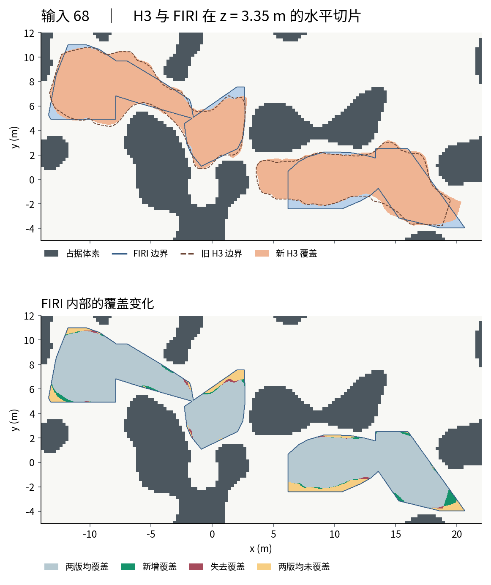

# H3 实体体素与分层膨胀

本文记录改动前的实验快照。评审方案已接入 H3 生成入口，当前默认与上一代的配对测量见[核心体积与生成耗时](validation/h3_core/README.md)。

在 `experiment/h3-local-hermite` 上，用相同的 71 条冻结输入重跑实验前的 H3 和新默认。两版共同成功的 69 条路径全部提速，逐路径生成耗时的中位降幅为 **14.72%**。其中 65 条的物理并集增大，配对中位增幅为 **6.24%**。只取原始起终点锚点之间的区段，仍有 65 条增大，中位增幅为 **4.34%**。

## 同输入对照

| 指标 | 旧 H3 · 外接球 | 新 H3 · 同一批外接球 | 新 H3 · 实体体素 |
|---|---:|---:|---:|
| 成功输入 | 69 / 71 | 69 / 71 | 70 / 71 |
| 生成耗时中位数，69 条共同路径 | 29.47 ms | 23.32 ms | 22.65 ms |
| 逐路径耗时相对旧版的中位变化 | 基线 | −11.32% | **−14.72%** |
| 逐路径去重并集相对旧版的中位变化 | 基线 | +1.53% | **+6.24%** |
| 去重并集增大的路径 | 基线 | 55 / 69 | **65 / 69** |
| FIRI 并集被 H3 覆盖的比例中位数，67 条 | 78.66% | 80.11% | **82.44%** |
| 逐路径 FIRI 覆盖率相对旧版的中位增量 | 基线 | +1.34 个百分点 | **+3.34 个百分点** |

耗时先取每条路径七次生成的中位数，相对变化再逐路径计算。两列总体中位数直接相除与配对变化可以不同。55 条 Perlin、迷宫和 RViz 地图记录的单次索引构造中位数由 **36.82 ms 降到 5.92 ms**。这项开销只在加载地图时发生。旧版计时从球容器已填好后开始，新版包含从中心点填充体素索引的开销。[逐例结果](validation/h3_inflation/paired.csv) · [运行记录、输入哈希及 QMC 平移结果](validation/h3_inflation/results.json.gz)

输入 47、70 的 FIRI 输出未满足整条多面体链连通且覆盖两个端点的条件，保留在逐例数据里。其余 67 条共同可比路径上，新 H3 有 65 条增加了与 FIRI 的交集，其中 63 条增益超过配对 95% 区间半宽。新 H3 与 FIRI 的生成耗时中位数分别为 22.51 和 24.54 ms，有 60 条 H3 更快。两种走廊的总体积之比中位数已达 98.72%，空间位置的重合程度由交集一列给出。

### FIRI 内新增和失去的覆盖

| 地图与路径 | 旧 → 新 H3 并集 | 旧 → 新 H3 生成耗时 | 旧 → 新的 FIRI 覆盖率 | 在 FIRI 内净增的体积 |
|---|---:|---:|---:|---:|
| 迷宫 2 | 441.46 → 468.22 m³ | 36.65 → 25.94 ms | 78.59% → 82.00% | +18.50 ± 0.30 m³ |
| Perlin 点选 68 | 401.92 → 421.84 m³ | 19.48 → 17.34 ms | 78.49% → 80.87% | +10.51 ± 0.55 m³ |
| Perlin 26 | 513.49 → 492.25 m³ | 24.88 → 21.10 ms | 79.99% → 78.80% | −6.21 ± 0.83 m³ |

输入 68 的总体积增加 **19.93 ± 0.47 m³**。其中，两个原始锚点之间增加 **10.15 ± 0.37 m³**。下图用导出圆盘和 FIRI 半空间对同一水平面逐点判定，显示分辨率为 4 cm。在右下方约 `x=19 m, y=−3 m` 的转角可以看到新增覆盖。接近 `x=20.5 m, y=−4 m` 的尖角仍有留白，整条路径上仍有约 **84.53 m³** 的 FIRI 空间落在新 H3 外。



### 退化、平滑性和验证

- 四条路径 3、26、32、41 的总体积分别减少 2.87%、4.14%、0.85%、2.43%，都超过对应配对误差区间。最大的增益出现在急转弯输入 61，达到 14.77%。局部分离面的选择仍影响最后到达的解。
- 折返尖点 65 在三种 H3 配置下均未能初始化。窄通道 66 的新增成功来自实体体素语义。使用原外接球时两版均失败。
- 相对旧 H3，锚点之间的曲面弯曲能量（两个主曲率平方和的面积积分）配对中位数增加 **24.28%**，最大为旧版的 2.83 倍，出现在变径管 54。加强 Jacobian 余量消除了仅用数值正性时个别急弯的尖峰。最终曲面积分逐次加密的最大相对变化约 0.33%，没有把 C¹ 连续性当作曲率界。
- 70 个成功结果全部通过原始障碍物独立复核、全圆盘 Jacobian、锚点和 C¹ 检查。相对 Jacobian 认证下界最小为 0.075000001，归一化 C¹ 拼接误差最大为 2.824 × 10⁻¹⁴。四组 H3 测试、主库 CTest、宿主搜索和体积 CTest 均通过。Perlin 与迷宫的 ROS 点选测试均成功，RViz 导出与离线重放逐系数最大误差为零。以上指标均针对走廊生成。[ROS 重放记录](validation/h3_inflation/rviz.json)

## 障碍物究竟占多大

演示先将点云落到占据栅格，每个占据单元有中心 $o$ 和边长 $d$。旧 H3 为每个单元建立半径 $r=\sqrt 3\,d/2$ 的外接球。设 $a=d/2$，$p=r_{\rm robot}+m_{\rm safety}+m_{\rm cert}$，单位法向 $n$ 从走廊指向障碍，则实体体素允许的分离面为

$$
n^\top x\le h(n),\qquad h(n)=n^\top o-a\lVert n\rVert_1-p.
$$

这是立方体与半径 $p$ 球的 Minkowski 和在该法向上的精确下支撑。球化时要减去 $r+p$，因此单侧可收回的余量为 $a(\sqrt3-\lVert n\rVert_1)$。边长 0.25 m 时，沿墙面法向为 9.15 cm，沿体对角线为零。种子线段也使用到实心方盒的欧氏距离。用线段与六个面所在平面的交点分割参数区间，每个区间内距离平方是二次函数，可直接取最小值。

`ObstacleIndex::fromOccupiedVoxels(centers, resolution)` 显式指定这套几何语义。`ObstacleIndex(std::vector<Sphere>)` 支持任意球心及半径。体素索引对 Morton 键做三趟基数排序，自底向上合并包围盒。查询包围盒仍包含每个外接球，量化只影响排序，法向投影和证书都使用原始双精度坐标。RViz 的占据地图使用体素入口，搜索和 FIRI 按各自的外接球模型计算，C3 模式保留球索引。[输入索引](../SweepCorridor/include/SweepCorridor/detail/ObstacleIndex.hpp)

## 分离面如何既宽又能复用

令三次 Hermite 扫掠为 $F(u,z)=c(u)+M(u)z$，其中 $\lVert z\rVert_2\le1$。在一段或其子区间的 Bézier 表示中，四个控制圆盘记为 $(c_j,M_j)$。若

$$
\max_{j=0,\ldots,3}\big(n^\top c_j+\lVert M_j^\top n\rVert_2\big)\le h(n),
$$

则该区间内每个圆盘上的每一点都在安全侧，因为固定 $z$ 后，三次 Bézier 曲线始终是四个控制点的凸组合。障碍物一侧另外用实体支撑函数验证。局部盒、地图边界和障碍物的分离面分别构造。

构造平面时，比较已有椭球度量给出的法向和世界坐标轴上的最佳面法向。设参考椭球中心为 $\bar c$，形状矩阵为 $A$。在平面 $n^\top x\le h(n)$ 下，参考椭球最多可同比放大

$$
\lambda(n)=\frac{h(n)-n^\top\bar c}{\lVert A^\top n\rVert_2}.
$$

当轴向候选的尺度达到度量候选的 98% 时，优先尝试轴向面。一面平墙上的多个体素往往能共用它。尺度比较只控制尝试顺序，候选仍须通过四个控制圆盘的验证。局部刷新会识别真正来自障碍物的轴向面，避免将其当成固定地图边界。

对于物理查询盒完全相同的相邻段，取最多八段的中间段先建完整障碍覆盖。只有整段有效的分离面才能跨段复用，接收段的四个控制圆盘必须严格位于每个面的安全侧。若任一条件失败，该段自行构造覆盖。各段仍单独保留自己的局部盒约束。每次更新要么得到完整新覆盖，要么继续使用已经认证的完整覆盖。[分离面构造](../SweepCorridor/include/SweepCorridor/detail/ObstacleCover.hpp) · [共享与细分](../SweepCorridor/experiments/h3/inflation_cover.hpp)

## 膨胀、网格与可微性

先用目标间距两倍的粗网格做两次主膨胀，每次可以移动中心、改变截面并更新共享一阶导数。随后在粗网格刷新分离面，逐段用 de Casteljau 精确插入中点。将每个父区间的支撑约束限制到相应的子区间，保留原始参考中心、自由端面的位移和锚点参数。在细网格上做一次短 Newton 校正，再执行局部形状、共享导数和端部的联合修正。粗网格初始几何或转移到细网格的状态不可行时，回到原细网格初始化。主问题继续使用六维块三对角求解。全段的单节点导数更新只需复核一个发生变化的 Bézier 控制圆盘。

优化目标沿用带弯曲正则的负对数扫掠体积。其体积项为

$$
V_{\rm sweep}=\pi\int (M_1\times M_2)^\top c'\,du.
$$

相邻段共享 $c,M,c',M'$，所以对每个固定 $z$，$F(u,z)$ 对纵向参数是 C¹。全截面 Jacobian 的最小值取决于
$(M_1\times M_2)^\top c'-\lVert M'^\top(M_1\times M_2)\rVert_2$，在整段上用 Bernstein 系数和必要的细分认证正性。二阶导数可在节点处跳变。离散选障碍、选面和预算调度没有对地图输入求导的接口。报告中的物理体积另行对空间并集测量，从而消除不同截面覆盖同一位置的重复计数。[H3 生成器](../SweepCorridor/experiments/h3/generator.hpp)

仅要求 Jacobian 大于数值零时，急转弯内侧仍可能挤成非常薄的一层。设 $v_k$ 是某段 Jacobian 锥的八次 Bernstein 系数，$S=\max_k\lVert v_k\rVert_2$。新默认让整段满足

$$
J_{\min}(u)>0.075\,S.
$$

对每段分别缩放，细分证明时使用原段的 $S$。这个量是扫掠映射的局部条件约束，和障碍物的米制间隙分别计算。初始解、粗细转移、Newton 步、共享导数与端部更新都应用同一阈值。用 10% 的阈值，输入 27 的扫掠体积会降到 112.48 m³。7.5% 保住了这条路径的 431.57 m³，同时改善急弯内侧的曲率。全局弯曲正则继续使用原权重。[连续证书](../SweepCorridor/include/SweepCorridor/detail/Certificates.hpp) · [余量消融原始数据](validation/h3_inflation/regularity.csv)

## 为什么部分 FIRI 边角仍会空出

考虑一个固定法向的正方形截面 $[-b,b]^2$。若 H3 截面在这个平面内用一个椭圆 $c+Mz$ 表示，$\lVert z\rVert_2\le1$，则 $M$ 每一行的范数都至多为 $b-|c_i|$。由行列式的 Hadamard 不等式，椭圆面积至多为 $\pi b^2$，仅占正方形面积的 $\pi/4\approx78.5\%$。把球化改为精确的体素支撑能收回人为侵蚀的墙边空间，但固定截面内的尖角仍受椭圆表示限制。一般三维路径还会改变截面位置与朝向，并有自由端部，因此不同路径的实际交集直接按三维几何测量。

## 实验口径

- 使用仓库冻结的 71 组地图与种子，涵盖 Perlin、迷宫、RViz 点选、直线、螺旋、变径管、窄通道与折返。旧版直接从实验前的提交 `08451b5df0f5a700289040cb18992df73b4f6ead` 重建。在相同输入上比较旧 H3、新求解器加原外接球、新求解器加实体体素。FIRI 使用演示中的覆盖、球半径侵蚀和 shortcut。[冻结输入清单](validation/h3_volume/inputs.json)
- 体素边长 0.25 m，机器人半径 0.20 m，安全余量 0.05 m，证书余量 0.002 m。局部盒外扩 3 m，种子每 7 m 划分局部盒，目标控制间距 0.4 m。每个算例的种子与边界对各方法相同。
- Ryzen 7 9700X，GCC 15.2，Release。基准固定在逻辑 CPU 2，地址空间限额 4 GiB。每条输入每种方法预热一次、正式跑七次。H3 生成时间包括种子检查、构造约束、优化及求解中的认证，独立复核、地图索引、文件 I/O、路径搜索、QMC 与渲染在计时外。FIRI 时间包括生成、侵蚀和 shortcut。两种 H3 按输入交替先后运行。
- 物理并集采用八组共同随机平移的 Sobol 点，每组 65,536 点。新旧 H3 的并集差用共同网格评估。与 FIRI 的交集另在统一的 FIRI 候选网格上测量，每个方法都访问相同的空间点。`FIRI 覆盖率` 为 $|H\cap P|/|P|$，其中 $P$ 为 FIRI 多面体并集。`±` 为八组配对估计的约 95% 区间半宽。覆盖率汇总只计入 FIRI 含两个端点且相邻多面体有体积交集的路径。
- 输出验证从导出的控制圆盘包围盒重新查询障碍。每个候选体素枚举八个顶点，检查能将其与走廊分离的平面所覆盖的参数区间并集是否完整，同时复核连续支撑、全圆盘正 Jacobian、锚点及 C¹ 误差。附加单测覆盖斜穿棱角、外接球与体素给出不同碰撞结果、隐藏碰撞、精确插入节点和 Morton 键冲突。[独立复核](../SweepCorridor/experiments/h3/audit_cover.hpp) · [单元测试](../SweepCorridor/experiments/h3/inflation_tests.cpp)

## 本地复现

在本仓库根目录、已构建 ROS 工作区的环境中执行以下命令。首次安装依赖和构建工作区可参照[原始地图交互验证](原始地图交互验证.md)。

```bash
python3 SweepCorridor/experiments/h3/build.py --targets benchmark,adaptive,measure,inflation_tests
.scratch/h3/inflation_tests
source /opt/ros/lyrical/setup.bash
source install/setup.bash
cmake -S gcopter -B build/gcopter -DGCOPTER_BUILD_CORRIDOR_BENCHMARK=ON
cmake --build build/gcopter --target h3_firi_overlap
python3 SweepCorridor/experiments/h3/validate_inflation.py
python3 SweepCorridor/experiments/h3/analyze_inflation.py
```

验证脚本自动解包和核对输入。可传入 `--cases 2,26,68` 只复查代表路径，再用 `analyze_inflation.py --output .scratch/my_report` 保存子集结果。交互演示沿用原有启动命令。

```bash
gcopter/tools/run_direct_demo.sh corridor:=h3 scene:=perlin
gcopter/tools/run_direct_demo.sh corridor:=h3 scene:=maze
```
