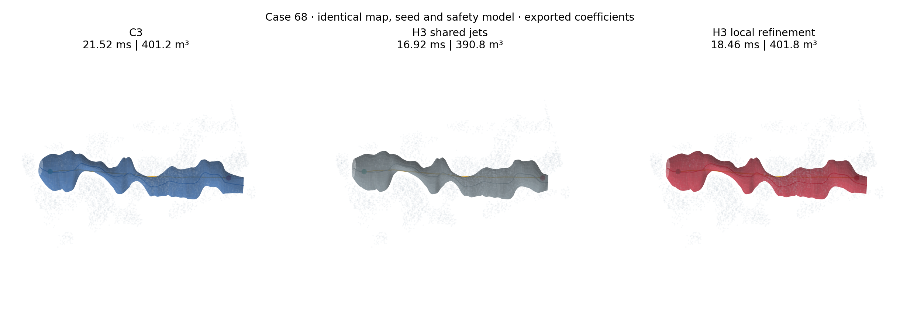
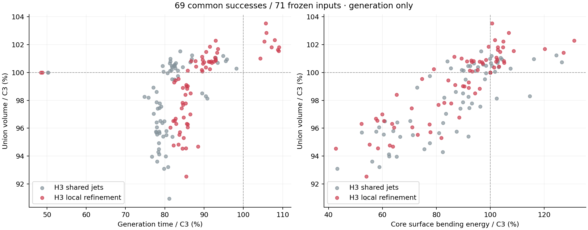
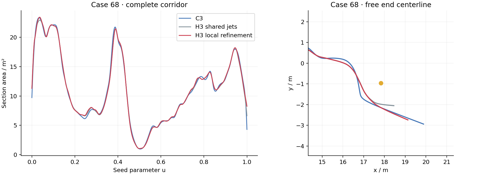
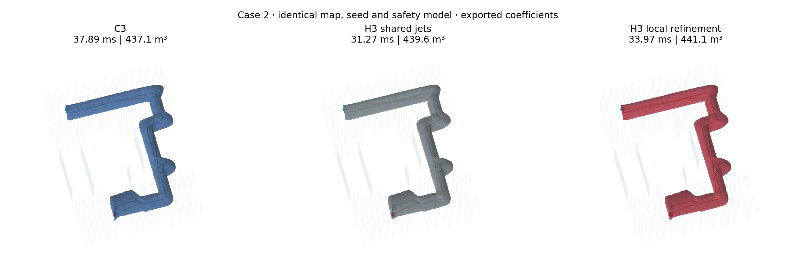
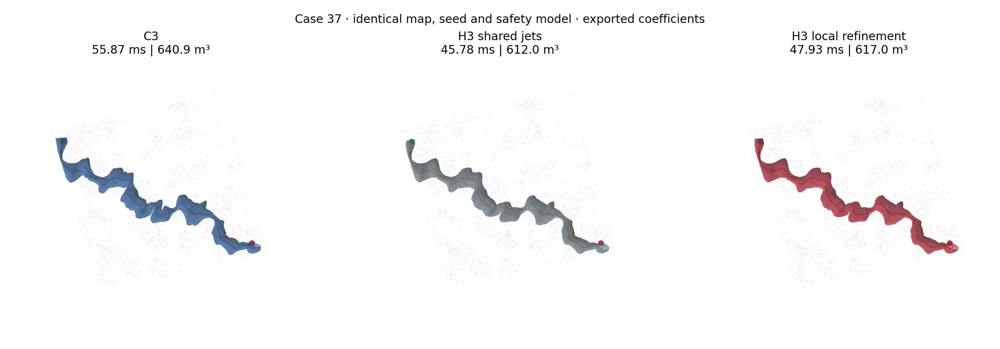

# H3：局部分离面刷新与自由端部耦合

这次优化继续使用三次 Hermite 扫掠模型，处理的是两个不同的瓶颈：端部节点逐个更新时，中心与相邻切向量难以一起移动；已有分离面固定后，新的截面仍被旧形状决定的半空间限制。实现先刷新少量受限区域的分离面，再交替优化节点形状、共享导数和端部中心块。

当前分支为 `experiment/h3-local-hermite`。直接对照是上一版共享导数 H3 `fd7a301e66bf8d836409ce508665ffedf457ef45`，C3 使用 `7d4fc603607f131a1d282247c3e523c11da5d06e`。两份基线都从对应提交重建。主库仍为 C3，H3 实验和 `corridor:=h3` 演示采用新的默认流程。

## 1. 同输入结果

新默认采用累计收益预算、两轮局部覆盖刷新和自由端部耦合。相对上一版 H3，**并集体积的配对中位增幅为 0.80%，最大增幅 5.51%**；67 例的提升超过 QMC 配对误差区间，两条空旷直线路径基本不变。相对 C3，并集体积的配对中位数由 98.50% 提高到 100.00%。

| 指标，69 条共同成功路径的配对中位数 | 共享导数 H3 `fd7a301` | 本次 H3 |
|---|---:|---:|
| 并集体积 / C3 | 98.50% | 100.00% |
| 生成耗时 / C3 | 80.40% | 86.54% |
| 公共区间曲面弯曲能量 / C3 | 90.02% | 91.98% |
| 比 C3 更快的路径数 | 69 / 69 | 60 / 69 |
| 全部输入成功数 | 69 / 71 | 69 / 71 |
| 生成进程峰值 RSS | 37.2 MiB | 37.4 MiB |

这里先计算每条路径的比值，再取中位数。本次完整生成比上一版慢 **9.11%**，相对 C3 仍快 **13.46%**。收益主要是扩大覆盖；新增的局部处理没有让整体生成比上一版更快。失败仍为输入 65、66 的初始化失败，没有新增失败。

截图输入 68 的结果如下。末端距离是最终末端截面中心到原终点的欧氏距离，不是沿种子切线规定的外推长度。

| 输入 68 | C3 | 共享导数 H3 | 本次 H3 |
|---|---:|---:|---:|
| 并集体积 / m³ | 401.2 | 390.8 | 401.8 |
| 生成耗时中位数 / ms | 21.52 | 16.92 | 18.46 |
| 末端中心到原终点 / m | 2.85 | 1.26 | 2.20 |
| 含一次 BVH 构建的冷启动 / ms | 57.05 | 52.23 | 53.78 |

输入 68 的并集测量增加到 **8 × 262,144** 个样本。新旧 H3 直接配对增幅为 **2.77% ± 0.04%**；与 C3 的体积基本持平。相对变化使用直接配对估计，表内体积是各自与 C3 配对的估计值。





实验只运行走廊生成。地图、种子路径、膨胀半径、局部扩张范围、输入锚点、连续支持与全截面 Jacobian 标准一致。开发集 11 例预热一次、正式重复 7 次；其余 60 例预热一次、正式重复 3 次。所有构建、生成、采样与 ROS 测试串行运行，固定 CPU 2，限制地址空间 4 GiB，数值库线程数为 1。正式计时关闭阶段时钟。表中生成耗时使用已构建的 BVH，包含本次走廊的初始化、两轮主膨胀、局部修正和连续认证；不含地图索引构建、QMC 测量和渲染。原始记录单独保存 `index_ms`，冷启动耗时为索引构建加本次生成。

并集体积采用 8 组随机平移、每组 65,536 个 QMC 样本。同一次配对测量使用共同采样域和样本序列，保留配对差值的 95% 误差区间。局部正 Jacobian 可以排除局部折叠，但不能排除远处扫掠重叠，所以生成目标中的体积积分与去重并集体积分别保存。

边界平滑性使用原起终点锚点之间的公共区间，积分曲面的 $\kappa_1^2+\kappa_2^2$。主积分为每段 48 点、截面 96 个角度；与 24×48 相差超过 1% 时，再升至 96×192。这个量衡量实际曲面弯曲，与参数化速度无关。H3 仍为 C¹，节点处二阶导数通常不连续。

## 2. 自由端部的小块更新

几何模型为

$$F(u,z)=c(u)+M(u)z,\qquad \|z\|_2\leq1.$$

在保持局部 Jacobian 正定的前提下，带重数的扫掠体积为

$$V=\pi\int (M_0\times M_1)^\mathsf T c'\,du.$$

固定截面矩阵 $M$ 后，$V$ 对中心节点值和共享中心一阶导数是**仿射函数**。因此端部联动不需要把所有形状通道塞进更大的联合系统。每个节点只保留

$$x_i=[\Delta c_i,\;\Delta c'_i/\sigma_i]\in\mathbb R^6,
\qquad \sigma_i=3/w_i,$$

其中 $w_i$ 为节点相邻区间长度的半和。导数缩放改善中心位移与切向量变量的尺度平衡。

默认联合更新起端、末端各四个节点；两块重叠时合并。四个节点决定的是一次更新的耦合范围，不是走廊向外延伸的长度。端部可向三维空间移动，由体积目标、锚点包含关系、连续支持约束和 Jacobian 共同决定可行步长。

### 2.1 六维块三对角结构

三次 Hermite 的 Bézier 中心控制点为

$$C_0=c_i,\quad C_1=c_i+\frac h3c'_i,
\quad C_2=c_{i+1}-\frac h3c'_{i+1},\quad C_3=c_{i+1}.$$

每个控制截面仍只关联相邻两个节点。固定形状后，支持条件

$$b-n^\mathsf TC_j>\|D_j^\mathsf Tn\|$$

可写成两个线性正间隙 $b-n^\mathsf TC_j\pm\|D_j^\mathsf Tn\|>0$。其对数障碍 Hessian 和中心弯曲能量均为六维块三对角。令体积梯度为 $v$，$-\log V$ 只额外贡献 $vv^\mathsf T/V^2$，沿用已有块分解并通过 Sherman–Morrison 完成秩一修正。端面主动约束使用同一分解的多右端项求解。

五点 Gauss 积分对三次模型的八次体积被积函数精确；中心二阶导数为一次多项式，二点 Gauss 即可精确构建弯曲能量。线搜索直接使用预构造的线性支持间隙、二次偏移约束和仿射体积，不重复组装完整目标。

### 2.2 锚点参数的消元

点击位置保持为内部锚点 $p=c(u)+M(u)z$，端部截面中心不必等于点击位置。对隐式关系求导，得到

$$\begin{bmatrix}\delta u\\\delta z\end{bmatrix}
=-\begin{bmatrix}c'+M'z&M_0&M_1\end{bmatrix}^{-1}\delta c.$$

每次候选更新都反求实际的 $u,z$，并要求 $\|z\|<1$、起始锚点在终止锚点之前。反求梯度进入端部目标，锚点曲率采用正的 Gauss–Newton 近似。没有冻结反求根，也没有增加固定长度的路径外推。

### 2.3 Jacobian 的仿射更新

全截面的下界为

$$J_{\min}(u)=(M_0\times M_1)^\mathsf Tc'-\|M'^\mathsf T(M_0\times M_1)\|.$$

固定 $M$ 时，只有第一项随中心变量线性变化。端部块缓存九个八次 Bernstein 系数及其线性映射；试探步只更新标量分量，继续调用原来的连续锥证书。接受后，只更新端部受影响区间的积分缓存。

## 3. 只刷新剩余瓶颈的分离面

固定平面内的联合优化不能越过旧平面。这里复用原地图 BVH、查询域和障碍包，只在选中的 span 上根据当前几何重新计算分离法向。

选择信号来自已经计算的局部 Newton 目标：若 SOC 间隙为 $s=r^2-\|D^\mathsf Tn\|^2$，已有障碍梯度因子给出压力代理 $2\mu r/s$。它是对数障碍下的乘子估计，不是额外求解的精确对偶变量。节点近期体积增益越小、压力越高，刷新优先级越高。轴向固定平面不参与这个优先级，避免把预算用于无法通过换法向改进的盒边界。

每轮优先刷新有障碍压力的端部区域，再选取约 5% 的高分内部区间。最多两轮；若上一轮体积增益不足 0.01%，则结束。没有相应障碍压力时，不做空刷新。

刷新保持同一局部盒和世界边界，也使用同一个障碍膨胀模型。新平面必须覆盖该区间查询域中的完整障碍候选集；未选区间保留完整旧覆盖。如果某个区间的新分离提议失败，则保留该区间原有的完整覆盖。支持分组只为将要更新的节点及其相邻 span 构造，避免建立完整的全局优化问题。

局部形状与导数修正使用完整支持行。之前针对固定导数成立的冗余裁剪不能直接用于自由导数更新，因此这里不借用裁剪后的约束前缀。

## 4. 计算预算跟随实际收益

先保留全体节点的首轮联合更新，记录最后一次接受步的目标下降量，并按节点参数宽度归一化。第二轮按该收益排序，保留累计收益达到 99% 的节点，仍按原反向次序执行。低收益尾部的节点跳过第二轮；约束检查和证书没有省略。

实验也测试过直接保留一半或四分之三节点。固定比例能省下一部分局部求解，但会损失体积，和后续刷新组合后也不一定节省总时间，因此默认采用累计收益规则。99% 是对上一轮收益的预算分配阈值，并不保证下一轮保留 99% 的潜在收益。

初始全局膨胀、共享导数提议和原有正则权重保持不变。新的工作集中于剩余局部约束，最终端部更新与局部形状更新交替进行。优化器继续返回真实终止状态；`SUCCESS` 表示获得通过连续证书的几何，固定步数用尽仍记录为 `iteration_limit`。

## 5. 消融与边界平滑性

下面固定输入 68，只改变新默认的一项配置。体积列使用精确扫掠积分，用于判断各步骤的贡献；本节主结果仍使用去重并集体积。

| 配置 | 扫掠体积 / m³ | 生成中位数 / ms |
|---|---:|---:|
| 新默认 | 401.77 | 18.49 |
| 不做收益预算筛选 | 401.89 | 18.47 |
| 不刷新内部高压力区域 | 401.22 | 18.00 |
| 不做端部耦合块 | 394.55 | 18.09 |
| 不刷新分离面 | 390.91 | 16.99 |
| 只刷新一轮 | 396.31 | 17.53 |

旧分离面确实是端部的主要限制：在旧覆盖内加端部块几乎不能改善这一例。刷新后，端部多节点联动贡献明显。内部瓶颈刷新带来较小的额外体积，也增加约束构造成本。

收益预算筛选的总耗时收益很小，不能解释成明显加速：五例消融中位约省 0.43%，输入 68 的差异处于运行波动范围内。它每条路径跳过 2–32 个低收益节点的第二轮更新；两条空旷直线路径的节省更明显。相对固定砍掉一半节点，累计收益规则保留了更多体积。

单独开启阶段时钟时，输入 68 的局部分离面刷新约 0.76 ms、局部分组约 0.14 ms、形状与导数修正约 0.43 ms、端部耦合约 0.23 ms。69 例共刷新 1,858 个 span，查询全部命中既有候选缓存，没有刷新失败。当前额外开销主要来自局部分离面构造，而不是六维块求解。

平滑性是本次保留的实际取舍：相对上一版 H3，曲面弯曲能量的配对中位增幅为 **0.53%**，23 例降低、46 例增加；最大增幅为输入 37 的 **16.34%**。相对 C3，48 例的该指标更低，中位约低 **8.02%**，但并非所有输入都更平滑。







局部优化使用弯曲能量正则，但该能量与最终曲面的主曲率平方积分并不等价。因此体积增加不能直接解释为边界更平滑。表中同时保留公共区间曲面弯曲指标，退化输入也纳入总体统计。

## 6. 验证与复现

新增数值测试独立核对端部仿射体积、梯度、Hessian、锚点隐式梯度、Jacobian 系数和解析线搜索。覆盖测试使用真实球障碍，要求选中区间与完整重建逐系数相同，未选区间与原覆盖逐项相同；局部节点更新也不能改变不相邻的 Bézier 区间。完整生成输出独立复核连续支持、全截面 Jacobian、锚点和 C¹ 拼接。

端部体积、梯度、Hessian、锚点隐式梯度及 Jacobian 系数的最大误差分别为 $4.41\times10^{-16}$、$8.67\times10^{-11}$、$3.73\times10^{-11}$、$4.74\times10^{-14}$、$2.78\times10^{-16}$。正式生成的最大 C¹ 拼接误差为 $2.66\times10^{-14}$。0.2 m 短路径的两端合并块也通过连续认证；不兼容的实验求解流程在入口处拒绝。

从完整积分缓存改成局部缓存后，69 条成功路径的全部导出系数逐字节不变；重建的 `fd7a301` 基线也与初始冻结二进制逐字节一致。原 H3 数值测试、共享导数测试、新的局部覆盖测试及主库 CTest 均通过。

Perlin、迷宫的 ROS 点选消息测试均通过，H3 与同输入 FIRI 标记正常发布；导出系数与离线重放的最大误差均为 **0**。演示只运行走廊生成，轨迹优化保持关闭。[ROS 验证记录](validation/h3_adaptive/rviz.json) 保存完整消息、配置和二进制哈希。

在仓库根目录执行：

```bash
python3 SweepCorridor/experiments/h3/validate_adaptive.py
python3 SweepCorridor/experiments/h3/analyze_adaptive.py
```

脚本从已保存的 `docs/validation/h3_volume/inputs.tar.gz` 恢复 71 个输入，校验 SHA256，并从冻结提交编译两份基线。逐次耗时、失败记录、编译器、源码与二进制哈希、并集配对区间、阶段计时、调参筛选结果保存在 [原始结果](validation/h3_adaptive/results.json.gz)；[配对表](validation/h3_adaptive/paired.csv)、[汇总](validation/h3_adaptive/aggregate.json) 和代表性系数也随仓库保存。

RViz2 命令保持不变：

```bash
/home/zdp/ForCodex/GCOPTER/gcopter/tools/run_direct_demo.sh corridor:=h3 scene:=perlin
/home/zdp/ForCodex/GCOPTER/gcopter/tools/run_direct_demo.sh corridor:=h3 scene:=maze
```

点选起终点后生成 H3 和同输入 FIRI，分别显示耗时。H3 模式不运行轨迹优化。导出的 `metrics.json` 增加 `end_steps`、`refreshed_spans`、`budget_skips`，可以核对实际执行的优化流程。

## 7. 当前余量

这次采用中心、形状交替的小块优化，保留了较小的线性系统。端部形状方向仍受节点参考标架约束，内部法向只做少量重建，体积目标也不是直接的扫掠并集体积。它没有把 H3 变成任意自由空间填充器。

后续值得继续处理的是平滑性退化输入：把实际边界曲率或局部曲面指标纳入预算选择，在弯曲增长明显的区域提高正则力度；以及为相邻的高压力区间合并刷新预算，避免重复构造近似相同的分离平面。这些需要保持同样的连续证书，并分别实测体积、时间与曲面质量。
