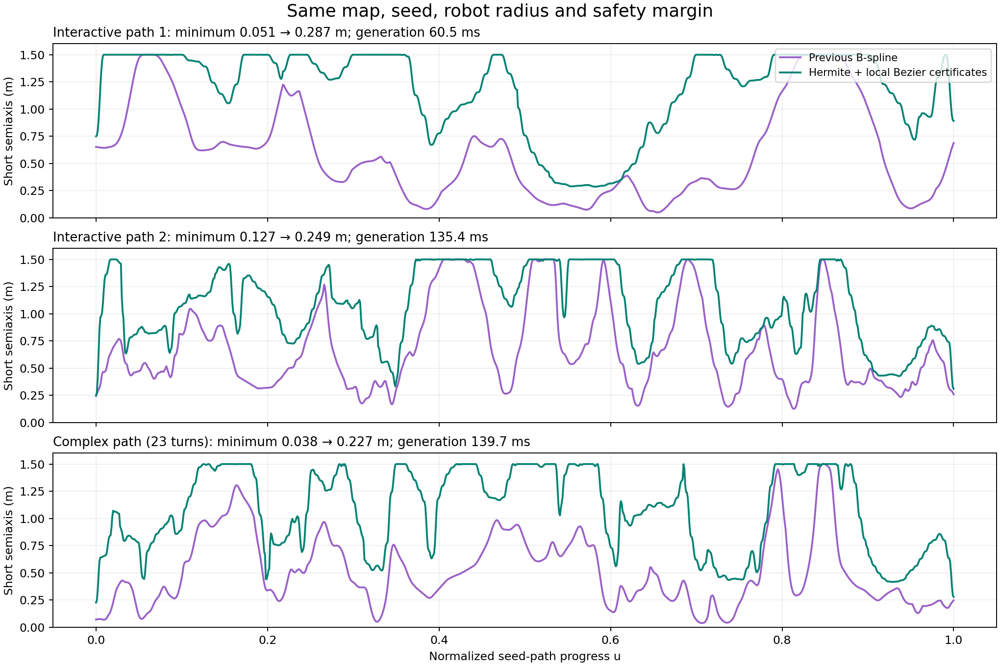
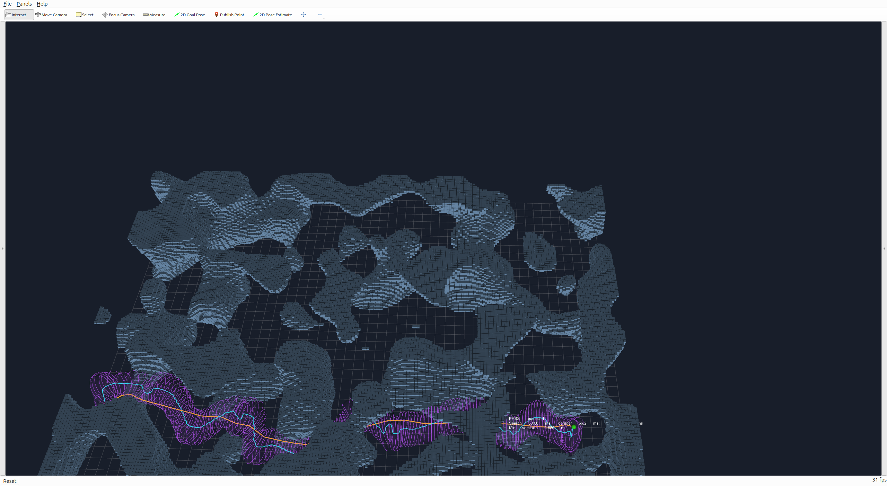

# 五次 Hermite 走廊修改与验证

验证日期：2026-11-02。当前分支 `feat/bspline-differentiable-corridor`，目录 `/home/zdp/ForCodex/GCOPTER`。核心已替换为五次 Hermite → 等价 Bézier → 局部细分；截面中心可偏移，椭圆主轴可旋转。完整数学模型、约束和剩余限制见 [设计说明](五次Hermite走廊.md)。

## 同地图、同种子路径对照

重放此前保存的 26 条原 GCOPTER 搜索路径：Perlin 12 条、迷宫 12 条、RViz 交互 2 条。新旧生成器使用相同地图、种子、机器人半径 0.2 m、安全距离 0.05 m、节点/控制间距参数 0.4 m、最小半轴参数 0.03 m、最大半轴 1.5 m。新实现还额外保留 2 mm 认证余量，没有通过削减安全尺寸扩张。

机器为 Ryzen 7 9700X，GCC 15.2，Release `-O3 -DNDEBUG`。每条路径各运行三次，先取该路径时间中位数，再汇总跨路径统计。核心时间不含地图 BVH 构建、路径搜索、导出或 RViz 绘制；不是最坏执行时间保证。

| 路径集 | 成功 | 旧版核心耗时中位数 | 新版中位数 | 新版 P95 |
|---|---:|---:|---:|---:|
| Perlin 12 条 | 12/12 | 13.1 ms | 121.0 ms | 149.3 ms |
| 迷宫 12 条 | 12/12 | 9.3 ms | 67.0 ms | 83.8 ms |
| 全部 26 条 | 26/26 | 10.2 ms | 74.8 ms | 146.6 ms |

每条曲线用 501 个归一化参数点计算 `πσ₁(M)σ₂(M)`。**每条路径平均截面面积的新旧比值，中位数为 2.60，范围 1.95–3.40。** 这是截面面积统计，不是扫掠体积或自由空间覆盖率。每条路径采样最短半轴均比旧版大，最小提升比例为 1.97 倍。新旧中心线允许不同，因此也不声称新走廊逐点包含旧走廊。

| 保存路径 | 旧版最短半轴 | 新版最短半轴 | 新版耗时 |
|---|---:|---:|---:|
| RViz 交互路径 1 | 0.051 m | 0.287 m | 60.5 ms |
| RViz 交互路径 2 | 0.127 m | 0.249 m | 135.4 ms |
| 23 次明显转弯路径 | 0.038 m | 0.227 m | 139.7 ms |



最窄值为上述采样统计；连续无碰撞与非退化由生成器的整段证书验收，不由采样最小值推断。

联合优化的计算量确实比旧版固定中心、固定主轴的大：旧版总体约 10 ms，新版约 75 ms。改进来自更充分使用空间，不能把结果描述成“比旧版更快”。本轮开发将首个直接实现约 614 ms 的同一交互回放降到了最终约 60 ms，主要依靠局部初值、消除重复约束、方向支撑缓存、已分离障碍复用及块三对角求解。

## 连续性、安全与接口测试

- C++ 回归通过：解析梯度/Hessian、用两侧 Bézier 系数直接核对 C² 接头、端点保持、多转弯/反向/竖直/旋转/长路径、短边连接急转弯、取消/预算/容量/非有限输入、BVH 对照。
- 单侧墙测试验证中心确实向空闲侧偏移；倾斜双墙测试验证椭圆主轴确实旋转，不只是更换多项式基。
- 24 个随机场景独立检查截面内部及边界；失败不得返回历史或部分走廊。
- 上表三条代表性真实路径，各独立检查 80,160 个点（501 截面 × 32 角度 × 5 个径向比例），对输入体素外接球与边界均无碰撞。额外采样净空分别约 11.3、8.1、10.1 mm，已扣除障碍半径、机器人半径与用户安全距离。
- ROS 独立适配器通过路径/地图输入、十一列 v2 系数、参考线/标记输出、端点、地图失效清除、恢复、错误坐标系与非法点云检查。

## 原地图、原搜索、RViz2

最终安装的 ROS2 二进制重新跑了完整选点话题链路：

| 场景 | 结果 | 核心耗时中位数 / P95 | 说明 |
|---|---|---|---|
| mockamap Perlin | 6/6 成功 | 127.9 / 147.7 ms | 最复杂路径有 24 次超过 30° 的转弯 |
| mockamap 迷宫 | 6 条可达路径成功；2 条隔离房间路径按预期搜索失败 | 66.5 / 84.2 ms | 未用人工路径替换搜索结果 |

每条成功输出另做 28,872 点独立球体/边界检查，共 346,464 点，无碰撞。检查同图重复发布不擦除结果、非法选点、显式起点和 reset。此次实际搜索分别约 500 ms / 3,030 ms，应与走廊生成时间分开看。

RViz2 已实际打开新版，并用保存的交互起终点重新执行原搜索：该次新搜索路径的核心生成 56.2 ms、整条链路 560.1 ms，显示采样最短半轴 0.680 m。**它是重新搜索所得的新路径，不用于上面的同路径新旧比较。**



从任何目录启动：

```bash
/home/zdp/ForCodex/GCOPTER/gcopter/tools/run_direct_demo.sh
```

在 RViz2 工具栏连续两次使用 `2D Goal Pose`，分别选择起点、终点；默认高度 2.5 m。新默认视图隐藏侧栏、扩大地图画布；需要时用 RViz 的 Panels 菜单恢复。原搜索、地图快照与输出目录仍按 [交互说明](原始地图交互验证.md) 使用。当前已打开的预览在 ROS domain 171；另起演示请先关闭该预览或使用不同 domain。

## 复现与原始记录

```bash
cmake -S direct_corridor -B build/direct_corridor -DCMAKE_BUILD_TYPE=Release
cmake --build build/direct_corridor -j4
ctest --test-dir build/direct_corridor --output-on-failure
build/direct_corridor/direct_corridor_benchmark 5
python3 direct_corridor/tools/example.py \
  --binary build/direct_corridor/direct_corridor_cli \
  --output .scratch/hermite_example --plot
```

本机保存的原始搜索快照可直接重放：

```bash
python3 direct_corridor/tools/replay_comparison.py \
  --input .scratch/interactive/rviz/run_1793605002598226995_3712673 \
  --input .scratch/interactive/perlin_final \
  --input .scratch/interactive/maze_connected \
  --candidate build/direct_corridor/direct_corridor_cli \
  --baseline .scratch/hermite_baseline/cli_configurable \
  --output .scratch/hermite_replay --repeats 3
```

去掉 `--baseline` 可只复核当前实现；增加 `--audit` 可对所有回放做独立密集检查。旧代码及适配后的基线 CLI 保留在本机 `.scratch/hermite_baseline/`，不作为生产模块构建。快照目录也属于本机数据，不随 git 跟踪；记录包含地图/种子的 SHA256。

- [同参数 26 条路径记录](validation/hermite_matched.json)
- [三条代表路径独立检查](validation/hermite_audit.json)
- [最终 ROS Perlin](validation/hermite_perlin.json)、[最终 ROS 迷宫](validation/hermite_maze.json)
- [源文件 SHA256](validation/hermite_sources.json)
- [合成压力测试](validation/hermite_synthetic.csv)：5 次测量，30 m/10 万障碍约 107 ms，200 m/4,001 个输入点/10 万障碍约 287 ms；所有回合成功。该项不是原地图成绩。

仍有必要的保守性：体素外接球、用户安全距离、椭圆截面族、有限细分与局部分离平面。不保证全局最大体积或任意输入路径都成功。截面平面法向仍跟随参考路径，释放的是中心和椭圆主轴；这些限制不能用“完全不保守”概括。
