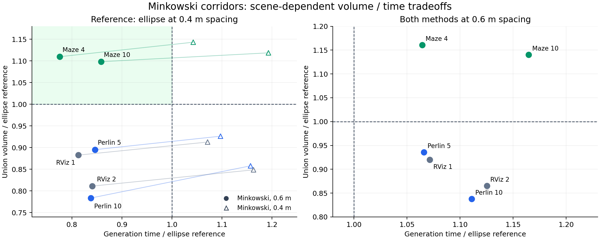

# Minkowski 三维走廊：体积与耗时的取舍

本轮把二维截面原型接成了完整三维生成器，比较了 29 种候选配置。**找到了这批迷宫路径上的有效配置，尚未找到适用于全部地图的统一替换方案。** 默认生成器保留椭圆；Minkowski 作为可选实验模块提供。

推荐继续验证的配置为 `m4_smooth_sparse`：四个短长轴比 0.05 的椭圆模板、局部定向、角度平滑系数 4、0.6 m 节点间距、两轮扩张、每个障碍参数阶段最多 12 次 Newton 迭代。不额外细分支持界。

## 1. 与现有默认配置比较

相同保存路径、地图、球形障碍、机器人半径和 3 m 局部扩张盒。椭圆使用原来的 0.4 m 间距；Minkowski 使用 0.6 m。下表是**完整配置对比**，提速中包含减少节点的贡献。

| 路径 | 椭圆体积 m³ | Minkowski 体积 m³ | 体积变化 | 椭圆 → Minkowski 耗时 ms | 耗时减少 |
|---|---:|---:|---:|---:|---:|
| RViz 路径 1 | 423.60 | 373.89 | -11.74% | 25.48 → 20.71 | 18.71% |
| Perlin 路径 10 | 635.49 | 497.99 | -21.64% | 46.17 → 38.68 | 16.22% |
| 迷宫路径 10 | 426.54 | 468.45 | +9.82% | 41.30 → 35.45 | 14.18% |
| RViz 路径 2 | 621.53 | 504.14 | -18.89% | 44.79 → 37.65 | 15.95% |
| Perlin 路径 5 | 482.42 | 431.90 | -10.47% | 22.82 → 19.31 | 15.39% |
| 迷宫路径 4 | 360.77 | 400.38 | +10.98% | 28.66 → 22.23 | 22.41% |

两条迷宫路径的体积增量分别为 **41.91 ± 0.18 m³**、**39.61 ± 0.13 m³**，± 为成对随机移位 QMC 的 95% 统计区间半宽，远小于观测增益。其余四条路径的体积损失也明显超过估计误差。

0.4 m 的平滑定向 Minkowski 在两条迷宫路径上可再增加少量体积，但耗时分别为 49.27 ms、30.02 ms，体积为 477.04 m³、412.39 m³。相对于 0.6 m 配置的少量增益，没有抵消其额外计算成本，因此优先保留 0.6 m 作为这批迷宫路径的折中配置。

## 2. 必须补充的同间距对照

把椭圆也改成 0.6 m 后，两种方法的节点数逐例相同。此时 **Minkowski 没有取得纯计算提速**；它在迷宫中以额外计算换取更大体积。

| 路径 | 共同节点数 | 椭圆 → Minkowski 耗时 ms | 体积变化 | 耗时增加 |
|---|---:|---:|---:|---:|
| RViz 路径 1 | 84 | 19.34 → 20.72 | -8.00% | 7.14% |
| Perlin 路径 10 | 153 | 34.84 → 38.71 | -16.22% | 11.10% |
| 迷宫路径 10 | 80 | 30.43 → 35.44 | +14.03% | 16.48% |
| RViz 路径 2 | 145 | 33.48 → 37.67 | -13.46% | 12.53% |
| Perlin 路径 5 | 82 | 18.13 → 19.33 | -6.45% | 6.60% |
| 迷宫路径 4 | 60 | 21.10 → 22.45 | +16.04% | 6.43% |

因此，在这两条迷宫路径上可以选择：0.6 m 椭圆优先速度，0.6 m Minkowski 取得更大体积。相对于原 0.4 m 椭圆，后者同时改善耗时和体积；相对于同间距椭圆，它是体积与耗时的交换。其余地图的这两个指标均不支持替换为当前 Minkowski 配置。



## 3. 尝试了什么

先用前三条路径做参数扫描，最后在六条路径复核，后三条未参与扫描。完整原始记录和各阶段源码哈希见 [validation/minkowski_round6.json](validation/minkowski_round6.json)。

| 方法 | 本轮观察与取舍 |
|---|---|
| 二/四模板，可变非负权重 | 二维方形复现约 97.82% 面积占比。固定模板方向的完整走廊无法普遍保持这一优势。四模板比二模板适应性更好。 |
| 使用椭圆近似提议障碍分离方向 | 初版三例均未完成第二轮扩张，体积显著偏低。增加真实 Minkowski 截面的最近点分离提议后，第二轮恢复；每个提议仍经过整段支持检查。 |
| 0/1 层额外细分、十次 Bernstein 乘积界 | 可以收紧连续约束，但带来大量耦合约束。自动定向 + 乘积界在迷宫试验增加约 16.8% 体积，耗时约 125 ms，对照椭圆约 40 ms；未选为折中配置。 |
| 模板短长轴比 0.01 / 0.05 / 0.15 / 0.30、整体转角 | 形状偏向随参数改变，没有普遍优于椭圆的固定取值。粗扫描中的不同形状收益不能推广为全局最优。 |
| 局部定向 | 用原点中心内接椭圆的极对偶矩阵估计方向。改善迷宫；逐节点方向变化也会增大连续支持界的保守性。 |
| 角度平滑 | 一次三对角求解减小相邻标架转动。系数 4、0.6 m 间距在两条代表性迷宫路径上得到当前折中；系数 16 没有形成更好的统一结果。 |
| 8/12 次内层迭代、0.4/0.6 m 间距 | 少迭代会降低部分路径体积。稀疏节点明显降低计算量，必须与同样稀疏的椭圆比较。 |
| 固定 Minkowski 基体 + 自由 SPD 仿射变换 | 只有 5 个变量/节点，保持凸 logdet 内层并复用原极对偶去冗余。当前二/四模板、转角、厚度、迭代数的候选在前三例未形成稳定体积收益；保留为实验接口。 |

在当前分离器下也补测了二模板：平滑定向、0.6 m 间距在迷宫路径 10 上约 34.19 ms、体积增加 9.28%，接近四模板，但另外两类路径的体积损失更大。该二模板候选尚未做六例高精度复核；不把四模板称为整个参数空间的全局最优。

26 条保存路径的回放全部成功。在同一迷宫地图的 12 条路径中，粗体积估计均增加，约 3.9%–13.5%；同一 Perlin 地图的 12 条路径和 RViz 地图的 2 条路径均减少。该回放每条只计时一次、使用 8×4,096 个体积样本，用于覆盖和排错；不能把它当成 26 个独立场景的性能统计。精确取舍以上面的六例九次计时为准。

## 4. 数学构造与可微接口

### 可变权重模型

在共同二维截面中使用固定非退化椭圆模板：

```text
E_k = {Q_k^(1/2) v : ||v|| ≤ 1}
K(s) = c(s) + F(s) [Σ r_k(s) E_k]
h_K(n) = n·c + Σ r_k sqrt((Fᵀn)ᵀ Q_k (Fᵀn))
A_local(r) = rᵀ V r
```

中心 c、共同标架 F 和权重 r 都使用节点间五次 Hermite 插值。形状字段的端点一、二阶导数为零，中心使用共享端点速度，因此连接处为 C²。F 在段内可以不是正交矩阵，但所有模板始终共享该二维平面；连续正则证书检查其秩及中心前进方向。

四模板每节点有 2 个中心偏移 + 4 个权重，共 6 个变量。二模板只有 4 个有效自由度，当前研究实现复用 6×6 内核并冻结其余两个坐标，未专门做 4×4 微优化。

对固定模板，二维 Brunn–Minkowski 性质使 log(rᵀVr) 在非负权重域上凹。加入线性支持约束、权重上下界和中心偏移球后，内层为凸问题。模板支持系数和混合面积矩阵提前计算，Newton 循环不重复计算模板范数；相邻节点的约束保持块三对角结构。

默认快速界对一小段 F 的端点取每个模板支持的最大值。支持函数的凸性保证这一最大值覆盖段内；再利用 Bernstein 基函数非负且和为一，把整段证明转换为线性控制系数约束。

乘积界进一步使用正系数恒等式 `B_i^5 B_j^5 = C(5,i) C(5,j) / C(10,i+j) · B_(i+j)^10`，对 F 与 r 的乘积生成更紧的十次控制约束。它仍是线性约束，但通常产生更多两节点耦合行，因此没有免费获得更大空间。

角度平滑求解 `min Σ(θ_i−θ_i_target)² + λΣ(θ_(i+1)−θ_i)²`，一次三对角消元即可完成。λ=4 是节点坐标中的权重，0.6 m 间距同时改变了它对应的物理平滑尺度；本轮将这组参数作为整体配置评价。

### 固定基体的仿射模型

固定 S₀=Σ w_k E_k，优化 `K(s)=c(s)+M(s)S₀`。节点上 M=F A，A 为 2×2 SPD，变量为 2 个中心偏移和 A 的 3 个独立元素。节点面积为常数乘 det(A)，半空间约束为几个二阶范数的和，因此保持凸内层。

该模式复用生产实现的形状可插拔证书与块优化器。默认椭圆通过静态模板实例化，保留原算术路径；26 份回放控制系数与原安装版本逐字节一致。

### 查询与连续性

`section(u)` 返回中心、共同标架、权重的一阶与二阶导数；`boundary(u,theta)` 返回边界点及 u、局部法向角 theta 的一阶、二阶和混合导数。

内部判定使用 `q(u,x)=gauge(u,x)^4−1`，并要求点位于该截面平面。非椭圆的 gauge² 在中心一般不具备连续 Hessian；四次表达在中心有零梯度、零 Hessian，并保持同一内部区域。法向根采用带二分保障的 Newton 解，导数通过驻点条件消去法向变量获得。初期对部分较圆模板的根求解未收敛，已加入确定的二分收缩，并重跑相关候选及独立体积测试。

这里保证的是沿路径的侧面参数化及查询的 C² 性质；不宣称端面与侧面拼成的整个封闭边界都为 C²，也不宣称全局无自交或完整管体 Jacobian 始终非零。并集体积通过独立求截面平面全部根后判断成员关系，重叠不重复计数。

## 5. 对照边界与验证

- 地图分辨率 0.25 m；障碍球半径 √3×0.25/2，机器人半径 0.2 m，安全余量 0.05 m，连续证书额外余量 0.002 m。
- 两种方法使用相同种子分段产生的 3 m 扩张盒、7 m 分段推进和世界边界。计时包含模板设置、入口处理、证书与优化；不包含地图索引构建、文件 I/O、独立采样和体积统计。
- 不同参数化的内部下界不完全同义：椭圆 `min_radius` 是形状特征值下界；可变权重模型使用很小的正权重下界保证非退化。仿射模式按基体的内接圆界调整矩阵参数范围。不能把模板权重上限称为同一个物理半轴上限；本轮空间上限由共同扩张盒控制。
- 最终六例每种方法预热一次、重复九次，报告中位数。体积使用八次随机移位、每次 262,144 个 Sobol 样本，共 2,097,152 点；每一对方法共享采样点，统计成对差值。不同配置的采样域可以不同，椭圆体积估计末位因此也可能不同。
- 四项测试全部通过：原走廊回归、Minkowski 支持界/梯度/Hessian/C²、解析直通道体积与重复排除、原体积工具的圆柱/重叠多面体/折返回归。
- 最终六例及 26 条 Minkowski 回放每条进行 24,672 个独立实体采样检查，包含边界与内部点，检查原始球障碍、世界边界和局部扩张盒。生成器仍保留全量连续支持残差和正则证书；体积未决根均为零。
- 默认椭圆另以保存请求的原始配置回放 26 条，与修改前安装版本比较，26 份控制系数 CSV 逐字节一致。该项与上述 3 m 扩张盒实验分别记录。
- 所有构建、测试、对照串行。构建地址空间限制 2 GiB、CPU 120 s；对照进程限制 512 MiB、CPU 50 s、墙钟 60 s。折中配置六例最大 RSS **33.31 MiB**，成功候选中最高约 **60.22 MiB**。沿用请求内 16 MiB 查询/分组缓存上限。
- 入口数据校验没有移入 Newton 热循环；保留的高频检查用于可行域、步长和连续安全证明。证书仍是带舍入余量的浮点证明，不是向外舍入的形式化区间实现。

## 6. 构建、调用与复现

实验 API 位于 [minkowski.hpp](../direct_corridor/experiments/minkowski.hpp)，启用 CMake 选项后生成静态目标 `corridor_minkowski_experiment`。原公共 API/ABI 和 ROS 消息接口不变。本轮未安装实验库或启动新的 RViz 会话。

```bash
cmake -S direct_corridor -B .scratch/minkowski_build \
  -DCMAKE_BUILD_TYPE=Release \
  -DDIRECT_CORRIDOR_BUILD_MINKOWSKI_EXPERIMENT=ON
prlimit --as=2147483648 --cpu=120 \
  cmake --build .scratch/minkowski_build -j1
timeout -k 2 60 prlimit --as=536870912 --cpu=50 \
  ctest --test-dir .scratch/minkowski_build --output-on-failure -j1

python3 direct_corridor/experiments/run_minkowski.py m4_smooth_sparse m4_smooth \
  --binary .scratch/minkowski_build/minkowski_benchmark \
  --inputs .scratch/accel_round3/inputs.json \
  --output .scratch/minkowski_reproduce --cases 6 --repeats 9 --samples 262144

# 同为 0.6 m 间距的对照，使用另一个全新输出目录。
python3 direct_corridor/experiments/run_minkowski.py m4_smooth_sparse \
  --binary .scratch/minkowski_build/minkowski_benchmark \
  --inputs .scratch/accel_round3/inputs.json \
  --output .scratch/minkowski_density_reproduce --cases 6 \
  --repeats 9 --samples 262144 --ellipse-spacing .6
```

输入 JSON 是保存请求目录的列表，原始地图/路径在本机 `.scratch/interactive`，未随仓库分发。runner 自动串行运行并设置每个子进程的内存和超时限制；输出表面采样 `surface.csv`、计时/审计结果和源码哈希。体积分析工具是离线依赖，不进入生成器计时。

可选模式的核心调用如下；`geometry` 应由上层填入相同地图、机器人和空间边界参数，benchmark 中会由局部盒计算足够宽松的代数参数上限。

```cpp
gcopter::direct::minkowski::Options options;
options.geometry = geometry;
options.geometry.control_spacing = 0.6;
options.templates = 4;
options.adapt_orientation = true;
options.orientation_smoothing = 4;
auto result = gcopter::direct::minkowski::generate(seed, index, bounds, options);
```

后续最值得解决的是不规则空间中的表达能力和方向选择，而不是继续无差别增加细分。当前固定模板族并不包含所有自由椭圆，因此没有“体积必然不少于椭圆”的包含关系；本轮结果不支持自动用它替换全部路径。
