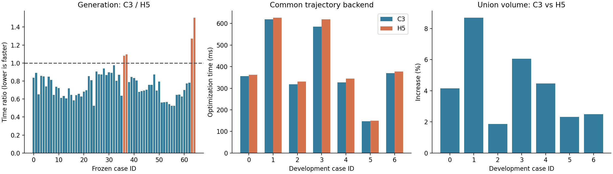
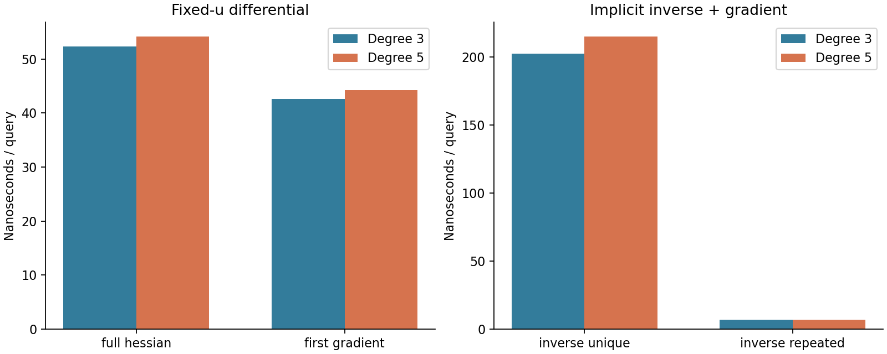

# SweepCorridor 统一查询与 C3/H5 轨迹复测

> 本文记录 `bd6d81f` 的 C3/H5 对照。后续 H5 已移至 `archive/h5-sweep-corridor`；当前 C3 专用接口与结果见 [H5 归档与 C3 专用化第一轮](H5归档与C3专用化第一轮.md)。

本轮把旧三次查询器中已经验证有效的一阶求值、截面几何缓存和反求缓存迁入 SweepCorridor，让 C3 与 H5 使用同一套实现。C3 继续作为主要方案；H5 暂时保留，因为扩展测试中仍有四条路径的生成速度更快。

统一接口保留原生次数：C3 每段四个 Bézier 控制量，H5 每段六个，没有升阶转换。七例主测试中，C3 生成更快、并集体积更大，轨迹优化也更快；但统一查询后，轨迹耗时优势为 1.20%–5.36%，不再是旧查询实现对照中的约两倍。



## 1. 实现变化

- `Query<D>::first(u)` 只计算中心、形状及一阶导数。
- `Query<D>::evaluateFirst(u,x)` 返回约束值、一阶梯度和平面残差，不计算二阶导数和 Hessian。原 `evaluate()` 保留完整二阶接口。
- `InverseQuery<D>` 共用同一段模板实现，完成截面反求和世界坐标梯度传播。
- 反求缓存使用 4096 个截面几何条目和 8192 个完整答案条目，采用精确键。缓存复用截面法向、Gram 逆矩阵和对偶映射；碰撞只替换缓存条目，不改变结果。
- 均匀节点采用常数时间区间定位，非均匀节点使用游标和二分查找。
- 库内查询没有时钟、计数器或重复输入扫描。数据有效性遵循入口约定；求根停止、奇异导数判定和边界处理属于算法本身，继续保留。

查询对象拥有系数和缓存，可独立于原走廊对象存活；不同线程各自持有查询对象。`InverseQuery` 从每次提供的进度提示开始求根，不借用上次轨迹的根。它是局部截面反求，端点外延保留端盖平面残差，远距离重叠区间仍可能有多个根。

令 $P=(M^TM)^{-1}M^T$，$z=P(x-c)$，固定参数的截面约束为 $q=z^Tz-1$。一阶接口计算 $q_u=2z^Tz_u$、$q_x=2P^Tz$。轨迹反求则先解 $f(u,x)=n(u)^T(x-c(u))=0$，再通过 $du/dx=-n^T/f_u$ 将截面变化传播到世界位置梯度。两个接口分别对应固定参数和隐式反求，不能互相替代。

## 2. 相同输入与计时口径

输入沿用 E1 的 67 组冻结快照，不重新搜索路径。体素边长 0.25 m，实体障碍为外接球，机器人半径 0.20 m、安全余量 0.05 m、扩张范围 3 m、节点间距 0.4 m。两种次数使用相同地图、输入路径与几何设置。

生成测试每例预热一次、正式七次，统计生成调用的 wall time，包含输出转换，复用已构建的障碍 BVH。独立证书复核、查询微基准和文件导出不计入生成耗时。主计时不开启逐阶段 profile。

轨迹测试使用同一五次最小 jerk 表示、SplineOptimizer、初始航点、时长和优化变量。初值哈希逐例一致；积分步数 16、位置权重 100000、Bézier 深度 2、最大迭代数 800，每组预热一次、正式三次。C3/H5 顺序在重复之间交替。

全部程序串行运行，固定 CPU 2，数值线程数为 1，地址空间上限 4 GiB；测量进程最高 RSS 为 32.70 MiB。编译也使用单任务和相同内存上限。

## 3. 生成速度与体积

两种方法均成功生成 65/67 条路径，成功输出全部通过连续支持与全截面 Jacobian 复核。两个预期失败输入分别为折返尖点和极窄通道：C3 返回初始化失败，H5 分别返回退化路径和净空不足；原始状态与失败耗时均保存在结果中。

65 条共同成功路径的逐例耗时中位数之和：C3 为 **1758.05 ms**，H5 为 **2343.79 ms**，C3 低 **24.99%**。C3 在 61 条路径上更快；这个合计不是单条请求的平均耗时。

| 场景 | C3 生成 / ms | H5 生成 / ms | C3 并集体积增幅 |
| --- | ---: | ---: | ---: |
| 0 | 22.39 | 26.77 | 4.15% |
| 1 | 45.51 | 51.12 | 8.70% |
| 2 | 28.50 | 43.79 | 1.87% |
| 3 | 42.34 | 49.32 | 6.05% |
| 4 | 20.40 | 23.95 | 4.48% |
| 5 | 21.51 | 29.09 | 2.32% |
| 6 | 24.61 | 28.96 | 2.50% |

本轮没有修改生成算法。65 组 C3 和已有七组 H5 的输出系数与迁移后基线逐字节相同。七例两种模型也与已有 QMC 体积实验的几何逐字节相同，因此直接引用配对并集体积结果，没有重新采样。各例样本数、配对误差区间、系数哈希和一致性证据保存在 `results.json`。边界平滑性随几何保持不变。

扩展测试中 H5 仍有以下生成速度优势：

| 场景 | 类型 | C3 / ms | H5 / ms |
| --- | --- | ---: | ---: |
| 36 | 历史 Perlin 路径 | 45.885 | 42.452 |
| 37 | 历史 Perlin 路径 | 54.724 | 49.968 |
| 63 | 空旷直线 | 2.373 | 1.866 |
| 64 | 空旷竖直 | 0.902 | 0.599 |

## 4. 查询性能

每条主测试生成 16384 个查询，预热一次、正式七次。固定参数使用相同的参数序列和截面坐标，两种模型各自在自己的截面上构造世界坐标点。反求包含独立位置查询与重复键查询两组；它们的迭代次数可能随几何变化，不能把全部差异解释成纯多项式次数差异。

下表先取每例七次中位数，再取七例中位数，单位为 ns/次，包含基准调用与结果累计开销。

| 查询 | C3 | H5 |
| --- | ---: | ---: |
| 值、梯度与 Hessian | 52.34 | 54.15 |
| 仅值与一阶梯度 | 42.58 | 44.26 |
| 截面反求与梯度：不同位置 | 202.20 | 214.67 |
| 截面反求与梯度：重复键 | 6.69 | 6.68 |



一阶接口相对完整二阶接口减少约 18%–19% 的耗时。C3 一阶梯度查询比 H5 快约 3.8%，不同位置的反求查询快约 5.8%。重复键命中时，两者都只读取缓存，次数差异基本不再影响成本。

## 5. 统一轨迹后端结果

| 场景 | C3 优化 / ms | H5 优化 / ms | C3 最大走廊残差 / mm | H5 最大走廊残差 / mm |
| --- | ---: | ---: | ---: | ---: |
| 0 | 356.28 | 362.06 | 1.68 | 0.00 |
| 1 | 619.61 | 627.10 | 4.97 | 13.52 |
| 2 | 318.77 | 330.66 | 2.93 | 7.27 |
| 3 | 586.00 | 619.17 | 4.87 | 8.18 |
| 4 | 327.18 | 345.28 | 4.05 | 8.32 |
| 5 | 147.00 | 149.94 | 6.08 | 6.00 |
| 6 | 369.78 | 378.09 | 3.50 | 4.10 |

七例主测试的轨迹优化耗时中位数之和为 C3 **2724.61 ms**、H5 **2812.31 ms**，C3 低 **3.12%**，逐例快 1.20%–5.36%。采样验收为 C3 **6/7**、H5 **2/7**。C3 唯一未通过的场景 5 最大走廊残差为 6.08 mm，超过 5 mm 门槛。

补充测试选择了初筛中 H5 生成较快的六个案例（27、32、36、37、63、64），用于寻找保留 H5 的实际理由；它们不是随机留出集。共 13 例中 C3 的轨迹优化全部更快，耗时中位数合计低 **3.80%**，采样验收为 C3 **12/13**、H5 **5/13**。正式生成复测中，27 和 32 已由 C3 略快，另外四例仍是 H5 更快。

七例主测试中，C3/H5 的轨迹目标值比值中位数为 0.99942，jerk 能量比值中位数为 0.99746。所有 13 例的障碍穿透和反求失败数均为零。轨迹复核使用独立 de Casteljau 求值与 LDLT 计算，时间采样间隔不大于 5 ms，且至少为优化采样密度的四倍。

场景 5、63、64 的优化器状态为 1，其余场景为迭代上限状态 -1008。因此这些数字比较的是固定预算下的优化结果；轨迹采样验收与走廊连续安全认证分别记录。

另做一次开启计时的 profile 对照，七例累计的查询耗时为 C3 2342.69 ms、H5 2447.43 ms。profile 中的高频计时本身有明显开销，不能与关闭计时的正式耗时混用；查询计时也嵌套在积分和 Bézier 回调中，不能相加得到总耗时。

## 6. 验证与保留决策

- 一阶接口与完整二阶接口的梯度最大相对差为 3.62e-14。
- 两种次数均通过独立有限差分检查，包括反求后的世界梯度、端点残差、缓存命中、重置与逐出后的结果一致性。
- 13 例公共轨迹目标方向梯度检查的最大相对误差为 6.63e-7。
- 头文件库测试、旧 H5 查询回归测试、两种轨迹对照程序编译通过；安装后的独立工程只依赖 Eigen 即可生成走廊并使用新反求接口。

结论是继续以 C3 为主要生成方案，保留 H5 的默认生成器作为对照与特定场景选项。H5 在四个输入上还有实际生成速度优势；本轮没有恢复任何旧预设或实验配置。后续若 C3 消除这几类场景的差距，并保持成功率与体积，就可以再考虑将 H5 移出正式库。

旧实验中约两倍的轨迹加速，不应归结为三次相对五次的固有倍数优势。它同时包含了三次专用缓存和反求优化。把这些优化公平地提供给 H5 后，保留下来的差距才更接近当前几何与次数的综合差异。

## 7. 复现与原始记录

```bash
cmake -S SweepCorridor -B .scratch/sweep_query/library -DCMAKE_BUILD_TYPE=Release -DSWEEP_BUILD_BENCHMARKS=ON
prlimit --as=4294967296 -- cmake --build .scratch/sweep_query/library -j1
cmake -S gcopter/experiments/trajectory -B .scratch/sweep_query/trajectory -DCMAKE_BUILD_TYPE=Release
prlimit --as=4294967296 -- cmake --build .scratch/sweep_query/trajectory --target sweep_trajectory_comparison -j1
python3 gcopter/experiments/trajectory/compare_sweep.py \
  --inputs .scratch/native_splines/e1/inputs/manifest.json \
  --output .scratch/sweep_query/reproduce-generation \
  --binary .scratch/sweep_query/library/sweep_frozen --stage generation
python3 gcopter/experiments/trajectory/compare_sweep.py \
  --inputs .scratch/native_splines/e1/inputs/manifest.json \
  --output .scratch/sweep_query/reproduce-trajectory \
  --binary .scratch/sweep_query/trajectory/sweep_trajectory_comparison \
  --stage trajectory --cases 0,1,2,3,4,5,6,27,32,36,37,63,64
```

输入文件使用原冻结快照，运行脚本在启动实验前校验 SHA256。更换机器时可通过 `--cpu` 指定可用核心。

- [汇总与逐例结果](validation/sweep_query/results.json)
- [生成命令、输入哈希与二进制哈希](validation/sweep_query/generation/manifest.json)
- [轨迹复测命令与初值](validation/sweep_query/trajectory/manifest.json)
- [计时诊断记录](validation/sweep_query/profile/manifest.json)
- [几何系数与轨迹 CSV 归档](https://github.com/Bziyue/GCOPTER/blob/62645e2fa2b7205d2a7492c05305734dd8534021/docs/validation/sweep_query/raw_csv.tar.gz)
- [源码快照](https://github.com/Bziyue/GCOPTER/blob/62645e2fa2b7205d2a7492c05305734dd8534021/docs/validation/sweep_query/source_snapshot.tar.gz)
