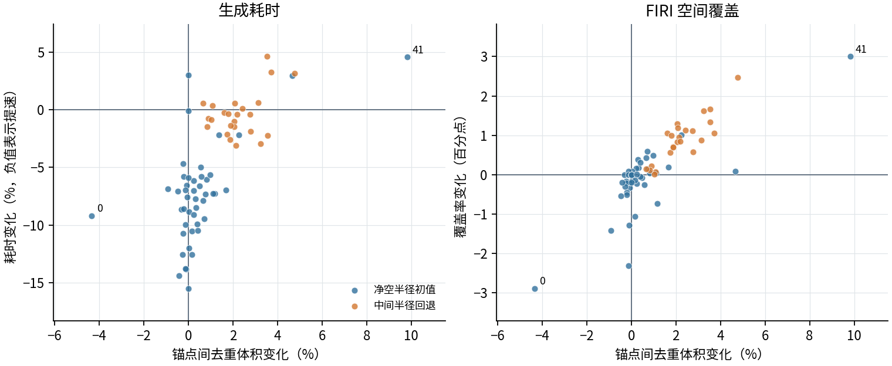

# H3 核心体积与生成耗时

对照是本轮改动前、已经使用实体体素和粗细网格的 H3。两版读取相同的 71 条冻结种子和地图，体素边长 0.25 m，机器人半径、安全余量、控制间距、局部盒与截止时间取自同一输入配置。[冻结输入和校验和](../h3_volume/inputs.json)

## 配对结果

70 条共同成功，折返尖点 65 在两版都返回初始化失败。每个方法在单核 Release 下预热，两次独立会话各测七次。每条输入的两种方法在第二次会话交换先后，合并 14 次耗时后取该路径的中位数。下表给出逐路径变化的中位数。两个计时会话单独统计的耗时降幅分别为 6.03% 和 5.55%。[逐次计时和版本校验和](summary.json) · [逐例结果与配对误差](paired.csv)

| 指标 | 全部配对路径 | 24 条采用中间半径的路径 |
|---|---:|---:|
| 生成耗时 | −5.86% | −0.57% |
| 起终点锚点之间的去重体积 | +0.66% | +2.07% |
| 包含自由端的去重体积 | +0.48% | +1.96% |
| FIRI 空间被 H3 覆盖的比例 | +0.09 个百分点 | +0.91 个百分点 |
| 核心侧壁曲率平方积分 | +2.66% | +11.76% |

70 条中有 59 条提速，43 条同时提速并扩大核心并集。全部路径的生成时间中位数从 21.17 ms 降到 20.04 ms。把不同输入的核心体积逐例相加，合计增加 1.18%。对 49 条路径，核心体积的估计增益大于各自配对 95% 区间半宽，14 条出现同样可区分的下降。触发中间半径的 24 条全部取得可区分的核心体积增长，其中 23 条接受了最终平滑。其余 46 条的配对耗时中位数降低 7.28%，核心并集增加 0.17%。[逐例数据](paired.csv)



FIRI 占据空间中被走廊覆盖的比例为 $|H\cap P|/|P|$，在有连通 FIRI 走廊的 68 条上统计。算例 47、70 的 FIRI 结果未形成连通走廊。交集与两个并集分别使用八组共同平移，每组 65,536 个 Sobol 点。全程无未决的走廊成员判定。曲率在独立截断的核心几何上逐次加密积分，最末两阶的最大相对差为 0.16%。计时仅包括在线生成，索引构造、导出审计、曲率积分和空间采样另外执行。默认值用这批输入筛选，以下数值描述该回归集。[空间测量](../../../SweepCorridor/experiments/h3/validate_core.py)

- Perlin 41 的核心从 526.27 增至 577.96 m³，FIRI 覆盖率从 77.42% 增至 80.42%，耗时增加 4.60%。Perlin 0 提速 9.19%，核心减少 4.34%，FIRI 覆盖率从 79.21% 降到 76.33%。
- RViz 输入 68 的核心增加 0.41%，FIRI 覆盖率增加 0.31 个百分点，耗时减少 10.50%。窄通道 66 的总并集增加 16.32%，核心只变化 0.003%，配对区间半宽为 0.021%，两版都覆盖全部 FIRI 样本。
- 侧壁曲率平方积分的最大增幅为 41.79%，出现在算例 17。算例 61 则下降 10.82%。正常数值证书只约束局部 Jacobian，侧壁曲率还取决于中心和形状的二阶导数。[逐例数据](paired.csv)

## 单项消融与检查

在相同 71 条输入上单独更改一个开关。下表为启用该项相对关闭时的逐路径中位变化。消融每个方法预热后计时三次，时差小于 1% 时易受计时波动影响。面积选点会增加局部优化访问的节点数。核心加权有小幅核心体积收益，对 FIRI 交集的中位影响接近采样误差量级。[逐例消融](ablations.csv)

| 启用的机制 | 生成耗时 | 总并集 | 核心并集 | FIRI 覆盖变化 |
|---|---:|---:|---:|---:|
| 自由端体积权重从 1 改为 0.5 | +0.25% | −0.02% | +0.06% | −0.02 个百分点 |
| 在压力刷新之外按面积余量补选节点 | +1.39% | +0.10% | +0.11% | +0.04 个百分点 |

70 个成功输出均通过独立原始体素审计、整段支撑与全圆盘 Jacobian 证书、锚点反解及 C¹ 拼接检查。归一化拼接误差最大 $2.72\times10^{-14}$，逐点 Jacobian 认证下界最小为 0.15000000033。命名配置 `h3_pre_core` 的 70 份导出系数与历史归档的 SHA256 完全一致。四组 H3 测试、SweepCorridor 主库测试、宿主搜索和体积测试通过。Perlin 和迷宫的 ROS 点选生成均成功，演示导出与离线重放逐系数的最大差值均为 0。[ROS 重放](rviz.json) · [历史基线](../h3_inflation/paired.csv)

71 条输入各取三套网格，对照旧实现逐项检查了 213 组区间布局。所有区间端点、盒边界及索引一致。单独构造 4,096 段与 4,096 个局部盒的布局，在本次合成微基准中从 25.54 ms 降到 0.104 ms。[布局微基准](layout.csv)

## 几何与求解

沿走廊的映射为 $F(u,z)=c(u)+M(u)z$，其中 $\lVert z\rVert\le1$。原始起终点在走廊中的参数为 $u_a,u_b$。令 $n=M_1\times M_2$，核心扫掠体积为 $V_c=\pi\int_{u_a}^{u_b} n^\top c'\,du$。细网格及局部求解优化 $V_c+0.5(V_{\rm full}-V_c)$，粗网格前几轮用完整体积建立可行初值。每个三次段的被积函数最高八次，五点 Gauss 积分精确。线搜索在试探几何上重新求受影响的锚点，首尾截段计入移动积分限的导数。空间验证另行测量去重并集。[体积及导数](../../../SweepCorridor/experiments/h3/cap_volume.hpp) · [全局求解](../../../SweepCorridor/experiments/h3/solve.hpp)

逐点 Jacobian 取 $q_0=n^\top c'$ 和 $q_\perp=M'^\top n$。默认在全圆盘上认证 $q_0-\lVert q_\perp\rVert>0.15q_0$，并独立认证 $q_0/\lVert n\rVert>0.02L$，$L$ 是种子总弧长，$u$ 归一化至 $[0,1]$。在局部 Bézier 参数下，第二个门槛乘以该段的参数宽度。两个不等式分别约束截面内压缩和法向推进。Bernstein 包络不够紧时二分验证，并保留浮点正性余量。节点共享一阶导数，输出映射沿 $u$ 为 C¹。输入变化时的障碍选择、换面和回退含离散切换。[连续证书](../../../SweepCorridor/include/SweepCorridor/detail/Certificates.hpp)

- 搜索和生成共享实体体素的点距离、线段碰撞与法向支撑。搜索继续使用自己的参考净空，FIRI 使用其历史外接球侵蚀模型。粗筛使用 BVH，离线复核直接检查原始体素八角点。[输入索引](../../../SweepCorridor/include/SweepCorridor/detail/ObstacleIndex.hpp) · [独立审计](../../../SweepCorridor/experiments/h3/audit_cover.hpp)
- 净空半径初始化失败时，在净空半径与最小半径之间尝试一次中点。中间初值通过完整验证后，弯曲权重从 1.25 提到 2.5，粗网格校正每阶段可走三步，常规初值为两步。最终允许再试一次自然导数平滑，只有核心扫掠体积损失不超过 0.5% 且采样侧壁曲率积分下降才接受。这个限额比较同一条路径平滑前后的两个候选。[生成调度](../../../SweepCorridor/experiments/h3/generator.hpp) · [物理侧壁评价](../../../SweepCorridor/experiments/h3/wall_quality.hpp)
- 膨胀和局部换面使用同一纵向尺度规则。记本段半弦长为 $l_s$，同查询域最多八段组成一组，组半弦长为 $l_g$，截面短半轴为 $r_s$。用于生成法向的纵轴为 $\max(l_s,r_{\min},\min(l_g,2r_s))$。平面能否跨段复用另外验证接收段的所有控制圆盘。局部盒与段的匹配改为单调扫描，复杂度为 $O(S+B+K)$，其中 $K$ 为非空交集数。[建面与复用](../../../SweepCorridor/experiments/h3/inflation_cover.hpp) · [尺度和区间布局](../../../SweepCorridor/include/SweepCorridor/detail/ObstacleCover.hpp)
- 第二次联合扫描访问全部节点，然后做一轮局部修正。障碍压力选择要重建分离面的段，截面内平移中心并沿同一方向拉伸椭圆的可行面积增量选择额外节点。两类内部选择各有 10% 的段数预算。实际步仍须通过相邻段支撑、圆盘 Jacobian 和锚点验证。无障碍压力时，自由端仍可单独修正。[局部修正](../../../SweepCorridor/experiments/h3/local_refinement.hpp)

## 复现

在仓库根目录执行。下列命令通过命名配置重建前一版几何。记录中的耗时使用改动前保留的原始可执行文件，机器和二进制都会影响具体毫秒数。若留有原始二进制，可在两次 `run.py` 调用中加入 `--pre-core-binary /path/to/before_benchmark`。构建 FIRI 测量程序需使用 GCOPTER 的 CMake 选项 `GCOPTER_BUILD_CORRIDOR_BENCHMARK=ON`。

```bash
python3 SweepCorridor/experiments/h3/build.py --targets tests,volume_tests,adaptive_tests,inflation_tests,benchmark,measure
mkdir -p .scratch/h3_volume/inputs
tar -xzf docs/validation/h3_volume/inputs.tar.gz -C .scratch/h3_volume/inputs
cmake --build build/gcopter --target h3_firi_overlap
for mode in h3_pre_core,h3_new h3_new,h3_pre_core; do
  python3 SweepCorridor/experiments/h3/run.py --inputs docs/validation/h3_volume/inputs.json \
    --cases all --modes "$mode" --repeats 7 --samples 0 --output ".scratch/h3_core/$mode"
done
python3 SweepCorridor/experiments/h3/validate_core.py \
  --root .scratch/h3_core/h3_pre_core,h3_new --replicate .scratch/h3_core/h3_new,h3_pre_core \
  --output .scratch/h3_core/validation
python3 SweepCorridor/experiments/h3/plot_core.py .scratch/h3_core/validation
```

复现两项消融时，使用 `run.py --modes h3_core_full,h3_new,h3_core_pressure --repeats 3` 生成三组几何。随后对同一输出目录运行两次 `validate_core.py`，分别指定 `--reference h3_core_full` 和 `--reference h3_core_pressure`。
