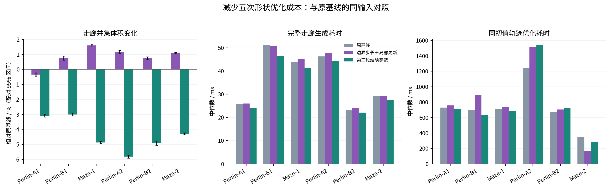
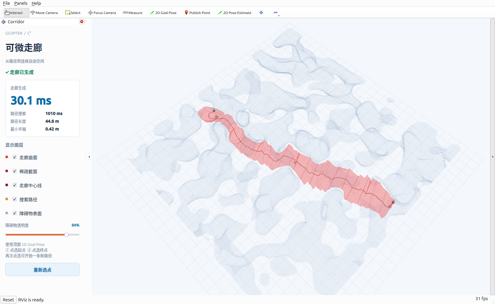

# 五次形状加速与原基线对照

2026-11-03，分支 `experiment/integrated-quintic-shape`。本轮继续使用六条冻结路径、原障碍模型、相同局部扩张范围和相同轨迹初值，目标是让非零导数走廊在生成速度、体积和轨迹质量上同时达到或超过原基线。

这轮消除了上一版明显增加的生成成本：附加形状阶段的求解中位数从约 51.8 ms 降至 0.49 ms，连同约束准备和校验共约 1.13 ms。最终的 `boundary-12` 方案完整生成耗时为原基线的 0.993～1.035 倍，六例中五例体积增加 0.74%～1.60%，一例减少 0.34%。

它还没有在速度和质量上全面超过基线。轨迹采样通过数由 1/6 提高到 2/6，但五例轨迹优化耗时增加。另一种减少原生求解步数的方案能让生成加快 3.9%～9.1%，同时损失 3.0%～5.8% 的体积。本轮将前者保留为可选实验，默认生成策略继续使用原基线。



## 1. 之前为什么慢

上一轮集成方案虽然复用了分离平面，但求解流程仍是“原来的两轮中心/截面优化，再加一次完整五次形状优化”。后者每个局部控制矩阵有三个对称变换变量，控制矩阵数量又约为原节点数的三倍，产生更宽的 Hessian 和更多的连续支持约束。

上一轮新增形状 Newton 求解的阶段中位数约 51.8 ms，而最终校验仅约 0.3 ms。原基线的六例完整生成约 23～48 ms。因此主要瓶颈是额外的数值求解，不是高频输入检查，也不是最终安全校验。原生节点求解在本轮六例中都用满两轮合计 72 个 Newton 步，证书构造也占有相当比例。

## 2. 本轮采用的计算方法

### 局部标量五次形状

保留原流程学到的节点中心及椭圆矩阵，将附加形状阶段缩小为

\[
M(u)=\sum_iN_{i,5}(u)\,\lambda_i A_i,\qquad \lambda_i>0.
\]

每个控制矩阵只增加一个缩放变量；它的方向和长短轴比例由原生成器决定。样条仍然 C²，节点处形状一、二阶导数可以非零。这是原自由形状优化的一个更小子空间，不是同一优化问题的等价提速。

五次内部三重节点使零导数初值可以由每个节点矩阵重复三次得到。基函数只在当前区间的六个局部函数上求值；不用扫描整条样条的全部基函数，也不用投影求解。

连续支持约束仍为

\[
n^TC_j+\|D_j^Tn\|\le b.
\]

某个缩放变量增加 \(\delta\) 时，受影响的支持向量变为 \(z+\delta a\)。它的可行上界由二次方程给出：

\[
\|a\|^2\delta^2+2(a^Tz)\delta+\|z\|^2-b_0^2=0,
\quad b_0=b-n^TC_j.
\]

取所有关联约束中最小的非负边界，并保留 0.5% 步长余量。前后各扫一遍变量，更新缓存的支持向量；无需全局 Newton 系统或逐级障碍参数。该更新使标量扩张目标单调改善，但不等于严格保证走廊并集体积单调增长。

### 原生 Newton 的快速可行步长

原生中心与形状优化包含二维正定矩阵、偏移圆盘和二阶锥约束。沿 Newton 方向，这些约束的边界均可归结为一次或二次方程。用稳定二次求根式计算首次可行域边界，作为 Armijo 回溯的起始步长。

实现先试完整 Newton 步。若它可接受，就不计算边界；若首次试探越界，才扫描约束。扫描时维护当前允许步长，约束在当前步长仍可行时跳过求根。最终 Armijo 条件和原来的全量支持残差检查均保留。

最终比较两个候选：

- **边界更新 `boundary-12`**：原节点密度、两轮膨胀、每轮三档障碍参数和每档 12 步上限不变，使用快速可行步长，再做局部标量更新。
- **延续参数 `continuation`**：第一轮完全沿用原求解策略；第二轮使用可行边界步长，跳过较大的 0.003 障碍参数，从 0.0001 延续至 0.00001，再做局部更新。它将原生步数上限由 72 降为 60。

## 3. 筛选过的方案

所有小试都串行、限制内存，并保留指标与可执行文件哈希。筛选阶段使用每组 16384 个 QMC 样本、八组平移；正式比较提高到每组 65536 个样本。

| 方案 | 小试观察 | 处理 |
|---|---|---|
| 一轮原膨胀＋标量 Newton | 三个筛选例体积减少约 19%～23%，总时间仍高于基线 | 未采用 |
| 两轮原膨胀＋标量 Newton | 体积仅小幅增加，新增求解约 7～10 ms | 未采用 |
| 第一轮每档缩短到 6 或 8 步＋局部更新 | 多数例子更快，但体积下降，6 步版最高约 5.8% | 未采用 |
| 对全部约束预先求可行边界 | 部分体积改善，但求根开销抵消收益 | 改为渐进裁剪和按需计算 |
| 节点间距从 0.4 m 增至 0.5 m | 更快，但多个例子体积减少约 1%～3% | 未采用 |
| 两轮都改步长，第二轮提前减小障碍参数 | 更快，但存在体积损失 | 保留小试；正式版固定第一轮，以单独评价第二轮延续 |

没有通过减少体积采样、降低轨迹验证密度、改变障碍膨胀或跳过几何校验取得速度收益。

## 4. 正式走廊比较

每条路径预热一次、正式重复七次，完整生成耗时取中位数，包含路径准备、原生两轮优化和局部形状阶段，不含地图索引加载、体积计算和独立审计。三种方法使用共同网格和同一批 524288 个 QMC 点，测量空间并集体积。所有体积查询未决根数为零，独立几何采样未发现障碍穿透。

| 路径 | 原基线体积 m³ | 边界更新体积变化 | 延续参数体积变化 | 完整生成 ms：基线 / 边界 / 延续 |
|---|---:|---:|---:|---:|
| Perlin-A1 | 424.32 | -0.34% | -3.08% | 25.68 / 25.98 / 24.17 |
| Perlin-B1 | 635.37 | +0.75% | -3.00% | 51.21 / 50.85 / 46.53 |
| Maze-1 | 426.93 | +1.60% | -4.87% | 44.00 / 45.03 / 41.26 |
| Perlin-A2 | 621.89 | +1.17% | -5.82% | 46.23 / 47.70 / 44.43 |
| Perlin-B2 | 482.66 | +0.74% | -4.92% | 23.25 / 24.06 / 22.05 |
| Maze-2 | 360.63 | +1.09% | -4.29% | 29.27 / 29.15 / 27.42 |

边界更新版的完整生成有两例略快、四例略慢，差距在 −0.7%～+3.5% 之间；这些小差距不足以证明稳定的速度优势。它的附加阶段在 42 次正式运行中的中位数为：约束与基函数准备 0.309 ms、局部更新 0.490 ms、输出与校验 0.331 ms，总计 1.134 ms。各分项分别取中位数，所以相加与总时间中位数略有差异。

相同运行中的原生证书构造中位数为 21.40 ms，原生 Newton 求解为 14.56 ms。现在主要成本已经回到原生成流程；继续压缩约 0.3 ms 的最终校验，收益远小于优化证书构造和原生求解。原始支持约束残差最多约 \(4.0\times10^{-13}\)，C² 接点误差最多约 \(1.6\times10^{-8}\)，六例都产生了非零形状导数，均无需正则性回退。

本轮体积估计使用新的共同采样网格，原基线的估计值与上一份报告略有差异；六例原基线截面 CSV 与上一轮逐字节一致，几何本身没有改变。图中的误差条来自八组配对 QMC 平移样本。

## 5. 同初值轨迹质量

沿用每段 16 个积分步、Bézier 深度 2、位置罚权 \(10^5\)、最大 800 次迭代，以及原来的五次最小 jerk 轨迹库和 `fast` 截面查询。每个输入预热后重复三次；初始优化向量、航点 CSV 与 FIRI 对照轨迹哈希一致。

下表每格顺序为 **原基线 / 边界更新 / 延续参数**。采样通过沿用 5 mm 位置残差、1% 动力学容差、\(10^{-6}\) m 障碍穿透容差和无反求失败的判据；采样通过不等于优化收敛或连续时间轨迹证明。

| 路径 | 轨迹优化 ms | 飞行时长 s | jerk 能量 | 局部位置残差 mm | 采样通过 |
|---|---:|---:|---:|---:|---|
| Perlin-A1 | 729.7 / 759.5 / 714.5 | 13.58 / 13.57 / 13.80 | 22.64 / 22.76 / 23.46 | 1.29 / 1.47 / 5.51 | 是 / 是 / 否 |
| Perlin-B1 | 703.7 / 893.0 / 632.1 | 25.30 / 23.63 / 23.19 | 84.43 / 83.55 / 80.80 | 8.50 / 22.54 / 15.43 | 否 / 否 / 否 |
| Maze-1 | 714.3 / 743.1 / 682.4 | 14.75 / 14.60 / 14.56 | 39.22 / 39.18 / 37.62 | 5.03 / 3.01 / 6.27 | 否 / 是 / 否 |
| Perlin-A2 | 1245.4 / 1513.1 / 1542.7 | 21.02 / 21.12 / 21.02 | 51.15 / 48.36 / 45.43 | 22.80 / 12.90 / 14.32 | 否 / 否 / 否 |
| Perlin-B2 | 672.2 / 705.7 / 728.1 | 12.77 / 12.92 / 12.77 | 27.46 / 24.74 / 22.88 | 7.60 / 8.52 / 3.20 | 否 / 否 / 是 |
| Maze-2 | 348.6 / 171.0 / 282.7 | 12.56 / 12.51 / 12.50 | 48.53 / 48.19 / 47.90 | 15.94 / 18.56 / 19.42 | 否 / 否 / 否 |

边界更新版保留了 Perlin-A1 的采样可行性，并使 Maze-1 的位置残差从 5.03 mm 降至 3.01 mm；后者飞行时间与 jerk 能量也略有改善。不过这两个通过案例都达到了 800 次迭代上限，尚不能报告优化已经收敛。该版本五例优化更慢；唯一明显更快的 Maze-2 仍未通过位置残差判据，因此不能算作有效轨迹的加速收益。

针对局部查询残差超过 5 mm 的轨迹采样点，额外进行全根并集归属检查。边界更新版在 Perlin-B1 的 9 个被标记点中有 1 个可通过其他截面根落入走廊，Perlin-A2 的 6 个点中有 2 个如此；剩余分别有 8 个和 4 个点在整个走廊并集外。Perlin-B2 与 Maze-2 分别有 4 个和 8 个并集外点。所有检查均完成根隔离，没有未决根。这说明局部反求分支确实影响残差解释，但并不能解释全部越界。

六例、三种方法的轨迹采样均未发现障碍穿透，截面反求失败数均为零。这里仍存在走廊约束残差、迭代上限和线搜索终止等问题。下一步要提高端到端表现，应优先处理轨迹约束查询的分支选择与收敛，再研究节点和非零形状导数的联合更新；单独增大走廊体积不能保证轨迹优化更快。

## 6. 验证和复现

八项 CTest 全部通过，覆盖原生成器、样条与梯度传播、Bézier 约束、截面反求、直接 u/z 参数化及本次形状更新。形状测试检查了零导数初值重构、非零导数、C² 接点、连续支持约束、正则性、标量目标的梯度/Hessian、带状求解残差，以及解析边界步长两侧的可行性。测试日志保存在 [ctest.log](https://github.com/Bziyue/GCOPTER/blob/62645e2fa2b7205d2a7492c05305734dd8534021/docs/validation/fast_shape/ctest.log)。

正式比较中的 18 组轨迹初值梯度检查全部通过，最大相对误差为 \(1.32\times10^{-6}\)。地图、种子路径、初始优化向量与航点均按哈希核对；三种方法复用的 FIRI 对照轨迹一致。六例原基线的走廊截面和最终轨迹与上一轮逐字节一致。将边界求解改为首次越界时才计算后，18 份截面 CSV 也与提前计算边界的版本逐字节一致。

编译采用单任务并设置 3 GiB 地址空间上限；基准与审计串行运行，每进程限制 512 MiB 地址空间、55 s CPU 时间和 60 s 墙钟时间。正式走廊比较的最大 RSS 为 36.3 MiB，轨迹比较最大 RSS 为 33.7 MiB。没有发生超时或内存限制退出。

正式对照记录了七次生成与三次轨迹优化的全部运行，保存了小试结果、二进制哈希和最终 C++ 源码哈希。小试中途曾调整解析边界实现；其历史计时对应记录的二进制，正式结论使用最终源码的完整重跑结果。

实验仍为可选入口，默认 `generate` 保持原策略。数据和各轮小试见 [results.json](validation/fast_shape/results.json)，代码入口及运行命令见 [实验 README](../direct_corridor/experiments/shape_spline/README.md)。

## 7. RViz2 交互查看

ROS 演示支持直接选择本轮 `boundary-12` 版本。先构建并安装最新的 `gcopter_direct_corridor` 和 `gcopter`，再运行：

```bash
gcopter/tools/run_direct_demo.sh shape_mode:=boundary-12 local_range:=3.0 search_timeout:=1.0
```

使用工具栏 **2D Goal Pose** 在自由空间依次点选起点和终点，默认端点高度为 2.5 m。珊瑚红半透明曲面表示走廊，深红色为中心线与截面线，橙色为搜索路径，与淡灰蓝色障碍物区分。截面线按距离稀疏排列，起终点用绿色和珊瑚色标记。完成一组后再次点选即可开始下一组，也可用 **2D Pose Estimate** 重新指定起点。

左侧固定面板显示走廊生成耗时、路径搜索耗时、路径长度和最小半轴，并提供图层开关与“重新选点”按钮。障碍物采用淡灰蓝半透明外表面，默认透明度为 84%，可用侧栏滑块实时调整，向右拖动更通透。绘制时剔除背面并关闭障碍物的深度写入，让走廊在遮挡区域仍可辨认；滑块直接更新渲染材质，无需重新发送地图或生成走廊。显示方式不改变用于搜索和走廊约束的占据体素及外接球模型。



`local_range=3.0` 使用实验中的局部扩张范围，并按当前路径的局部盒对角线设置半轴与中心偏移上限，不再受旧的 1.5 m 上限截断。`shape_mode:=baseline` 可切回相同扩张范围下的基线。该交互入口展示走廊生成，轨迹优化对照仍使用前述离线入口。

## 8. RViz 中发现的折叠问题

放大查看红色走廊后，可见局部表面像褶皱一样挤在一起。这包含真实的扫掠映射折叠，而绘图程序又保留了折入空间并集内部的参数曲面。相邻截面已经通过三角片连接，只有整条走廊的首尾封口；问题并非遗漏了段间连接。

检查本次 RViz 请求导出的 123 段 Bézier 系数，每段采样 129 个参数值，在其中 24 段的采样位置发现全截面 Jacobian 下界为负。中心切向与截面法向的最大夹角约为 87.8°。这些负值给出了局部翻折的反例；其余位置的正采样值不能替代连续证明。

令 \(F(u,z)=c(u)+M(u)z\)，\(\|z\|\le1\)，以及 \(n=M_1\times M_2\)。整个截面的 Jacobian 是

\[
J(u,z)=n^Tc'+(M'^Tn)^Tz,
\qquad \min_{\|z\|\le1}J=n^Tc'-\|M'^Tn\|.
\]

目前的连续正则性证书只检查 \(n^Tc'>0\)，即中心处的条件。本例中 \(\|M'^Tn\|/(n^Tc')\) 的采样最大值约为 7.41，已超过局部不翻折条件的上限 1。非零形状导数的加速阶段保留了基线中心；原中心偏移仍通过节点处一、二阶导数为零的五次函数过渡，配合较弱的平滑项，会出现短距离内的陡峭侧向移动。参数函数 C² 并不限制这种变化幅度，也不保证空间并集边界光滑或坐标反求唯一。

一个具体例子是 \(u=0.5211667\) 的截面外圈点：它同时落在 \(u=0.5235730\) 的截面内，椭圆归一化半径仅为 0.84466。当前网格仍将该点所在参数面画为红色表面。该反例的 Jacobian 解析值为 −527.21710，有限差分值为 −527.21709。原始记录、输入系数哈希与采样范围见 [数值诊断](validation/fold_geometry/rviz_case.json)。

后续修复需要同时处理生成和显示：协调中心及截面方向的变化，加入覆盖整个截面的局部防折叠条件；显示时提取空间并集的真实外边界，删除内部重叠面。局部正 Jacobian 仍不排除相距较远的参数段发生全局自交。并集运算也不会自动填平实际存在的凹槽，进一步扩张仍需满足障碍约束。本节是诊断记录，尚未将防折叠条件加入生成器。
