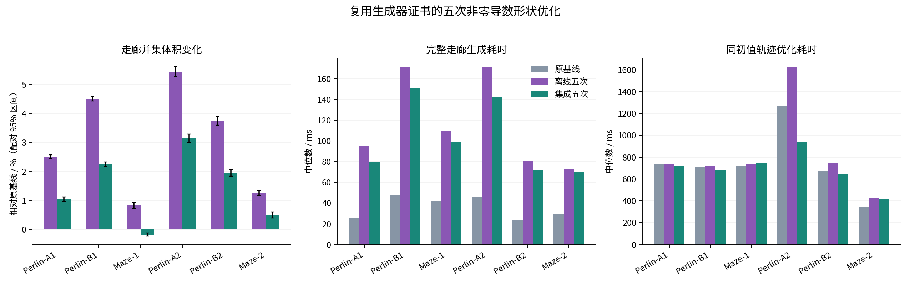

# 五次非零导数优化融入生成流程

2026-11-03。在分支 `experiment/integrated-quintic-shape` 上进行。前一轮五次非零导数与 C² 三次实验已先提交为 `57c3cd2`，本轮继续使用同六条冻结路径，比较原基线、离线五次和集成五次。

后续减少附加形状变量、改进可行步长的实验见[五次形状加速与基线对照](五次形状加速与基线对照.md)。下文保留本轮原始结果。

集成版相对旧离线五次方案，六例生成耗时减少 **4.5%～16.8%**，完整生成时间为 **69.8～151.1 ms**。代价是体积比离线方案小；相对原零导数基线，五例增加 **0.50%～3.14%**，一例减少 **0.18%**。三组轨迹的采样通过数均为 **1/6**。本轮验证了约束复用能省时，但还不能同时改善体积与轨迹质量，默认仍保留原生成器。



## 1. 融入原生成流程的部分

旧离线方案在原生成器返回后，重新从输出构造节点、局部盒和形状标架，重新查询障碍物、建立连续分离平面，再对基线形状做样条投影和约束优化。

现在原生成器可接受一个内部形状阶段。每次膨胀建立证书时，同时记录每个平面的原始法向、界限和适用参数区间；只保留最后一次接受的迭代对应的平面。原中心与截面优化完成后，在返回前把这份平面覆盖交给五次形状优化。

```text
原基线：输入校验 → 路径与节点 → 两轮证书/中心及截面优化 → 输出
离线版：原基线 → 重建节点/局部盒/BVH查询/证书 → 投影 → 五次形状优化
集成版：输入校验 → 路径与节点 → 两轮证书/中心及截面优化
                             └ 保留接受迭代的平面 → 五次形状优化 → 输出
```

输入仍只由原生成器校验，形状阶段消费流程保证有效的数据。取消信号与时间预算贯穿整个生成过程，Newton 每轮检查一次，不在每条约束内重复验证输入。最终支持不等式、C² 接缝和截面正则性仍统一复核。

本轮保留原来的两轮中心与截面优化，以保持与基线相同的中心线和节点。消除的是后处理中的重复几何准备与投影，不是把原来的两个数值优化问题合并成一个求解器。集成版仍有一个新增的五次形状优化阶段，其成本包含在完整生成时间里。

## 2. 直接构造五次初值与复用约束

五次 C² 样条使用内部三重节点。若原形状在每个节点的一、二阶导数为零，则其 B 样条控制矩阵可以直接写为

\[
A_{3i}=A_{3i+1}=A_{3i+2}=M_i.
\]

原来的节点形状依次重复三次，就精确表示同一条曲线。基函数积分权重也有解析式：

\[
w_i=\int_0^1N_{i,5}(u)\,du=\frac{t_{i+6}-t_i}{6}.
\]

因此集成路径不再组装投影 Gram 矩阵、计算投影右端或做投影线性求解。后续仍优化每个控制矩阵的二维对称正定变换 \(S_i\)，形状为 \(M(u)=\sum_iN_i(u)A_iS_i\)，节点导数不再固定。

对复用的每个分离平面及其子区间，中心与形状控制系数满足

\[
n^TC_j+\|D_j^Tn\|_2\le b.
\]

这仍然约束整个参数区间的扫掠体。原生成器中按零导数结构压缩后的二维约束不能直接用于自由导数形状，因此复用的是压缩前的**三维支持平面及其区间**；形状阶段只做一次到当前局部样条基的映射。

复用的平面来自最后一次接受的膨胀迭代，建立时使用的是该次优化前的形状。离线方案则在最终形状上重新建立平面，二者一般不同。这解释了为什么省去重建会改变可扩张空间，而不仅仅改变耗时。

### 一次未采用的热启动小试

另外在 Perlin-A1 上尝试将初始缩放从 0.8 改为 0.98，并只保留障碍参数 0.01、0.001 两阶段；其余目标和约束不变。完整生成中位数从 79.65 ms 降至 78.14 ms，约省 **1.9%**，体积从 428.27 m³ 变为 428.53 m³。几何检查通过，但两阶段都用满 20 步上限，结果也有所变化，收益不够明确。

该试验仅作为小试记录保留，没有扩展成六例轨迹实验，也没有用于下面的主表。最终集成版仍采用 0.8 初始缩放与 1、0.1、0.01、0.001 四阶段，和旧离线版一致。恢复后重编译的生成与轨迹可执行文件哈希均与主实验一致。

## 3. 同输入走廊比较

四条 Perlin、两条 Maze，输入地图、种子路径、世界边界、机器人膨胀与局部扩张范围均与前轮相同。三种方法的中心线采样逐项一致。每例预热一次、正式三次，取完整生成耗时中位数；不计地图加载、体积测量、梯度检查和独立审计。生成阶段的导数检查只放在预热运行。

体积是空间并集体积。每例对三种形状使用共同网格和同一批 QMC 点，八次平移、共 524288 个样本；配对 95% 区间见原始数据和图中误差条。本轮共同网格包含集成版本，个别体积估计与前轮略有不同，但原基线和离线五次的几何保持一致。

| 路径 | 体积 m³：原基线 / 离线 / 集成 | 集成相对基线 | 生成 ms：原基线 / 离线 / 集成 | 集成相对离线耗时 |
|---|---:|---:|---:|---:|
| Perlin-A1 | 423.85 / 434.49 / 428.27 | +1.04% | 25.8 / 95.6 / 79.6 | -16.7% |
| Perlin-B1 | 635.99 / 664.68 / 650.29 | +2.25% | 47.7 / 171.3 / 151.1 | -11.8% |
| Maze-1 | 426.93 / 430.45 / 426.18 | -0.18% | 42.3 / 109.5 / 98.9 | -9.7% |
| Perlin-A2 | 621.57 / 655.43 / 641.11 | +3.14% | 46.2 / 171.2 / 142.4 | -16.8% |
| Perlin-B2 | 482.27 / 500.34 / 491.71 | +1.96% | 23.3 / 80.8 / 72.3 | -10.5% |
| Maze-2 | 360.63 / 365.18 / 362.42 | +0.50% | 29.3 / 73.1 / 69.8 | -4.5% |

所有空间体积查询的未决根数均为零，几何边界独立采样未发现障碍穿透。Maze-1 的体积差为 −0.758 m³，配对 95% 半宽 0.229 m³，不能当成仅由本轮采样误差造成的变化。

六例共 18 次正式运行的各阶段中位数如下。阶段分别取中位数，不相加作为某一例的总时间。

| 新增阶段 | 离线五次 / ms | 集成五次 / ms |
|---|---:|---:|
| 重建连续平面 | 9.00 | 0.00 |
| 初值、基映射与约束准备 | 3.48 | 3.00 |
| 五次形状 Newton 优化 | 55.79 | 51.78 |
| 最终几何验证 | 0.32 | 0.31 |

每例复用 **2292～5790** 个连续平面，集成路径不再执行第二次平面构造。保留平面的记录开销已计入原生成阶段。约束数量和方向变化还会影响 Newton 迭代次数，所以完整节省不等于简单减去平面构造时间；这里不能把全部加速归因于直接初值。

集成版本仍比原基线慢，主要剩余成本是新增形状优化，而非最后的校验。

## 4. 同初值轨迹优化

三组都重新串行运行六条路径；相同初始变量、航点、时间分配以及 FIRI 对照轨迹的哈希逐项核对。仍使用五次最小 jerk 轨迹、每段 16 个积分步、Bézier 深度 2、位置罚权 \(10^5\)、最多 800 次迭代以及 `fast` 截面查询。每次优化都从同一初值开始，预热一次后重复三次。

下表每格顺序为 **原基线 / 离线五次 / 集成五次**。时间仅计 L-BFGS，不含走廊生成。局部残差沿用当前截面反求返回的米制违约量；“采样通过”要求位置残差不超过 5 mm、动力学容差 1%、障碍穿透不超过 \(10^{-6}\) m，且无反求失败。

| 路径 | 优化耗时 ms | 飞行时长 s | jerk 能量 | 局部查询残差 mm | 采样通过 |
|---|---:|---:|---:|---:|---|
| Perlin-A1 | 736.9 / 741.6 / 718.2 | 13.58 / 13.57 / 13.57 | 22.64 / 22.80 / 23.17 | 1.29 / 2.97 / 3.36 | 是 / 是 / 是 |
| Perlin-B1 | 706.1 / 721.4 / 685.1 | 25.30 / 23.69 / 33.74 | 84.43 / 85.85 / 54.41 | 8.50 / 165.29 / 316.55 | 否 / 否 / 否 |
| Maze-1 | 725.2 / 734.6 / 741.8 | 14.75 / 14.92 / 15.07 | 39.22 / 38.70 / 39.49 | 5.03 / 84.94 / 34.61 | 否 / 否 / 否 |
| Perlin-A2 | 1269.7 / 1625.6 / 937.2 | 21.02 / 20.85 / 21.01 | 51.15 / 47.87 / 54.11 | 22.80 / 15.84 / 19.48 | 否 / 否 / 否 |
| Perlin-B2 | 678.7 / 748.8 / 647.9 | 12.77 / 12.77 / 12.75 | 27.46 / 27.17 / 26.73 | 7.60 / 15.44 / 6.31 | 否 / 否 / 否 |
| Maze-2 | 344.0 / 430.6 / 418.5 | 12.56 / 12.66 / 12.83 | 48.53 / 48.00 / 48.60 | 15.94 / 277.77 / 313.02 | 否 / 否 / 否 |

三组的六例初始完整轨迹目标梯度检查全部通过，最大相对误差约 **3.10×10⁻⁸**。优化后仍只有 Perlin-A1 达到采样判定，且这条路径三组都达到 800 次迭代上限；“采样通过”不等于优化已经收敛。各终止状态均保留在原始数据中。

集成版在 Perlin-A2 的优化时间明显缩短，但 jerk 能量高于离线五次，位置残差仍超过 5 mm。Perlin-B1 的飞行时长从离线五次的 23.69 s 增至 33.74 s。其余例子有升有降，因此不能概括为同质量条件下的稳定提速。

独立全根审计继续确认两类问题：

- Perlin-B1 集成版有 4 个局部查询标记点，3 个位于其他截面内，1 个在走廊并集之外；最大约 317 mm 的局部残差点实际上在另一个截面内。
- Perlin-A2 集成版的 16 个标记点中，4 个在其他截面内，12 个在并集之外。
- Maze-2 集成版的 29 个标记点均在并集之外，最大局部残差约 313 mm。

全根审计只复查 CSV 重放中残差超过 5 mm 或查询无效的点，未决根数为零，不替代连续时间轨迹证明。所有轨迹的障碍采样均未发现穿透，原查询也未报告反求失败，但根分支与真正的走廊越界仍影响轨迹质量。

## 5. 验证与资源

- **8/8 回归测试通过**，包含原生成器完整测试、样条库与优化器测试、截面查询，以及集成形状的梯度/Hessian、C²、非零节点导数、空间几何、入口校验和取消行为。
- 集成形状目标的方向梯度误差最大约 **5.00×10⁻¹⁰**，Hessian 向量积误差约 **4.11×10⁻¹¹**；最终支持残差全部为负，C² 接缝误差最大约 **8.0×10⁻⁹**。
- 原基线与旧离线五次的截面 CSV、初始航点、可微走廊轨迹和 FIRI 轨迹，对前轮共 **48 份文件逐字节一致**。三种方法本轮的中心线采样相同，前端初始变量和初始航点哈希相同。
- 构建与实验均串行。构建使用 `-j1`、地址空间上限 **3 GiB**；每个实验进程上限 **512 MiB**、55 s CPU、60 s 墙钟时间。实测生成峰值 RSS **39.5 MiB**，轨迹峰值 **38.3 MiB**。

下一步更值得尝试的是按活跃约束选择性更新分离平面，以较低成本追回离线重建的体积收益；轨迹侧则需要继续处理进度变量与截面分支。两者分别影响生成几何和轨迹约束，后续仍应分开做同输入对照。

实现入口为 `generateIntegratedShape`，轨迹实验使用 `--shape-mode integrated-quintic`；原 `generate` 默认路径不启用这个阶段。旧离线实验仍可使用 `--shape-mode hermite-free` 复现。

原始指标、分阶段计时、输入与可执行文件哈希、梯度结果和独立审计保存在 [results.json](validation/integrated_shape/results.json)。运行方法见 [实验 README](../direct_corridor/experiments/shape_spline/README.md)。
