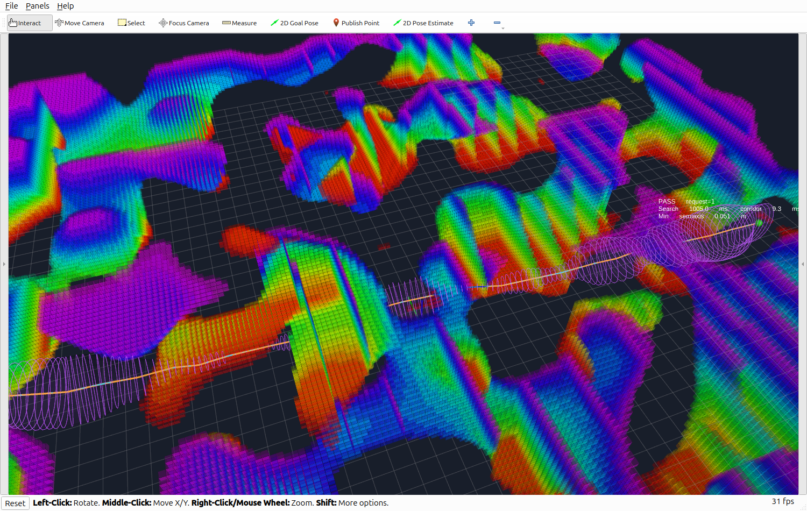
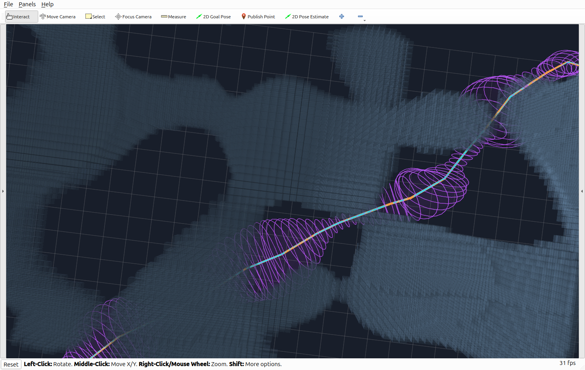

# GCOPTER 原始地图 → 路径搜索 → 直接可微走廊

> 历史阶段记录：以下实现或计时对应旧版 B 样条/离线实验。当前主生成器和 ROS 演示已使用 [五次 Hermite](五次Hermite走廊.md)，最新结果见 [验证报告](Hermite走廊验证.md)。交互启动方式保持一致。


2026-11-02，分支 `feat/bspline-differentiable-corridor`，基于 `Bziyue/GCOPTER` 的 `ros2` 提交
`5f44faf88c486cb39dbd087afa3dbfb837fad05d`。本页记录实际构建、原地图批量验证和 RViz2 交互验证。

## 接入结构

```text
原 mockamap_node ── /voxel_map ── 原 VoxelMap 量化 ── 占据体素外接球 BVH
                                                        │
RViz2 选起点/终点 ── 原 sfc_gen::planPath / InformedRRTstar ┤
                           │                            │
                           └── 种子折线 ── generate() ──┘
                                             │
                         C² B 样条椭圆走廊、系数、参考线、耗时
```

- 原地图生成算法保持不变，提供原 Perlin 地图和原 type=3 迷宫。地图坐标系为 `odom`。
- 搜索调用原 `sfc_gen::planPath()`，算法仍为 OMPL `InformedRRTstar`。新增可选闭线段碰撞回调、可选扩展距离，拒绝只接近目标的 approximate solution，并在搜索前清空输出。原调用者默认继续使用 OMPL 的离散校验。
- 新演示对占据体素使用半径 `sqrt(3)*resolution/2` 的实体球，对整条搜索边作精确球距离检查，与走廊使用同一地图几何。所有占据体素都进入索引，不只抽取表面。
- 搜索额外预留 `reference_clearance=0.2 m`，以给折线圆滑留出空间；走廊使用机器人半径 `0.2 m` 和安全余量 `0.05 m`。这比原有离散体素搜索更保守，因此可通行性不能直接等同于原示例。
- 地图重复发布同一内容时复用索引、保留已选端点与结果。地图变化或无效新地图会清除旧结果；搜索/生成失败不显示历史走廊。
- 本演示直接调用 `generate()`，不经过 FIRI，不生成凸多面体。原 MINCO 轨迹优化器未改造为使用此走廊。

入口：[演示节点](../gcopter/src/direct_corridor_demo.cpp)、[搜索地图适配器](../gcopter/include/gcopter/direct_search_map.hpp)、[launch](../gcopter/launch/direct_corridor.launch.py)、[RViz 配置](../gcopter/config/direct_corridor.rviz)。

## 构建和启动

需要 ROS2 的 rclcpp、RViz2、PCL 转换支持，以及 Eigen3、OMPL、CMake、colcon。当前机器为 ROS2 Lyrical / GCC 15.2.0 / AMD Ryzen 7 9700X；没有宣称已在其他发行版测试通过。

系统已安装 OMPL 时，在仓库根目录构建：

```bash
source /opt/ros/<distro>/setup.bash
MAKEFLAGS=-j1 CMAKE_BUILD_PARALLEL_LEVEL=1 prlimit --as=4294967296 -- colcon build --cmake-clean-cache --packages-up-to gcopter mockamap --executor sequential \
  --cmake-args -DCMAKE_BUILD_TYPE=Release
gcopter/tools/run_direct_demo.sh
```

当前机器未修改系统依赖，OMPL 1.6.0、ODE、CCD 的发行版 deb 已解包在 `.scratch/ompl/usr`。
本机完整构建命令为：

```bash
cd /home/zdp/ForCodex/GCOPTER
source /opt/ros/lyrical/setup.bash
export LD_LIBRARY_PATH="$PWD/.scratch/ompl/usr/lib/x86_64-linux-gnu:${LD_LIBRARY_PATH:-}"
MAKEFLAGS=-j1 CMAKE_BUILD_PARALLEL_LEVEL=1 prlimit --as=4294967296 -- colcon build --cmake-clean-cache --packages-up-to gcopter mockamap --executor sequential \
  --cmake-args -DCMAKE_BUILD_TYPE=Release \
  -DCMAKE_PREFIX_PATH="$PWD/.scratch/ompl/usr;/opt/ros/lyrical"
```

启动脚本自动加载本仓库 `install/setup.bash`，存在上述本地依赖时自动加入运行库路径。
在只有一个 `/opt/ros/*` 安装且尚未加载 ROS 时也会加载它；多个安装需先手动 source 目标发行版。
Wayland 环境默认使用 Qt 的 xcb 后端。`ROS_DOMAIN_ID` 等已有环境设置保持有效。

```bash
# 原 Perlin 地图，默认搜索预算 0.5 秒
/home/zdp/ForCodex/GCOPTER/gcopter/tools/run_direct_demo.sh

# 原迷宫，给 RRT* 3 秒搜索预算
/home/zdp/ForCodex/GCOPTER/gcopter/tools/run_direct_demo.sh scene:=maze search_timeout:=3.0

# 无界面运行；其余参数见 --show-args
gcopter/tools/run_direct_demo.sh rviz:=false output_dir:=/tmp/direct_demo_results
```

每组 launch 请使用不同 ROS domain，或者先停止上一组，避免地图和选点话题串扰。原 `global_planning` 可执行程序也已构建成功；它与此演示应分别运行。

## RViz2 操作

1. 等待 `WAITING_FOR_START`。点击工具栏 **2D Goal Pose**，在自由区域按下、拖动、松开，选择起点。
2. 再用一次 **2D Goal Pose** 选择终点，触发搜索和走廊生成。绿色球为起点，红色球为终点。
3. 橙色是原搜索折线，青色是 B 样条中心线，紫色是椭圆截面与半透明扫掠面。文字显示搜索、走廊、总耗时和采样最小短半轴。
4. 一组完成后再次选点开始下一组。**2D Pose Estimate** 可随时重新指定起点。碰撞点或地图外点会显示 `INVALID_POINT`，有起点时可重新选择终点。

默认两端高度均为 `2.5 m`，箭头只用于选位置。**搜索本身仍是三维搜索，中间路径可能升降。**
使用 `height:=1.5` 修改固定端点高度；使用 `height_mode:=arrow` 时，箭头姿态的 `abs(q.z)` 在上下边界安全内缩范围中映射端点高度，与原示例的交互思路一致。
`Publish Point` 使用消息的真实 xyz；点在障碍表面时会因净空不足被拒绝。

```bash
# 在同一个 ROS domain、已 source 的终端中清空端点和显示
ros2 topic pub --once /direct_demo/reset std_msgs/msg/Empty '{}'
ros2 topic echo /direct_demo/metrics
ros2 param get /direct_demo session_dir
```

`/direct_demo/seed`、`reference` 为 `nav_msgs/Path`；`corridor`、`selection` 为 `MarkerArray`；
`controls` 为每行九个数的 B 样条系数；`status` 和 `metrics` 为字符串，后者内容是 JSON。输出 QoS 为 reliable/transient-local。

每次启动建立独立 `run_*` 目录，地图快照为 `map_N.xyz`，每次请求有 `request_N/metrics.json`、`seed.xyz`，成功时另有 `reference.xyz`、`controls.csv`。
地图快照是量化后的占据体素中心，球半径可由 metrics 中的 resolution 还原。系数格式与 [模块说明](../SweepCorridor/README.md) 相同。

## 原地图批量结果

地图 seed=1024、分辨率 0.25 m、搜索 seed=7、扩展距离 2 m、控制间距 0.4 m、控制半轴范围 [0.03,1.5] m、生成预算 1000 ms。
两幅地图各建一次 BVH 后复用，使用实际 mockamap 和原 RRT*，通过与 RViz 相同的选点话题触发。批量测试关闭 RViz 渲染。
固定随机种子不能保证时间受限的 RRT* 在不同负载下得到完全相同的路径。

| 场景 | 实体体素数 | 连通请求 | 走廊耗时中位 / P95 / 最大 ms | 搜索中位 ms | 节点总耗时中位 ms |
|---|---:|---:|---:|---:|---:|
| 原 Perlin，50×50×5 m | 239999 | 12/12 成功 | 12.89 / 18.32 / 19.74 | 500.58 | 516.81 |
| 原 maze，30×30×5 m | 184320 | 12/12 成功 | 9.20 / 12.58 / 13.29 | 3028.10 | 3038.97 |

Perlin 路径长 40.04–81.95 m，26–54 个搜索顶点，最多 **23 处超过 30° 的转弯**，中间高度跨度最高 3.99 m。
迷宫路径长 30.62–43.15 m，22–34 个顶点，最多 5 处超过 30° 的转弯。各场景含不同端点高度以及路径反向测试，每组正反向重复两轮。

迷宫另测 **4 次不连通请求**，全部返回 `SEARCH_FAILED` 且清空旧系数/显示。此 seed 的原生成器确实包含一个孤立房间：测试先确认墙体贯穿所有 z 层，再对原始自由体素做八邻域连通分量检查，证明这组端点属于不同分量。
该连通检查只用于分类测试端点，**没有用它生成或替换 RRT* 的种子路径**。对一般地图，`SEARCH_FAILED` 只表示预算内未获得精确路径，不能单凭超时证明无路。

每次成功结果均用独立 Python 重建 B 样条，检查 **401 个截面 × 24 个角度 × 3 个径向层 = 28872 个样本**，直接对原始占据体素球计算距离，扣除机器人半径和安全余量。
两场景的最小采样剩余间隔分别为 0.02716 m / 0.02488 m；全部端点、地图边界检查通过。密集采样是额外排错，连续安全性仍依据模块的支撑平面与非退化证书。

两场景还验证了：1 Hz 重复地图不擦除已完成结果；无效点清空旧输出；显式重设起点；reset 清空。
此次全仓库构建的三个包成功，核心 CTest 1/1、原 RRT* 闭线段/近似解拒绝 CTest 1/1 通过。

时间口径：走廊耗时包括核心校验、优化和连续验收；地图量化/BVH 构建各为 41.74 / 33.74 ms，单独计时且不计入每次请求。
`total_ms` 包含搜索、生成、显示消息构造及主要快照导出，不包含 RViz GPU 渲染、ROS 传输、最后的 metrics 文件落盘和状态发布。
RRT* 按预算持续改善路径，因此当前端到端延迟主要由 0.5 / 3 秒搜索预算决定，**不能把走廊十余毫秒称为完整规划十余毫秒**。

## RViz2 实际窗口验证

实际打开 RViz2，向其窗口发送两次工具栏 `2D Goal Pose` 的鼠标按下/松开事件，RViz 日志确认发布了起终点：
`(19.785,-1.60157,2.5) → (-22.8094,-0.86236,2.5)`，节点返回 PASS。
该次搜索 1005.00 ms、走廊 9.31 ms、总计 1016.64 ms，使用 1 秒搜索预算。
随后通过同一输入话题显示另一条斜跨地图的复杂路径，搜索 1010.81 ms、走廊 46.74 ms、总计 1063.31 ms；GUI 运行时的这两次结果不混入上述关闭 RViz 的批量统计。



截图只是显示证据，不作为碰撞验证。RViz 可用鼠标调整视角、缩放，当前默认采用灰蓝色地图便于观察紫色走廊。

下面是第二条复杂路径的局部视图，可观察折线与平滑中心线，以及横截面随局部净空变化的形状：



## 复现与证据

```bash
source /opt/ros/lyrical/setup.bash
source install/setup.bash
# 本机使用本地 OMPL 时，还需上面的 LD_LIBRARY_PATH。
python3 gcopter/tools/test_direct_demo.py --scene perlin --search-timeout 0.5 \
  --domain 169 --repeats 2 --output .scratch/interactive/perlin_replay
python3 gcopter/tools/test_direct_demo.py --scene maze --search-timeout 3.0 \
  --domain 170 --repeats 2 --output .scratch/interactive/maze_replay
ctest --test-dir build/gcopter --output-on-failure
ctest --test-dir build/SweepCorridor --output-on-failure
```

测试脚本依赖 rclpy、numpy，会自动启动和关闭对应 launch，并生成实际端点、地图内容 SHA256、逐请求指标和独立采样结果。不要与其他进程共享其测试 domain。

保留在仓库中的原始指标与输入：[Perlin](validation/direct_demo_perlin.json)、[迷宫](validation/direct_demo_maze.json)、[端点和地图指纹](validation/direct_demo_inputs.json)。
被测核心、接入节点和测试脚本的 [源文件 SHA256](validation/direct_demo_sources.json) 用于区分本地修改与上游基线。
本机完整快照、种子、系数、日志分别在 `.scratch/interactive/perlin_final/`、`maze_connected/`、`rviz/`。
探索阶段的 `.scratch/interactive/perlin/`、`maze_final/` 保留原记录，未混入本表；首次迷宫测试还记录过不连通端点搜索失败，随后才将其作为明确的负例。

本实现为静态占据地图演示，未观测/未列出的体素按自由空间处理；采用同步单线程回调，没有抢占取消。
固定端点净空不足、极端回折、资源上限等仍可使生成失败；不保证任意路径都成功，也不保证走廊全局无自交。
采样最小短半轴在 Perlin / 迷宫分别约 0.038 / 0.035 m，说明部分瓶颈较窄；它是机器人中心可行域的横向余量，机器人本体已在碰撞膨胀中计入。
这完成了地图→搜索→走廊的验证，不包含轨迹动力学优化、控制器或实机飞行。
