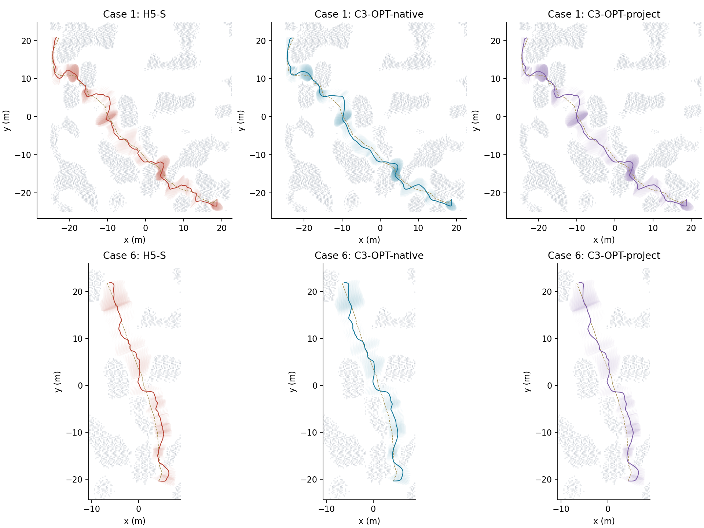
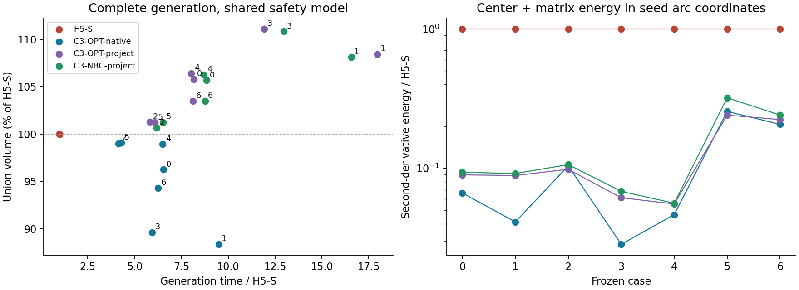
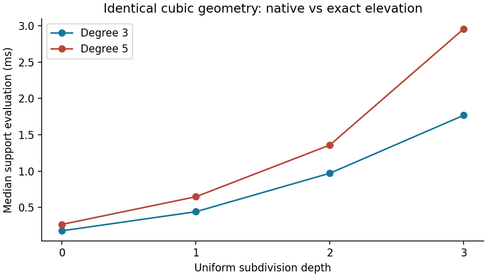
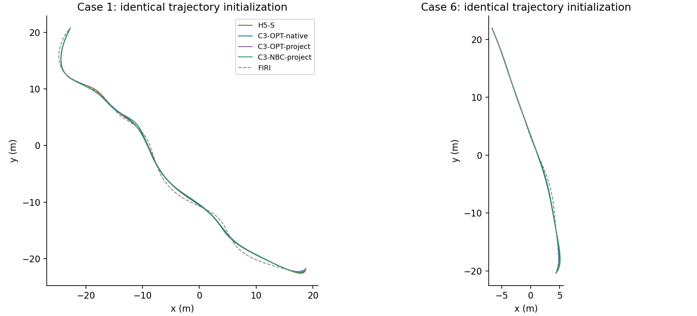

# 原生三次与最小 jerk 走廊实验

本实验以 `ros2@15c70cd` 的五次 Hermite `smooth`（H5-S）为基线，在
`experiment/native-cubic-minjerk` 分支开展。生产生成器和 ROS 默认入口保持原样。
实验实现集中在 `direct_corridor/experiments/native_splines/`。

本文保留首轮结果。后续原生三次生成、体积恢复与查询加速的实现和同输入实测，
见[原生三次走廊性能优化实验](原生三次走廊性能优化实验.md)。

## 首轮结论（七例开发集）

**三次能够生成连续认证、更加平滑的走廊，但当前实现还没有在生成速度上超过 H5-S。**
原生初始化的三次在轨迹验收上表现较好；从 H5-S 投影再优化的三次获得了更大的
并集体积。这两个收益来自不同的方案，目前还没有一个方案同时赢得所有指标。



图为俯视投影，灰色障碍绘制中间高度切片，虚线为输入种子路径。上下两行分别
对应较长的 Perlin 路径和此前保存的 RViz 路径。颜色区域来自实际控制系数，
没有为了出图重新拟合几何。



后文保留完整研究计划。本轮实际完成了基线冻结、固定节点表示对照、原生三次
生成器、H5 投影初始化、投影后的自然端点消融，以及同初值的公共轨迹比较。
Q5-C 联合优化、导数消元、大规模留出测试及完整参数扫描仍属于后续阶段。

## 研究问题

我们比较的是同一安全模型下的完整计算成本和几何质量。三次每段只有四个
Bézier 控制截面，Jacobian 证书只有九个系数；但控制变量影响四个相邻区间，
线性系统比当前五次的两节点耦合更宽。是否值得替换，取决于这些成本的实测总和。

统一模型为 $F(u,z)=c(u)+M(u)z$，$\|z\|_2\le1$。
世界坐标下的 $c,M$ 都必须是被声明次数的多项式，不能在求值时额外归一化标架。
相同地图使用边长 0.25 m 的体素外接闭球，机器人半径 0.20 m，安全余量
0.05 m，证书余量 0.002 m，局部扩张 3 m，长种子边按 7 m 切分。
主配置节点间距 0.40 m。H5-S 的平滑配置为 `1.5 / 0.2 / 0.01`，
开启全截面 Jacobian，首轮 Newton 预算为 8。

## 分组和比较层次

| 组 | 表达与用途 |
| --- | --- |
| H5-S | 当前五次 smooth，主基线 |
| H5-Z | 固定节点形状一、二阶导数为零，历史对照 |
| C3-I | 相同节点值的无约束自然三次，只作诊断 |
| C3-OPT | 原生三次 B 样条，中心偏移和 SPD 形状联合受约束优化 |
| C3-NBC | C3-OPT 加中心及形状二阶端点导数为零 |
| Q5-U | 相同节点值、自由端点导数的无约束最小 jerk，只作诊断 |
| Q5-T | 最小 jerk 导数提议，经连续证书限制，仍为五次 |
| Q5-C | 节点值与共享一、二阶导数联合优化 |

另设 `H5-C3-T`：将自然三次导数作为目标，在五次空间内修正。它与现有
smooth 的思想相近，不能将它当作受约束的三次样条。

1. **A：固定节点表示。** 同一 H5-S 的节点值和参数，比较重构、能量、过冲、
   C²、障碍支持证书和 Jacobian。固定同一三次曲线，精确升阶到五次，比较
   两种表示在 0、1、2、3 层细分下的支持上界与耗时。
2. **B：完整生成。** 同一种子折线，各方法独立初始化、生成约束、优化、认证。
   H5 投影初始化单独列出，包含 H5 生成耗时；原生初始化不依赖 H5。
3. **C：最终轨迹。** 同一个最小 jerk 优化器、初始变量、动力学和停止条件。
   三次可精确升阶进入现有查询接口，适配成本单列；这不能用于推断原生三次查询速度。

## 数学实现

三次使用 clamped 非均匀节点和简单内节点。每个控制点五个变量：二维中心
偏移，以及对称正定的 $2\times2$ 形状矩阵。固定运输标架 $F_i$ 后，
$c=\sum N_i(r_i+F_id_i)$，$M=\sum N_iF_iS_i$。端点中心固定。
积分权重 $w_i=\int N_i=(t_{i+4}-t_i)/4$，不把控制点密度误当成体积权重。

每段精确提取四个 Bézier 控制截面；约束
$n^TC_j+\|D_j^Tn\|\le b$ 可证明整个截面扫掠位于该半空间。
失败区间采用 de Casteljau 细分。固定平面时这些是凸 SOC 约束。
目标为负加权 logdet、中心偏移惩罚、中心和形状的二阶导数积分。
二次能量预先装配，三次 Hessian 的控制点块半带宽为 3。

全截面 Jacobian 为
$J_{\min}=(M_0\times M_1)^Tc'-\|M'^T(M_0\times M_1)\|$。
三次产生八次 Bernstein 锥多项式，五次产生十四次。固定平面的凸优化并不
消除此条件的非凸性。候选必须完成连续证书，必要时向可行解回退。
局部 Jacobian 正定与远距离扫掠不重叠是两个不同指标。

Q5-C 的节点状态为九维世界几何通道，共享一、二阶导数增加 18 个变量。
最小 jerk 正则为 $\int\|Y'''\|^2du$；比较显式稀疏优化、固定值时的
最小能量消元和导数提议。消元后不预设 Hessian 仍为原来的块三对角。
自由端点最小 jerk 的自然边界来自变分条件，不能用零速度、零加速度代替。

## 实验顺序与验收

| 阶段 | 工作及验收 |
| --- | --- |
| 0 | 冻结七条已保存路径、地图 SHA256、源码、编译器、配置及 H5-S 输出；保留 FIRI 辅助结果 |
| 1A | 固定节点的三次/五次表示、升阶和细分对照；独立核对导数、C²、能量和证书 |
| 1B | 原生三次几何 API；非均匀提取、九系数 Jacobian、版本化原生四行输出 |
| 2 | 原生/投影初始化，带状 Newton、梯度与 Hessian-vector 检查，完整成功/失败记录 |
| 3 | Q5-C、Q5-T 和消元策略比较，报告真实终止状态 |
| 4 | 七例重复测量，再扩展历史路径及独立留出场景 |
| 5 | 参数消融、相同自由度与各自 Pareto 前沿 |
| 6 | 通过安全门槛的模型接入公共轨迹后端 |

开发集来自 `inputs.json`，不重新搜索路径。七例每种方法预热一次、正式七次，
串行运行；峰值 RSS 与完整耗时序列入报告。历史 26 条路径用于回归，独立
场景按地图随机种子划分，目标不少于 100 组。人工例包括直线、90°/U/S 转弯、
螺旋、窄口、突变半径、急转弯、退化轴比和远距离重叠。

体积采用去重扫掠并集，同一采样域和 Sobol 序列，8 次随机平移，每次
65,536 点。接近 1% 的差异增加样本并报告配对区间。失败样本进入总体分母。
诊断组无论体积多大，都不能在未认证时进入安全性能排名。

计时分为地图索引、初始化、基函数/提取、障碍查询、分离平面、连续证书、
Hessian 组装、分解/回代、导数处理、最终复核。热路径与冷启动分别报告。
记录变量/约束数、迭代状态、回退、细分、最小半轴、种子弧长坐标下的能量、
Jacobian 裕量，以及 section/evaluate/反求成本。

消融覆盖自然端点、二维能量权重扫描、形状导数、Jacobian（仅诊断关闭）、
细分策略、固定/自适应间距、相同变量数、带状/稀疏求解、初始化方式和标架。
间距扫描 0.3/0.4/0.5/0.6 m；所有配置使用相同最终可行性容差。

## 首轮实现与验证范围

三次模型直接保存每段四行 Bézier 控制量，输出格式为
`native_sweep_v3_degree_explicit_bezier`。三次与五次都使用同一障碍球模型、
世界边界和局部扩张范围。原生生成器从种子路径的 Greville 控制位置和小截面
开始，不调用 H5-S 或 FIRI。投影组先生成 H5-S，再求自然三次和可行控制点，
其完整计时包含 H5-S。自然端点组在投影组上增加世界坐标的二阶端点约束，
以小型 Schur 系统实现。

固定分离平面的子问题使用加权 logdet、中心偏移正则，以及种子路径弧长坐标
$s=Lu$ 下的二阶导数能量。中心调整后，这个坐标不等同于输出中心线的弧长。
本轮 $\lambda_c=\lambda_M=10^{-4}$，中心偏移
权重为 $10^{-3}$。SOC 使用光滑 Lorentz 对数障碍，固定带宽 Cholesky
求解 Newton 步。连续 Jacobian 失败时，先在失败区间增加固定法向的导数
SOC 约束，再重新求解；最后仍以完整 Bernstein 锥证书接受结果。

自然三次和无约束最小 jerk 使用相同的九维节点值。最小 jerk 求解器释放
端点一、二阶导数，并通过仓库中最新 `QuinticSplineND<9>` 的重构和能量
对照验证。它的自然边界是三、四阶导数为零，不是速度、加速度为零。

两个诊断组需要与计划中的完整方法区分：`H5-Z-fixed` 是在 **当前 H5-S
节点值** 上把形状导数归零，尚未重跑历史 H5-Z 生成器；`H5-C3-T` 和 `Q5-T`
在本轮使用一个全局导数调整比例，尚未实现计划中的逐节点局部裁剪。
它们不能代表 Q5-C 的联合优化能力。

验证结果如下：

- 七例 H5-S 的所有控制系数与 `15c70cd` 留存结果逐项一致，最大差为 0。
- 三个受约束三次组均为 7/7 连续支持证书和全截面 Jacobian 通过。
- 真实输入上的目标方向梯度相对误差不超过 $4.4\times10^{-8}$，
  Hessian-vector 误差不超过 $4.9\times10^{-10}$。
- NumPy 独立重建多项式、SciPy 最近障碍球检查未在已认证候选中发现采样碰撞。
  三次候选按种子弧长缩放的 C² 接缝误差不超过 $1.6\times10^{-11}$。
- 新增四组数学/优化器/场景测试和现有八组回归测试全部通过。新增测试覆盖
  非均匀提取、de Boor 对照、导数、细分、升阶、完整 Jacobian、带状求解、
  自然边界和迁入样条库对照。直线、90° 转弯、U 形、竖直、螺旋及靠近的非相邻路径段均得到认证输出；精确折返尖点和 0.03 m 净空窄口明确失败且不输出走廊。

## 表示、连续证书与过冲

七例中，自然三次和无约束最小 jerk 都通过了完整 Jacobian，却都无法通过
连续几何安全认证。更换分离面后仍然失败。独立采样找到了真实见证：自然
三次在六例中进入膨胀障碍球，最深约 7.1 cm；最小 jerk 在七例中进入障碍，
最深约 10.2 cm。两组也有地图边界越界。因此，这些失败不只是原支持平面的
保守性，光滑能量本身确实不能替代安全约束。

| 固定节点表示 | 构造中位数 | Jacobian 认证中位数 | 连续几何安全 |
| --- | ---: | ---: | --- |
| H5-S | 已生成，复制不计为构造收益 | 0.0688 ms | 7/7 |
| 自然三次 C3-I | 0.0176 ms | 0.0276 ms | 0/7 |
| 无约束最小 jerk Q5-U | 0.0629 ms | 0.0688 ms | 0/7 |

上述 Jacobian 计时的几何不同，仅用于展示该阶段的实际成本。下面的升阶实验
则严格固定同一条三次曲线，只改变 Bézier 表示和细分深度。



原生三次的支持计算较便宜，但升阶后的控制凸包可能更紧。原始的全部支持
上界、失败约束数和七次耗时序列保存在各例 `rows.jsonl` 的 `elevation` 行。
这两种现象可以同时成立，不能把“次数较低”与“更不保守”等同起来。

## 完整生成

下表由脚本生成，包含原生与投影两种初始化。体积使用同一个采样域和
随机化 Sobol 序列；百分比后的区间是配对 QMC 的 95% 区间。每种方法
预热一次、正式七次；表内为热生成中位数，BVH 构建在原始结果中单列。
投影组计入 H5-S 成本。每例的冷启动估计可用 `index_ms + median_ms` 得到，
文件读取不计入这两个阶段。

场景 0、3 来自 `rviz` 的请求 1、2；场景 1、4 来自 `perlin_final` 的请求
10、5；场景 2、5 来自 `maze_connected` 的请求 10、4；场景 6 是
`polished_rviz` 保存的请求 1。完整路径和哈希保存在冻结清单中。

| 场景 | H5-S / ms | 原生三次 / ms | 原生体积变化 | 投影三次 / ms* | 投影体积变化 |
| --- | ---: | ---: | ---: | ---: | ---: |
| 0 | 27.28 | 178.22 | -3.77% ± 0.16% | 222.76 | +5.76% ± 0.14% |
| 1 | 49.70 | 471.43 | -11.65% ± 0.14% | 892.94 | +8.42% ± 0.16% |
| 2 | 43.00 | 177.99 | -1.01% ± 0.04% | 249.97 | +1.26% ± 0.04% |
| 3 | 48.94 | 290.35 | -10.40% ± 0.16% | 583.26 | +11.09% ± 0.15% |
| 4 | 24.33 | 158.22 | -1.06% ± 0.04% | 195.12 | +6.41% ± 0.05% |
| 5 | 29.02 | 124.51 | -0.91% ± 0.04% | 176.55 | +1.21% ± 0.06% |
| 6 | 29.07 | 181.35 | -5.71% ± 0.11% | 235.89 | +3.46% ± 0.17% |

*投影组包含 H5-S 的生成成本；± 为配对 QMC 的 95% 区间。场景 2、4、5 已提高至 8 × 262,144 个样本，其余为 8 × 65,536。


自然端点没有带来一致的额外体积收益。它通常增加线性求解成本，但在某些
案例中也改变了 Jacobian 修复次数，完整耗时并非总是更大。详细数据保留在
`C3-NBC-project` 行中。

首版三次的主要瓶颈是 Hessian 组装：原生和普通投影组分别约占自身生成时间
的 75% 和 77%，带状求解约占 3%。自然端点组的求解占比增加到约 11%。
这些比例是逐例、逐次占比的中位数。当前约束装配将局部关联按最多 20 个标量
处理，还有利用提取矩阵实际零结构的空间。首批已有等价支持平面去重和稀疏
带状存储，但尚未做到当前 H5-S 优化器的实现成熟度。

本轮各三次组最后一阶段均返回 `iteration_limit`。这里的生成成功表示输出
通过连续证书，不表示 Newton 已达到收敛精度。所有额外修复、初始化和回退
都包含在完整耗时中；`cover_ms` 包含查询和分离阶段，不能与它们重复相加。
整个生成与体积测量进程的最大 RSS 约为 65 MiB，运行没有设置内存上限。

## 同初值轨迹优化

所有候选进入同一个五次最小 jerk / SplineOptimizer 后端。三次几何经过精确
升阶接入旧查询接口，轨迹初始航点、时长、优化变量、动力学和惩罚权重完全
相同，七例的 `initial_hash` 均一致。每组预热一次、正式三次，最多 800 步。
完整耗时使用关闭逐调用计时器的运行；细粒度 profiling 另行保存。

| 方案 | 优化耗时 / ms（七例中位数） | 稠密采样验收 | 目标值比 H5-S（中位数） |
| --- | ---: | ---: | ---: |
| H5-S | 820.3 | 2/7 | 1.00000 |
| C3-OPT-native | 811.8 | 5/7 | 0.99972 |
| C3-OPT-project | 830.3 | 3/7 | 0.99657 |
| C3-NBC-project | 809.0 | 4/7 | 0.99776 |
| H5-C3-T | 837.1 | 3/7 | 1.00007 |
| FIRI | 121.0 | 3/7 | 1.05468 |


这里的验收沿用公共后端的稠密采样标准：最多 5 ms 的时间采样，走廊径向和
平面误差不超过 5 mm、无采样障碍侵入，并满足速度、角速度、倾角和推力的
既有容差。它不是连续轨迹安全证明。多数案例仍达到 800 步上限，原始 L-BFGS
终止码保留在数据中。

原生三次的通过数从 2/7 增加到 5/7，主要改善了若干案例的走廊残差；
投影三次虽然体积更大，通过数为 3/7。两者的轨迹优化时间总体接近 H5-S，
这轮数据没有证明稳定的优化加速。三次在本轮仍使用升阶后的公共反求接口，
尚未获得原生四控制点查询可能带来的计算收益。



图展示优化器输出的轨迹，是否通过验收以数据表为准。`runs.jsonl` 中历史字段
`method=hermite` 代表公共可微走廊后端，实际几何由 `shape_mode` 和 `shape_degree`
区分。该文件的 `corridor_ms` 是冻结几何读取、认证和适配时间，完整走廊生成
耗时应读取上一节的数据。

## 下一阶段

这轮值得保留的结论是：降低次数确实减少了部分证书成本；连续安全的三次
表示可行；几何平顺性有机会改善轨迹可行性；体积、平顺性与耗时需要分别看。
目前继续保留 H5-S 为默认生成器。

下一步优先优化控制约束的稀疏装配和 Jacobian 修复的热启动，并实现原生
三次 section/反求查询，再考虑扩大统计样本。Q5-C 的世界坐标共享导数联合
优化、显式与消元求解、原生初始化的自然端点、相同变量数比较、二维正则
扫描、历史 26 条路径、100 组留出场景和全局重叠统计尚未完成。
本轮是七例开发集实验，不能据此给出泛化成功率或宣称三次参数化必然更慢。

## 复现与文件

完整记录在 [results.json](validation/native_splines/results.json)，输入和基线源码
哈希在 [frozen_manifest.json](validation/native_splines/frozen_manifest.json)，独立
几何检查在 [independent_audit.json](validation/native_splines/independent_audit.json)。
各例保留全部耗时行、显式次数控制系数和支持平面；轨迹 CSV 使用 gzip 归档。
地图快照保留在本地 `.scratch/native_splines/frozen/`，通过 SHA256 核对。

```bash
cd /home/zdp/ForCodex/GCOPTER
python3 direct_corridor/experiments/native_splines/freeze.py
cmake -S direct_corridor/experiments/native_splines \
  -B .scratch/native_splines/build -DCMAKE_BUILD_TYPE=Release \
  -DNATIVE_SPLINE_TRAJECTORY=ON \
  -DCMAKE_PREFIX_PATH="$PWD/.scratch/ompl/usr"
cmake --build .scratch/native_splines/build -j1
ctest --test-dir .scratch/native_splines/build --output-on-failure -j1
python3 direct_corridor/experiments/native_splines/run.py --native \
  --output .scratch/native_splines/final
python3 direct_corridor/experiments/native_splines/trajectory.py
python3 direct_corridor/experiments/native_splines/compare.py
```

仅做快速检查可使用 `run.py --native --cases 0 --repeats 1 --samples 0`。
`trajectory.py --profile --output .scratch/native_splines/trajectory_profile` 单独采集
细粒度计时。独立 Python 检查需要 NumPy 和 SciPy，出图还需要 Matplotlib；
当前环境的 SciPy 使用下载到 `.scratch/native_splines/audit_dependencies/`
并解包的系统包，不修改系统安装。

```bash
PYTHONPATH="$PWD/.scratch/native_splines/audit_dependencies/usr/lib/python3/dist-packages" \
  python3 direct_corridor/experiments/native_splines/independent_audit.py
```

接近 1% 的体积差另用 `native_volume_refine` 增加共同样本数。示例中的 seed
路径应取冻结 manifest 对应条目：

```bash
.scratch/native_splines/build/native_volume_refine \
  /path/to/frozen/seed.xyz .scratch/native_splines/final/case_02 262144
```
