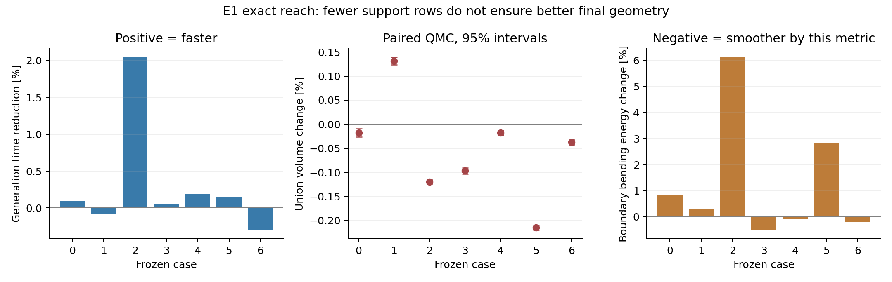
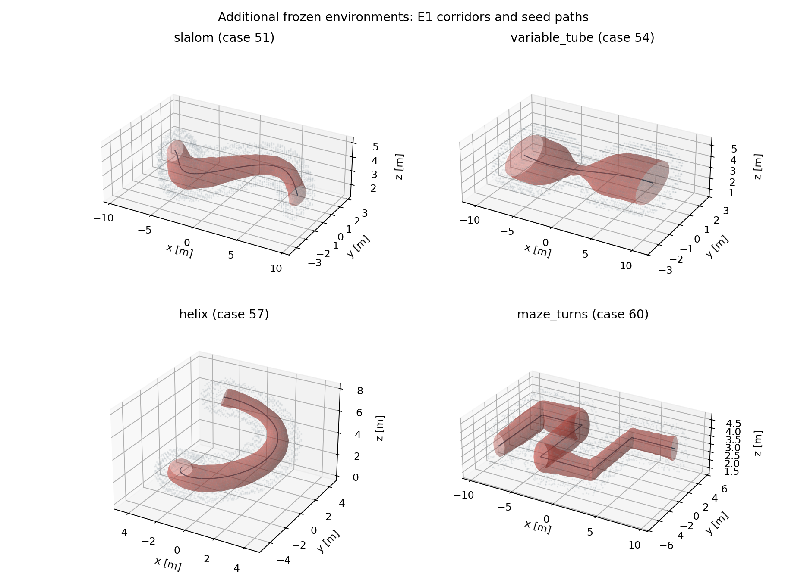
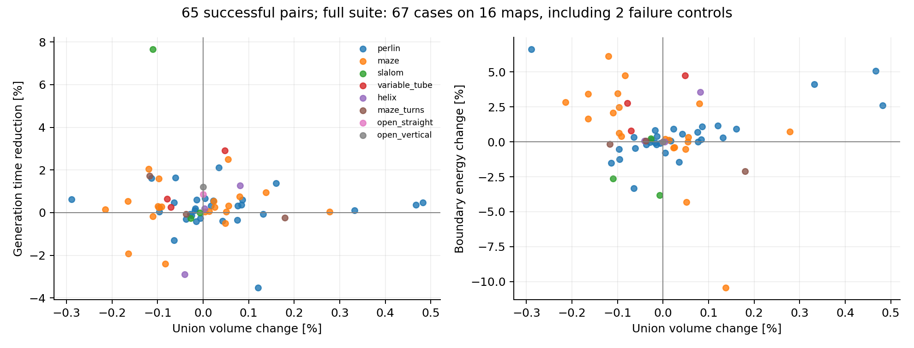

# 原生三次走廊 E1：精确可达域冗余界实验

2026-11-04 · `experiment/native-cubic-minjerk`

**E1 已实现并完成对比，目前保留为实验选项。** 新界能够证明更多支持约束冗余，但在相同迭代预算下，生成速度、并集体积与边界平滑性没有同时改善，因此本轮保持原 Balanced 默认配置。

[下一阶段方案](原生三次走廊下一阶段改进方案.md)及图表已先提交为 `f920f42`。本轮在该提交之后冻结基线二进制；其生成算法与 `0990161` 相同。后续 E1 代码、原始测量和输入哈希独立保存。

## 1. 实现了什么

控制截面组满足

$$
c=c_{\rm ref}+\sum_i A_i d_i,\qquad M=\sum_i A_iS_i,
\qquad \|d_i\|\le D_i,\quad \ell I\preceq S_i\preceq uI.
$$

对残差方向 $e$，记 $v_i=A_i^\top e$。把旧的三角上界替换为

$$
h(e)=e^\top(c_{\rm ref}-c_0)+\sum_iD_i\|v_i\|
+\frac{u-\ell}{2}\sum_i\|v_i\|
+\frac{u+\ell}{2}\left\|\sum_iv_i\right\|.
$$

所有形状矩阵共享同一个截面参数 $z$，因此向量和中发生的抵消可以保留。固定端点的偏移取 $D_i=0$；如果固定偏移非零，先将其常量贡献吸收到参考中心。

改动集中在 [support_pruning.cpp](../direct_corridor/experiments/native_splines/support_pruning.cpp) 和 [support_reach.hpp](../direct_corridor/experiments/native_splines/support_reach.hpp)。已有二维候选搜索、保留顶点见证及连续工作集继续使用。删行结果同时用于 Hessian 组装、可行步长和线搜索，原始平面仍用于完整连续认证。

浮点余量按未抵消的输入项规模计算，避免新界很小时低估求和误差。模型与参数在入口检查，Newton 循环没有增加重复数据校验。

比较了三种界：

| 设置 | 内容 | 当前用途 |
| --- | --- | --- |
| `reach_bound=0` | 原三角上界 | 保持为默认 |
| `reach_bound=1` | 每个候选直接计算精确域界 | 数学及性能对照 |
| `reach_bound=2` | 旧界未通过时再计算精确域界 | E1 主要实验配置 |

原七例中，直接计算与按需计算得到的几何系数逐字节相同。当前二进制的旧界模式与冻结二进制也逐字节一致。下文 E1 指 `reach_bound=2`。

## 2. 原七例：约束减少，完整流程收益很小

七例各预热一次、正式重复 21 次。完整生成时间包含初始化、障碍覆盖、问题准备、优化、体积修正和最终复核；地图索引构建单独保留在原始日志中。

| 场景 | 基线中位数 / ms | E1 中位数 / ms | 基线 P95 / ms | E1 P95 / ms | 末轮求解行减少 |
| --- | ---: | ---: | ---: | ---: | ---: |
| 0 | 26.733 | 26.707 | 26.943 | 27.367 | 1.88% |
| 1 | 53.129 | 53.168 | 53.632 | 53.903 | 1.60% |
| 2 | 32.849 | 32.177 | 33.811 | 33.658 | 2.38% |
| 3 | 50.016 | 49.990 | 50.573 | 50.764 | 1.94% |
| 4 | 24.617 | 24.572 | 24.726 | 26.824 | 1.49% |
| 5 | 24.445 | 24.409 | 25.488 | 25.357 | 2.68% |
| 6 | 29.064 | 29.151 | 29.307 | 29.982 | 2.06% |
| 中位数之和 | **240.852** | **240.174** | | | |

总差约为 **0.28%**，多数场景的变化与运行波动相当，P95 也没有同步下降，不能据此认定获得了稳定的端到端加速。

此前初筛中，七例中位数之和是基线 248.005 ms、E1 248.548 ms，E1 反而慢约 0.22%。反转配置执行顺序后的最终测量略快，而两轮几何系数相同；这也说明千分量级时间差需要谨慎解释。

七例阶段中位数之和进一步说明了收益为什么有限：

| 阶段 | 基线 / ms | E1 / ms |
| --- | ---: | ---: |
| 分离面生成 | 65.346 | 65.752 |
| 问题准备 | 25.284 | 25.410 |
| 其中：冗余证明 | 10.276 | 10.359 |
| 梯度与 Hessian 组装 | 48.717 | 48.283 |
| 分解与回代 | 20.450 | 20.483 |
| 步长与线搜索 | 25.389 | 25.182 |

装配和步长部分确实节省了计算，但只减少约 2% 的求解行，不会让障碍查询、分离和固定二次项一起变快；证明准备还增加了少量成本。各阶段独立取中位数，因此表格不用于逐项重建总计时。

### 并集与边界平滑性

原七例最终使用相同采样域、相同序列的配对 QMC：8 个随机平移，每组 1,048,576 点。表中区间是体积百分比变化的配对 95% 区间半宽。

| 场景 | 并集体积变化 | 95% 区间半宽 | 边界二阶能量变化 | 最大中心曲率变化 |
| --- | ---: | ---: | ---: | ---: |
| 0 | −0.0179% | ±0.0085% | +0.839% | −0.518% |
| 1 | +0.1318% | ±0.0077% | +0.300% | +1.610% |
| 2 | −0.1199% | ±0.0044% | +6.125% | +59.259% |
| 3 | −0.0967% | ±0.0064% | −0.510% | +1.211% |
| 4 | −0.0175% | ±0.0050% | −0.060% | +1.452% |
| 5 | −0.2147% | ±0.0053% | +2.827% | −1.209% |
| 6 | −0.0374% | ±0.0053% | −0.201% | +0.073% |



这里的边界二阶能量使用固定角度的纵向边界曲线
$F(u,z_\theta)=c(u)+M(u)z_\theta$，并按种子弧长 $s=Lu$ 统一尺度：

$$
E_\partial
=\frac{1}{2\pi}\int\!\int
\left\|\frac{d^2F(s,z_\theta)}{ds^2}\right\|^2\,d\theta\,ds
=E_c+\frac12E_M.
$$

它衡量纵向边界起伏，不等同于曲面的平均曲率。另独立采样每段 65 个参数点、48 个角度，记录边界纵向曲线的最大曲率和 P99；这些指标以及最小半轴、Jacobian 裕量均保存在完整结果中。

场景 2 最能说明问题：求解行减少了 2.38%，但最大中心曲率从 3.541 增至 5.639 m⁻¹，边界能量也增加。连续安全和 C² 仍成立，几何质量却没有因此更好。

## 3. 扩展到 67 例、16 张地图

本次在算法测量前冻结了以下输入，不重新搜索或为不同方法更换路径：

| 分组 | 数量 | 内容 |
| --- | ---: | --- |
| 原开发集 | 7 | 原 Perlin、Maze 与 RViz 路径 |
| 历史扩展 | 44 | 从保存请求中去重得到的其他有效路径 |
| 新环境 | 14 | S 弯、变宽通道、三维螺旋、连续直角迷宫，各 3 个固定种子；另有空旷直线和竖直路径 |
| 失败对照 | 2 | 退返尖点、仅 0.03 m 剩余通道宽度 |

历史路径共用原来的两张地图；新增输入带来另外 14 张地图。统计是这些固定案例的描述性比较，没有把同图多条路径当作相互独立的地图样本。

所有方法采用相同 0.25 m 体素外接球、0.20 m 机器人半径、0.05 m 安全余量、0.002 m 证书余量、3 m 扩张范围和 0.4 m 节点间距。新通道地图由固定种子生成体素墙，直接输入同一套球障碍模型。



图中红色是 E1 走廊，深色线是输入种子路径，灰色是障碍采样点。

扩展案例各预热一次、正式重复 7 次，使用同一二进制的旧界/E1 开关隔离算法差异。两种方法都在 65 个有效场景中成功，且完整连续支持、全截面 Jacobian 和重新生成的地图覆盖认证全部通过。两个失败对照都返回 `INITIALIZATION_FAILED`，没有发布未认证走廊，也没有从记录中删除。

| 分组 | 成功案例 | 基线中位数之和 / ms | E1 中位数之和 / ms | 并集增加 / 减少 / 未分辨或相同 |
| --- | ---: | ---: | ---: | --- |
| 原开发集 | 7 | 240.852 | 240.174 | 1 / 6 / 0 |
| 历史扩展 | 44 | 1504.613 | 1501.059 | 23 / 19 / 2 |
| 新环境 | 14 | 352.021 | 348.959 | 4 / 8 / 2 |
| 全部有效案例 | **65** | **2097.486** | **2090.192** | **28 / 33 / 4** |

体积分类依据每例配对区间是否跨零，仅用于描述该次采样。扩展体积默认每组 262,144 点；原七例以及初测变化不超过两倍区间半宽的案例提高到每组 1,048,576 点，共精测 19 例。两例空旷输出的系数逐字节相同，另外两例差异仍未分辨。所有包含判定均已完成。

65 例的求解行数变化中位数为 **−1.85%**，生成耗时变化中位数为 **−0.27%**；中位数总和降低约 **0.35%**。并集变化中位数为 **−0.0062%**，边界能量变化中位数为 **+0.194%**。这些结果不足以支持替换默认配置。



## 4. 为什么数学上更紧，结果却没有稳定改善

**新界减少的是冗余约束，不是几何保守性。** 被删除的约束已经由其他约束和变量域推出，删除前后的真实可行域相同。因此，E1 本身不会像放松粗 Bézier 证书那样打开新的可行空间。

**当前求解器使用有限障碍参数和固定迭代预算。** 冗余半空间仍有非零对数障碍项，删除它们会改变中心路径。虽然几何约束等价，有限次 Newton 后的中心、形状和后续分离平面仍可能变化；本轮体积的增减来自这些优化路径变化。

**新增删行量尚小。** 标架接近时，$v_i$ 基本同向，精确形状界接近三角界；较大的偏移域也限制了证明的收紧程度。这与合成随机标架实验中较大的收益不同。当前全部有效案例的行数中位数只下降约 1.85%，最终时间变化自然更小。

因此，本轮结论是：公式正确，工程接入也有效，但单靠 E1 还没有达到“更快、更大、更顺滑”的目标。

## 5. 验证与保留的结果

- 原生测试 **7/7 通过**。场景单测覆盖三种界；证明测试覆盖固定非零端点、非均匀权重、两/四个内部控制点，以及确实只能由新界删除的约束。
- 100,000 组极值构造通过，独立对称特征分解与公式的最大归一化误差为 **3.50×10⁻¹⁵**。覆盖零投影、完全抵消、相等谱界和多数量级尺度。
- 生成对比中最大全局梯度差分相对误差 **3.67×10⁻⁸**，Hessian **3.78×10⁻¹⁰**。
- 独立 NumPy/SciPy 边界采样未发现碰撞或越界，最大全局 C² 误差约 **7.19×10⁻¹³**。
- 编译、生成、采样串行执行，数值库单线程，生成与评估固定 CPU 2，地址空间上限 **4 GiB**。生成进程峰值 RSS 为 **43.41 MiB**。

初筛与最终测量均保留。最终测量在按未抵消输入项修正浮点余量后重新执行；所有 67 例的新旧轮几何一致性检查见复核记录。原始日志保存实际终止状态，没有把 `iteration_limit` 改写为收敛。

文件：

- [汇总结果和逐例完整指标](validation/native_splines_e1/results.json)
- [逐例比较表 CSV](validation/native_splines_e1/case_metrics.csv)
- [输入清单](validation/native_splines_e1/input_manifest.json)
- [冻结地图与路径](validation/native_splines_e1/inputs.tar.gz)
- [全部测量、失败记录、几何与支持平面](validation/native_splines_e1/measurements.tar.gz)
- [测试日志](validation/native_splines_e1/tests.log)
- [逐字节一致性复核](validation/native_splines_e1/review.json)
- [源码和产物哈希](validation/native_splines_e1/manifest.json)

## 6. 下一步

保留 `reach_bound=0` 为默认，`1/2` 用于后续实验。下一项优先做 E2：根据约束压力和控制凸包间隙，选择性地**替换**粗支持证书，让新增计算能够真正扩大可行空间。

本轮的失败改进案例也进入后续回归，尤其是场景 2、5 和新增三维环境。后续仍同时报告并集、边界能量和曲率，避免只凭删行数或扫掠积分选默认配置。

### 重放

当前工作区已有冻结基线二进制。只比较当前库的旧界与 E1 时，可使用同一可执行文件：

```bash
cd /home/zdp/ForCodex/GCOPTER
tar -xzf docs/validation/native_splines_e1/inputs.tar.gz

python3 direct_corridor/experiments/native_splines/run_e1.py \
  --output .scratch/native_splines/e1/replay \
  --cases 0,1,2,3,4,5,6 \
  --configurations triangle,hybrid --repeats 21
```

`run_e1.py` 自动设置 CPU、单线程和地址空间限制，记录二进制与输入哈希。`triangle` 为旧界，`exact` 为直接精确界，`hybrid` 为按需精确界，`frozen` 则调用预先保存的基线二进制。

体积与平滑性由 [evaluate_e1.py](../direct_corridor/experiments/native_splines/evaluate_e1.py) 独立计算；它读取生成系数，不运行轨迹优化。默认读取本轮两个 `final_*` 目录。通过 `--cases`、`--samples` 和 `--volume-binary` 可指定案例、采样精度与体积程序。统计、配图及归档由 [analyze_e1.py](../direct_corridor/experiments/native_splines/analyze_e1.py) 重建。
