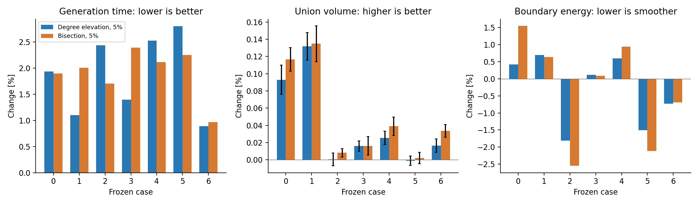
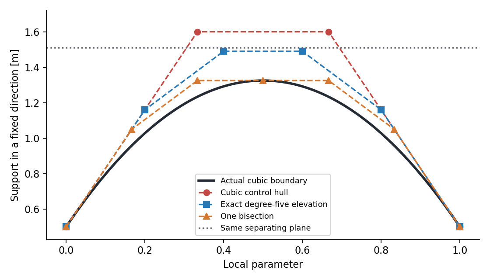
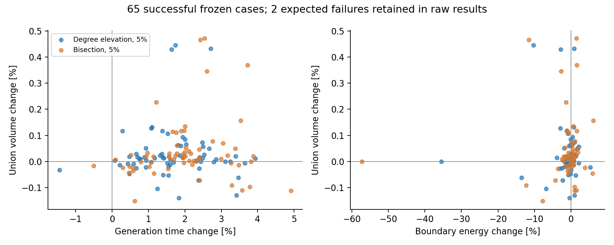

# 原生三次走廊 E2：选择性证书替换

2026-11-04 · `experiment/native-cubic-minjerk` · 基线 `5c6f860`

E2 已完成三次控制凸包、精确升阶和一次二分的比较。当前配置下，**少量替换可以释放局部空间，但收益不足以覆盖新增计算，默认生成器继续关闭 E2**。

在 16 张地图的 67 条冻结输入中，三种配置均有 65 条生成成功，另外两条预设失败用例保持失败。成功结果全部通过原始支持平面、全截面 Jacobian 和独立地图覆盖认证。生成使用单核、单线程，进程地址空间限制为 4 GiB。

测量进程的峰值 RSS 为 66.85 MiB。CPU 时间的合计变化分别为 +1.67% 和 +2.07%，与墙钟计时一致。

| 方案 | 65 例生成耗时变化 | 并集体积变化中位数 | 边界弯曲能量变化中位数 | 体积增加 / 减少 / 未分辨 |
| --- | ---: | ---: | ---: | ---: |
| 原 C3 | 基线 | 基线 | 基线 | — |
| 升阶证书，5% 区间预算 | +1.66% | +0.0114% | −0.132% | 35 / 16 / 14 |
| 二分证书，5% 区间预算 | +2.06% | +0.0185% | −0.018% | 40 / 17 / 8 |

耗时变化按各场景耗时中位数之和计算，几何指标按场景配对变化取中位数。“体积增加 / 减少”要求配对差值超出该场景的 95% 采样误差区间；“未分辨”包括变化太小或相同的情况。两个失败用例保存在原始记录中，不参与成功走廊的几何排名。



## 1. 替换的是什么

输出保持原生三次 C² B 样条：

$$
F(u,z)=c(u)+M(u)z,\qquad \|z\|_2\le 1.
$$

在一个三次 Bézier 区间内，记中心和形状控制量为 $C_j,D_j$。原来的充分安全条件是

$$
n^\top C_j+\|D_j^\top n\|_2\le b,\qquad j=0,1,2,3.
$$

控制椭圆可能比实际曲面突出。E2 用更紧的控制包围替换该区间的原约束：

| 表示 | 每个区间的控制截面 | 本轮用途 |
| --- | ---: | --- |
| 原生三次 | 4 | 默认优化约束 |
| 精确升阶到五次 | 6 | 在相同曲线上收紧包围 |
| de Casteljau 二分一次 | 7 个不同控制截面 | 两个子区间共享中点 |

升阶和细分后的控制量都是原控制量的凸组合，因此旧的严格可行解仍然满足替换后的约束。替换后仍覆盖同一个参数区间、同一个障碍分离平面。三次控制变量、四控制点局部关联和带状 Hessian 的宽度均不变。



图中实际三次边界完全位于 1.51 m 的分离平面内，原控制包围却达到 1.60 m。精确升阶后上界为 1.49 m，二分后为 1.325 m。这个例子也进入了测试：原约束拒绝该几何，替换后的约束接受它，连续安全认证通过。

实现中撤下受选“区间—平面”的粗控制行，再加入完整的升阶或细分行。共享端点只保留一份相同支持约束；三次和五次内部控制行使用不同分组标识，避免把不同线性映射合并。

## 2. 如何选择区间

第一轮扩张完成后，第二轮沿用原来的障碍覆盖流程。对每个区间和平面计算粗支持上界 $U_0$、细化上界 $U_1$，以及

$$
\Delta=\max(0,U_0-U_1).
$$

对控制行定义 $d=b-n^\top c$、$r=\|M^\top n\|_2$。Lorentz 障碍项 $-\mu\log(d^2-r^2)$ 对平面位置的敏感度为

$$
\widehat\lambda=\frac{2\mu d}{d^2-r^2}.
$$

实现先归一化平面法向，取同一平面四个控制行的平均压力，再按参数区间长度计权。每个区间的排序分数为

$$
\operatorname{score}(I)=
\frac{|I|\sum_{p\in I}\overline{\lambda}_p\Delta_p}
{\sum_{p\in I}\text{新增控制行数}_p}.
$$

所有候选共用的 $\mu$ 在排序中约去。这是有限障碍目标下的压力指标。分母统计有实际支持间隙的平面，升阶预计增加两行，二分预计增加三行。

按分数选择 5%、10% 或 25% 的区间组；小规模问题向上取整。受选区间中，仅替换支持上界确实变紧的平面。全局安全判定仍使用原始平面集合，支持证书允许继续自适应细分，并独立检查全截面 Jacobian。

这次实现复用现有第二轮优化，没有增加常规 Newton 步数。替换发生在优化问题创建前，固定二次能量继续复用，支持分组及冗余证明重新建立。因此不会保留指向已撤下控制行的旧证明。

为了压低准备成本，同一区间的世界坐标曲线、升阶系数或二分系数只计算一次，各平面共享它们。关闭 E2 时不创建候选平面副本，三次和五次行分别使用编译期确定次数的构造路径。

## 3. 实验条件

基线是提交 `5c6f860` 中的 `balanced` 原生 C3，E1 的 `reach_bound` 设为 0。E2 的两种方式分别单独测试。

| 项目 | 设置 |
| --- | --- |
| 输入 | E1 已冻结的 67 条路径、16 张地图，逐文件校对 SHA256 |
| 开发集 | 原有七条 Perlin、Maze、RViz 路径 |
| 扩展集 | 44 条历史路径、14 个额外环境、2 个失败控制用例 |
| 障碍模型 | 0.25 m 体素外接球，机器人半径 0.20 m，安全余量 0.05 m |
| 证书余量 | 0.002 m |
| 局部扩张范围 / 初始间距 | 3.0 m / 0.40 m |
| 运行 | CPU 2，数值线程 1，串行，地址空间上限 4 GiB |
| 开发集最终计时 | 三个交错块，每块预热一次、测量七次，共 21 次 |
| 扩展集最终计时 | 三个交错块，每块预热一次、测量三次，共 9 次 |
| 并集体积 | 相同采样域和配对 QMC 序列，8 次随机平移，每次 262,144 点 |

每个计时块轮换配置顺序，保存全部墙钟时间和进程 CPU 时间。冻结旧可执行文件用于检查关闭 E2 的结果；七例输出系数逐字节一致。

最初的六档预算扫描还保留了每档七例、21 次计时，以及每次 65,536 点的八组配对体积估计。缓存优化前后的六档几何输出逐字节一致，因此初扫体积结果可直接对应到最终实现。

边界平滑性使用同一个指标：

$$
E_\partial=\int\left(\|c_{ss}\|^2+\frac12\|M_{ss}\|_F^2\right)ds,
\qquad s=L_{\rm seed}u.
$$

它等于对截面角度取平均后的纵向边界二阶导数能量。三次的二阶导数平方是二次多项式，采用两点 Gauss 积分精确计算。另采样统计边界曲率 P99、最大值、C² 接缝误差和最小参数速度，独立检查障碍与地图边界。

## 4. 小预算有局部收益，增加预算没有带来单调改善

七例最终交错计时中，各场景中位数之和为：基线 244.12 ms，升阶 5% 为 248.33 ms，二分 5% 为 248.85 ms。

对应的并集体积变化如下。图中的误差棒来自八次随机平移的配对 95% 区间，与生成计时的重复次数无关。

| 场景 | 升阶 5% 体积变化 | 二分 5% 体积变化 |
| --- | ---: | ---: |
| 0 · Perlin A1 | +0.0931% | +0.1167% |
| 1 · Perlin B1 | +0.1320% | +0.1348% |
| 2 · Maze 1 | +0.0006% | +0.0082% |
| 3 · Perlin A2 | +0.0160% | +0.0163% |
| 4 · Perlin B2 | +0.0257% | +0.0391% |
| 5 · Maze 2 | −0.0010% | +0.0021% |
| 6 · RViz 路径 | +0.0164% | +0.0337% |

完整误差区间见 [case_metrics.csv](validation/native_splines_e2/case_metrics.csv) 和上方带误差棒的图。场景 2 的升阶结果、场景 5 的两种结果尚不能分辨出体积变化。

在初扫的七例中，5%、10%、25% 升阶的体积变化中位数依次约为 +0.0260%、+0.0084%、+0.0016%；二分依次为 +0.0350%、+0.0331%、−0.0229%。较大的预算增加了控制行，没有稳定扩大最终并集，因此用 5% 进入扩展回归。初扫和最终体积估计使用不同样本数，微小数值差异应结合各自误差区间阅读。

## 5. 扩展环境改变了判断



| 测试组 | 升阶 5% 耗时变化 | 升阶体积中位数 | 二分 5% 耗时变化 | 二分体积中位数 |
| --- | ---: | ---: | ---: | ---: |
| 七例开发集 | +1.72% | +0.0164% | +1.94% | +0.0337% |
| 44 条历史路径 | +1.48% | +0.0130% | +1.91% | +0.0209% |
| 14 个额外环境 | +2.38% | −0.0231% | +2.78% | −0.0404% |

额外环境包括错列障碍、变截面通道、螺旋、迷宫转弯、开阔直线和竖直路径，没有参与 E2 的预算选择。变截面通道的三例都损失了少量体积，部分螺旋与迷宫转弯也出现下降。

边界能量略降，也没有保证局部曲率峰值同步下降。例如升阶在历史场景 31 中的边界最大采样曲率增加约 54.3%，二分在场景 10 中增加约 54.0%。两者仍通过 Jacobian 认证，但平均二阶能量无法约束每个位置的速度分母和曲率峰值。

## 6. 为什么更紧的证书没有带来综合提升

**新增行会改变有限障碍目标。** 每个控制行都带一个对数障碍项。将四行换成六行或七行后，几何可行集合扩大，但障碍项的数量与分布也改变。在固定迭代预算下，最终位置可以向另一个方向移动。本轮升阶和二分的保留支持行数变化中位数分别为 +1.27% 和 +1.65%。

**选择过程本身有成本。** 需要求支持上界、压力、间隙及排序。缓存已经消除了同一区间的重复升阶和细分，但这部分仍占新增成本的较大比例。新增分组和支持行还进入梯度、Hessian 组装和步长计算。

**局部间隙不等于最终体积收益。** 当前评分描述第一轮结果上的局部保守性。后续扩张还受到其他支持平面、中心偏移、Jacobian 和正则项共同限制；优化目标中的节点 logdet 也不是去重并集体积的直接表达。

这些结果表明，在当前 0.4 m 初始间距和优化预算下，统一增加证书精度并不是主要突破口。E2 提供了可用的局部松弛机制，下一步更值得先降低构造和覆盖成本。

## 7. 验证与实现入口

新增测试覆盖：旧约束拒绝而替换约束接受的连续安全几何；严格可行初值的保留；平面尺度归一化；非均匀 knots、子区间端点和混合次数分组；稀疏控制行与世界坐标曲线的支持上界一致；梯度、Hessian 和可行步长。

第二轮的检查点靠近活跃约束，原来固定 $10^{-6}$ 步长的中心差分出现了明显截断误差。诊断函数改为按双向可行余量缩放步长，并使用 Richardson 外推消去二阶误差。该函数只在显式测试或不计入正式统计的预热中运行，不进入正常生成的 Newton 热路径。修正前的原始数值也保存在结果中，另外重新核对了全部配置的导数和输出系数。

8 项测试全部通过。67 例、三个配置共 201 组复核的状态和系数保持一致；有限差分梯度最大相对误差为 $8.05\times10^{-8}$，Hessian-vector 为 $2.56\times10^{-6}$。另用逐控制行的独立稠密解析公式核对分组内核，梯度与 Hessian-vector 最大相对差分别为 $1.02\times10^{-10}$、$2.98\times10^{-10}$。靠近障碍边界时，有限差分的高阶项和浮点消减仍比解析内核间的差异大，这两种误差分别记录。

正式计时完成后的源码调整只涉及预热导数检查及其日志字段；201 组复核确认了生成结果一致。最大 C² 接缝误差为 $9.45\times10^{-13}$。

核心文件：

- [support_refinement.hpp](../direct_corridor/experiments/native_splines/support_refinement.hpp)：候选评分、区间预算和几何缓存。
- [cubic_optimizer.cpp](../direct_corridor/experiments/native_splines/cubic_optimizer.cpp)：控制行替换、分组及证明重建。
- [cubic_generator.cpp](../direct_corridor/experiments/native_splines/cubic_generator.cpp)：第二轮接入、参数入口检查和连续复核。
- [tests/support_refinement.cpp](../direct_corridor/experiments/native_splines/tests/support_refinement.cpp)：数学、几何和导数回归。
- [results.json](validation/native_splines_e2/results.json)：完整统计、误差、阶段计数和验证结果。

## 8. 复现实验与后续方向

设置 `certificate_refinement=1` 使用升阶，`=2` 使用二分，`certificate_fraction=.05` 采用本轮的小预算。默认值为 0。Benchmark 对应环境变量为 `NATIVE_CERTIFICATE_REFINEMENT` 和 `NATIVE_CERTIFICATE_FRACTION`。

在仓库根目录、已有冻结输入和 Release 构建时，运行七例交错比较：

```bash
python3 direct_corridor/experiments/native_splines/run_e2.py \
  --output .scratch/native_splines/e2/replay \
  --cases 0,1,2,3,4,5,6 \
  --configurations baseline,elevate05,split05 \
  --blocks 3 --repeats 7
```

重新计算并集与边界指标：

```bash
python3 direct_corridor/experiments/native_splines/evaluate_e2.py \
  --generations .scratch/native_splines/e2/replay \
  --configurations elevate05,split05 \
  --output .scratch/native_splines/e2/replay_evaluation \
  --samples 262144
```

输入沿用 [E1 inputs.tar.gz](validation/native_splines_e1/inputs.tar.gz)。[measurements.tar.gz](validation/native_splines_e2/measurements.tar.gz) 保存各轮配置、逐次日志、系数、原始平面及体积估计；[source_snapshot.tar.gz](validation/native_splines_e2/source_snapshot.tar.gz) 保存本轮实验源码；[manifest.json](validation/native_splines_e2/manifest.json) 记录文件哈希。

后续按 E3 推进：先缓存固定 knots、标架和区间下的提取权重、局部控制编号及平面投影，减少树容器分配和重复构造，以几何逐字节一致作为验收条件。E2 可在这些成本降低后，再研究少量区间的增量替换，以及按区间统一障碍权重的消融。当前继续使用原 C3 默认流程。
