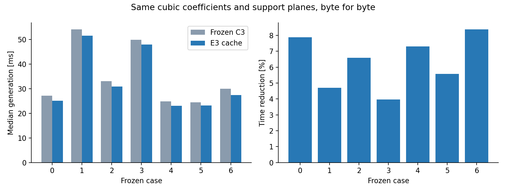
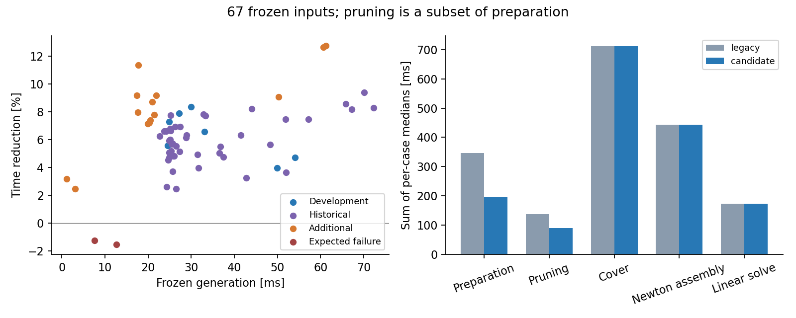

# 原生三次走廊 E3：构造缓存与覆盖复用

本轮在 E2 提交 `3a34a75` 上继续优化 C3 的构造流程。**67 个相同输入的逐例生成耗时中位数合计下降 6.75%；其中 65 条成功路径全部更快，合计下降 6.83%。** 导出的三次系数和原始支持平面逐字节一致，因此并集体积、边界平滑性和连续安全结果保持不变。

构造复用、区间拓扑缓存和静态覆盖布局缓存已在 `Fast`、`Balanced`、`Volume` 三个 C3 预设中默认启用。正式性能测量使用 `Balanced`。E1 精确可达域界与 E2 选择性证书替换仍保持关闭，分别保留实验开关。

本轮只测走廊生成，没有运行轨迹优化。

## 1. 相同输入下的结果

下表中的时间是**每个场景各自取中位数，再在该组内求和**，用于比较同一组请求的总计算负担。它不是单条路径耗时，也不是将所有样本混合后的中位数。

| 输入组 | 数量 | 冻结 C3 / ms | E3 / ms | 耗时变化 |
| --- | ---: | ---: | ---: | ---: |
| 原七例开发集 | 7 | 243.699 | 229.159 | −5.97% |
| 历史路径 | 44 | 1518.005 | 1423.099 | −6.25% |
| 额外环境 | 14 | 353.778 | 318.715 | −9.91% |
| 两个预期失败用例 | 2 | 20.134 | 20.422 | +1.43% |
| 全部输入 | 67 | 2135.615 | 1991.394 | **−6.75%** |
| 全部成功输入 | 65 | 2115.481 | 1970.972 | **−6.83%** |

两条失败路径分别为折返尖点和极窄通道，前后均返回 `INITIALIZATION_FAILED`，没有输出走廊。它们保留在总体统计中。额外环境包括错列障碍、变截面通道、螺旋、迷宫转弯、开阔直线和竖直路径。

七条开发路径的独立结果如下：

| 场景编号 | 地图 | 冻结 C3 / ms | E3 / ms | 耗时下降 |
| --- | --- | ---: | ---: | ---: |
| 0 | Perlin | 27.207 | 25.064 | 7.88% |
| 1 | Perlin | 54.111 | 51.565 | 4.70% |
| 2 | Maze | 33.055 | 30.878 | 6.59% |
| 3 | Perlin | 49.916 | 47.936 | 3.97% |
| 4 | Perlin | 24.918 | 23.099 | 7.30% |
| 5 | Maze | 24.537 | 23.168 | 5.58% |
| 6 | 历史 RViz 路径 / Perlin | 29.956 | 27.449 | 8.37% |



进程 CPU 时间的总体下降为 6.75%，与墙钟时间一致。上述生成时间复用已建立的 BVH；若每条请求都额外加入一次实测 BVH 构建时间，总体下降为 3.84%。冷启动口径包含索引构建，不包含文件读取、可视化或 ROS 通信。

## 2. 三项实现分别改变了什么

### A：复用已经构造的几何约束

初始化原本要构造一个 `CubicProblem`，检查小截面初值是否处于 SOC 严格内部；进入第一轮优化后，又对同一模型和同一覆盖重新构造一次。两次都包含支持平面去重、控制截面分组、冗余证明、平面投影和法向乘积预计算。

现在保留通过初始化检查的问题，把其中的几何分组和几何支持行交给第一轮优化使用，只重新建立与当前阶段有关的前进约束。Jacobian 修复阶段也复用原问题的几何部分，再建立修复所需的前进约束。

这里保留了原问题本身：后续体积细化仍使用原来的前进约束集合。没有在原对象上直接追加修复约束，因而求解路径与原实现一致。

复用发生在同一模型、参考标架、knots、覆盖、几何设置和冗余证明参考点保持不变的阶段。进入下一次膨胀、重建分离面、更新标架或细化 knots 后，重新构造相应几何数据。实验性的支持交换和工作集模式继续采用独立构造。

### B：同一区间只构造一次提取与关联拓扑

一个证书区间通常对应多个障碍法向。原实现会为每个法向重复计算相同的 Bézier 提取权重，并逐控制行查找相同分组。

现在按 `(span, begin, end, degree)` 缓存提取权重和分组编号。普通三次、E2 升阶以及二分后的区间使用各自的缓存条目。法向投影和支持余量仍按原顺序计算。

平面规范化改为连续数组上的稳定排序，替代每个平面一次树节点分配。相同键仍保留最小界；相同界仍保留最早出现的记录。分组插入顺序、浮点累加顺序和冗余判定顺序保持一致。

例如开发场景 0，最终配置累计命中 4126 次区间缓存，只提取 380 次，并复用 16504 次控制行分组查找。这些计数包含初始化和后续实际构造，不把直接复制的问题再次记为计算工作。

### C：复用静态覆盖布局

种子路径、knots、世界边界和局部扩张参数固定后，各样条区间与局部盒的交集以及对应 BVH 查询域也固定。新的 `CoverLayout` 用一个连续数组存储这些交集，各 span 只保存索引范围和查询包围盒。

同一组 knots 下的初始化重试和各轮膨胀共用布局；细化 knots 时创建新布局。当前几何的支持判断、障碍优先级和分离平面仍在每一轮重新计算，保持原来覆盖的顺序与内容。

缓存有效期由生成流程管理，不在每次 Newton 求值时重复比较地图、knots 或整个覆盖。布局创建时间计入覆盖耗时。

## 3. 加速来自哪里

七例采用相同迭代预算，分别开启各部分：

| 配置 | 含义 | 七例耗时合计 / ms |
| --- | --- | ---: |
| frozen | 提交 `3a34a75` 的冻结二进制 | 243.699 |
| legacy | 当前代码，关闭三项 E3 优化 | 245.230 |
| construction | 仅 A：几何构造复用 | 234.822 |
| coverage | 仅 C：静态覆盖布局 | 244.442 |
| cached | A + C | 234.181 |
| topology | 仅 B：排序、提取和分组缓存 | 235.942 |
| all | A + B + C | **229.159** |

A 与 B 是主要收益来源。C 的独立收益较小，在本轮测量噪声范围内，不能据此宣称障碍覆盖算法已明显加速。

阶段统计采用当前代码的 `legacy` 与 `all` 比较。此前 `setup_ms` 漏记了初始化可行性问题的构造，本轮补齐，并用 `initial_problem_ms` 单独显示这一部分；完整 `total_ms` 原本就包含它。因此阶段比较不直接拿旧二进制的 `setup_ms` 作分母。

| 阶段，65 条成功路径的逐例中位数合计 | legacy / ms | E3 / ms |
| --- | ---: | ---: |
| 问题准备 `setup_ms` | 346.061 | **196.985** |
| 其中：初始化问题构造 | 100.046 | 80.261 |
| 其中：冗余证明 | 137.991 | 89.419 |
| 障碍覆盖 | 711.116 | 711.603 |
| Newton Hessian 组装 | 443.745 | 443.072 |
| 线性求解 | 173.836 | 173.684 |
| 线搜索 | 223.657 | 223.576 |

问题准备下降 **43.08%**。初始化问题构造与冗余证明都是准备阶段的子项，不能再次相加；各阶段独立取中位数，其和也不要求严格等于完整耗时中位数。



## 4. 几何、求解与连续认证核对

本轮比较直接生成的三次结果，不经过拟合或重新搜索路径。

| 核对项 | 结果 |
| --- | --- |
| 成功 / 失败状态 | 67 例全部一致，65 成功、2 预期失败 |
| 三次系数和参数分段 | 65 条成功路径的导出文件 SHA256 完全一致 |
| 原始支持平面 | 法向、边界、区间及顺序完全一致 |
| Newton 步数、Jacobian 修复、回退、终止状态 | 所有正式重复一致 |
| 连续支持与全截面 Jacobian | 所有成功输出通过 |
| 独立重建地图覆盖审计 | 通过，附加采样穿透为 0 |
| 分组与稠密参考梯度最大相对误差 | 1.15 × 10⁻¹⁵ |
| Hessian 最大相对误差 | 1.15 × 10⁻¹⁵ |
| 最大 C² 接缝误差 | 7.19 × 10⁻¹³ |

系数使用 17 位有效数字导出，可以往返恢复双精度值。正式实验核对了 1338 个导出文件的哈希，覆盖全部计时块及开发集消融配置。

由于 `c(u)`、`M(u)` 和分段完全相同，扫掠集合、去重并集体积、边界弯曲能量和曲率也完全相同，变化为 **0**。这次没有重新运行随机体积采样，避免给相同几何引入采样差异。

启用预设默认值后又检查了全部 67 例，仍与冻结二进制一致。另对七例开发集及两个额外案例，分别组合 E2 的 5% 升阶和 5% 二分：共 18 对比较，E3 前后的系数、覆盖与求解状态一致。这些复核用于检查默认入口和开关组合，没有混入正式性能统计。

9 项 CTest 全部通过。新增构造测试覆盖非均匀 knots、变化的截面、跨局部盒区间、带符号零的重复法向、E2 两种替换、前进约束修复，以及新旧目标值、梯度、Hessian 的精确一致性。

## 5. 实验设置与内存

基线为 `3a34a75` 的 `Balanced` 原生 C3；地图和种子路径来自已冻结的 E1 输入，共 67 例、16 张地图，逐例核对 SHA256。安全模型保持体素 0.25 m 外接球、机器人半径 0.20 m、安全余量 0.05 m、证书余量 0.002 m、局部扩张范围 3.0 m、初始节点间距 0.40 m。

七例开发集使用 3 个计时块，每块预热一次、正式运行 7 次，每配置每场景共 21 个计时样本；其余 60 例使用 3 个计时块，每块预热一次、正式运行 3 次，共 9 个样本。配置顺序按场景和计时块轮换、反转，全部过程串行。

编译使用 Release，关闭 `-march=native`，`-j1`；测量绑定 CPU 2，数值线程数为 1，每个进程的地址空间上限为 4 GiB。正式生成进程的峰值 RSS 为 **77.32 MiB**。编译器与 CPU 信息、完整原始耗时序列、P95、构造计数和输入哈希随结果保存。

## 6. 代码与复现

主要改动位于：

- [`cubic_generator.cpp`](../direct_corridor/experiments/native_splines/cubic_generator.cpp)：管理初始化问题和覆盖布局的生命周期。
- [`cubic_optimizer.cpp`](../direct_corridor/experiments/native_splines/cubic_optimizer.cpp)：几何模板复用、稳定去重、区间提取与分组缓存。
- [`obstacle_cover.hpp`](../direct_corridor/experiments/native_splines/obstacle_cover.hpp)：静态 `CoverLayout` 与逐轮动态覆盖。
- [`tests/construction.cpp`](../direct_corridor/experiments/native_splines/tests/construction.cpp)：精确等价回归。
- [`run_e3.py`](../direct_corridor/experiments/native_splines/run_e3.py)、[`analyze_e3.py`](../direct_corridor/experiments/native_splines/analyze_e3.py)：串行对照、默认入口审计与结果归档。

在当前已构建工作区复跑七例：

```bash
cd /home/zdp/ForCodex/GCOPTER
python3 direct_corridor/experiments/native_splines/run_e3.py \
  --output .scratch/native_splines/e3/reproduce \
  --cases 0,1,2,3,4,5,6 --blocks 3 --repeats 7 \
  --configurations frozen,legacy,construction,coverage,cached,topology,all
```

脚本自动限制 4 GiB、单线程、CPU 2，并按顺序启动进程。冻结基线可执行文件为 `.scratch/native_splines/e3_baseline/native_spline_benchmark`；当前可执行文件为 `.scratch/native_splines/build/native_spline_benchmark`。重新搭建工作区时，从 `3a34a75` 单独导出源码，以 Release、`NATIVE_SPLINE_NATIVE_ARCH=OFF` 构建基线；从当前源码构建候选。输入可从 E1 的 `inputs.tar.gz` 恢复。

当前 Benchmark 开关与 C++ 字段对应如下：

| 环境变量 | `OptimizerSettings` 字段 |
| --- | --- |
| `NATIVE_REUSE_CONSTRUCTION` | `reuse_construction` |
| `NATIVE_FAST_CONSTRUCTION` | `fast_construction` |
| `NATIVE_CACHE_COVERAGE` | `cache_coverage` |

三项设为 0 即为当前代码的 `legacy`。调用 `applyNativePreset()` 或 `generateNative()` 时三项默认开启；直接使用裸 `OptimizerSettings` 时仍可逐项控制研究配置。

结果目录：[validation/native_splines_e3](validation/native_splines_e3)。其中 `results.json` 保存完整汇总，`case_metrics.csv` 保存逐例对照，`measurements.tar.gz` 保存原始日志和几何，`source_snapshot.tar.gz` 保存实现快照，`manifest.json` 保存哈希。`tests.log` 保存本轮测试输出。交互演示目标已串行重新构建并安装，记录在 `ros_build.log` 与 `ros_install.log`；本轮没有启动 RViz。

## 7. 下一步的计算重点

本轮消除了确定性的重复构造，并保留了完整几何结果。现在成功路径累计覆盖约 712 ms，其中障碍分离约 558 ms，已明显大于剩余约 197 ms 的问题准备。下一步应继续压低分离计算和每轮必要的数据更新。

直接复用上一轮分离平面会限制新的扩张方向，可能改变最终体积；本轮只复用固定布局，不将这种几何变化混入缓存加速的结论。后续若实验平面复用或增量更新，需要继续同时报告时间、体积和边界变化。
