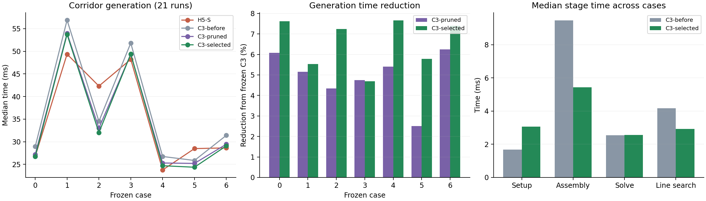
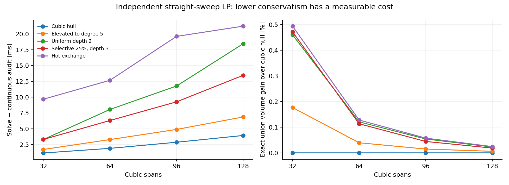
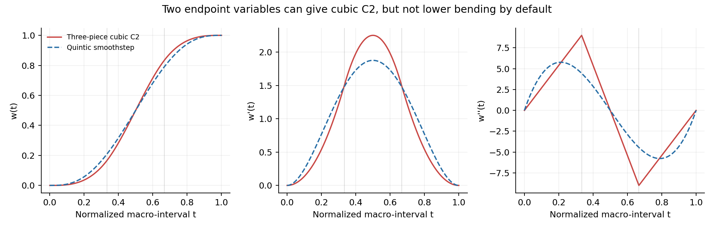

# 原生三次走廊下一阶段改进方案

当前活动代码已完成[代码清理与热路径精简](原生三次走廊代码清理与热路径精简.md)。E1/E2 及未采用的实验实现已从默认模块移除，历史结果和源码快照保留；下文的实验开关描述对应各阶段提交。

2026-11-04 · 分支 `experiment/native-cubic-minjerk` · 实现基准 `0990161`

E1 的实现和 67 例测量已完成，见[精确可达域实验报告](原生三次走廊E1精确可达域实验.md)。新界减少了求解行，但综合收益不稳定，当前保留为实验开关。E2 的升阶与二分替换也已完成同输入比较，见[选择性证书替换实验](原生三次走廊E2选择性证书替换实验.md)：小预算体积略增、生成变慢，额外环境表现不一致，默认保持关闭。

E3 的[构造缓存与覆盖复用实验](原生三次走廊E3构造缓存与覆盖复用实验.md)已完成：67 例的逐例中位耗时合计下降 6.75%，65 条成功路径的系数和原始支持平面逐字节一致，已启用为 C3 预设默认项。当前收益主要来自消除重复问题构造与区间拓扑计算；障碍分离仍是下一步的主要计算开销。以下保留实施前记录的完整路线。

下一阶段继续以**从种子路径直接生成 C² 走廊**为主线，评价生成耗时、去重并集体积、边界平滑性和连续安全性。优先收紧冗余证明、按需放松保守的支持证书，并减少障碍覆盖与问题重建的成本。另开一组“便宜主优化＋受约束 C² 恢复”实验，研究能否吸收 H5 分阶段求解的优势。

原生 C3 是主要优化对象，H5 投影到 C3 的结果保留为质量参照，用来定位初始化与参数化各自造成的体积损失。当前阶段不运行轨迹优化，也不以轨迹残差筛选走廊配置；内部实现不承担 H5 兼容要求。

## 1. 从最新结果出发

本方案综合两类证据：

- 用户提供的 [REVIEW.md](/home/zdp/ForCodex/native_cubic_review_experiments/REVIEW.md)、[优化方向.md](/home/zdp/ForCodex/native_cubic_review_experiments/优化方向.md)、独立数学实验和原始结果。
- 当前仓库的[第五轮生成实验](原生三次走廊冗余约束与Newton内核优化.md)及源码。当前 HEAD 为 `0990161`，生成算法的最近一次修改为 `795a242`；`0990161` 接入 RViz2 交互演示。

外部 REVIEW 对应较早的 `f72f3fe`，没有构建本仓库，也没有重跑七例地图。因此，其中的数学结论可以迁移，简化模型的速度不能直接当作当前生成器的速度。

### 当前 C3 已经有整体收益，剩余问题是收益不均衡

| 场景 | 类型 | H5-S / ms | 当前 C3 / ms | C3 相对上一轮的并集增加 |
| --- | --- | ---: | ---: | ---: |
| 0 | Perlin | 26.76 | 26.72 | +0.4821% |
| 1 | Perlin | 49.37 | 53.76 | +0.6959% |
| 2 | Maze | 42.31 | 32.01 | +0.8864% |
| 3 | Perlin | 48.23 | 49.40 | +0.0407% |
| 4 | Perlin | 23.75 | 24.69 | +0.5241% |
| 5 | Maze | 28.48 | 24.35 | +0.9572% |
| 6 | RViz 保存路径 | 28.63 | 29.08 | +0.7363% |
| 七例中位数之和 | | **247.54** | **240.01** | |

这里每例正式重复 21 次。C3 相对冻结版本的总时间降低 6.30%，相对同批 H5 降低 3.04%；场景 0 基本持平，两例迷宫明显更快，另四例仍较慢。体积列与冻结 C3 比较，不是与 H5 比较。



目前主要成本仍在障碍分离、Hessian 组装和步长扫描。例如场景 1：

| 阶段 | 当前中位数 / ms | 后续关注点 |
| --- | ---: | --- |
| 障碍查询 | 3.71 | 复用已有查询覆盖，减少重复遍历 |
| 分离面生成 | 14.54 | 跨扩张轮复用、空间批处理 |
| 问题准备 | 5.71 | 提取拓扑、分组、去冗余的增量更新 |
| 梯度与 Hessian 组装 | 11.89 | 减少有效求解行和重复几何投影 |
| 分解与回代 | 4.35 | 保留带状直接求解，暂不优先替换 |
| 可行步长与线搜索 | 5.96 | 复用同一精简工作集 |
| 生成中的 Jacobian 检查 | 0.80 | 局部证书缓存 |
| 最终复核 | 0.37 | 保持完整 |

阶段各自取中位数，且表中未列全部杂项，不要求逐项相加等于总时间。即使把线性求解加快一倍，该例也只节省约 2.17 ms；只优化最终认证的收益更小。

空间质量还有一个明确问题：场景 3 的采样最大中心曲率从 6.30 增至 11.03 m⁻¹，形状弯曲能量从 261.89 增至 332.18，而并集只增加约 0.04%。场景 5 的最大曲率也从 4.36 增至 6.21 m⁻¹。下一轮应把这些案例作为平滑性回归，不能把 C² 连续直接等同于边界起伏较小。

### 已实现与待实现

| 资料中的建议 | 当前状态 | 下一步 |
| --- | --- | --- |
| 二维候选＋三维冗余证明 | 已默认启用 | 把三角不等式上界换成更紧的可达域支持函数 |
| 删除行贯穿组装、步长和线搜索 | 已默认启用，保留行连续存储 | 新证明直接复用现有工作集 |
| 9 维几何聚合、坐标轴专用内核 | 已实现；逐行 20 维组装曾更慢 | 先减少行数，不重做已失败的内核方案 |
| 初值扩张 | 已有净空初值，也测过额外扩张 | 有方向的局部椭圆初值仍可研究；不再只扫统一放大比例 |
| 障碍参数预测、一次体积修正 | 已默认启用 | 加入平滑性预算，单独消融两者的影响 |
| 选择性证书细化 | 有连续 oracle 和细分基础，尚无完整收益驱动流程 | 本轮主要体积方向 |
| 持久化约束交换 | 现有实验会产生重建成本 | 在固定证书优化之后再做 |
| 多段三次、两端变量的 C² 宏单元 | 仅有代数构造 | 独立原型，不直接替换当前 C3 |
| 低成本 C¹ 主优化＋C² 恢复 | 尚未实现 | 与宏单元方案一起检验 H5 式分阶段结构 |

## 2. 第一优先级：更紧的冗余证明

这一项改动范围小，能够直接接入 [support_pruning.cpp](../direct_corridor/experiments/native_splines/support_pruning.cpp)。

### 2.1 利用所有形状矩阵共享同一个截面参数

一个控制截面组写成

$$
c=c_{\rm ref}+\sum_i A_i d_i,\qquad M=\sum_i A_i S_i,
$$

其中 $\|d_i\|\le D_i$，$\ell_i I\preceq S_i\preceq u_i I$，所有项共享同一个 $\|z\|\le1$。当前三次组最多关联四个控制节点；$A_i$ 已包含提取权重和参考标架。

对冗余证明中的残差方向 $e$，令 $v_i=A_i^\top e$。在上述闭变量域内，支持函数的精确表达是

$$
\boxed{
h(e)=e^\top(c_{\rm ref}-c_0)
+\sum_i D_i\|v_i\|
+\left\|\sum_i\frac{u_i+\ell_i}{2}v_i\right\|
+\sum_i\frac{u_i-\ell_i}{2}\|v_i\|
}.
$$

推导要点是：固定单位 $z$ 后，$\operatorname{sym}(zv_i^\top)$ 的两个特征值为
$(v_i^\top z\pm\|v_i\|)/2$，所以

$$
\max_{\ell_iI\preceq S_i\preceq u_iI}v_i^\top S_i z
=\frac{u_i+\ell_i}{2}v_i^\top z
+\frac{u_i-\ell_i}{2}\|v_i\|.
$$

先求和，再对同一个 $z$ 最大化，得到上式中的向量和范数。偏移项独立贡献 $D_i\|v_i\|$。严格内点域的上确界与闭域相同；加入其他支持约束后实际域更小，因此该式仍可作为安全上界。

当前代码使用

$$
h_{\triangle}(e)=e^\top(c_{\rm ref}-c_0)+\sum_i(D_i+u_i)\|v_i\|.
$$

新界满足 $h\le h_{\triangle}$。当所有节点共用 $\ell,u$ 时，改善量恰好为

$$
h_{\triangle}-h
=\frac{u+\ell}{2}
\left(\sum_i\|v_i\|-\left\|\sum_i v_i\right\|\right).
$$

因此，标架混合后出现方向抵消的组最可能受益。若各 $v_i$ 同向，新旧界相等；偏移范围很大时，形状项的改善也可能被偏移项淹没。这解释了为什么需要测真实约束组，而不是直接外推合成随机组的平均收益。

### 2.2 接入方式

取严格位于各支持半空间内的参考点 $c_0$，将平面归一化为
$q_j=n_j/(b_j-n_j^\top c_0)$。现有冗余候选满足

$$
q_j=\lambda q_a+\eta q_b+e,\qquad \lambda,\eta\ge0.
$$

保持当前候选搜索和保留顶点见证，只把删除条件改为

$$
\lambda+\eta+h(e)<1-\varepsilon_{\rm fp}.
$$

具体实施：

1. 从模型域传入 `min_radius`、`max_radius` 和各节点偏移上限。固定起终点的偏移可取 $D_i=0$；若某入口固定的是非零偏移，应先把该常量吸收到参考中心。
2. 比较“直接用新界”和“旧界已通过就直接接受，否则计算新界”两种流程。前者少一次分支，后者可复用现有范数；以准备阶段实测决定。
3. 删除后的行继续使用现有连续前缀，贯穿 `objective()`、`prepareLine()`、`feasibleStep()`。不增加 Newton 内部的输入校验。
4. 保存原行、保留见证、域界和证明裕量；几何域、标架或见证改变时重建相应证明。

资料中的 3,000 个合成组，新旧完整上界比值中位数为 0.9354，形状部分为 0.8708，构造的可删除候选从 532 增至 931。本次重新运行随附 C++ 的 100,000 组极值构造测试，最大误差为 $1.42\times10^{-14}$，未出现新界超过旧界。这些是公式验证，不是地图中的删行率或生成加速率。

新增针对性测试应覆盖零投影、向量和为零、上下半轴界相等、固定端点、非均匀提取系数以及临界删除裕量。浮点累计余量沿用现有尺度处理；它属于数值充分条件，不宣称为定向舍入的区间算术证明。

**验收重点：** 真实七例中多删多少行、增加多少准备成本、减少多少累计行求值，以及完整生成与并集体积的变化。删除冗余行不扩大真实可行域，但会改变有限障碍参数下的中心路径，因此仍要比较最终几何。

## 3. 第二优先级：把证书预算用在限制体积的位置

连续安全条件为

$$
\max_{t\in I}\left[n^\top c(t)+\|M(t)^\top n\|-b\right]\le0.
$$

当前通过控制截面支持上界认证。曲线可能还有净空，但某个控制椭圆已顶到平面。这种情况应收紧局部证书，而不是统一缩小走廊或全局增加节点。

### 3.1 先做固定平面的选择性证书替换

保持三次几何、控制变量、标架和支持平面不变，比较三种局部操作：

| 操作 | 几何是否改变 | 每个受选区间的控制量 | 用途 |
| --- | --- | ---: | --- |
| 原生三次控制凸包 | 否 | 4 | 默认起点 |
| 精确升阶到五次 | 否 | 6 | 用少量额外行收紧支持上界 |
| de Casteljau 二分一次 | 否 | 两组各 4 个，边界可共享 | 对局部弯曲进一步收紧 |

升阶后的控制量是原控制量的凸组合，新支持上界不大于旧上界；细分也具有这一性质。这里升阶的是**认证表示**，输出和求值仍是三次。

原来的粗约束必须从该区间的优化工作集中撤下，再用新的完整覆盖替换。把细分行叠加到旧行上会保留原有收缩，同时增加求解量。替换只涉及同一安全平面、同一参数覆盖，不删除障碍本身。

这是有别于任意加点交换的重要优势：同平面的升阶与细分约束由旧控制约束推出，旧的严格可行解仍是新问题的可行初值。已有变量和能量矩阵可以保留，随后做少量校正；受影响组的去冗余证明重新生成，防止引用已经撤下的见证。

### 3.2 用“约束压力×保守间隙”排序

对每个“区间—平面”计算：

- 粗支持上界 $U_0$；
- 一次廉价升阶或二分得到的上界 $U_1\le U_0$；
- 保守间隙 $\Delta=\max(0,U_0-U_1)$；
- 当前障碍项对该平面的压力，以及预计新增行数和求值成本。

对当前 Lorentz 障碍 $-\mu\log(d^2-r^2)$，其中 $d=b-n^\top c$、$r=\|M^\top n\|$，可用

$$
\widehat\lambda=\frac{2\mu d}{d^2-r^2}
$$

作为单行压力指标，再在同一平面的控制行之间聚合。它是有限障碍目标的敏感度；当前按迭代预算停止，不能直接称为收敛后的 KKT 乘子。

首轮按 $\widehat\lambda\Delta/\text{预计增量成本}$ 排序，分别测试 5%、10%、25% 的区间预算。法向先统一尺度，分段长度和共享边界统一计权，避免拆出更多行反而获得更高优先级。曲率只作辅助信息：弯曲大并不一定意味着控制凸包正在损失空间。

第一版直接比较两层支持上界，不要求扩展 oracle 的接口。已有 [continuous_oracle.hpp](../direct_corridor/experiments/native_splines/continuous_oracle.hpp) 可在后续用于定位极值附近区域；它目前返回认证状态或违反见证，并不直接给出精确支持最大值。

### 3.3 独立实验支持什么结论

资料中的模型是直线中心、一个随三次样条变化的半轴和分段仿射侧壁。其体积可精确积分，没有全局重叠。它适合隔离证书保守性，不代表完整三维障碍地图。

以下为相同 HiGHS simplex 后端、预热一次、重复 11 次的 128 段结果。总时间含装配、求解和连续复核，不含各方法共用的基函数准备。

| 方法 | 总时间 / ms | 精确并集体积 |
| --- | ---: | ---: |
| 原始三次控制凸包 | 3.920 | 189.958573 |
| 精确升阶五次 | 6.849 | 189.970885 |
| 全部二层细分 | 18.435 | 190.002702 |
| 选 25% 区间、三层细分 | 13.438 | 189.994881 |
| 冷启动交换 | 96.805 | 190.005832 |
| 热启动交换 | 21.215 | 190.005832 |



热启动相对冷交换快约 3.10–5.22 倍，但四种规模中仍慢于统一二层细分。25% 选择性细化在 64、96、128 段时比统一细分更快，同时略损失体积；50% 选择并无稳定优势。由此更合理的顺序是：**先做小预算证书替换，再研究持久化交换。**

原脚本用离散点构造细化排序指标，最终安全由独立连续认证给出。原生实现采用上述可计算支持上界差，不能把排序采样当作安全证明。

## 4. 第三优先级：摊薄障碍覆盖与问题重建成本

当前主线已经复用了地图索引、查询缓存和固定能量矩阵，也使用了惰性障碍优先队列。后续应针对仍然重复的部分做增量更新。

### 4.1 先复用不随优化变量变化的数据

在 knots、标架和证书区间固定时，缓存提取权重、局部控制编号、占用带块位置，以及必要的平面投影 $A_i^\top n$。保留连续数组和固定小块，减少问题构造中 `std::map` 的重复分配和键查找。

优先区分三类变化：

| 变化 | 可复用部分 | 需要更新部分 |
| --- | --- | --- |
| 只有优化变量变化 | 提取、关联拓扑、固定二次能量、平面投影 | 当前几何、余量、导数与 Hessian 数值 |
| 只替换少量证书区间 | 未受影响组及其拓扑 | 新区间支持行、关联证明、相关缓存 |
| 标架、knots 或安全域变化 | 地图索引等外部数据 | 几何映射及受影响的全部证明 |

旧 Hessian 因子不能因为“只改了一些约束”就一直复用：变量移动后，其他障碍项的数值曲率也会改变。已有整 Hessian 隔步复用曾使部分场景的扫掠体积积分下降约 9%，不能直接作为新默认。

### 4.2 分离面复用同时看时间和空间

同一障碍球与固定安全余量对应的分离关系可以缓存，但旧平面可能限制新一轮扩张方向。先沿用缓存平面做廉价覆盖检查，只对未覆盖障碍重算；同时统计旧平面引起的体积损失和阻塞比例。

复用成立需要障碍集合、膨胀半径和参数覆盖一致。查询包围盒只是检索范围；只有真正约束同一控制截面的盒，才能参与几何支持上界或冗余证明。

资料提出的平面感知初值可放在这里做消融：利用已经生成的局部平面确定二维椭圆与偏移，替代额外的统一半轴放大。比较“更好初值节省的 Newton 步”与“多做一次局部优化的成本”，避免重复生成整套覆盖。

输入与结构检查放在生成入口或缓存创建处。Newton 内只保留定义域、可行步长等求解本身需要的判断；阶段计时和计数按组累计，详细分析使用独立 profiling 运行。

## 5. 独立候选：把优化节点与三次分段分开

这部分是资料补充的结构性方向，值得原型验证。它解决的是主优化耦合成本，不只是多项式求值成本。

### 5.1 为什么当前 C3 不能直接“四并二”

H5 主优化的六个控制量采用变量权重 $[0,0,0,1,1,1]$。同一平面下，前三行和后三行分别具有相同变量系数，所以可以精确取最严格右端项，合并为两行。

若单段三次采用 $[A,A,B,B]$，过渡为 $q=A+(B-A)(3t^2-2t^3)$。端点一阶导数为零，二阶导数却为 $\pm6(B-A)/h^2$。相邻段要达到 C²，就必须满足

$$
-\frac{q_{i+1}-q_i}{h_i^2}
=\frac{q_{i+2}-q_{i+1}}{h_{i+1}^2}.
$$

均匀间距下成为 $q_{i+2}=q_i$，不能承载任意独立节点值。因此，**单个三次段、两个独立端点、自动 C²**不能同时成立。标准 C² 三次 B 样条通过多个控制点的局部耦合解决了这个问题。

### 5.2 三个三次子段可以构成两端变量的 C² 宏单元

定义

$$
w(t)=\frac92\left[t^3-3(t-\tfrac13)_+^3+3(t-\tfrac23)_+^3\right],
\qquad t\in[0,1].
$$

它单调从 0 变到 1，端点一、二阶导数均为零，内部两个连接点也达到 C²。三个子段的 Bézier 权重为：

| 子段 | 四个权重 |
| --- | --- |
| $[0,\tfrac13]$ | $0,0,0,\tfrac16$ |
| $[\tfrac13,\tfrac23]$ | $\tfrac16,\tfrac13,\tfrac23,\tfrac56$ |
| $[\tfrac23,1]$ | $\tfrac56,1,1,1$ |

用它构造偏移与形状：

$$
c(t)=r(t)+(1-w(t))a_i+w(t)a_{i+1},\qquad
M(t)=(1-w(t))M_i+w(t)M_{i+1}.
$$

$r(t)$ 需要另行提供相容的分段三次 C² 参考中心，保持非零切向，并计入初始化成本。不能把整个中心写成两个端点的零导数过渡，否则端点 $c'=0$，全截面 Jacobian 无法严格为正。

这个构造的优化变量只关联两个节点，但有多种混合权重，不能自动精确合并成两条支持行。先比较保留混合行的版本，再考虑单节点包络。

令 $\phi_i(n)=n^\top a_i+\|M_i^\top n\|$。若固定 $\beta_i,\beta_{i+1}$ 满足每个控制量

$$
(1-w_j)\beta_i+w_j\beta_{i+1}\le b-n^\top R_j,
$$

则只约束 $\phi_i\le\beta_i$、$\phi_{i+1}\le\beta_{i+1}$ 就能覆盖整个过渡。这利用了范数凸性，通常会额外收缩可行域；与 H5 的重复行精确合并不同。

### 5.3 新构造有更高的过渡能量，不能预设它更顺滑

本次用符号计算复核了上述权重、C² 拼接和单调性，并与五次 smoothstep $10t^3-15t^4+6t^5$ 比较：

| 同一归一化区间的标量过渡 | $\int_0^1(w'')^2dt$ | $\int_0^1(w''')^2dt$ |
| --- | ---: | ---: |
| 三段三次宏单元 | 27 | 1458 |
| 五次 smoothstep | $120/7\approx17.14$ | 720 |



相同端点差和参数区间下，这个三次构造的二阶能量更高约 57.5%，三阶能量更高约 102.5%。区间长度为 $h$ 时，两项分别乘以 $h^{-3}$ 和 $h^{-5}$，再乘端点差的平方。它说明“低次数”与“小起伏”是两回事，不是对完整走廊质量的直接结论。

宏节点再次固定零形状导数，也可能重现以前的边界停顿。与此同时，每个宏区间变成三个几何子段：低阶 Jacobian 证书的单段优势可能被分段数量抵消。

因此这条路线的价值在于**减少优化耦合**。第一版应完整计量混合约束版、两行包络版各自的行数、带宽、体积损失、起伏和认证成本，不能只比较主求解器。

### 5.4 更接近 H5 的另一条路线：便宜主优化，再恢复 C²

独立比较以下流程：

1. 使用少耦合的 C¹ 三次或原始控制截面约束，快速获得较大的节点截面。
2. 在已有支持覆盖下投影到原生 C² 三次控制空间，允许中心与形状适度调整。
3. 做少量联合校正，完成连续支持与全截面 Jacobian 认证。

原始 B 样条控制截面约束可利用非负基函数保证安全，但一个控制点要满足其影响范围内多个安全区域的交集，急弯处可能过度收缩。它适合作为便宜初值候选。支持行只涉及单节点，并不消除弯曲能量的多节点耦合。

C² 恢复不能直接用无约束自然插值替代。固定节点值时可能不存在满足全部安全条件的三次解；恢复阶段要允许移动节点、缩小截面或局部插 knot，并把修复失败和总成本一起记录。

该候选与现有“先生成完整 H5 再投影 C3”的质量参照分开命名。只要使用了 H5，完整耗时就必须包含 H5 的生成时间。

## 6. 平滑性是本轮所有候选的共同指标

当前体积目标已经有效，下一步先定位曲率峰值来自哪里：

- 分别关闭预测和体积修正，检查峰值是在前端初值、Newton 更新还是最后一次体积修正中形成。
- 按区间记录中心弯曲能量、形状弯曲能量、最小半轴和归一化 Jacobian 裕量；把峰值标在 RViz 曲面上。
- 对边界 $F(u,z)=c(u)+M(u)z$ 记录 $c''(u)+M''(u)z$ 的尺度一致指标，避免只看中心线。角度/参数采样用于质量统计，连续安全仍由原证书负责。

优先试两种低成本控制：

**固定预算的正则延续。** 前期保持现有较弱能量权重，允许扩张；最后少量校正提高局部弯曲权重。正则积分矩阵可以预计算，预算从原 Newton 步中调配，先测相同总步数。

**体积修正附带二次能量预算。** 沿方向 $p$，现有弯曲能量是

$$
E(x+\alpha p)=E(x)+\alpha g_E^\top p+\tfrac12\alpha^2p^\top H_Ep.
$$

把 $E(x+\alpha p)\le E(x)+\Delta_E$ 与现有可行步长区间相交，再选择体积三次多项式的候选最优步。它无需每个试探点重新数值积分。局部预算比单一全局预算更能防止能量集中，但也会增加行数，需要单独比较。

能量预算并不直接界定最大曲率，因为曲率还包含中心速度的分母。最终同时报告采样曲率峰值和参数化速度/Jacobian 裕量，场景 3、5 优先做可视化回归。所有权重采用统一规则，避免按场景编号手工特调。

## 7. 持久化交换与自适应节点：后续研究

**持久化交换**需保留控制变量、障碍参数阶段、局部拓扑和可复用缓存。新增违反约束可能使当前点失去严格可行性，需要可行恢复；不能照搬“保存 LP basis”就认为当前内点 Newton 也能获得同样倍数的加速。先把固定平面选择性替换跑通，再判断交换是否值得引入。

**自适应节点**解决表达能力不足，与细化证书是两个层次。证书细化不改变曲线自由度；插 knot 才改变变量空间。当前已测试精确 knot insertion，但在线增量生成尚未完整接入。插 knot 后若重设标架或每控制点 logdet 权重，即使初始几何相同，优化域和目标也可能改变，应重新建立模型与证明。

先细化证书；只有支持上界已较紧、局部几何仍难扩张时，再增加控制点。这样可以区分“认证太保守”与“表示能力不足”。

## 8. 实施顺序与判定标准

### 8.1 按可单独复现的实验推进

| 顺序 | 实验 | 主要文件 | 交付 |
| --- | --- | --- | --- |
| E0 | 冻结当前 Balanced 与阶段统计 | `cubic_generator.hpp`、benchmark/分析脚本 | 当前配置、输入/源码哈希、完整序列 |
| E1 | 精确可达域冗余界 | `support_pruning.cpp`、`cubic_optimizer.hpp/.cpp`、对应测试 | 真实删行率、准备开销、端到端结果 |
| E2 | 活跃度驱动的证书替换 | `cubic_generator.cpp`、`cubic_optimizer.cpp`、`cubic_certificates.hpp` | 升阶/二分预算扫描、体积—耗时曲线 |
| E3 | 覆盖和问题结构增量复用 | `obstacle_cover.hpp`、`lazy_obstacles.hpp`、问题构造 | 查询/分离/准备节省、缓存占用 |
| E4 | 平滑预算与正则延续 | `cubic_refinement.cpp`、固定能量与分析脚本 | 场景 3/5 起伏来源和改善情况 |
| E5 | 宏单元、低成本主优化＋C² 恢复 | 独立生成器原型 | 与原生联合 C3 的完整流程比较 |
| E6 | 持久化交换、在线插 knot | oracle、适配与生成器 | 仅在前面结果显示必要时推进 |

E1～E4 每项单独开关、先单独比较，再组合验证。E5 是改变算法结构的竞争方案，不混入前几项的加速归因。

### 8.2 固定输入与统计口径

以当前七例冻结地图和种子路径为开发集，继续使用 0.25 m 体素外接球、0.20 m 机器人半径、0.05 m 安全余量、0.002 m 证书余量、3.0 m 局部扩张范围和 0.4 m 初始节点间距。

- **计时：** 串行、CPU 2、单数值线程、4 GiB 地址空间上限；预热一次，正式重复 21 次，交替基线与候选顺序。RViz 演示单列，不当作性能基准。
- **完整成本：** 初始化、覆盖、分组、去冗余、优化、恢复、平滑、最终认证全部计入。地图索引复用的热路径与包含索引构建的冷启动分别报告。
- **体积：** 使用相同域和随机化 QMC 序列，至少 8 组配对随机平移；沿用每组 262,144 点，微小差异增加到 1,048,576 点。给出配对置信区间，扫掠积分仅用于快速筛选。
- **几何：** C² 误差、中心/形状弯曲能量、曲率峰值、最小半轴、归一化 Jacobian 裕量、并集与带重数体积之差。
- **求解：** 实际保留行、累计求值行、有效变量数、Newton 步、终止原因、修复次数、证书深度、未决区间、RSS。`iteration_limit` 保留原名。
- **泛化：** 通过开发集后扩展历史路径和预先冻结的独立场景；按地图种子划分调参与留出集，逐场景配对，所有失败纳入统计。

新的“更快且更好”默认候选应通过同一连续支持和全截面 Jacobian 门槛，且完整生成的中位数/P95、并集和几何质量有共同收益。作为首轮筛选目标，可尝试总热路径再降低 5%、不出现显著并集退化，并压低场景 3/5 的曲率峰值；这些是待验证目标，不是收益预测。

小幅体积收益若低于采样分辨能力，不作为胜出依据。速度更快但体积或平滑性明显下降的配置保留在 Pareto 对照中，单独说明适用取舍。

## 9. 本文证据与复核

资料包 `manifest.json` 列出的 10 个文件 SHA256 均已核对一致；补充的 `优化方向.md` 不在原 manifest 中，本次单独记录了其哈希。原独立实验采用 SciPy 随附的私有 HiGHS 接口；后续如扩展该实验，固定环境版本或迁移公开 `highspy` 接口，并重新测量。

本次完成的是资料归纳、源码对照、现有结果汇总、独立支持界测试重跑和宏单元符号验证，没有重新运行地图生成 Benchmark，也没有修改生成器。

支持材料：

- [证据摘要与来源哈希](validation/native_cubic_next_plan/evidence.json)
- [汇总、绘图与数学验证脚本](validation/native_cubic_next_plan/summarize.py)
- [当前七例完整数据](validation/native_splines_round5/results.json)
- [上一阶段结构分析](原生三次与五次走廊的性能结构分析.md)
- [C3 交互演示](C3交互可视化.md)

重新生成本文新增图表和验证记录：

```bash
cd /home/zdp/ForCodex/GCOPTER
OPENBLAS_NUM_THREADS=1 OMP_NUM_THREADS=1 MKL_NUM_THREADS=1 \
python3 docs/validation/native_cubic_next_plan/summarize.py \
  --review-dir /home/zdp/ForCodex/native_cubic_review_experiments
```

脚本只汇总已有实验、串行运行轻量 C++ 数学测试和符号计算，不启动 ROS 或轨迹优化。
