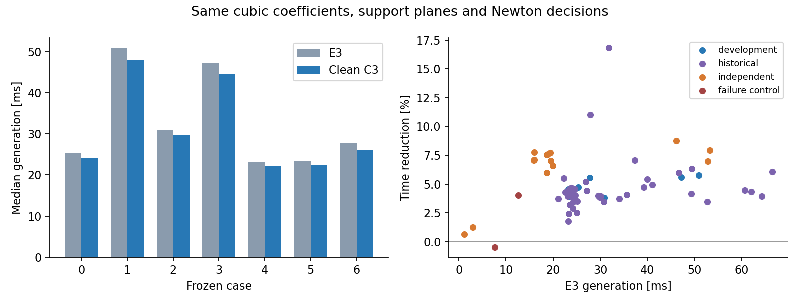
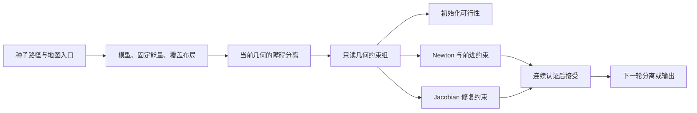

# 原生三次走廊：代码清理与热路径精简

E3 的代码和结果先提交为 `01c8a5b`，本轮以该提交为基线整理 C3 模块。清理后的 **67 例生成耗时合计下降 5.21%**，65 条成功路径全部更快；走廊系数、原始支持平面和 Newton 决策逐字节或逐项一致。

本轮的重点是收敛到一条清晰的实现链路：移除未采用的算法分支，把已经有效的内核和缓存变成固定实现，减少重复构造、复制、认证与计时。外部数据在生成入口校验；动态变量的数学可行性仍由求解与连续证书判断。

## 1. 相同输入下的验证

每个场景先独立取耗时中位数，再在组内求和。基线是冻结的 E3 二进制，候选是清理后的默认 C3；地图、路径、安全参数和优化预算相同。

| 输入组 | 数量 | E3 / ms | 清理后 / ms | 耗时下降 |
| --- | ---: | ---: | ---: | ---: |
| 原七例开发集 | 7 | 228.291 | 216.820 | 5.02% |
| 历史路径 | 44 | 1434.407 | 1365.687 | 4.79% |
| 额外环境 | 14 | 318.932 | 295.291 | 7.41% |
| 两个预期失败用例 | 2 | 20.235 | 19.764 | 2.33% |
| 全部输入 | 67 | **2001.864** | **1897.562** | **5.21%** |
| 全部成功输入 | 65 | 1981.630 | 1877.798 | **5.24%** |

65 条成功路径的耗时中位数均下降；两个失败用例一快一慢，状态均保持 `INITIALIZATION_FAILED`，已计入总体统计。



原七例每配置使用 3 个计时块，每块预热一次、正式运行 7 次，共 21 个计时样本。其余 60 例每块运行 3 次，共 9 个样本。按场景和计时块轮换、反转配置顺序。所有构建与实验串行执行，数值线程为 1，编译 `-j1`，测量绑定 CPU 2，地址空间上限为 4 GiB。

两组生成进程的峰值 RSS 均为 **52.42 MiB**。本轮没有观测到峰值 RSS 的进一步下降。

## 2. 移除了哪些实现

`OptimizerSettings` 从 **55 项缩减为 15 项**。保留几何权重、迭代预算、默认预设实际使用的预测与体积修正，以及明确的诊断开关。

| 类别 | 已移除的活动实现 |
| --- | --- |
| 未采用的连续约束实验 | E1 精确可达域、E2 升阶/二分替换、点约束交换、工作集 |
| 未采用的覆盖与初始化实验 | 旧分离平面复用、启发式自适应 knots、标架重定位、初始/末尾坐标半轴扩张 |
| 未采用的求解近似 | 替代距离障碍函数、弱曲率 Hessian、隔步 Hessian 刷新 |
| 旧计算实现与消融开关 | 逐行主求解、张量组装、急切障碍排序、额外当前值缓存、非缓存线搜索、先试完整步、缓存关闭开关 |
| 不再使用的边界与阶段策略 | 自然端点约束生成、障碍阶段数扫描、跨膨胀阶段跳步与统一收缩热启动 |

精确分组内核、轴向平面内核、提取缓存、覆盖布局缓存和能量矩阵复用不再需要开关，直接成为实现本身。`Fast`、`Balanced`、`Volume` 保留各自已使用的权重与迭代组合。

删除了 25 个旧实验头文件、测试和运行/分析脚本。历史报告、测量数据、输入及源码快照保持保留，旧配置可从相应提交恢复：E1 为 `5c6f860`，E2 为 `3a34a75`，完整 E3 为 `01c8a5b`。旧实验的开关只属于这些历史版本。

H5 基线、C3 投影质量参照、独立导数核对和轨迹回放接口仍有明确用途，继续保留。本轮没有运行轨迹优化。

## 3. 几何约束只构造、存储一次

此前同一批几何约束保存了两套数据：一套是按控制截面聚合的 `Group`，另一套是逐平面展开的 `Cut`。默认 Newton 已经使用前者，后者主要服务于旧算法分支。初始化和修复阶段还会复制这两套数据。

现在用 `GeometricConstraints` 保存只读的分组、保留行数和统计信息，初始化问题、第一次优化和 Jacobian 修复通过 `shared_ptr<const ...>` 共享它。`Cut` 只存储本阶段的前进约束。



新一轮膨胀产生新的分离面后，重新构造对应几何组；细化 knots 后重新创建布局。这个生命周期由生成流程保证，无需在每次目标函数求值时比较 knots、地图或整个缓存。

还完成了以下精简：

- 几何约束计数在构造时累计，后续优化直接读取，不再重新扫描每个平面。
- 冗余删除的证明仍用于判定，但只有独立证明测试要求时才保存证据列表，正常生成不分配这份诊断数据。
- 障碍参数预测只使用上一阶段最后一次 Newton 的梯度与因子，因此只在那个时刻计算所需梯度。
- 体积修正只需要目标函数的 Hessian，不再计算未使用的绝对对数代价值。
- 详细稠密参考组装移入 `cubic_diagnostics.cpp`，不再通过主求解器中的模式分支选择。

## 4. 检查与时钟放在哪里

### 输入检查

生成入口负责种子点、边界、半径、间距、预算和求解参数的有效性，移除重复点，并建立内部数据约定。控制点容量在模型构造前检查一次。模型、Newton 和覆盖内循环不重复验证这些外部数据。

### 动态可行性

SOC 余量、SPD 定义域、带状分解主元、截面退化和连续碰撞条件会随当前变量改变，属于算法本身。它们用于确定可行步长、触发修复或拒绝更新，不能由初始输入合法代替。

重复的是“对同一个已接受状态再次认证”。初始化经过连续认证，每次更新在接受前认证，体积修正也使用同一接受条件。因此最终输出直接使用已接受状态，不再为了导出重复执行一次完整支持与 Jacobian 认证。Benchmark 仍在计时外独立认证导出结果，并重新建立地图覆盖。

### 计时

默认路径只记录总耗时。阶段计时由 `profile=true` 显式开启，关闭时不会读取用于阶段统计的时钟。对应 Benchmark 环境变量为 `NATIVE_PROFILE=1`；此时才解释 `setup_ms`、`assembly_ms` 等分阶段字段。默认的零值表示“未测量”。RViz 指标增加了 `c3_stage_profiled:false`，不再输出四个未测量的 C3 子阶段字段。

超时检查保留在生成阶段、样条区间、递归细分和 Newton 步边界。原来每处理 32 个障碍物读取一次时钟，现在每 1024 个读取一次；区间入口与零层分离也不再重复读取。超时仍会终止请求，检查粒度意味着它不是硬实时截止保证。

七例中单独比较了计时开关，几何与求解决策完全一致。三次重复的耗时差在波动范围内，本轮总体加速不单独归因于关闭计时。

## 5. 数值与接口回归

| 验证 | 结果 |
| --- | --- |
| 67 例状态 | 65 成功、2 预期失败，与 E3 一致 |
| 三次系数、分段、原始支持平面 | 所有成功例逐字节一致 |
| Newton 步数、线搜索回退、Jacobian 修复、预测和体积步数 | 正式重复逐项一致 |
| 并集体积与边界平滑性 | 几何完全相同，变化为 0 |
| 连续支持、全截面 Jacobian 与独立地图覆盖 | 全部成功输出通过 |
| 分组与独立稠密梯度的最大相对误差 | 1.15 × 10⁻¹⁵ |
| Hessian 最大相对误差 | 1.15 × 10⁻¹⁵ |
| Fast、Volume | 各七例，清理前后几何及求解决策一致 |
| 阶段计时开关 | 七例输出一致 |
| CTest | 8 项全部通过 |

保留的测试覆盖提取与 C²、完整截面认证、带状求解与独立导数、分离排序、冗余证明、截面反求、缓存生命周期、输入异常和超时。已删除的算法分支对应测试随代码一起移除。

ROS 演示目标与轨迹回放目标均已串行编译通过，演示程序已重新安装。本轮没有启动 RViz，也没有运行轨迹优化。

## 6. 复现与资料位置

模块结构和编译命令见 [README](../direct_corridor/experiments/native_splines/README.md)。复跑七例默认路径：

```bash
cd /home/zdp/ForCodex/GCOPTER
python3 direct_corridor/experiments/native_splines/run_cleanup.py \
  --output .scratch/native_splines/cleanup/reproduce \
  --cases 0,1,2,3,4,5,6 --blocks 3 --repeats 7
```

对照脚本自动限制内存、线程和 CPU，使用 E1 冻结输入并核对 SHA256。基线二进制由提交 `01c8a5b` 构建，路径为 `.scratch/native_splines/cleanup_baseline/native_spline_benchmark`。两版均使用 Release，未启用 `-march=native`。

[结果目录](validation/native_splines_cleanup)保存逐例统计、全部计时序列、系数、支持平面、测试和集成构建日志。`results.json` 是完整汇总，`measurements.tar.gz` 是原始记录，`source_snapshot.tar.gz` 包含当前模块和三个集成文件，`manifest.json` 保存输入来源及文件哈希。
