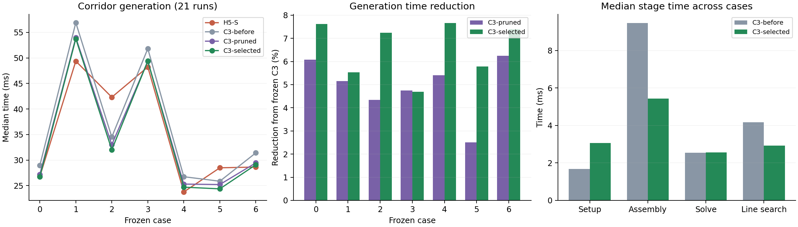
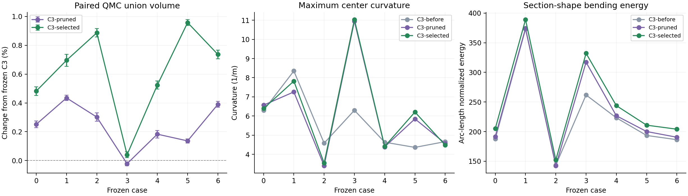

# 原生三次走廊：约束压缩、精确计算与生成性能

本轮以**走廊生成耗时、去重并集体积、几何平滑性和连续安全性**作为评价依据。
轨迹优化不参与配置选择。参考版本为 `f72f3fe`，地图、种子路径和机器人尺寸
均使用此前冻结的七例输入。

新的 C3 `Balanced` 默认组合为**有证明的约束压缩、精确计算内核、障碍参数预测和一次体积修正**。
七例完整生成时间下降 **4.7%–7.7%**，七例中位数之和从
256.15 ms 降到 **240.01 ms**，下降 6.30%；每例去重并集体积都增加，
幅度为 **0.04%–0.96%**。支持证书和全截面 Jacobian 证书全部通过。

同批 H5-S 的七例中位数之和为 247.54 ms，本轮 C3 低约 3.04%。
两条迷宫路径的优势最明显，场景 0 与 H5 接近，其余四例仍慢于 H5；这里没有
得到对所有地图都成立的速度优势。

## 1. 相同输入下的生成结果

图中 `C3-before` 为冻结版本，`C3-pruned` 为约束压缩与精确内核组合，
`C3-selected` 为加入预测和一次体积修正后的新默认配置。

| 场景 | H5-S / ms | 冻结 C3 / ms | 新 C3 中位数 / ms | 新 C3 P95 / ms | 相对冻结 C3 加速 |
| --- | ---: | ---: | ---: | ---: | ---: |
| 0 | 26.76 | 28.92 | 26.72 | 27.30 | 7.62% |
| 1 | 49.37 | 56.91 | 53.76 | 57.76 | 5.53% |
| 2 | 42.31 | 34.51 | 32.01 | 32.54 | 7.24% |
| 3 | 48.23 | 51.83 | 49.40 | 49.78 | 4.69% |
| 4 | 23.75 | 26.73 | 24.69 | 24.82 | 7.66% |
| 5 | 28.48 | 25.85 | 24.35 | 25.11 | 5.78% |
| 6 | 28.63 | 31.40 | 29.08 | 29.31 | 7.40% |

每例预热一次，正式重复 21 次，固定 CPU 2，交替参照与候选的运行顺序。
表中时间包含初始化、障碍覆盖、约束准备、优化、体积修正和最终连续认证；
不包含可复用的地图索引构建。原始记录另列索引时间，冷启动需把这一项加回。
所有编译、生成和统计串行运行，地址空间上限为 4 GiB，数值库使用单线程。

场景 0、1、3、4 为 Perlin，2、5 为迷宫，6 为保存的 RViz 路径。
仍使用 0.4 m 初始节点间距、3 m 局部扩张范围、0.25 m 体素外接球、
0.20 m 机器人半径和 0.05 m 安全余量。半轴和偏移的全局上限由局部盒对角线
导出，没有重新引入固定的小半轴上限。

## 2. 体积与边界质量

| 场景 | 冻结 C3 并集 / m³ | 新 C3 并集 / m³ | 增加 | 配对 95% 区间半宽 |
| --- | ---: | ---: | ---: | ---: |
| 0 | 436.395 | 438.499 | +0.4821% | ±0.0297% |
| 1 | 655.123 | 659.682 | +0.6959% | ±0.0416% |
| 2 | 430.030 | 433.842 | +0.8864% | ±0.0297% |
| 3 | 631.280 | 631.537 | +0.0407% | ±0.0202% |
| 4 | 497.632 | 500.240 | +0.5241% | ±0.0282% |
| 5 | 369.704 | 373.243 | +0.9572% | ±0.0208% |
| 6 | 539.133 | 543.102 | +0.7363% | ±0.0296% |

体积采用同一采样域、同一 QMC 序列的配对比较。六例各使用 8 个随机平移，
每组 262,144 点；场景 3 的差异较小，增加到每组 1,048,576 点。表中的区间
半宽来自随机平移之间的配对差，所有点的包含判定均已完成。
筛选阶段使用的扫掠积分会重复计算自重叠部分，只用于初筛；表格采用去重并集。

新走廊保持 C² 连续和正 Jacobian，但局部曲率与弯曲能量没有同步下降。
例如场景 3 的采样最大中心曲率从 **6.30 增至 11.03 m⁻¹**，形状弯曲能量从
261.89 增至 332.18；场景 5 的最大中心曲率从 4.36 增至 6.21 m⁻¹。
场景 1、2、4、6 的最大中心曲率则下降。图中同时展示这些变化，后续应在保留
体积和速度收益的基础上继续压低曲率峰值。

连续支持证书与全截面 Jacobian 证书仍是输出条件。另用独立 NumPy/SciPy
实现检查截面采样、障碍距离、地图边界和 C² 拼接，未发现碰撞或越界。
这里的“更好”体现为体积和生成速度同时改善；几何弯曲能量仍作为独立指标记录。

## 3. 有证明的约束压缩

一个三次 Bézier 控制截面对应一组半空间约束：

$$n_j^T c+\|M^Tn_j\|\le b_j.$$

以前，部分重复约束虽不改变可行域，仍会在每次 Hessian 组装、可行步长扫描
和线搜索中重复求值。现在先在构造问题时完成一次冗余证明，再让保留的约束
贯穿整个求解过程。

取当前可行截面中心 $c_0$，构造三维对偶点

$$q_j=\frac{n_j}{b_j-n_j^Tc_0}.$$

把它们投影到局部主要二维平面，用二维凸包快速寻找候选。投影只负责选候选，
删除依据仍在原三维变量域内计算。若有两个保留顶点满足

$$q_r=\lambda q_a+\eta q_b+e,\qquad
\lambda,\eta\ge0,\quad\lambda+\eta\le1,$$

且截面写成

$$c=c_{\rm ref}+\sum_i A_i d_i,\qquad M=\sum_i A_i S_i,$$

利用入口和优化约束保证的 $\|d_i\|\le d_{\max}$、
$0\prec S_i\preceq r_{\max}I$，可得

$$q_r^T(c-c_0+Mz)\le
\lambda+\eta+e^T(c_{\rm ref}-c_0)
+(d_{\max}+r_{\max})\sum_i\|A_i^Te\|,
\qquad \|z\|\le1.$$

右端严格小于 1 时，原约束由保留约束推出。实现给该界留出随计算尺度变化的
浮点余量，并保存原行编号、见证顶点和权重。见证只使用保留凸包顶点，因此
同时删除的约束不会互相依赖。

保留行被排成连续前缀，Newton 与步长扫描只遍历这个前缀。原始分离平面继续
用于阶段末的完整连续认证。单元测试另外用 `long double` 重算证明，覆盖
近共面、倾斜标架、单侧半空间、近平行法向和不能删除的面。

这一操作保持规定变量域内的几何可行集，但会改变有限障碍参数下的对数障碍
目标：删掉冗余半空间，也删掉了它的障碍项。因此最终中心和形状可能变化，
需要重新比较体积和几何，而不能把它视为逐字节等价的代码优化。

## 4. 不改变几何的计算优化

### 坐标轴平面的专用计算

地图和局部盒产生了较多与世界坐标轴平行的平面。构造时识别这类法向，求值时
直接读取相应坐标，Hessian 只更新六个非零项。一般障碍平面仍使用完整三维
计算。常用的精确 Lorentz 障碍内核在组外选择计算模式，避免在每个约束内
反复判断实验开关。

### Newton 只计算实际需要的量

缓存线搜索直接计算 $f(x+\alpha p)-f(x)$，不使用 Newton 组装返回的绝对函数值。
因此该路径只计算梯度、Hessian 和定义域条件，省去逐条 `log`。
独立的函数值求值、差分检查和非缓存线搜索仍保留完整目标。

固定工作集时，活跃约束数量在一个子问题内不变，统计值也只计算一次，避免
为了日志在每次 Newton 更新中重新扫描全部约束。

### 用便宜上界接受线搜索

沿搜索方向，每个行列式或 SOC 平方余量都能写成相对变化
$q(\alpha)=\alpha(b+\alpha a)$，对数障碍增量为
$-w\log(1+q)$，其中 $w>0$。

当 $q>-1$ 时，有下面两个下界：

$$L(q)=\begin{cases}
\dfrac{2q}{2+q},&q\ge0,\\[4pt]
\dfrac{q(2+q)}{2(1+q)},&-1<q<0.
\end{cases}
\qquad L(q)\le\log(1+q).$$

两段都与对数在零点的一、二阶展开一致。正半轴上，
$\log(1+q)-2q/(2+q)$ 的导数为
$q^2/[(1+q)(2+q)^2]\ge0$；负半轴上，另一段差值的导数为
$-q^2/[2(1+q)^2]\le0$。结合零点取值为零即可得到上述界。

于是用 $-wL(q)$ 替代各障碍增量，得到真实目标增量的上界。若这个上界已经
满足 Armijo 条件，就可以直接接受；否则回到原来的精确 `log1p` 求值。
求和只在末尾添加一次浮点累计余量。可行步长与最终几何认证没有改变。

精确优化对照中，七例的生成系数与冻结 C3 逐字节相同。这一组实验单独保留，
用来区分计算实现带来的加速与后续算法配置带来的变化。

## 5. 三次原生生成中的预测与体积修正

在约束压缩和精确内核基础上，复用上一轮已经实现的中心路径预测与扫掠体积
梯度，把计算预算放在更有效的更新上。

对 $f(x)+\mu\phi(x)$，障碍参数下降时使用

$$\Delta x\approx(\mu_{\rm old}-\mu_{\rm new})H^{-1}\nabla\phi(x)$$

提出新阶段的初值。它复用上一阶段的带状因子，候选步仍经过可行步长与目标
下降检查。每轮由 `8/4/4` 次 Newton 更新改成 `8/3/3`，两次扩张合计
**28 次 Newton 更新和 4 次预测更新**。

末尾再做一次体积修正。对已经通过正 Jacobian 认证的椭圆扫掠，带重数体积为

$$V_{\rm sweep}=\pi\int(M_0\times M_1)^Tc'\,du.$$

三次几何使被积项最高八次，五点 Gauss 积分可精确计算。世界几何对控制变量
仿射，沿给定变量方向的体积是三次多项式；检查可行区间端点和二次导数方程
的根即可选择候选步。候选经过完整支持与 Jacobian 认证后才接受。
末尾的并集测量负责验证这种积分改进有没有变成实际空间收益。

新默认指 `generateNative()` 的 `NativePreset::Balanced`：

| 设置 | 本轮值 |
| --- | --- |
| `projected_pruning` | 2：同时压缩障碍组装和步长扫描 |
| `axis_kernels` / `skip_unused_values` / `bounded_line` | 开启 |
| `path_predictor` | 1 |
| 初始 / 后续障碍阶段 Newton 预算 | 8 / 3 / 3 |
| `volume_refinements` | 1 |
| 弱曲率近似、Hessian 延迟、替代障碍函数 | 关闭 |

## 6. 其余实验结果

| 方法 | 本轮观察 | 处理 |
| --- | --- | --- |
| 二维候选加三维残差证明 | 显著减少约束；预处理本身也有成本 | 接入默认流程 |
| 逐行直接组装 20 维 Hessian | 比九维组聚合明显慢 | 保留对照 |
| 正则化距离障碍 | 梯度和 Hessian 正确，但初筛更慢 | 不默认开启 |
| 优化前做半轴扩张 | 常降低最终体积，有的场景触发 Jacobian 修复 | 不默认开启 |
| 每两步复用一次完整 Hessian | 初筛加快约一成，但部分体积积分下降约 9% | 不默认开启 |
| 弱约束只保留中心曲率 | 体积变化较小，速度收益不稳定 | 保留对照 |
| 预测后减少 Newton 步 | 更快、六例体积增加，一例缩小 | 配合一次体积修正 |
| 一次体积修正 | 小幅增加计算，补回缩小场景的体积 | 接入平衡配置 |

前几项在三个开发场景筛选，约束压缩、精确内核和最终组合扩展到七例。
所有原始测量与未采用的配置均保留。早期筛选的扫掠积分与正式并集体积分别
存储，没有混用为同一种体积指标。

## 7. 验证与后续方向

新增测试覆盖约束冗余证明、组装与稠密参考的一致性、梯度/Hessian 差分、
零投影处的正则化距离障碍、缓存与非缓存步长、对数增量上界及优化结果一致性。
原生测试 7/7、公共回归 8/8 通过。

正式生成中，最大全局梯度差分相对误差为
`1.18e-08`，Hessian 为
`2.22e-10`；按种子弧长归一化的
最大 C² 拼接误差约为 `6.04e-13`。
生成 Benchmark 的峰值 RSS 为 **47.9 MiB**。
各例均为 28 次 Newton、4 次接受的预测和 1 次接受的体积修正，Newton 线搜索
上界全部成功接受，无需计算精确对数增量。各例仍用完固定迭代预算，终止状态
如实记录为 `iteration_limit`，安全认证标准保持一致。

本轮完成了方案中的约束压缩、精确内核、替代障碍、初值扩张和部分延迟曲率
实验，并把预测、体积修正与优胜内核组合。局部块修正、按需进度约束及跨更新
的细分证书复用仍是后续工作。下一步优先减少分离面构造和复杂转弯处的组装
成本，同时控制局部曲率峰值，继续只用走廊自身的速度、体积和几何质量选型。

- [测量汇总与全部时间序列](validation/native_splines_round5/results.json)
- [正式生成、几何和历史轨迹原始数据](validation/native_splines_round5/formal_raw.tar.gz)
- [所有筛选实验](validation/native_splines_round5/exploration_raw.tar.gz)
- [独立走廊几何检查](validation/native_splines_round5/corridor_audit.json)
- [复现实验说明](../direct_corridor/experiments/native_splines/README.md)

此前已完成的轨迹对照作为历史数据保留，后续配置选择没有使用其结果，也没有
再进行新的轨迹优化。七例均为固定开发集，独立留出场景的泛化实验尚未开展。
