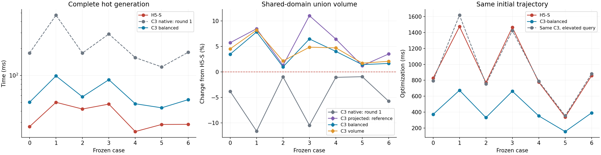
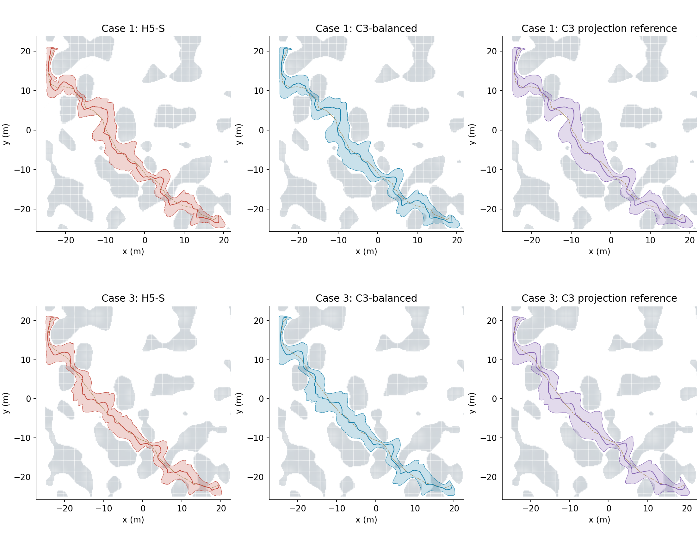
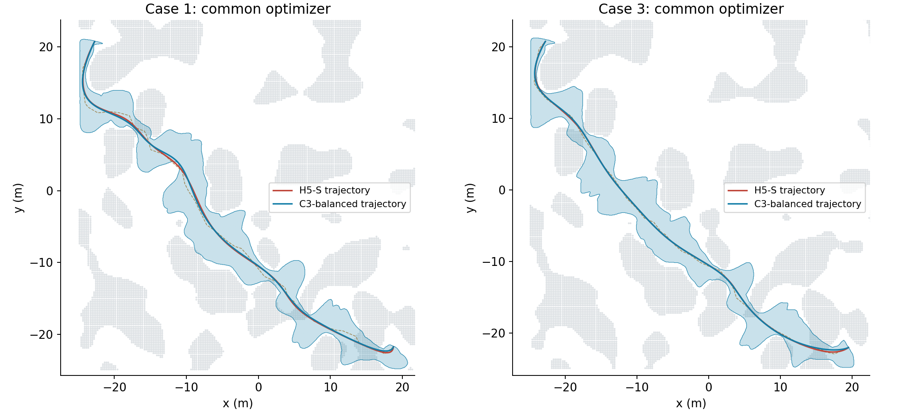

# 原生三次走廊：生成、体积与查询优化

这轮在 `experiment/native-cubic-minjerk` 上继续优化直接从种子路径生成的三次
B 样条。上一轮的 H5 投影结果作为几何质量参照；新的原生入口不调用 H5 或
FIRI。地图、种子路径、机器人尺寸、扩张范围和连续认证标准沿用七例冻结输入。

## 本轮结果

**默认选择原生 C3 `balanced`。** 它直接从种子路径生成，在七例上恢复了投影
参照 95.9%–100.2% 的并集体积，生成速度比首轮原生实现提高 2.9–4.8 倍。
单独的生成耗时仍高于 H5-S；使用原生三次查询后，生成与轨迹优化两阶段的
耗时之和降到 H5-S 的 48%–54%。



左图为可复用地图索引时的完整生成耗时，包含初始化、优化和连续认证。
中图的体积是去除自重叠后的扫掠并集体积。右图额外固定同一条三次走廊，
只切换查询器，区分几何变化和查询实现的收益。

| 场景 | H5-S / ms | 原生 C3 首轮 / ms | C3 平衡 / ms | 平衡体积变化 | 体积 / 投影参照 |
| --- | ---: | ---: | ---: | ---: | ---: |
| 0 | 26.80 | 178.22 | 50.22 | +3.46% ± 0.06% | 97.87% |
| 1 | 50.05 | 471.43 | 98.76 | +7.83% ± 0.06% | 99.42% |
| 2 | 42.11 | 177.99 | 57.67 | +0.97% ± 0.03% | 99.70% |
| 3 | 47.78 | 290.35 | 89.55 | +6.45% ± 0.12% | 95.89% |
| 4 | 23.58 | 158.22 | 48.25 | +4.01% ± 0.06% | 97.73% |
| 5 | 28.30 | 124.51 | 43.46 | +1.41% ± 0.04% | 100.21% |
| 6 | 28.38 | 181.35 | 53.57 | +1.65% ± 0.03% | 98.21% |

时间为各例预热一次、正式七次的中位数。体积变化相对 H5-S，误差项为配对
95% 区间半宽，单位为百分比点。所有模型共用采样域和随机化 Sobol 序列，
每例使用 8 次随机平移、每次 262,144 个样本；未判定样本数均为零。
投影列使用首轮冻结几何，作为空间质量参照，不参加本轮生成速度排名。
场景 0、1、3、4 为 Perlin 路径，2、5 为迷宫，6 为此前保存的 RViz 路径。



上图为实际扫掠的俯视投影，灰色障碍显示种子路径中间高度的切片，虚线为
种子路径，实线为走廊中心。上下两行展示场景 1 和 3；投影参照在场景 3
仍有约 4.1% 的体积优势，说明原生初始化和局部扩张还有改进空间。

### 相同初值的轨迹优化

| 方案 | 生成中位数 / ms | 优化中位数 / ms | 采样验收 | 目标值 / H5-S（中位数） |
| --- | ---: | ---: | ---: | ---: |
| H5-S | 28.4 | 826.2 | 2/7 | 1.00000 |
| C3-fast | 48.4 | 360.8 | 4/7 | 1.00481 |
| C3-balanced | 53.6 | 371.4 | 5/7 | 0.99857 |
| C3-volume | 58.5 | 366.4 | 3/7 | 1.00519 |
| C3 投影参照 | 冻结几何参照 | 359.2 | 3/7 | 0.99721 |

该表先计算每例正式重复的中位数，再取七例之间的中位数。轨迹各预热一次、
正式重复三次，使用共同的五次最小 jerk 优化器、相同初始变量及 800 次迭代
上限。原始目标值、时长、路径长度、jerk 能量和动力学极值全部保存。
平衡档的目标值比值中位数为 0.99857，jerk 能量比值中位数为 1.01175，
因此收益主要体现为速度和采样可行率，并非所有轨迹质量指标都同时改善。

同一条 `C3-balanced` 几何使用旧的升阶查询器时，采样验收仍为 5/7。
原生查询使优化速度提高 **2.14–2.40 倍**；浮点运算顺序会影响有限迭代后的
优化结果，最终目标值的最大相对差为 0.142%。这项对照没有重新生成走廊。



轨迹采样使用不大于 5 ms 的时间间隔，且至少为优化采样密度的四倍。
验收要求径向与截面残差不超过 5 mm，并满足同一动力学容差。平衡档的场景
1、5 径向残差分别为 6.00、6.21 mm，因此记为未通过；全部五组轨迹的
采样障碍穿透与反求失败数均为零。该采样验收与走廊的连续几何证书分别记录。

体积优先档在七例中的六例比平衡档更大，但轨迹采样验收下降到 3/7。
结合速度和下游效果，本轮选择平衡档作为默认值。

### 分阶段时间与 CPU 指令集

平衡档七例的阶段时间中位数如下。各阶段分别取中位数，不能直接相加当作
某一条路径的总时间。

| 阶段 | 时间 / ms |
| --- | ---: |
| 初始化 | 1.15 |
| 障碍查询与分离面覆盖 | 10.33 |
| 优化器准备 | 1.87 |
| 梯度与 Hessian 装配 | 25.86 |
| 带状分解及回代 | 2.55 |
| 线搜索 | 9.12 |
| 优化中的 Jacobian 检查 | 0.40 |
| 最终复核 | 0.21 |

瓶颈已经从大量重复局部矩阵计算收敛到支持约束装配；带状求解只占较小部分。
BVH 首次构建另需 27.3–34.8 ms，冷启动时应把对应场景的建树耗时加回。
平衡档热生成 P95 为 43.93–99.24 ms。

另外在 AMD Ryzen 7 9700X、GCC 15.2 上，以相同配置给 H5 和 C3 都启用
`-march=native`，C3 平衡档生成耗时降到 36.16–81.97 ms，较通用指令集
版本减少约 16%–19%。该收益单列，主表仍使用通用 Release 编译。
两种编译的几何系数最大差为 $2.49\times10^{-8}$，连续认证均通过。

## 为什么原生初始化会损失体积

上一轮从半径 0.033 m 的小圆截面开始生成分离平面，再进行两轮扩张。极小
截面提供的分离方向并不适合最终的大椭圆；有限的 Newton 预算也需要先用于
扩张小截面。H5 投影组已经有较大的截面和调整过的中心，因此具有更好的起点。

现在先根据控制位置到膨胀障碍球、世界边界的距离，给每个控制截面设置不同
的初始圆半径，采用局部净空的 65%。这个初始化随后通过完整连续认证；
不能认证时再使用小截面初始化。七例正式测量均直接接受了净空初始化。

该改动没有预先生成五次走廊，也没有把 H5 生成成本隐藏到初始化之外。
它借鉴的是投影组“大截面进入优化”的优势。固定间距仍为 0.4 m。

## 利用三次局部结构减少计算

### 精确零结构与截面级汇总

简单内部 knots 下，每段三次 Bézier 的两个内部控制截面各依赖两个 B 样条
控制点，端部控制截面通常依赖三个。提取矩阵中的结构性零直接写为零，避免
浮点相消留下的微小数值把稀疏关系变成四控制点稠密关系。

原实现对每个平面约束分别构造一个 20×20 局部 Hessian。新的实现把作用于
同一个控制截面的所有平面放在一组。设该截面的九维世界几何量为
$Y=[c,\operatorname{vec}(M)]=Y_0+Ax$，则先累计

$$g_Y=\sum_p g_p,\qquad H_Y=\sum_p H_p,$$

再一次性传回控制变量：

$$g_x=A^Tg_Y,\qquad H_x=A^TH_YA.$$

每个支持约束只有三个投影通道，世界坐标 Hessian 的各块都是
$n n^T$ 的标量倍数。利用这一结构后，可以减少重复几何求值和控制变量映射。
未分组的进度约束使用稀疏 Gram 更新，直接写入下三角带状存储。

仅改变装配时，七例输出与上一轮系数的最大差约为 $4.4\times10^{-13}$。
这一阶段的速度收益与后续初始化、正则权重及迭代预算调整分别记录。

### 步长与局部正则性

SOC 沿搜索方向的可行条件是一个二次不等式。先检查完整试探步，只有它可能
越界时才求第一个正根，以 0.99 的比例留在可行域内。矩阵正定和偏移半径约束
也采用对应的一维边界。这样减少了反复试探不可行步长的计算。

急转弯处提前加入固定法向的局部进度 SOC，避免先扩张到折叠状态再重算。
已经发现的问题区间跨扩张轮次复用；需要修复时，从满足新增约束的混合点热启动。
最终仍检查原始支持约束和完整八次 Bernstein Jacobian 锥证书。

## 原生三次截面求值与反求

新的查询器直接存储每段四个幂基系数，以三次 Horner 同时计算中心、形状及
一阶导数。均匀 knots 使用常数时间定位，非均匀 knots 使用区间查找。

截面反求沿用相同的隐式方程和梯度：

$$f(u,p)=n(u)^T(p-c(u))=0,\qquad
\frac{\partial u}{\partial p}=-\frac{n(u)^T}{f_u}.$$

利用 $\det(M^TM)=\|M_0\times M_1\|^2$ 直接计算 2×2 Gram 逆，并缓存截面
的对偶映射。查询和截面缓存采用精确键，不根据上一次轨迹的解改变根的初始提示。
因此缓存只影响计算量。

轨迹优化的热路径不再将三次升阶到五次。升阶接口保留用于独立核对和稠密审计，
H5 对照仍使用原查询器。查询改进同时包含低阶求值、Gram 计算和缓存调整，
不能把全部收益仅归因于多项式次数。

## 配置选择与未采用的尝试

三个原生配置都使用两轮扩张、相同间距、净空初始化和提前进度约束。

| 配置 | 每轮三个障碍阶段的 Newton 上限 | 中心/形状弯曲权重 |
| --- | --- | --- |
| fast | 6 / 4 / 4 | 1e-5 |
| balanced | 8 / 4 / 4 | 1e-5 |
| volume | 6 / 6 / 6 | 1e-6 |

`balanced` 是 `generateNative()` 的默认配置。原始停止状态保存在结果中，
达到迭代上限与通过几何认证是两个独立记录。

本轮还串行扫描了初始半径比例、节点间距、弯曲权重、障碍参数阶段数、
迭代分配、进度约束、重定向标架、工作集和极对偶凸包删冗余。

- 过少的 Newton 步数、直接跳到最后一级障碍参数，会损失明显体积。
- 0.5/0.6 m 间距可以减少计算，但在部分窄通道上损失空间，没有作为主配置。
- 仅按当前支持余量启用约束，节省有限，且需要额外处理新增活跃约束。
- 极对偶凸包可以删除部分冗余平面，但预处理成本抵消了本组输入上的收益。
- 直接旋转已扩张截面的标架没有获得有效收益，未进入默认流程。
- 三轮扩张有时进一步提高体积，也可能重新触发昂贵的 Jacobian 修复。

不同实现阶段的探索记录按各自二进制哈希保存。正式三档对比使用同一个最终
二进制；探索扫描用于选择配置，不作为独立留出集的泛化结论。

## 验证与复现

五个三次实验测试与八个公共轨迹回归测试全部通过；CPU 专用编译也通过相同
五个三次测试。测试覆盖非均匀 knots、精确提取、值与导数、C²、细分、升阶、
分组/稠密 Hessian 等价、梯度/Hessian-vector、带状求解和解析可行步长。

合成场景中，直线、90° 转弯、U 形、竖直、螺旋及非相邻近距离路径通过；
尖点折返与不满足当前机器人净空的 0.03 m 窄口明确返回初始化失败。
正式三档的七例全部完成连续障碍与全截面 Jacobian 认证，均一次初始化成功，
无 Jacobian 修复重启。Newton 原始终止状态均为 `iteration_limit`，没有将
有限预算下的可行输出记作收敛解。

| 数值核对 | 最大误差 |
| --- | ---: |
| 生成目标方向梯度相对误差 | 1.69e-8 |
| 生成 Hessian-vector 相对误差 | 2.98e-10 |
| 公共轨迹目标方向梯度相对误差 | 3.14e-8 |
| 三次查询梯度与高精度独立求根有限差分的绝对误差 | 1.19e-7 |
| NumPy 独立检查的 C² 误差（种子弧长参数） | 3.23e-11 |

查询有限差分采用独立 de Casteljau 求值和高精度求根。直接对停止阈值为
1e-8 的快速反求结果作 1e-6 位置扰动，会把求根停止误差放大；原查询器
也有相同现象，因此独立核对不依赖两种实现的快速求根停止时刻。

独立 NumPy/SciPy 审计覆盖 35 条几何输出，采样未发现障碍穿透或越过地图
边界。正式生成进程峰值 RSS 最高 40.2 MiB，轨迹比较进程最高 29.6 MiB；
这两个数字不包含编译器和离线绘图程序。

完整数据和核对记录：

- [结构化汇总与所有正式计时](validation/native_splines_optimized/results.json)
- [33 组探索配置记录](validation/native_splines_optimized/exploration.json)
- [独立几何审计](validation/native_splines_optimized/independent_audit.json)
- [查询数值核对](validation/native_splines_optimized/query_checks.txt)
- [三次测试](https://github.com/Bziyue/GCOPTER/blob/62645e2fa2b7205d2a7492c05305734dd8534021/docs/validation/native_splines_optimized/native_ctest.log)、[公共回归](https://github.com/Bziyue/GCOPTER/blob/62645e2fa2b7205d2a7492c05305734dd8534021/docs/validation/native_splines_optimized/common_ctest.log)、[CPU 专用测试](https://github.com/Bziyue/GCOPTER/blob/62645e2fa2b7205d2a7492c05305734dd8534021/docs/validation/native_splines_optimized/native_arch_ctest.log)
- [验证元数据](validation/native_splines_optimized/validation.json)

`generation/` 和 `trajectory/` 保存各组 manifest、原始运行行和压缩系数。
`geometry/` 保存共同采样域使用的六组几何及体积结果；
`round1_generator_sources.tar.gz` 保存首轮生成器源码，用于追溯本轮优化前的实现。
去重后的地图和路径快照保存在 `frozen_inputs.tar.gz`，解包到仓库根目录即可
恢复冻结输入，不需要重新搜索路径或依赖原 RViz 录制目录。

实验代码位于 `direct_corridor/experiments/native_splines/`。原生 API 为
`generateNative(seed, index, bounds, options, NativePreset::Balanced)`；
`CubicQuery` 直接接收返回的三次几何。所有编译与实验均串行运行。

```bash
cd /home/zdp/ForCodex/GCOPTER
tar -xzf docs/validation/native_splines_optimized/frozen_inputs.tar.gz
cmake -S direct_corridor/experiments/native_splines \
  -B .scratch/native_splines/build -DCMAKE_BUILD_TYPE=Release \
  -DNATIVE_SPLINE_TRAJECTORY=ON \
  -DCMAKE_PREFIX_PATH="$PWD/.scratch/ompl/usr"
cmake --build .scratch/native_splines/build -j1
ctest --test-dir .scratch/native_splines/build --output-on-failure -j1
python3 direct_corridor/experiments/native_splines/run.py \
  --native --generation-only --method-count 1 --preset balanced \
  --repeats 7 --samples 65536 --output .scratch/native_splines/round2/balanced
python3 direct_corridor/experiments/native_splines/trajectory.py \
  --geometry .scratch/native_splines/round2/balanced \
  --models H5-S,C3-OPT-native --repeats 3 \
  --output .scratch/native_splines/round2/trajectory_balanced
```

将 `--preset` 改为 `fast` 或 `volume` 可复现另外两档。
`--quintic-replay` 单独测量同一三次几何使用旧查询器的结果。
CPU 专用编译使用独立目录并开启 `-DNATIVE_SPLINE_NATIVE_ARCH=ON`；H5 和
三次会使用相同指令集配置，未开启 `fast-math`。
