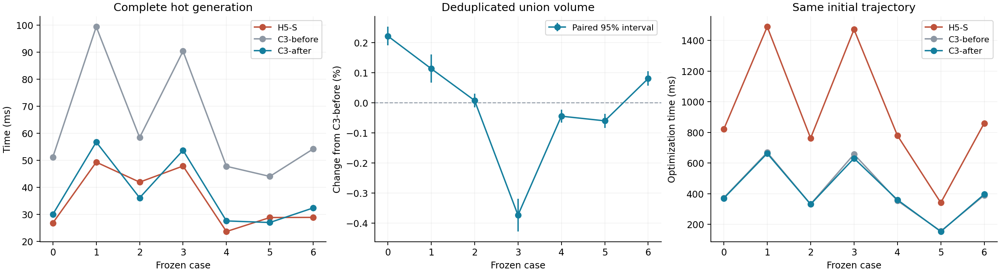
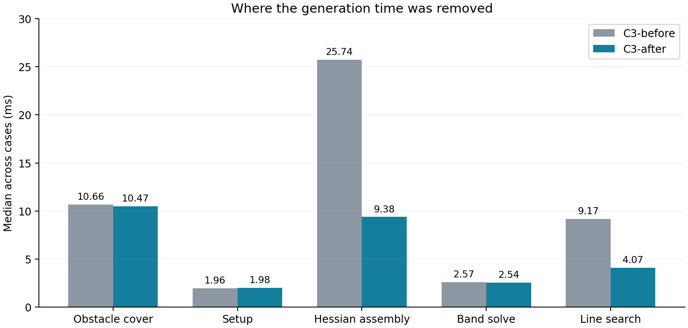

# 原生三次走廊：约束合并、块装配与线搜索缓存

这轮先将已有三次实现和实验结果提交为 `5ed3f99`，随后在
`experiment/native-cubic-minjerk` 上继续优化。主要比较对象是该提交中的
原生 C3 `balanced`；H5-S 使用同一份冻结输入作为速度和质量参照。

默认配置保留 0.4 m 节点间距、65% 净空初始化、两轮扩张，以及每轮
8 / 4 / 4 步的三个障碍参数阶段。中心和形状的弯曲权重仍为 `1e-5`。
变化集中在约束组织、局部矩阵运算和线搜索，不靠减少 Newton 预算获得速度。

## 结果

原生 C3 的完整热生成从 **44–99 ms 降到 27–57 ms**。两条迷宫路径已经
快于 H5-S，其余五条还慢约 12%–17%。七条路径全部通过连续障碍支持与
全截面 Jacobian 认证。



| 场景 | H5-S / ms | 上一版 C3 / ms | 本轮 C3 / ms | C3 耗时下降 | 体积相对上一版 C3 | 体积相对 H5-S |
| --- | ---: | ---: | ---: | ---: | ---: | ---: |
| 0 | 26.77 | 51.14 | 29.97 | 41.4% | +0.222% ± 0.031% | +3.68% |
| 1 | 49.29 | 99.42 | 56.73 | 42.9% | +0.113% ± 0.047% | +7.91% |
| 2 | 41.88 | 58.41 | 36.08 | 38.2% | +0.008% ± 0.022% | +0.97% |
| 3 | 47.86 | 90.39 | 53.67 | 40.6% | -0.373% ± 0.055% | +5.98% |
| 4 | 23.60 | 47.75 | 27.52 | 42.4% | -0.044% ± 0.021% | +3.93% |
| 5 | 28.78 | 44.00 | 26.94 | 38.8% | -0.060% ± 0.023% | +1.35% |
| 6 | 28.84 | 54.19 | 32.34 | 40.3% | +0.081% ± 0.024% | +1.75% |

时间为每例预热一次、正式七次的中位数，包含初始化、障碍查询、分离面生成、
优化和连续认证；可复用的地图索引建树时间单列。场景 0、1、3、4 为 Perlin，
2、5 为迷宫，6 为此前保存的 RViz 路径。全部使用通用 Release 编译，
未在本轮启用 `-march=native` 或 fast-math。
测试机器为 AMD Ryzen 7 9700X，编译器为 GCC 15.2；数值库线程数固定为 1。

体积统计使用三组模型共同覆盖的采样域、相同随机化 Sobol 序列，以及
8 次随机平移 × 262,144 个样本。表中的误差项是“本轮 C3 减去上一版 C3”
配对差的 95% 区间半宽，单位为百分比点。测量的是去除自重叠后的扫掠并集，
不是将各截面面积沿路径简单相加。

## 一、共享截面的支持约束只计算一次

相邻三次 Bézier 区间在公共 knot 处拥有同一个截面；de Casteljau 子区间也
共享边界截面。原来按区间分别保存约束，会反复计算这些相同的几何量。

现在为公共截面建立统一标识，左右区间使用同一组全局控制点与提取系数。
同一截面上，法向相同的两个约束

$$n^T c+\|M^Tn\|\le b_1,\qquad n^T c+\|M^Tn\|\le b_2$$

合并为一个边界 $\min(b_1,b_2)$。这保持原可行域。最后的连续认证仍遍历
原始覆盖平面，因此优化时的公共截面表达也受到原几何证书的独立核对。

每例最后一轮合并了 834–1,956 条重复支持约束。需要区分两件事：
**可行域相同不表示有限障碍参数下的目标完全相同。** 删除重复的对数障碍项
会改变障碍函数的权重分布，所以体积和轨迹需要重新测量，不能直接宣称输出不变。

## 二、只装配实际占用的 5×5 控制块

每个控制点只有五个变量：二维中心偏移和二维对称形状矩阵的三个独立元素。
对同一控制截面，先在九维世界几何中汇总平面贡献：

$$Y=[c,M_0,M_1],\qquad g_Y=\sum_p g_p,\qquad H_Y=\sum_p H_p.$$

控制点 $i$ 的映射 $J_i$ 重复使用加权运输标架 $w_i F_i$，只有固定的几个
非零位置。现在直接计算

$$g_i=J_i^T g_Y,\qquad H_{ij}=J_i^T H_YJ_j,$$

并将实际存在的 5×5 块写入下三角带状存储。去掉填充的 9×20 映射和
20×20 临时 Hessian，不为结构性零做矩阵乘法。Newton 的梯度、搜索方向、
候选值和分解缓冲区跨迭代复用。

这部分延续了 H5 中“按截面汇总、直接写局部块”的有效做法，同时按 C3 的
局部控制点关联组织带宽。固定完整输入、只替换装配时，最大几何系数差为
`5.13e-8`；密集独立装配器的梯度与 Hessian 核对也通过。



| 阶段 | 上一版 C3 / ms | 本轮 C3 / ms |
| --- | ---: | ---: |
| 障碍查询与分离面覆盖 | 10.66 | 10.47 |
| 优化器准备 | 1.96 | 1.98 |
| 梯度与 Hessian 装配 | 25.74 | 9.38 |
| 带状分解与回代 | 2.57 | 2.54 |
| 线搜索 | 9.17 | 4.07 |

各列先取每例重复中位数，再取七例中位数，不能相加代表某一条路径。
本轮还将修复循环首次 Jacobian 检查纳入阶段计时；完整 `total_ms` 的计时
边界没有变化。带状求解已不是主要瓶颈，下一步更值得关注障碍覆盖和支持项累加。

## 三、把线搜索化成缓存的一维二次式

H5 已经使用解析可行步长。C3 在此基础上，把可行边界与 Armijo 代价求值
共用的系数一次算出，避免每次回退重新求整个几何。

沿 Newton 方向 $x(\alpha)=x+\alpha p$，SOC 的三个投影分量都是仿射函数，
其平方余量为二次式：

$$q(\alpha)=v_0(\alpha)^2-v_1(\alpha)^2-v_2(\alpha)^2
=C+B\alpha+A\alpha^2.$$

二维形状矩阵的行列式、半轴上下界和中心偏移圆约束也具有相同结构。
对数障碍的代价变化可以精确写成

$$-\mu\log\frac{q(\alpha)}{q(0)}
=-\mu\log\!\left(1+\alpha\left(\frac BC+\alpha\frac AC\right)\right).$$

缓存 $A/C$、$B/C$ 和权重后，试探步只需标量运算与 `log1p`。二次目标的
变化也预先合并成 $\alpha(l+\alpha q)$。同一批系数同时用于求第一个可行
边界，保留 0.99 的边界比例。它计算的是原目标的精确一维限制，不是近似代价。

这一方法本身也适用于 H5；C3 的结构优势体现在生成这些系数时，只读取
实际关联的局部五维控制块。测试逐一核对缓存代价差、完整目标重算和原解析步长。

## 四、利用三次导数只有二次的结构

三次 Bézier 的一阶导数由三个二次 Bézier 控制量决定。原进度约束先把
导数区间分成两半，再对每半的三个控制量施加约束；使用三个固定参考法向时，
每个受约束区间产生 18 行。

新的默认配置直接使用原二次导数的三个控制量，即每个区间 9 行。
这减少了进度约束的装配和线搜索开销。未细分控制凸包通常更保守，
因此这里的收益来自较少的约束行，**不意味着未细分比细分更精确**。
最终仍使用完整八次 Bernstein 全截面 Jacobian 证书。

当局部认证失败时，修复流程恢复更细的约束；两半导数曲线共享的中点只保留
一次。已识别的修复区间跨扩张轮次复用。正式七例没有发生修复重启。

将参考法向进一步减少到一个，虽然单次优化更便宜，却在长转弯路径上引发
额外 Jacobian 修复，完整生成反而变慢，因此保留三个法向。

## 五、热启动与其他尝试

这轮对第三项建议——障碍参数延续和 Newton 热启动——进行了单独扫描。
第二轮扩张复用上一轮解是合理的；直接省掉粗障碍参数阶段却没有得到质量相当的结果。
重新生成分离面后，上一轮的贴边解并不位于新障碍函数的中心路径附近。

| 尝试 | 实测现象 | 默认选择 |
| --- | --- | --- |
| 第二轮跳过粗障碍阶段 | Newton 步数减少，但多例扫掠积分下降约 5%–20% | 保留三个阶段 |
| 先收缩 1%–10% 再跳阶段 | 未恢复相同体积，部分配置触发修复 | 关闭 |
| 每步先试完整 Newton 步 | 多数步仍受支持边界限制，试探通常被拒绝 | 关闭 |
| 将世界 Hessian 压缩为 6×6 系数张量 | 运算减少未转化为稳定的完整耗时收益 | 关闭 |
| 逐控制点解析扩张 | 完整预算下扫掠积分增加不足约 0.1%，额外增加耗时 | 关闭 |
| 降低中心/形状弯曲权重 | 小幅增加扫掠积分，轨迹采样验收从 5/7 降到 4/7 | 保留 `1e-5` |

探索阶段使用五点 Gauss 积分精确计算三次扫掠的 Jacobian 积分，用于快速筛选。
它会重复计算自重叠部分，表中的探索变化不是去重并集体积。最终选择单独使用
共享 QMC 统计。各实现阶段具有各自源码和二进制哈希，未把不同阶段当作同一个
二进制上的受控消融。

## 六、相同初值的轨迹结果

走廊生成器修改后，使用同一个冻结的公共轨迹二进制，重放 H5-S、上一版 C3
和本轮 C3。三组的初始变量哈希逐例相同；五次最小 jerk 轨迹、动力学参数、
代价权重、Bézier 约束深度、积分密度及 800 次迭代上限全部相同。

| 方案 | 生成中位数 / ms | 轨迹优化中位数 / ms | 采样验收 | 目标值 / H5-S | jerk 能量 / H5-S |
| --- | ---: | ---: | ---: | ---: | ---: |
| H5-S | 28.84 | 821.40 | 2/7 | 1.00000 | 1.00000 |
| 上一版 C3 | 54.19 | 373.23 | 5/7 | 0.99857 | 1.01175 |
| 本轮 C3 | 32.34 | 370.59 | 5/7 | 0.99927 | 1.01579 |

各指标先计算逐例重复中位数，再取七例中位数。相对上一版 C3，本轮轨迹目标值
逐例变化为 −0.26% 至 +0.19%，jerk 能量变化为 −2.86% 至 +2.63%。

轨迹每组预热一次、正式三次。两版 C3 均有 5/7 通过采样验收，H5-S 为 2/7。
本轮 C3 的场景 1、5 径向残差分别为 6.33、6.35 mm，超过 5 mm 验收阈值；
全部三组的采样障碍穿透和反求失败数均为零。采样时间间隔不大于 5 ms，
并至少达到优化采样密度的四倍。

轨迹优化器在大多数场景达到 800 次迭代上限，原始状态为 `-1008`；场景 5
为 `1`。走廊的连续安全证书与轨迹采样验收分别报告，也没有把迭代上限当作
优化收敛。该轮主要改善走廊生成；轨迹查询器和轨迹优化器没有修改。

## 验证、数据和复现

五个 C3 数学/场景测试和八个公共轨迹回归测试全部通过。新增核对覆盖：

- 一到四个局部控制点的块装配与密集 oracle。
- 非均匀 knots 下，约束合并前后任意状态的最小支持余量。
- 缓存线搜索的精确代价差、可行步长和原始未合并约束。
- 坐标扩张实验的目标下降与支持可行性。

正式生成的最大方向梯度相对误差为 `1.17e-8`，Hessian-vector 相对误差为
`2.29e-10`；公共轨迹方向梯度最大相对误差为 `3.39e-8`。
独立 NumPy/SciPy 对 21 条几何输出的审计未发现采样障碍穿透或世界边界越界，
弧长参数下最大 C² 拼接误差为 `3.23e-11`。QMC 未判定样本数为零。

最终 C3 生成 P95 为 27.29–63.25 ms。单次地图索引构建为 27.35–34.57 ms，
冷启动需加回对应路径的建树时间。正式生成进程峰值 RSS 为 35.72 MiB，
轨迹比较进程最高为 29.50 MiB；这些数字不包含编译器和离线绘图。
全部正式生成均一次初始化成功，无 Jacobian 修复、无几何回退，
Newton 原始终止状态为 `iteration_limit`。

全部构建、生成、轨迹与体积统计串行进行。正式输入沿用上轮保存的快照，
没有重新搜索路径。这七例仍是开发集；本轮结果说明了这些输入上的性能取舍。

- [汇总、完整计时与轨迹指标](validation/native_splines_round3/results.json)
- [探索配置与筛选数据](validation/native_splines_round3/exploration.json)
- [全部探索输出压缩包](validation/native_splines_round3/exploration.tar.gz)
- [独立 NumPy/SciPy 几何审计](validation/native_splines_round3/independent_audit.json)
- [输入快照](validation/native_splines_optimized/frozen_inputs.tar.gz)
- [上一轮报告](原生三次走廊性能优化实验.md)

```bash
cd /home/zdp/ForCodex/GCOPTER
tar -xzf docs/validation/native_splines_optimized/frozen_inputs.tar.gz
cmake -S direct_corridor/experiments/native_splines \
  -B .scratch/native_splines/build -DCMAKE_BUILD_TYPE=Release
cmake --build .scratch/native_splines/build -j1
ctest --test-dir .scratch/native_splines/build --output-on-failure -j1
python3 direct_corridor/experiments/native_splines/run.py \
  --native --preset balanced --generation-only --method-count 1 \
  --repeats 7 --samples 0 --output .scratch/native_splines/round3/reproduce
```

`generateNative()` 默认使用本轮配置。`explore.py` 显式冻结各探索配置，
不会随默认参数变化而悄悄改换消融条件。`analyze_round3.py` 汇总、归档本轮
目录并生成报告图片。连续证书仍在生成流程内执行，数值差分和独立审计在
测试/实验入口运行，不进入常规 Newton 热循环。
