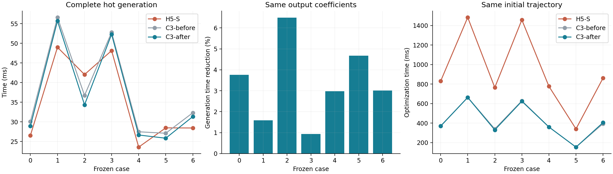
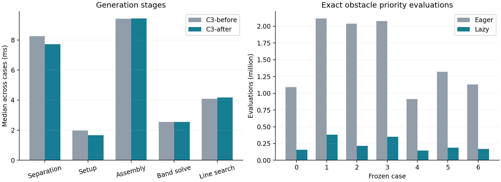
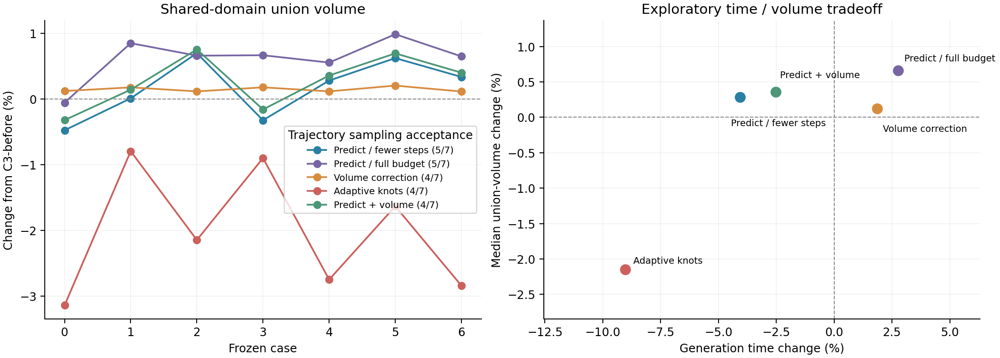

# 原生三次走廊：连续约束、自适应节点与中心路径预测

本轮沿着常量矩阵复用、障碍覆盖、连续约束生成、自适应 knots、中心路径预测和
真实扫掠体积六个方向继续实验。默认入口最终采用**固定能量矩阵复用和延迟障碍
排序**。其余方法保留为可运行的实验配置，完整保存测量结果。

相对上一轮 C3，默认生成耗时下降 **0.9%–6.5%**，七例中位数范围从
27.1–56.6 ms 降到 **25.8–55.7 ms**。走廊系数逐项相同，因此体积、曲面和
最终轨迹也保持不变。这轮主要获得了小幅计算收益；尚未找到同时改善体积、
生成耗时和轨迹效果的新默认参数化。

## 1. 相同输入的最终结果



| 场景 | H5-S / ms | 上一轮 C3 / ms | 本轮 C3 / ms | C3 耗时下降 |
| --- | ---: | ---: | ---: | ---: |
| 0 | 26.55 | 30.07 | 28.94 | 3.76% |
| 1 | 49.00 | 56.61 | 55.71 | 1.59% |
| 2 | 42.05 | 36.73 | 34.35 | 6.49% |
| 3 | 48.14 | 52.80 | 52.31 | 0.93% |
| 4 | 23.58 | 27.48 | 26.66 | 2.98% |
| 5 | 28.48 | 27.11 | 25.84 | 4.67% |
| 6 | 28.45 | 32.32 | 31.35 | 3.01% |

表中为一次预热、正式 **21 次**的中位数。最终生成比较固定在 CPU 2，逐场景
交替旧版与新版的运行顺序。七次未固定核的初测中，小幅收益与系统波动相近，
因此增加了这一组对照；初测数据也保留在归档中。

场景 0、1、3、4 为 Perlin，2、5 为迷宫，6 为保存的 RViz 路径。两条迷宫路径
仍快于 H5-S，其余五例比 H5-S 慢约 8.7%–13.7%。相对 H5-S 的并集体积优势
保持在约 1.0%–7.9%；这部分优势来自此前的 C3 实现，不是本轮新增收益。

本轮保留 0.4 m 节点间距、65% 净空初始化、两轮扩张、每轮 8 / 4 / 4 步的
障碍参数阶段，以及 `1e-5` 的中心和形状弯曲权重。七例均为 32 次 Newton 更新，
没有用减少优化预算换取默认速度。

## 2. 默认采用的两项改动

### 固定的弯曲能量矩阵只构建一次

参考标架和 knot vector 固定时，中心与形状通道都是控制变量的仿射函数。
二阶导数能量与中心偏移代价可以写成

$$E(x)=\frac12 x^TQx+q^Tx+\text{const}.$$

以前每次构建一个新的约束问题，都会重新积分和组装 $Q,q$。现在由
`CubicEnergy` 保存它们，在初始化探测、扩张和约束修复之间共享。若重建控制
空间或重新设置参考标架，则重新构建能量矩阵。正式七例每次生成只构建一次。

它不改变目标函数、梯度或 Hessian，只减少重复准备工作。具体实现在
[cubic_optimizer.cpp](../direct_corridor/experiments/native_splines/cubic_optimizer.cpp)
和 [cubic_generator.cpp](../direct_corridor/experiments/native_splines/cubic_generator.cpp)。

### 用空间块的距离下界延迟计算障碍优先级

原分离器先计算查询域内所有障碍的白化距离，再按最近障碍依次构造分离面。
但一个分离面常常就能排除大量障碍，它们的精确排序分数最后根本不会被用到。

设白化矩阵为 $A$，截面中心为 $c$，障碍块的包围盒中心和半长为 $m,h$。
块中任意障碍中心的白化坐标都落在

$$A(m-c)\pm |A|h$$

给出的盒内。因此有平方距离下界

$$\ell^2=\left\|\max\left(|A(m-c)|-|A|h,0\right)\right\|^2.$$

现在先将这些块下界放入优先队列，只有一个块可能包含下一个最近障碍时，才
计算其中仍存活障碍的精确分数。分离面已经覆盖的障碍直接从位图移除。不同
半径的障碍使用块内最大半径构造保守的排序下界；距离相同时仍按原障碍编号
打破平局。

这保持原贪心分离器的选择顺序。七例的障碍优先级精确求值数量减少
**82%–89%**，生成系数最大差为 **0**。排序只决定处理顺序，连续几何接受条件
仍由原来的分离与支持证书判断。

实现见 [lazy_obstacles.hpp](../direct_corridor/experiments/native_splines/lazy_obstacles.hpp)。
测试将队列与逐障碍穷举比较，覆盖不同障碍半径、各向异性度量、分数平局和
动态块删除。分数缓冲只为真正访问的候选写入数据，避免再次初始化全部候选。



| 阶段 | 上一轮 C3 / ms | 本轮 C3 / ms |
| --- | ---: | ---: |
| 障碍查询 | 2.34 | 2.17 |
| 分离面生成 | 8.25 | 7.71 |
| 优化器准备 | 1.97 | 1.66 |
| 梯度与 Hessian 装配 | 9.40 | 9.42 |
| 带状求解 | 2.55 | 2.54 |
| 线搜索 | 4.08 | 4.17 |

各列先取每例重复中位数，再取七例中位数。节省了大量排序计算，并不等于
同比例减少完整生成时间：块下界、队列维护、分离面本身和 Newton 更新仍然
需要计算。Hessian 装配依然是主要成本之一。

### 当前点 SOC 值缓存为什么没有默认打开

本轮也实现了将目标求值时算出的 SOC 三维投影和能量梯度直接传给线搜索。
数值测试确认缓存前后的可行步长、精确代价差与最终几何一致。

但独立开关对照中，缓存版本的线搜索反而更慢。例如场景 1 从约 7.67 ms
增加到 8.34 ms，场景 0 从约 4.13 ms 增加到 4.45 ms。因此默认关闭
`cache_values`，保留该实现作为实验。上一轮的一维二次式线搜索缓存仍然启用；
这里关闭的只是额外的“当前点投影值缓存”。

## 3. 连续约束生成：约束更少，但修正成本尚未降下来

对固定支持平面，令

$$d(u)=b-n^Tc(u),\qquad w(u)=M(u)^Tn.$$

在 $d(u)\ge0$ 的条件下，连续 SOC 可转为

$$q(u)=d(u)^2-w(u)^Tw(u)\ge0.$$

三次中心与形状使 $q$ 最高为六次。新增的 oracle 对 $d$ 与 $q$ 的 Bernstein
系数做界定，必要时进行 de Casteljau 细分，并返回实际违反约束的参数位置。
不能只检查平方项，否则会错误接受 SOC 的负分支。

实验先对每个支持区间放置少量点约束，再用 oracle 寻找遗漏的连续违约点，
将其加入优化问题。这使部分配置的约束行数约减半，但每轮新增约束后都要
重新恢复可行性和优化，完整生成反而变慢。末尾直接将整条修正方向减半也
造成过大的体积损失，因此增加了更精细的已认证步长恢复；接受的每个候选
仍通过完整支持和 Jacobian 证书。

在当前固定预算下，两点、三点初始化以及 0 / 2 / 4 轮修正的组合没有形成
优于默认配置的稳定结果。这一实现仍保留在 `support_exchange` 开关下。

[continuous_oracle.hpp](../direct_corridor/experiments/native_splines/continuous_oracle.hpp)
还支持二次固定法向进度量对应的四次平方余量，数学测试已覆盖。**生成流程
目前只接入支持平面的点约束交换，尚未将进度约束也替换为该 oracle。**
最终全截面 Jacobian 仍使用原八次连续证书。

## 4. 自适应 knots 与精确插入

当前自适应初始化根据相邻标架转角与净空变化，合并较平缓区域的 knot span，
保留端点附近和快速变化区域的密度。激进配置将控制点数最多减少约四分之一，
但七例并集体积下降 **0.79%–3.14%**，轨迹采样验收也从 5/7 降到 4/7。

这一实验同时改变了 knot vector 和由种子路径重建的参考几何，所以不能把
体积损失全部归因于三次表达能力。额外增加优化步数和补充体积修正，也没有
恢复同等综合表现。

新增的 `insertKnot()` 则在九维世界几何通道上进行精确 Boehm 插入，再对
新的形状控制矩阵做极分解，恢复正交参考标架和对称形状矩阵。单元测试确认
插入前后的位置、一阶、二阶导数一致。

当前生成器使用的是**初始非均匀节点选择**；精确插入已作为独立工具实现，
尚未用于生成过程中的粗到细优化。下一步可以利用它，从已经得到的可行几何
出发局部增加自由度，从而避免重新初始化时改变整条曲线。

## 5. 中心路径预测与扫掠体积梯度

### 复用前一个阶段的因子做预测

对固定分离面的障碍目标

$$f(x)+\mu\phi(x),$$

若 $x(\mu)$ 位于中心路径上，微分驻点方程可得

$$\frac{dx}{d\mu}=-H^{-1}\nabla\phi(x).$$

实验使用前一阶段最后一次 Newton 因子，对下一个障碍参数做近似预测。预测
方向先经过解析可行步长和目标下降检查，再进入原有 Newton 修正流程。这是
基于当前原始变量求解器的预测步骤，没有引入完整的原始—对偶算法。

每轮仍使用 8 / 4 / 4 步时，多数场景体积小幅增加，耗时也增加。将后两个
阶段改成 3 步后，总 Newton 更新从 32 次降到 28 次，另有 4 次预测更新。
该配置仍有 5/7 轨迹通过采样验收，但失败场景改变：场景 1 从约 6.33 mm
改善到 4.90 mm，场景 4 则变为约 5.20 mm。因此没有直接替换默认配置。

### 直接使用真实扫掠积分的解析梯度

对已通过正 Jacobian 认证的椭圆扫掠，带重数的体积为

$$V(x)=\pi\int_0^1\big(M_0(u)\times M_1(u)\big)^Tc'(u)\,du.$$

被积式最高八次，每段五点 Gauss 积分即可精确计算。其几何梯度为

$$\frac{\partial V}{\partial c'}=\pi(M_0\times M_1),\qquad
\frac{\partial V}{\partial M_0}=\pi(M_1\times c'),\qquad
\frac{\partial V}{\partial M_1}=\pi(c'\times M_0).$$

通过三次局部基函数即可累加到每个控制点的五维变量。沿仿射方向
$x+\alpha p$，$V$ 又是关于 $\alpha$ 的三次式，因此可在可行步长内检查
端点和导数的二次方程根，直接选择体积较大的候选。

实现使用原问题的带状 Hessian 作为方向度量，再以完整连续证书接受修正。
解析体积梯度的方向差分相对误差为 `5.85e-10`。一次修正确实让七例的去重
并集体积都增加了约 **0.12%–0.21%**，但轨迹验收降到 4/7。它说明“体积
增加”本身并不能保证现有轨迹优化器更容易得到满足容差的解。

积分会重复计算全局自重叠部分，所以表格和最终选择仍使用共享 QMC 并集体积。
实现见 [cubic_volume.hpp](../direct_corridor/experiments/native_splines/cubic_volume.hpp)
和 [cubic_refinement.cpp](../direct_corridor/experiments/native_splines/cubic_refinement.cpp)。

## 6. 候选方案的取舍



| 配置 | 并集体积逐例变化 | 轨迹采样验收 | 选择 |
| --- | ---: | ---: | --- |
| 默认矩阵复用与延迟排序 | 完全相同 | 5/7，失败场景相同 | 默认启用 |
| 预测，保留完整 Newton 预算 | −0.05% 至 +0.99% | 5/7 | 保留实验开关 |
| 预测，后两阶段各减一步 | −0.47% 至 +0.70% | 5/7，失败场景改变 | 保留实验开关 |
| 一次体积修正 | +0.12% 至 +0.21% | 4/7 | 保留实验开关 |
| 激进自适应节点 | −3.14% 至 −0.79% | 4/7 | 保留实验开关 |
| 减步预测后再修正体积 | −0.32% 至 +0.76% | 4/7 | 保留实验开关 |

图中探索时间为各配置与对应参考配置的逐例相对变化，采用三次重复中位数；
它与最终固定核的 21 次默认性能比较分别报告。候选轨迹筛选为一次预热和一次
正式运行，默认方案另做三次正式轨迹重放。七例都是已有开发集。

此外，分离面与障碍覆盖位图复用确实节省了分离时间，但保留旧平面也限制了
新一轮扩张。以 0.05 m 复用间隙为例，扫掠积分下降约 2%–7%，所以默认关闭。
其掩码缓存预算为 32 MiB，本轮实测约 0.7–1.6 MiB。这里的探索指标是带重数
积分，未将其作为最终并集体积收益。

## 7. 验证与数据

六项 C3 测试和八项公共轨迹测试通过。新增核对包括：固定能量共享、当前点
缓存与重算等价、延迟队列与全量排序一致、覆盖位图不能错误接受扩张后的碰撞、
六次和四次 SOC oracle 的负分支及窄违约区间、精确 knot 插入，以及体积梯度。

正式生成的方向梯度最大相对误差为 `1.16e-8`，Hessian-vector 最大相对误差
为 `2.28e-10`。七例全部通过连续障碍支持和全截面 Jacobian 证书，并通过
重新构造分离面的独立地图核对；没有初始化重试、Jacobian 修复或几何回退。
Newton 原始终止状态仍为 `iteration_limit`。

QMC 对所有八组模型使用相同采样域、相同序列与 8 次随机平移，每次
262,144 个样本。两版默认 C3 的配对体积差和区间半宽均为零，未判定样本数
为零。独立 NumPy/SciPy 审计覆盖 56 条几何，没有发现采样障碍穿透或世界
边界越界，最大弧长 C² 拼接误差为 `3.23e-11`。

默认轨迹比较使用同一个冻结的公共优化器，初始变量哈希逐例一致，正式重复
三次。两版 C3 的轨迹文件逐字节相同，目标值和 jerk 能量相同；优化时间的
七例中位数分别约为 371 ms 和 369 ms，应视作计时变化。H5-S 约为 830 ms。
两版 C3 都为 5/7 通过采样验收，H5-S 为 2/7。C3 场景 1、5 的径向残差仍约
为 6.33、6.35 mm，超过 5 mm 阈值；采样时间间隔不大于 5 ms。走廊的连续
认证和轨迹的采样验收在数据中分别记录。

正式生成 P95 为 25.90–56.71 ms；地图索引建树需另加约 27.39–34.84 ms。
生成进程峰值 RSS 为 36.31 MiB，轨迹进程最高约 28.69 MiB。这些数字不包含
编译与离线绘图。构建、生成、体积和轨迹实验串行进行，后续构建与测量进程
设置了 4 GiB 地址空间上限。未新增运行时的逐步有限差分或输入重复校验。

基线是上一轮尚未提交的完整 C3 状态，而不是仅用 `5ed3f99` 代表其源码。
已保存对应的源码快照和二进制哈希；当前分支仍为 `experiment/native-cubic-minjerk`。
生产 ROS/H5 默认入口没有改变。

- [正式计时、完整序列、体积与轨迹指标](validation/native_splines_round4/results.json)
- [各实验配置与筛选数据](validation/native_splines_round4/exploration.json)
- [所有探索输出压缩包](validation/native_splines_round4/exploration.tar.gz)
- [独立几何审计](validation/native_splines_round4/independent_audit.json)
- [上一轮源码快照](validation/native_splines_round4/baseline_source/source.tar.gz)
- [逐文件 SHA256](validation/native_splines_round4/sha256.json)
- [上一轮报告](原生三次走廊约束与求解加速.md)

常规复现命令：

```bash
cd /home/zdp/ForCodex/GCOPTER
tar -xzf docs/validation/native_splines_optimized/frozen_inputs.tar.gz
cmake -S direct_corridor/experiments/native_splines \
  -B .scratch/native_splines/build -DCMAKE_BUILD_TYPE=Release
prlimit --as=4294967296 -- cmake --build .scratch/native_splines/build -j1
ctest --test-dir .scratch/native_splines/build --output-on-failure -j1
taskset -c 2 prlimit --as=4294967296 -- \
  python3 direct_corridor/experiments/native_splines/run.py \
  --native --preset balanced --generation-only --method-count 1 \
  --repeats 21 --samples 0 --output .scratch/native_splines/round4/reproduce
```

`paired_generation.py` 保存本轮固定核、交替运行的测量流程；`explore_round4.py`
显式冻结探索参数，其中保留探索时开启的当前点缓存，不随最终默认值改变。
`analyze_round4.py` 汇总数据、压缩原始输出并生成图表。
