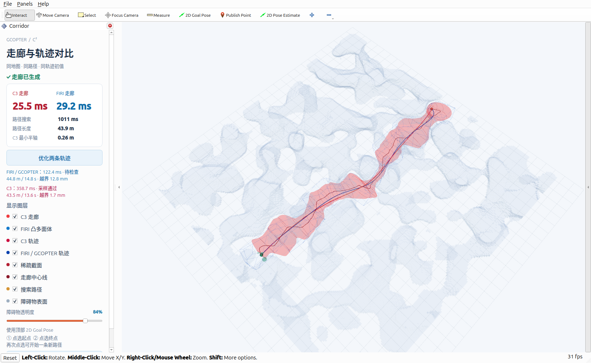

# 同输入走廊与轨迹交互演示

RViz2 左侧现在同时显示 C3 和 FIRI 走廊的生成耗时。点选起终点后，原地图和 Informed RRT* 只搜索一次路径，两种生成器使用同一个量化体素快照、种子路径、机器人半径、安全余量和局部扩张范围。FIRI 使用现有四次迭代、实体体素侵蚀与 shortcut；三次走廊仍使用 SweepCorridor。

## 使用

```bash
/home/zdp/ForCodex/GCOPTER/gcopter/tools/run_direct_demo.sh scene:=perlin
# 或迷宫
/home/zdp/ForCodex/GCOPTER/gcopter/tools/run_direct_demo.sh scene:=maze search_timeout:=3.0
```

1. 使用顶部 **2D Goal Pose** 依次点选起点、终点。
2. 查看红色 C3 曲面和蓝色 FIRI 凸多面体。左侧分别显示生成耗时。
3. 点击 **优化两条轨迹**。完成后显示两条轨迹的求解耗时、长度、时长、走廊残差和采样验收状态。
4. C3 走廊、FIRI 走廊、C3 轨迹、FIRI / GCOPTER 轨迹均可独立开关。关闭 C3 走廊时同步隐藏截面和中心线；两条轨迹不受影响。

面板较窄或窗口较小时可纵向滚动，障碍物透明度和重新选点操作仍保留。

## 轨迹后端

按钮直接复用已经生成的两份走廊，不重新寻路或重新生成走廊。两种方法使用相同的等弧长航点、初始时长、五次最小 jerk 样条、GCOPTER 平坦性动力学约束和 L-BFGS 设置，仅替换位置走廊约束。

这是现有公平对照的公共后端，**不调用原生 GCOPTER 重新构造 shortestPath 的初始化管线**。FIRI 侧每个细分 Bézier 片固定关联一个凸多面体；C3 侧使用控制点和积分点各半权重的位置惩罚。速度使用 Bézier 导数控制点惩罚，其余动力学约束积分计算。默认两层细分、16 个积分步、最多 800 次迭代。

优化在一个后台任务中依次完成 FIRI 和 C3，ROS 回调和 RViz 操作保持响应。重复点击不会排队启动重复任务。重新选点、重置或地图更新都会取消当前任务，清除旧图层；返回时再次核对请求代次，旧轨迹不会覆盖新结果。工作线程持有不可变地图快照，地图更新不会使旧任务访问失效对象。

轨迹通过稠密采样检查原始障碍、走廊残差和动力学限制。面板中的“采样通过”与“待检查”是验收结果，求解器原始状态和迭代数保留在悬浮提示与 JSON 中。达到迭代上限不会标成收敛；采样检查也不等于连续时间安全证书。

## 代码与消息

- `gcopter/src/demo_comparison.cpp`：FIRI 输出、两种轨迹求解与采样验收，不依赖 ROS。
- `gcopter/experiments/trajectory/optimization_core.hpp`：离线实验与交互演示共用的代价、控制点约束与 L-BFGS 回调。
- `gcopter/src/direct_corridor_demo.cpp`：快照、后台任务、取消与可视化发布。
- `gcopter/src/corridor_panel.cpp`：耗时、优化按钮、结果与图层开关。

新增 `/direct_demo/firi_corridor`、`/direct_demo/c3_trajectory`、`/direct_demo/firi_trajectory` 三个 MarkerArray 主题；`/direct_demo/optimize` 接收 Empty，`/direct_demo/comparison` 发布 JSON 状态。显示消息使用 transient-local QoS，重新打开 RViz 后能看到最近结果。

每个请求目录保存 `trajectory_comparison.json`、`firi_trajectory.xyz`、`c3_trajectory.xyz`。原有地图、种子路径和 C3 控制点快照继续保留。

## 验证

编译与场景测试串行执行，子进程地址空间限制 4 GiB，数值线程为 1。测试命令：

```bash
source /opt/ros/lyrical/setup.bash
source install/setup.bash
ROS_DOMAIN_ID=187 OMP_NUM_THREADS=1 OPENBLAS_NUM_THREADS=1 \
  prlimit --as=4294967296 -- python3 gcopter/tests/c3_demo_smoke.py --optimize
```

Perlin、迷宫都检查了非空 C3/FIRI 走廊、非空两条轨迹、优化消息状态、重复点击抑制，以及优化中重置后的取消和全部图层清除。实际 RViz 窗口另外完成了面板与叠加图层的视觉检查。此测试不要求所有软约束结果都通过采样验收，失败状态必须如实显示。

场景结果见 [Perlin](validation/rviz_comparison/perlin.json)、[迷宫](validation/rviz_comparison/maze.json)。这些是交互功能测试的单次结果，不作为算法性能排名。



抽出公共优化代码后，离线程序重新编译成功，轨迹相关 CTest 5/5 通过；空旷控制用例的 C3/FIRI 梯度相对误差均为 `1.68975e-9`，两种轨迹通过采样验收。见 [回归日志](validation/rviz_comparison/regression.log)。
