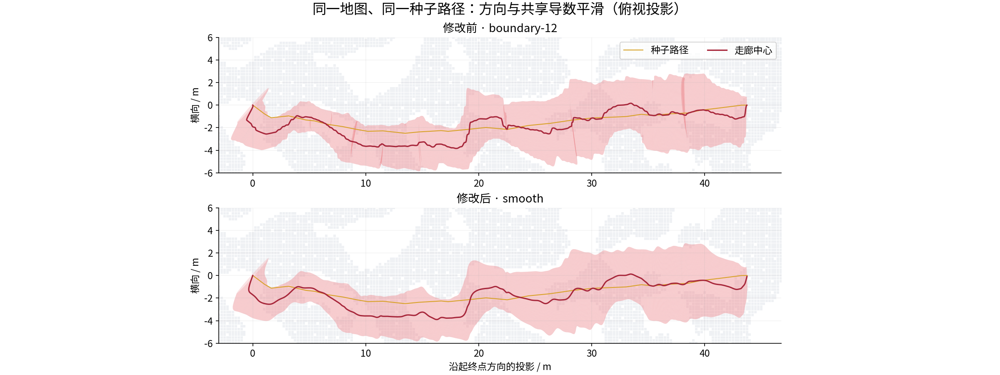
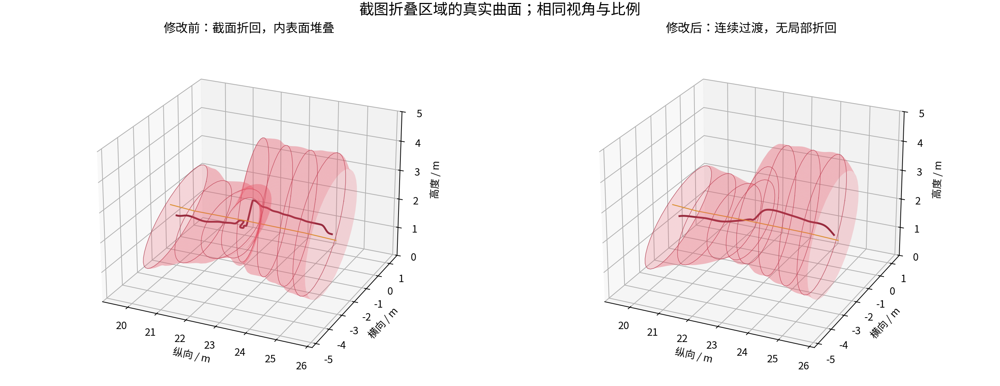

# 平滑可微走廊：消除截面折回，保留空间利用率

本次改动针对 RViz 中截面挤成褶皱的问题。中心、截面形状依然使用 C2 五次 Hermite 表达；生成时先平滑截面方向，再优化邻段形状，最后让中心与形状共享非零导数，并补回可用空间。

截图路径的折叠区段从 **24 段降到 0 段**，最大中心曲率从 **194.30 降到 7.11 m⁻¹**，体积保留 **99.36%**。默认 RViz 演示已切换到 `smooth` 模式。





## 1. 褶皱是怎样产生的

原来的节点偏移采用零一阶、零二阶导数的 smoothstep 插值。节点位置可以明显侧移，但节点切向仍沿原种子路径；宽截面又在短距离内转向，曲面便可能折回。C2 只描述连接处导数连续，不能阻止这种折回。

截面映射为

$$F(u,z)=c(u)+M(u)z,\qquad \|z\|\leq1.$$

令 $n=M_0\times M_1$，整个截面上的最小 Jacobian 是

$$J_{\min}(u)=n^Tc'(u)-\|M'(u)^Tn\|.$$

旧检查只包含第一项。现在检查两项的差：它必须在整个参数区间内严格为正。

## 2. 生成流程

### 平滑截面方向

沿种子路径弧长，用半径 **1.5 m** 的三角核积分方向，再平行移动截面坐标架。积分使用前缀位移和一阶矩，不依赖种子顶点的采样密度。中心仍能横向移动，椭圆仍能旋转、改变长短轴。

### 联合优化相邻节点

在最大截面面积的凸优化中增加权重 **0.2** 的邻接平滑项。每段用两端法向和中间法向建立前进约束；先细分参考 Bézier 曲线，再把等价约束压缩为每个法向一条 SOC 约束。约束法向在扩张轮次之间保持固定，因此上一轮结果可以继续作为可行初值。

若完整 Jacobian 证书仍不通过，只对这些区段补充法向约束并修正。正式七组输入均不需要这一步额外修正。

### 用最小弯曲能量目标调整共享导数

中心的三个通道与形状矩阵的六个通道，分别求自然三次插值的目标导数。它在固定节点值下最小化二阶导数平方积分，九个通道共用一次三对角求解。

目标被转换为五次 Bézier 控制点。每个节点的一、二阶导数使用同一个调整比例；左右两段共享这一比例，所以局部受限后仍保持 C2。节点位置和起终点位置保持一致。

先预留 **1%** 半轴余量，再依据已接受的障碍物支撑面求允许的导数调整量。单个调整量的可行域由二次方程直接给出，不再搜索障碍物，也不组装大型 Hessian。

### 补回空余截面

导数调整后，在同一组支撑面内再次扩大节点形状。新增形状项的节点一、二阶导数为零，因此不会破坏已有的 C2 连接。扩张同时遵守半轴上限，并在最后重新确认全截面 Jacobian。

## 3. 连续检查与开销

对于五次 $c$ 和 $M$，$n^Tc'$ 与 $M'^Tn$ 都是十四次多项式。把它们一起转换为 Bernstein 系数，利用 Lorentz 锥的凸性判断整个区间；系数界不够紧时才细分。这里使用带数值余量的浮点证书。

障碍物安全仍由原有支撑面和 Bézier 凸包给出。导数调整还保留原障碍物查询范围的边界，确保新曲线不会进入未查询的空间。新阶段复用这些支撑面，阶段结束时统一审核，截面求值和轨迹梯度链路没有增加逐次数据校验。

这个条件保证局部不折回。种子路径存在远距离回环时，走廊仍可能发生全局重叠；本次没有增加全局布尔并集网格算法。

## 4. 同输入结果

七组地图和种子路径全部固定，扩张范围、障碍物膨胀、控制间距保持一致。基线为此前交互演示使用的 `boundary-12`。每组预热一次，随后串行运行七次，耗时取中位数；体积使用同一组随机平移 QMC 点，共 **524,288** 点，计算走廊并集体积。

| 输入 | 体积：原版 → 新版 / m³ | 体积变化 | 生成耗时：原版 → 新版 / ms | 折叠区段：原版 → 新版 | 边界起伏能量下降 |
|---|---:|---:|---:|---:|---:|
| Perlin-A1 | 422.48 → 421.24 | -0.29% | 25.76 → 26.91 | 20 → 0 | 98.2% |
| Perlin-B1 | 639.58 → 606.02 | -5.25% | 48.56 → 50.06 | 79 → 0 | 99.2% |
| Maze-1 | 433.76 → 426.31 | -1.72% | 43.12 → 43.80 | 12 → 0 | 95.0% |
| Perlin-A2 | 629.80 → 595.47 | -5.45% | 47.84 → 49.75 | 61 → 0 | 97.8% |
| Perlin-B2 | 485.65 → 478.61 | -1.45% | 23.80 → 23.89 | 29 → 0 | 93.5% |
| Maze-2 | 364.67 → 364.90 | +0.06% | 28.56 → 28.76 | 3 → 0 | 97.0% |
| 截图路径 | 533.85 → 530.44 | -0.64% | 28.98 → 29.07 | 24 → 0 | 99.0% |

原版折叠数量来自每段 129 个参数位置的独立检查；新版全部 **972 段**通过连续全截面证书。独立障碍物采样未发现穿透，体积反求无未解决根。

边界起伏能量定义为 $\int(\|c''(s)\|^2+\tfrac12\|M''(s)\|_F^2)\,ds$，$s$ 为同一条种子路径的弧长参数。该指标同时反映中心偏移和截面边界的快速起伏，不等同于最大几何曲率。

体积没有在所有地图上增加。两组复杂 Perlin 路径约损失 5%，换来了没有局部折回、边界更平顺的结果；截图路径的体积变化较小。体积差的配对置信区间和各阶段耗时保存在原始结果中，微小变化不视为显著提升。

## 5. 轨迹优化回归

轨迹初值、段数、代价权重与原版相同。每组预热一次后串行运行三次，保留原来的 800 次迭代预算和 Bézier/积分混合约束。

| 输入 | 轨迹优化耗时：原版 → 新版 / ms | 目标值：原版 → 新版 | 采样可行：原版 → 新版 |
|---|---:|---:|---|
| Perlin-A1 | 741.2 → 810.2 | 294.12 → 294.36 | 是 → 是 |
| Perlin-B1 | 879.3 → 1455.1 | 556.62 → 531.24 | 否 → 否 |
| Maze-1 | 751.1 → 749.2 | 331.16 → 332.14 | 是 → 否 |
| Perlin-A2 | 1521.9 → 1442.7 | 471.03 → 467.18 | 否 → 否 |
| Perlin-B2 | 707.1 → 764.2 | 283.18 → 279.69 | 否 → 否 |
| Maze-2 | 172.5 → 333.4 | 298.75 → 297.82 | 否 → 否 |
| 截图路径 | 846.8 → 844.1 | 303.04 → 300.65 | 否 → 是 |

所有初值梯度检查通过，最大相对误差 **1.32e-06**。两种走廊的采样可行结果分别为 **2/7** 与 **2/7**；未发现障碍物穿透。走廊曲面变顺并不自动解决有限惩罚权重和迭代预算下的轨迹约束残差，本次也没有改变这些优化器参数。

八项实验回归全部通过；ROS 构建下的[路径搜索与体积测试](https://github.com/Bziyue/GCOPTER/blob/62645e2fa2b7205d2a7492c05305734dd8534021/docs/validation/smooth_sweep/ros_ctest.log)也通过。ROS 测试沿用演示脚本的 OMPL 运行库路径。

## 6. 代码与复现

- `direct_corridor/src/hermite_optimizer.hpp`：全截面证书、局部前进 SOC、邻接平滑。
- `direct_corridor/src/sweep_smoothing.hpp`：共享导数调整、局部半轴约束、截面补充扩张。
- `direct_corridor/src/direct_corridor.cpp`：方向滤波、约束修正与阶段接入。
- `gcopter/launch/direct_corridor.launch.py`：默认使用 `smooth`。
- [完整结果](validation/smooth_sweep/results.json)、[参数探索记录](validation/smooth_sweep/pilots.json)、[回归测试](https://github.com/Bziyue/GCOPTER/blob/62645e2fa2b7205d2a7492c05305734dd8534021/docs/validation/smooth_sweep/ctest.log)。

```bash
cmake --build .scratch/trajectory_comparison/build -j1
ctest --test-dir .scratch/trajectory_comparison/build --output-on-failure -j1
python3 direct_corridor/experiments/smooth_sweep/run.py \
  --inputs direct_corridor/experiments/smooth_sweep/inputs.json \
  --output .scratch/smooth_sweep/final --repeats 7 --samples 65536
```

本轮程序保持串行运行，没有设置地址空间或 cgroup 内存上限。正式生成/体积测试的进程峰值 RSS 为 **36.0 MiB**。RViz 和之前的演示进程已关闭；启动下一次演示时会使用新版。
