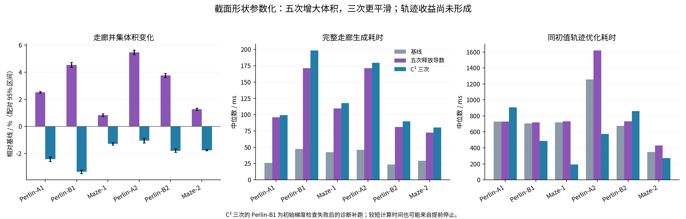
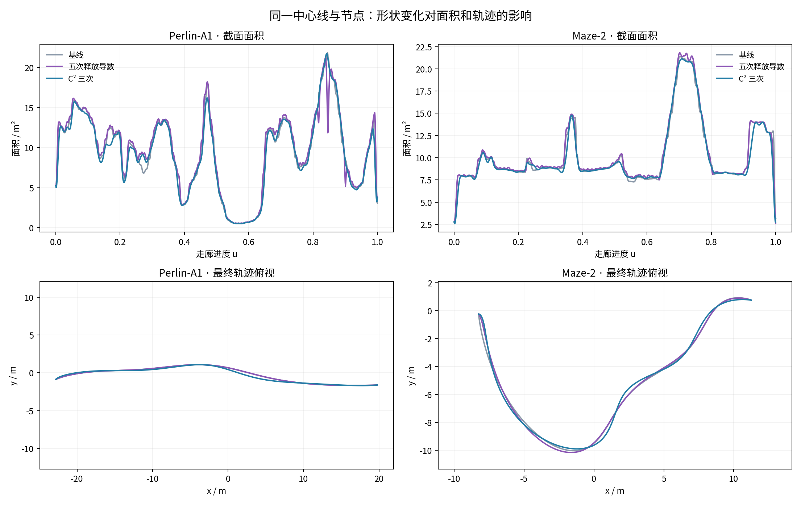

# 截面非零导数与 C² 三次样条对照

2026-11-03。六条冻结路径，四条 Perlin、两条 Maze；地图、种子路径、前端初值、扩张范围与轨迹优化参数一致。

释放五次截面的节点导数后，六例走廊并集体积增加 **0.82%～5.45%**。C² 三次截面的二阶导数能量明显下降，但体积减少 **1.06%～3.36%**。当前两种实现都增加了生成耗时，轨迹优化也没有稳定收益。因此保留原生成器为默认，将两个新版本作为可选实验。

## 1. 这次放开了什么

走廊仍表示为

\[
\mathcal C=\{c(u)+M(u)z:\ u\in[0,1],\ \|z\|_2\le1\},\qquad M(u)\in\mathbb R^{3\times2}.
\]

本轮只改变截面形状场 \(M(u)\)，中心线 \(c(u)\) 和分段节点保持逐项一致。原来的中心线仍为五次，因此“三次版本”指形状场为三次，并非整套几何全部降为三次。

| 版本 | 形状表达 | 节点处形状导数 | 与现有查询的连接 |
|---|---|---|---|
| baseline | 五次 Hermite | 一、二阶导数固定为零 | 原接口 |
| hermite-free | 五次 C²，内部节点重数 3 | 共享且可非零 | 每段转换为六个 Bernstein 控制矩阵 |
| cubic-c2 | 三次 C²，内部简单节点 | 由三次样条共同决定 | 升阶为六个 Bernstein 控制矩阵 |

内部采用局部 B 样条基，是为了直接消去 C² 等式约束并得到带状 Hessian。五次、节点重数 3 的基空间与共享位置、一阶及二阶导数的分段五次 Hermite 空间等价，并没有重新固定导数为零。

实际优化采用更小的子空间：先将基线形状投影为控制矩阵 \(A_i\)，再优化

\[
M(u)=\sum_i N_i(u)A_iS_i,\qquad
S_i=\begin{bmatrix}a_i&b_i\\b_i&d_i\end{bmatrix}\succ0.
\]

每个控制矩阵三个变量。\(A_i\) 保持固定，\(S_i\) 改变局部尺度与二维形状；组合后的节点一、二阶导数随优化改变。它不是每个 \(3\times2\) 矩阵六分量完全自由的优化，也不是把各个 Hermite 导数作为独立变量直接求解。

五次投影能重现原形状，误差约 \(10^{-13}\)；三次空间更小，投影会产生偏差，必须重新求可行形状。两种新方法都在原走廊生成后执行 refit，表中的总时间计入这两部分。

## 2. 非零导数如何保留连续空间约束

从基线的连续证书重建分离平面及其适用参数区间。对每个区间细分后的中心控制点 \(C_j\) 和形状控制矩阵 \(D_j\)，施加

\[
n^TC_j+\|D_j^Tn\|_2\le b.
\]

对任意单位圆盘内的 \(z\)，都有 \(n^T(C_j+D_jz)\le b\)。区间上的点是这些控制点的 Bernstein 凸组合，因此整个扫掠区间都满足该分离平面。这里约束的是同一参数区间的**中心与形状联合控制系数**，与“世界轨迹控制点分别落在非凸走廊某处”是不同的条件。

该约束对 \(S_i\) 是二阶锥形式。目标采用可解的体积代理和形状平滑项：

\[
\min_{S_i\succ0}
-\sum_i w_i\log\det S_i
+0.005\sum_iw_i\|s_i-(1,0,1)^T\|^2
+\frac{0.05}{\max(E_0,10^{-6})}\int\left\|\frac{d^2M}{ds^2}\right\|_F^2ds,
\]

其中 \(w_i=\int_0^1N_i(u)du\)，\(s\) 是种子路径弧长，\(E_0\) 为基线二阶导数能量。\(\log\det S_i\) 是控制矩阵扩张的代理，并非走廊并集体积的精确公式；并集体积另行测量。

用对数障碍与带状 Newton 求解，障碍参数依次为 1、0.1、0.01、0.001，各最多 20 步。只组装局部带宽内的 Hessian，使用稀疏 LDLT；不分配稠密的全局平方规模矩阵。导数和 Hessian 都是解析表达，有限差分仅用于预热验证，不进入正式计时。

输出时直接对原始平面与最终控制系数复核一次支持不等式，并检查 C² 接缝，以及整个区间的

\[
c'(u)\cdot(m_1(u)\times m_2(u))>0.
\]

最后一项通过十四阶 Bernstein 系数细分检查，确保中心处截面不退化、与中心切向横截。本轮没有触发恢复回退。它不保证整个扫掠映射全局单射，截面之间仍可能重叠。

## 3. 体积与生成时间

体积是走廊空间并集体积，重叠区域只计一次。三种方法使用共同网格及共同采样点，八组平移 QMC、总计 524288 点，报告配对差值及 95% 区间；图中的误差条对应体积差值。每例预热一次、正式重复三次，时间取中位数，包含完整基线生成和新增 refit，不含地图加载、体积估计及独立审计。

| 路径 | 基线体积 m³ | 五次体积 m³（变化） | 三次体积 m³（变化） | 生成耗时 ms：基线 / 五次 / 三次 |
|---|---:|---:|---:|---:|
| Perlin-A1 | 423.85 | 434.49（+2.51%） | 413.56（-2.43%） | 25.9 / 95.8 / 99.2 |
| Perlin-B1 | 635.34 | 664.15（+4.53%） | 614.00（-3.36%） | 47.4 / 171.5 / 198.6 |
| Maze-1 | 426.93 | 430.45（+0.82%） | 421.39（-1.30%） | 42.5 / 109.5 / 117.7 |
| Perlin-A2 | 621.57 | 655.43（+5.45%） | 614.96（-1.06%） | 46.3 / 171.5 / 179.7 |
| Perlin-B2 | 482.27 | 500.34（+3.75%） | 473.60（-1.80%） | 23.4 / 81.3 / 89.8 |
| Maze-2 | 360.63 | 365.18（+1.26%） | 354.24（-1.77%） | 29.2 / 72.4 / 80.3 |

五次的体积增益和三次的损失均大于本轮配对统计区间。所有几何采样均未发现障碍穿透，体积计算未决根数为零。五次形状二阶导数能量下降 **47.1%～62.4%**，三次下降 **95.0%～98.8%**；平滑与体积并不等价。

三次的变量更少，但这版还不能兑现原生三次求值的优势：中心仍为五次，几何接口仍使用每段六个控制系数，连续空间约束数量也没有按次数同比减少。它还承担基线生成、投影、可行化和 refit 的新增成本。三次的体积下降说明当前子空间、证书和平滑权重的组合不占优，不能推出三次样条在其他构造中一定更保守。

按六例全部 18 次正式运行分别取各阶段中位数，新增耗时主要在约束优化：

| 新增阶段 | 五次 / ms | 三次 / ms |
|---|---:|---:|
| 连续分离平面覆盖 | 8.58 | 8.70 |
| 基投影、约束与带状结构准备 | 3.52 | 1.92 |
| 约束 Newton 优化 | 56.30 | 63.34 |
| 最终系数、正则性与 C² 验证 | 0.31 | 0.29 |

各列是阶段各自的中位数，不相加冒充某一条路径的总时间。五次完整生成时间为对应基线的 **2.48～3.70 倍**，三次为 **2.75～4.19 倍**；最终验证所占比例很小，优先优化应落在约束求解与重复生成上。

## 4. 同初值轨迹优化

三种形状使用相同地图、种子路径以及完全相同的初始轨迹变量和初始航点 CSV。轨迹仍为迁移库中的五次最小 jerk 样条。优化配置为位置罚权 \(10^5\)、每段 16 个积分步、Bézier 细分深度 2、位置积分与控制点惩罚各半权重、最大 800 次迭代，截面查询使用 `fast`。

下面每格顺序为 **基线 / 五次释放导数 / C² 三次**。优化时间只计 L-BFGS；不包含走廊生成和梯度检查。jerk 能量为时间积分平方范数。选根位置残差是现有局部截面查询返回的米制违约量，不是到整条走廊并集的精确距离。

| 路径 | 优化耗时 ms | 飞行时长 s | jerk 能量 | 选根位置残差 mm | 采样通过 |
|---|---:|---:|---:|---:|---|
| Perlin-A1 | 729.1 / 730.7 / 907.9 | 13.58 / 13.57 / 13.83 | 22.64 / 22.80 / 26.05 | 1.29 / 2.97 / 27.44 | 是 / 是 / 否 |
| Perlin-B1 * | 707.1 / 718.5 / 488.5 | 25.30 / 23.69 / 37.53 | 84.43 / 85.85 / 1293.49 | 8.50 / 165.29 / 576.04 | 否 / 否 / 否 |
| Maze-1 | 718.1 / 733.6 / 190.7 | 14.75 / 14.92 / 22.98 | 39.22 / 38.70 / 25.91 | 5.03 / 84.94 / 60.35 | 否 / 否 / 否 |
| Perlin-A2 | 1256.5 / 1620.1 / 574.8 | 21.02 / 20.85 / 33.71 | 51.15 / 47.87 / 41.17 | 22.80 / 15.84 / 8.38 | 否 / 否 / 否 |
| Perlin-B2 | 674.1 / 734.1 / 860.5 | 12.77 / 12.77 / 13.07 | 27.46 / 27.17 / 28.01 | 7.60 / 15.44 / 28.72 | 否 / 否 / 否 |
| Maze-2 | 349.1 / 429.7 / 271.5 | 12.56 / 12.66 / 16.06 | 48.53 / 48.00 / 36.06 | 15.94 / 277.77 / 226.99 | 否 / 否 / 否 |

采样通过要求：障碍穿透不超过 \(10^{-6}\) m，位置残差不超过 5 mm，动力学限制容差 1%，无反求失败。采样时间间隔不超过 5 ms，且每段至少为优化采样数的四倍。这个“通过”仅指该采样判定。

基线与五次释放导数均为 **1/6** 通过；三次没有通过的算例。五次在部分例子略微缩短飞行时间或降低 jerk，但没有稳定缩短优化耗时。三次一些算例停止得更早，最终轨迹反而更长，不能作为质量相同条件下的加速。

带星号的 Perlin-B1 三次结果来自单独的诊断补跑：其完整轨迹目标在初值处有限差分检查失败，相对误差约 **7905.08**。原失败保留，只在另一个输出目录关闭检查以观察最终行为；表中该行不计为梯度验证通过。五次六例全部通过，三次其余五例通过。形状生成目标自身的解析梯度与 Hessian 向量积检查均通过，问题出现在轨迹目标的截面反求链路。

### 越界与选根问题各占什么情况

另外对 CSV 重放中位置残差超过 5 mm 的点，独立枚举所有截面平面根，再检查圆盘成员关系。结果确认两类现象同时存在：

- Perlin-B2 五次版本有一个局部查询判为越界的点，实际上位于另一个截面内。
- Perlin-B1 五次版本的 16 个被标记点中，8 个在其他截面内，8 个在整个走廊并集之外。
- Maze-2 五次版本的 32 个被标记点均在走廊并集之外，最大局部位置残差约 278 mm。
- Perlin-A2 三次版本在 CSV 重放时出现约 3.23 m 的局部残差，而该点位于其他截面内；原始优化输出的最大残差为 8.38 mm。两次查询的分支敏感，不能把重放值替换到原始指标表中。

审计未决根数为零；它只复查被标记的离散点，不扩展为整条轨迹的连续证明。所有最终轨迹的障碍采样均未检测到穿透，但“未碰障碍”也不等同于“满足走廊与动力学约束”。

因此仅让 \(M(u)\) 更平滑，无法解决 \(p\mapsto u\) 的多根与分支切换。几何 C² 连续和全局光滑的轨迹约束函数是两个问题。当前证据支持先改进轨迹约束与进度参数化，再评价释放导数对轨迹的收益。

## 5. 后续值得继续的方向

1. **直接联合求截面值与导数。** 将这轮 refit 融入原生成阶段，复用分离平面，消除“生成一次再优化一次”的重复成本；先保留五次得到的体积收益。
2. **三次配合自适应节点。** 当前节点完全固定，三次在急变位置表达不足。只在活跃障碍附近加节点，开阔区域减少节点；与原生四控制系数求值一起验证成本。
3. **处理进度变量和根分支。** 继续直接优化 \(u(t),z(t)\) 或可靠的分支连续跟踪，使曲线不依赖每次从世界坐标重新选根；同时检查进度单调、映射退化和端点条件。

这三项是下一步实验方向，本轮没有作为已经实现的加速计入结果。

## 6. 代码、资源和复现

实验代码与运行方法见 [shape_spline/README](../direct_corridor/experiments/shape_spline/README.md)，轨迹运行器新增 `--shape-mode baseline|hermite-free|cubic-c2`，默认仍为 baseline。

原始计时、阶段计时、目标检查、输入与可执行文件哈希、全部轨迹结果和全根审计记录见 [results.json](validation/shape_spline/results.json)。已有基线的初始航点、可微走廊轨迹和 FIRI 轨迹与前轮 `fast` 输出逐字节一致，见 [baseline_equivalence.json](validation/shape_spline/baseline_equivalence.json)。

所有构建、测试、基准严格串行。构建 `-j1`、地址空间上限 3 GiB；实验进程上限 512 MiB，CPU 55 s、墙钟 60 s。最终复核记录及峰值内存见下方。

最终完整重编译后 **7/7** 测试通过。形状目标方向梯度与 Hessian 向量积相对误差分别在约 $10^{-11}$ 量级；新增测试确认中心与节点未改变、五次基可精确再现基线。生成阶段峰值 RSS **37.4 MiB**，轨迹阶段 **35.7 MiB**。

清理阶段移除了带宽已由基结构保证的热循环运行时检查，并增加最终原始平面复核。之后重新测量六例生成时间与体积，18 份截面 CSV 与清理前逐字节一致，结果记录在 `final_geometry_replay`。轨迹时间与审计使用此前同几何的完整实验数据，其可执行文件哈希单独保留；没有把生成阶段复核的二进制冒充为轨迹计时使用的二进制。

最终复核曾发现构建缓存内存在空的可执行文件，丢弃了那次无输出的返回结果，完整重编译后再执行测试和生成基准。运行脚本已在入口检查可执行文件非空，并检查实验输出条数。
