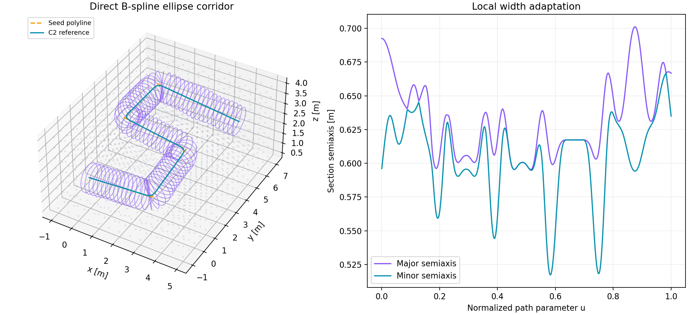

# 直接 B 样条走廊验证

> 历史阶段记录：以下实现或计时对应旧版 B 样条/离线实验。当前主生成器和 ROS 演示已使用 [五次 Hermite](五次Hermite走廊.md)，最新结果见 [验证报告](Hermite走廊验证.md)。交互启动方式保持一致。


日期：2026-11-02。状态：独立核心、ROS2 适配器及安装消费验证通过；未进行真实飞行或原 GCOPTER 全链路轨迹回归。

本页保留第一阶段的核心验证记录。后续已完成原地图、原路径搜索、RViz2 的接入和测试，
见 [原始地图交互验证](原始地图交互验证.md)；原轨迹优化可执行程序现已构建通过，仍未做飞行或轨迹执行验收。

## 被测代码和环境

- 来源：`https://github.com/Bziyue/GCOPTER.git`，`ros2` 基线 `5f44faf88c486cb39dbd087afa3dbfb837fad05d`。
- 实现分支：`feat/bspline-differentiable-corridor`；新模块为工作区修改，未推送。以下 SHA256 标识本次被测源文件，不把上游提交冒充新模块提交。
- CPU：AMD Ryzen 7 9700X，8 核 / 16 线程；核心生成按单线程运行。
- 编译：GCC 15.2.0，C++17，CMake Release（`-O3 -DNDEBUG`）；断言式测试使用显式失败检查，不依赖 `assert`。
- ROS：宿主机 ROS2 Lyrical。未声称在 Humble / Jazzy / Ubuntu 20.04 上测试通过。

| 文件 | SHA256 |
|---|---|
| `direct_corridor/src/direct_corridor.cpp` | `fbfd26ba73b035d0f6d78c9dc3fca2aa01ce16bd807b3c77fd2d1af08e96b4a4` |
| `direct_corridor/include/gcopter/direct_corridor.hpp` | `4f5b9aa4dc79a084c117df592356bdcdd0036452f48ff37db64f7104febec7d5` |
| `direct_corridor/tests/test_corridor.cpp` | `8937842cf635b73718a1debbad2c086a9240540c157a8d70b433bcba0f6824b7` |
| `direct_corridor/src/ros2_node.cpp` | `8356db8ca308ec3d606acfadbb3d35e718d894297bd58659ed3fa28ce2941b7b` |

## 核心验证

`ctest --test-dir build/direct_corridor --output-on-failure`：1/1 聚合测试通过，约 0.46 s。覆盖：

- 对 `[u,x,y,z]` 的解析梯度/Hessian 与中心有限差分对照。
- 全部样条接头的中心与形状 C⁰/C¹/C² 连续性。
- 首末端点、重复点清理、多转弯、反向、竖直、整体旋转、1001 点长种子。
- 各向异性窄通道保留长轴，局部瓶颈不限制远处开放区的截面积。
- 贴近边界时细分而不截短端点；圆滑拐角对实体障碍的检查。
- 多个固定案例及 24 个确定性随机案例的独立密集采样：502 个截面、24 个角度、三个径向层；直接对原始球体计算欧氏距离，不复用生成器的支撑约束。
- BVH 对 1000 个球、100 个查询盒的结果与暴力 AABB 枚举一致。
- 线段中部碰撞、精确回折、全重复、NaN、无效半径/选项、控制量/约束容量、取消、超时和不足净空失败；失败输出为空。
- q 的轴向柱体与真正截面成员资格的区别。

Debug + AddressSanitizer + UndefinedBehaviorSanitizer：同一 CTest 1/1 通过，约 68.65 s，无 sanitizer 报告。

```bash
cmake -S direct_corridor -B build/direct_corridor_sanitize \
  -DCMAKE_BUILD_TYPE=Debug \
  -DCMAKE_CXX_FLAGS='-fsanitize=address,undefined -fno-omit-frame-pointer' \
  -DCMAKE_EXE_LINKER_FLAGS='-fsanitize=address,undefined'
cmake --build build/direct_corridor_sanitize -j2
ctest --test-dir build/direct_corridor_sanitize --output-on-failure
```

## 合成性能基准

命令：`build/direct_corridor/direct_corridor_benchmark 30`。固定随机种子 42，障碍球半径 0.08 m，保留围绕正弦种子路径的已知自由带；机器人半径 0.15 m，安全余量 0.02 m，最大控制半轴 1 m。每场景预热一次，然后重复 30 次；同一场景复用 BVH。

场景名称中的 30/200 m 是 x 跨度，实际种子折线长度分别约 **32.14 / 213.79 m**。这些是确定性合成数据，不是 GCOPTER 原地图、KITTI 或真实点云。

| 场景 | 障碍数 | 种子点数 | BVH 构建 ms（一次） | 生成中位 ms | P95 ms | 成功次数 |
|---|---:|---:|---:|---:|---:|---:|
| 开放，32.14 m | 0 | 121 | 0.00042 | 0.060 | 0.063 | 30/30 |
| 稀疏，32.14 m | 10,000 | 121 | 1.155 | 0.409 | 0.452 | 30/30 |
| 密集，32.14 m | 100,000 | 121 | 15.510 | 2.352 | 2.473 | 30/30 |
| 长路径，213.79 m | 100,000 | 4001 | 13.728 | 18.589 | 19.267 | 30/30 |

生成时间包括种子线段校验、细分、方向运输、局部邻域查询、约束构造、半轴优化、连续非退化验收；**不包括 BVH 构建、点云输入、ROS 通信和可视化**。该硬件上的单场景 30 次结果不能作为最坏时间保证。

密集短路径：123 个控制截面、14334 个有效支撑约束，1001 个截面采样中的最小短半轴约 0.461 m。长路径：4003 个控制截面、81081 个约束，采样最小短半轴约 0.481 m。采样半轴仅用于质量描述，不替代连续验收。

没有与 FIRI 或原 CorrGen 做同地图、同几何模型、同目标的公平速度比较，不能据这些数字宣称对其有某个加速倍数。

## 三维多转弯示例

```bash
python3 direct_corridor/tools/example.py \
  --binary build/direct_corridor/direct_corridor_cli \
  --output .scratch/direct_corridor_example --plot
```

六个三维种子顶点、1420 个障碍球，生成 39 个控制截面、10534 个约束，单次生成约 1.57 ms。独立 Python 对 25664 个边界样本检查原始球体距离，扣除障碍半径、机器人半径和安全余量后最小采样间隔为 0.07564 m。采样结果只是额外排错。



紫色为椭圆截面，青色为圆滑中心线，橙色为种子折线。曲面采用世界坐标 B 样条矩阵插值；截图不是算法验收依据。

## 构建、安装和 ROS2

- 独立 CMake 构建通过。
- 独立 `cmake --install` 后，在新的最小消费工程中通过 `find_package(gcopter_direct_corridor CONFIG REQUIRED)` 和 `gcopter::direct_corridor` 链接、执行成功。
- `colcon build --packages-select gcopter_direct_corridor --cmake-args -DCMAKE_BUILD_TYPE=Release -DDIRECT_CORRIDOR_BUILD_ROS2=ON` 通过。
- 构建目录节点与 colcon 安装目录节点分别通过 `tools/ros2_smoke.py`。隔离 domain 137 / 138，限制 localhost，测试结束终止节点。
- 实测地图/种子输入、控制量与参考线/Marker 输出、端点保持、地图更新使旧路径碰撞后清空、有效新地图恢复、错误 frame 拒绝及畸形点云拒绝。
- 未改动原 `gcopter/src/global_planning.cpp` 等轨迹链路，也未构建/回归其 OMPL 全局规划示例。本次验证的是新增模块及其 ROS2 包，不是整仓库仿真或实机验收。

## 本地证据位置

原始 benchmark CSV 和 ROS 日志：`.scratch/validation/`；示例输入、系数、采样曲面和额外审计：`.scratch/direct_corridor_example/`；CTest 日志位于对应 `build/.../Testing/Temporary/`。这些生成物不提交；基准生成器、示例生成器、测试源码和本报告足以复现，单次原始工件仅在本机保留。
