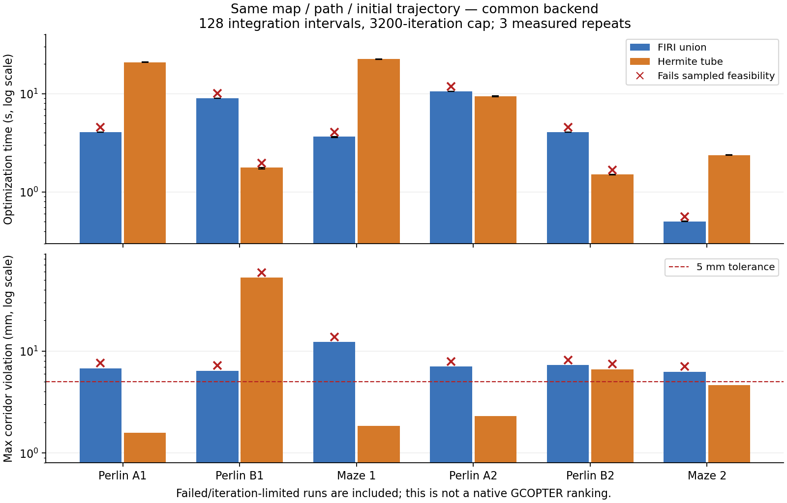

# 相同初值的 FIRI / 可微走廊轨迹优化对照

实验使用六组已有 RViz 冻结地图与种子路径，来自同一份 Perlin 地图的四条路径与一份 Maze 地图的两条路径。历史 Random 标签按地图 SHA256 更正为 Perlin-A，批量 Perlin 请求记为 Perlin-B。两边从同一份五次最小 jerk 样条及时间分配开始，用同一后端优化。当前可微走廊指默认 Hermite 椭圆扫掠，未使用可选 Minkowski 截面。

**这是一套新接入的公共后端对照，不是原生 GCOPTER/FIRI 完整管线的性能排名。** 原生后端会根据多面体重建初值；本实验为了保持初值一致，使用统一的空间变量及软走廊约束。可微走廊的局部截面反求、FIRI 并集的活动约束切换都会影响优化。详细公式、容差与复现命令见 [实验说明](../gcopter/experiments/trajectory/README.md)。

## 设置与可信范围

- AMD Ryzen 7 9700X，GCC 15.2 Release；串行、单线程，无并行跑图。编译地址空间上限 2 GiB；每个运行进程 512 MiB。
- 轨迹按种子弧长约 1 m 分段，初速分配 2 m/s，起终点速度/加速度为零。每次从相同初值重新开始，并核对优化向量哈希。
- 每条方法先预热一次，再正式运行三次，交替顺序；表中为正式优化时间中位数。走廊生成时间单独记录一次，不混入轨迹优化。
- 小预算：16 个积分间隔/段、800 次迭代上限、位置惩罚 1e5。高预算：128 个积分间隔/段、3200 次迭代上限、位置惩罚 1e6。两档同时改变了积分、预算和权重，属于整体配置对照，不是单因素消融。
- 通过要求：稠密检查中的走廊违约 ≤5 mm，原始膨胀障碍穿透 ≤1e-6 m，动力学限制允许 1% 容差，且截面反求无失败。审计采样至少为优化的 4 倍，时间间隔不超过 5 ms。
- “通过”只表示上述采样/容差要求，不表示连续时间安全证书或优化收敛。失败轨迹的耗时仍列出，不当作成功解耗时。

## 小预算结果

| 输入 | FIRI 优化 ms | 可微优化 ms | FIRI 违约 mm | 可微违约 mm | FIRI / 可微采样通过 |
|---|---:|---:|---:|---:|---|
| Perlin-A1 | 185.7 | 919.6 | 43.56 | 1.44 | 未通过 / 通过 |
| Perlin-B1 | 350.7 | 404.1 | 35.50 | 11.18 | 未通过 / 未通过 |
| Maze-1 | 144.7 | 831.2 | 21.18 | 3.78 | 未通过 / 通过 |
| Perlin-A2 | 397.4 | 411.6 | 36.60 | 33.36 | 未通过 / 未通过 |
| Perlin-B2 | 166.2 | 644.3 | 27.77 | 15.07 | 未通过 / 未通过 |
| Maze-2 | 81.3 | 411.0 | 53.93 | 16.14 | 未通过 / 未通过 |

严格 5 mm 口径下：FIRI 0/6、可微 2/6。重复运行是同一输入的耗时重复，不算额外独立成功案例。

## 高预算结果

| 输入 | FIRI 优化 ms | 可微优化 ms | FIRI 违约 mm | 可微违约 mm | FIRI / 可微采样通过 |
|---|---:|---:|---:|---:|---|
| Perlin-A1 | 4055.4 | 20887.1 | 6.80 | 1.58 | 未通过 / 通过 |
| Perlin-B1 | 8982.1 | 1765.8 | 6.44 | 52.54 | 未通过 / 未通过 |
| Maze-1 | 3643.1 | 22410.0 | 12.35 | 1.85 | 未通过 / 通过 |
| Perlin-A2 | 10508.9 | 9391.9 | 7.06 | 2.32 | 未通过 / 通过 |
| Perlin-B2 | 4060.5 | 1503.0 | 7.28 | 6.64 | 未通过 / 未通过 |
| Maze-2 | 501.7 | 2378.8 | 6.29 | 4.62 | 未通过 / 通过 |

严格 5 mm 口径下：FIRI 0/6、可微 4/6。重复运行是同一输入的耗时重复，不算额外独立成功案例。

## 高预算的轨迹质量与终止

以下展示全部输出，包含不满足走廊容差的轨迹，不能直接从某一项较低得出可行解更优。长度为稠密折线积分，jerk 能量为样条解析积分。

| 输入 | 方法 | 飞行时间 s | 长度 m | jerk 能量 | 迭代数 / 状态 | 优化节点违约 / 稠密违约 mm |
|---|---|---:|---:|---:|---|---:|
| Perlin-A1 | firi | 14.490 | 44.859 | 33.742 | 2949 / 1 | 4.75 / 6.80 |
| Perlin-A1 | hermite | 13.595 | 43.382 | 19.914 | 3200 / -1008 | 1.44 / 1.58 |
| Perlin-B1 | firi | 21.669 | 68.675 | 73.170 | 3200 / -1008 | 4.40 / 6.44 |
| Perlin-B1 | hermite | 32.674 | 69.198 | 57.242 | 63 / -1009 | 3.74 / 52.54 |
| Maze-1 | firi | 14.407 | 43.767 | 40.553 | 3200 / -1008 | 8.87 / 12.35 |
| Maze-1 | hermite | 14.414 | 43.564 | 39.907 | 2983 / -1009 | 1.72 / 1.85 |
| Perlin-A2 | firi | 21.813 | 69.111 | 65.212 | 3200 / -1008 | 5.39 / 7.06 |
| Perlin-A2 | hermite | 21.097 | 66.765 | 51.663 | 482 / -1009 | 1.86 / 2.32 |
| Perlin-B2 | firi | 13.660 | 41.928 | 34.031 | 3200 / -1008 | 2.30 / 7.28 |
| Perlin-B2 | hermite | 13.323 | 40.262 | 28.817 | 175 / -1009 | 3.79 / 6.64 |
| Maze-2 | firi | 13.149 | 30.886 | 50.591 | 727 / 1 | 3.86 / 6.29 |
| Maze-2 | hermite | 12.538 | 30.331 | 50.200 | 429 / -1009 | 4.19 / 4.62 |

状态 1：相对目标变化停止；-1008：达到迭代上限；-1009：线搜索区间过小。三者均不自动意味着可行或最优。

## 诊断

| 输入 | FIRI 单次梯度评估 μs | 可微单次梯度评估 μs | 初始种子在 FIRI 外的最大距离指标 m | FIRI 相邻不重叠数 |
|---|---:|---:|---:|---:|
| Perlin-A1 | 1016.6 | 5407.0 | 0.600 | 0 |
| Perlin-B1 | 2287.3 | 12435.0 | 0.565 | 0 |
| Maze-1 | 938.9 | 5988.8 | 0.034 | 0 |
| Perlin-A2 | 2325.5 | 11167.6 | 0.342 | 0 |
| Perlin-B2 | 948.0 | 5426.0 | 0.900 | 0 |
| Maze-2 | 600.9 | 4052.4 | 0.008 | 0 |

- 完整目标对初始优化向量的中心有限差分检查，两档、六输入、两方法最大相对误差 3.1e-08。这只检查测试点附近的梯度，不证明全局光滑。
- 每个进程最大实测 RSS 28.4 MiB；CPU/wall 上限及每次终止状态见原始 JSON。
- 两档 24 条不同配置/输入/方法输出中，原始膨胀障碍采样检查出现穿透的有 0 条；走廊违规仍独立计为失败，不能以“碰撞采样没发现问题”代替走廊约束。
- 表中的“初始种子在 FIRI 外”按原始折线采样测量，不是初始样条碰撞量。它说明 shortcut/侵蚀之后原种子不一定仍被完整覆盖；相同初值不是“两边都可行的初值”。
- 更高采样密度仍有节点间违约，证明仅增加积分点不能代替连续约束。
- 可微几何在当前接入方式下没有自动变成更快的轨迹优化：局部截面求根与隐函数梯度是额外开销，多根与活动分支切换还可能影响线搜索。这个结论针对本适配器，不能归结为 Hermite 曲线本身慢。

空旷直线控制用例已通过：两边初值一致、采样可行，飞行时间、长度、jerk 能量在 1e-4 相对容差内一致。新实验目标与复用公共生成函数后的原体积 benchmark 均已编译通过。

## 下一步应优先验证

1. 改进约束满足方式：用审计发现的最大违约位置增补约束/积分点，或做段级连续证书；先获得两边满足同一容差的解，再比较质量和收敛速度。
2. 为可微走廊显式引入单调进度变量 u(t) 或局部坐标，研究有序、单射条件；避免每个样条采样点都做全局范围截面反求，并减少分支切换。
3. 另做原生管线对照：允许 FIRI 使用 PolytopeSpatialMap 与自己的初值，并同时记录其初值变化。它回答“实际系统谁更好”，但与本次“严格相同初值”是不同实验。

## 证据

[小预算原始结果](validation/trajectory_comparison/final_fast.json) · [高预算原始结果](validation/trajectory_comparison/final_dense.json)。包含输入 SHA256、二进制 SHA256、参数、初值哈希、全部预热/正式计时、动力学极值、几何违规和终止状态。

稠密轨迹 CSV、共同初始航点和完整日志位于 `.scratch/trajectory_comparison/final_fast` 与 `final_dense`。冻结地图沿用本地交互快照，不重复加入 Git。
