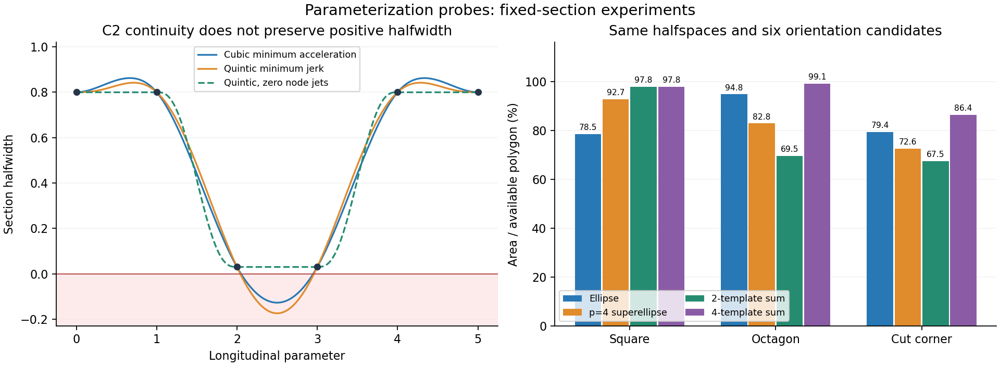

# 走廊参数化首轮实验

日期：2026-11-02。先将[方案](走廊参数化与优化实验方案.md)与第三轮优化提交为 `abc0631`，再以该提交为固定基线开展本轮实验。下列各方向都已开始实验，但完成层级不同；新参数化尚未替换默认生成器。

本文保留 `7d23370` 时的首轮结论。后续已经接入分组剔除与块求解缓存，其完整验证见[后续加速报告](分组剔除与块求解加速.md)。

**结论：只要求 C² 时，三次样条成立，也更便宜。但单纯更换次数不能解决当前主要开销和空间利用问题。** 当前更值得推进的是：受连续约束的三次样条、少量光滑支持函数模板，以及精确体素盒/占据块预处理。无差别增加细分或直接减少节点，都未同时改善体积和耗时。

实验工具及完整复现命令见[实验目录](../direct_corridor/experiments/README.md)，精简数据、来源哈希与通过状态见[记录](validation/parameterization_round4.json)。原始输入、源码副本、二进制和日志保存在本机 `.scratch/parameterization_round4/`。



左图为窄口半宽的过冲反例，右图为相同固定二维半空间下的截面面积比例；两图均不是完整三维走廊的性能对照。

## 实际完成范围

| 方法 | 本轮完成层级 | 决定 |
|---|---|---|
| A1 工作集 | 三条真实路径，完整生成与独立审计 | 补约束重启使计算变慢，暂不采用 |
| A2 收敛阈值 | 同上 | 仍全部达到 72 步，没有减少迭代 |
| A3 自适应节点 | 同上；首轮按转角，尚未按净空 | 提速但体积下降，不直接替换 |
| B1 三次最小加速度 | 参考 C++ 内核、四种规模、窄口反例、独立能量/C² 检查 | 优先研究受约束版本 |
| B2 五次最小 jerk | 与 B1 相同 | 消除零导数能量浪费，但也会过冲 |
| C 正交标架 | C² 旋转路径的截面积实验 | 有明确几何收益，尚缺配套连续障碍证书 |
| D Minkowski 和 | 五个固定凸截面、两/四模板优化、解析导数验证 | 四模板最有希望，尚未接入整条走廊 |
| E 四次超椭圆 | 与 D 同半空间、同方向枚举 | 矩形效果好，对斜切空间不普遍占优 |
| F 连续约束交换 | 24 个固定单段凸问题；另做完整走廊细分消融 | 优先少量自适应细分，避免全面高成本 oracle |
| G MINVO | 三次/五次各 200 条随机曲线的方向支持比较 | 平均更紧，但不逐方向占优；保留选择性研究 |
| H 精确体素盒与合并 | 三个并集等价用例及 239,999 体素真实地图 | 障碍对象降到 10,923，适合地图预处理 |
| 块求解缓存 | 三例初测，六例交换顺序复核 | 小幅收益，暂作为独立候选保留 |

## 1. 三次 C² 与五次最小能量样条

直接调用用户指定参考仓库中的 `CubicSplineND<3>`、`QuinticSplineND<3>`，没有重写一份未经比较的最小能量求解器。参考目录、提交及两个头文件哈希见实验目录和记录。

三个标量场分别表示截面偏移、两个半宽，标架固定。每种规模预热后测七批，报告批均值的中位数；`update()` 复用既有拓扑和存储。括号内为转换成 Bézier 的耗时，单位均为 **μs**：

| 段数 | 三次构造（转 Bézier） | 五次构造（转 Bézier） |
|---:|---:|---:|
| 16 | 0.29（0.28） | 0.50（0.51） |
| 64 | 1.25（1.12） | 2.18（1.96） |
| 256 | 4.87（4.52） | 8.44（7.90） |
| 1024 | 19.02（17.22） | 33.12（31.29） |

这说明三次内核的构造/转换成本约降低四成，但现有走廊生成耗时为几十 **ms**。不能把这个微基准的百分比直接套在整个生成器上。

三次通过联立内部导数满足 C²，普通独立三次 Hermite 并不自动具有这一性质。三次每段 4 个控制点，五次 6 个；对应平面平方支持条件的最高次数为 6/10，正则性多项式为 8/14。因此更大的潜在收益在优化变量组织和认证成本，尚需完整受约束实现验证。

### 窄口过冲是实际检测到的问题

给六个等间距节点的某半宽赋值：

```text
0.8, 0.8, 0.03, 0.03, 0.8, 0.8
```

保持节点数值全部为正，三次最小加速度样条的连续最小值为 **−0.1275**，五次最小 jerk 为 **−0.17443**。原零导数五次过渡的最小值仍为 0.03。新的两条插值都会穿过零，因此不能作为有效截面直接输出。

这不是三次不能 C²，而是**最小能量插值不自动保持形状正定或安全空间包含**。下一步应将局部多项式系数/共享导数与连续支持约束一起求解，或者采用具正性结构的形状参数，而非生成安全节点后无约束插值。

另一方面，释放节点导数确实消除了大量人为能量：16 段平滑例中，零导数五次场的 jerk 能量约 6231.53，五次最小 jerk 为 32.34；窄口例约为 853.78 → 27.35。但后者含负半宽，低能量不能替代可行性。

三次固定端点速度，五次同时固定端点速度和加速度，可行域不同，不能用这组数据直接比较两者的 jerk 最优值。所有样条在插值值、C² 接缝、独立高斯积分及共享导数扰动的能量驻点检查上通过；扰动驻点最大误差低于 6×10⁻⁹。

## 2. 完整生成器的计算与证书消融

三例为交互路径 1、Perlin 路径 10、迷宫路径 10。相同实体球覆盖、机器人半径、安全余量、3 m 局部扩张盒，放开原 1.5 m 半轴上限。每例预热一次、重复五次；体积使用 8×65,536=524,288 个 QMC 样本。每格为“生成耗时 ms / 并集体积 m³”：

| 方法 | 交互路径 | Perlin 路径 | 迷宫路径 |
|---|---:|---:|---:|
| 本轮重跑基线 | 24.52 / 423.59 | 46.96 / 635.03 | 43.56 / 426.63 |
| 块求解缓存 | 24.60 / 423.59 | 46.30 / 635.03 | 43.11 / 426.63 |
| 分阶段 decrement 阈值 | 24.48 / 423.59 | 47.63 / 635.03 | 44.34 / 426.63 |
| 工作集 + 补约束 | 45.25 / 423.50 | 67.63 / 636.69 | 56.48 / 427.04 |
| 按转角减少节点 | 19.50 / 404.60 | 42.54 / 615.92 | 32.91 / 416.20 |
| 第二轮全部区间细分一层 | 55.44 / 430.88 | 108.41 / 649.91 | 76.91 / 430.14 |
| 第二轮选择性细分 | 25.93 / 425.28 | 52.65 / 641.05 | 47.63 / 427.63 |

主要原因：

- 工作集把最终约束数从 1930/3221/2641 降到 1587/2714/2354，但补充遗漏项时需要从全局内点重启，Newton 步数变为 252/180/180，超过基线的 72。工作集实现尚不够有效，不能据此否定所有工作集方法。
- 按转角抽稀后节点从 122/214/118 降到 106/198/98；时间下降，但并集体积损失约 4.5%/3.0%/2.4%。本轮保留所有种子顶点，未使用净空自适应，也未释放零导数限制。
- 全部细分使最终参与优化的约束增至 12471/25366/14033，很多原本只关联一个节点的约束变为双节点耦合。体积增加约 0.8%–2.3%，但求解成本大幅增加。
- 选择性细分只处理当前支持间隙 <5 cm 且半区间上界可收紧 >5 mm 的平面。约束增至 2499/4431/3575，体积增加约 0.2%–0.9%，仍未抵消额外耗时。这是初始启发式，不是最佳阈值结论。

所有七个变体的匹配源码测试通过，三条路径的完整支持残差、连续正则性证书、独立实体采样及局部扩张盒审计通过，体积统计未决根均为零。本轮没有将这些新变体安装到 ROS/RViz 使用的共享库。

### 块求解的额外六例复核

缓存 `G_i = H_i⁻¹ U_i`、`z_i = H_i⁻¹ rhs_i`，回代用 `x_i=z_i-G_i x_{i+1}`，避免再次做三角求解。两批各九次，第二批交换新旧顺序；合并十八次的中位数如下：

| 路径 | 基线 → 缓存 ms | 耗时降低 |
|---|---:|---:|
| 交互 1 | 24.52 → 24.11 | 1.70% |
| Perlin 10 | 48.48 → 47.11 | 2.82% |
| 迷宫 10 | 43.92 → 43.97 | −0.13% |
| 交互 2 | 47.37 → 46.13 | 2.63% |
| Perlin 5 | 22.80 → 22.33 | 2.04% |
| 迷宫 4 | 30.33 → 30.20 | 0.43% |

体积估计保持相同。它是小幅计算优化，不是体积优化；尤其迷宫两例接近噪声，不表述为稳定的大幅加速。九次与五次设置下的 FIRI 随机流不同，未跨设置比较 FIRI 体积。

## 3. 新截面族：Minkowski 和更有表达潜力

固定二维半空间，优化中心及形状参数；所有方法使用相同六个主方向枚举。模板为短长轴比 0.05 的光滑椭圆，四模板比二模板额外加入两条斜向。表中为所得截面积/给定多边形面积：

| 自由截面 | 椭圆 | 四次超椭圆 | 二模板 Minkowski | 四模板 Minkowski |
|---|---:|---:|---:|---:|
| 方形 | 78.54% | 92.70% | 97.83% | 97.83% |
| 长方形 | 78.54% | 92.70% | 94.41% | 94.41% |
| 旋转长方形 | 78.54% | 92.70% | 94.41% | 94.41% |
| 正八边形 | 94.81% | 82.81% | 69.54% | 99.11% |
| 方形切去一角 | 79.38% | 72.57% | 67.47% | 86.39% |

二模板过于接近圆角矩形，对八边形很差；增加斜向模板显著改善。四次超椭圆也并非普遍优于椭圆，斜切约束会限制它的“方形”部分。以上仅对本轮方向网格最优，不宣称连续方向下全局最优，更不代表三维并集体积比例。

Python/NumPy 内点原型中，六个方向合计求解约：椭圆 14–17 ms、超椭圆 14–17 ms、二模板 10–11 ms、四模板 10–12 ms。模板支持系数/混合面积矩阵的设置耗时单列；这些数值只比较该原型中的同类问题，不能与 C++ 走廊耗时直接对照。

Minkowski 方法对固定平面的支持约束是线性的，面积由预计算混合面积矩阵给出，省去了每次支持约束求范数的工作。四种截面的梯度/Hessian 与有限差分最大误差约 1.3×10⁻⁹；4096/8192 点混合面积积分细化检查通过。后续还需要纵向参数化、连续安全证书和供轨迹优化使用的可微接口。

## 4. 正交标架、MINVO 与连续约束交换

### 正交标架

等半径圆截面在相邻标架间直接混合形状矩阵，会产生 `cos(θ/2)` 的中点面积损失。实验的 30°/60°/90° 转动分别剩 96.59%/86.60%/70.71%；使用端点一、二阶角速度为零的 C² 旋转插值后，面积均保持 100%。

这是不依赖障碍物的几何收益。正交旋转通常不再是多项式，不能把旧 Bézier 认证原样复用；尚未计入完整路径安全优化和认证的额外成本。

### MINVO

保持相同随机曲线，比较某一平面的控制支持上界与数值最大支持值，每个次数 200 例：

| 次数 | Bézier 平均上界间隙 | MINVO 平均上界间隙 | MINVO 更紧 / 更松 |
|---:|---:|---:|---:|
| 3 | 0.1090 | 0.0597 | 94 / 106 |
| 5 | 0.1821 | 0.0752 | 125 / 75 |

平均间隙降低，但每个方向未必改善。五次原来的节点混合系数 `[0,0,0,1,1,1]` 换基后约为 `[-0.054,-0.119,0.149,0.851,1.119,1.054]`，全部成为耦合行，不能继续使用原单节点冗余剔除假设。

参考浮点矩阵的基函数最小值存在约 10⁻¹⁴ 的负舍入量；本轮检查和极值计算都是数值参考，没有把这些结果冒充严格非负区间证明，也没有接入生产安全证书。

### 连续约束交换与局部细分

构造固定单段、两个端点半径的凸问题，最大化半径乘积。每种次数十二例。该例中 SOC 范数退化为正标量半径；不包含完整三维标架、障碍分离和多段 C² 耦合。

| 次数/方法 | 平均半径乘积 | 平均求解 ms | 平均约束数 |
|---|---:|---:|---:|
| 三次，原控制点 | 0.5478 | 0.64 | 4 |
| 三次，细分 1 层 | 0.6831 | 0.64 | 8 |
| 三次，细分 2 层 | 0.6857 | 0.67 | 16 |
| 三次，连续交换 | 0.6890 | 5.36 | 9.83 |
| 五次，原控制点 | 0.4383 | 0.62 | 6 |
| 五次，细分 1 层 | 0.6403 | 0.63 | 12 |
| 五次，细分 2 层 | 0.6642 | 0.69 | 24 |
| 五次，连续交换 | 0.6682 | 4.63 | 8.75 |

连续交换去掉更多凸包保守量，但反复求解和寻找违反位置较贵。两层细分相对连续交换的逐例乘积差距平均仅约 0.44%/0.62%，成本明显更低。不过完整生成器中，细分带来的耦合约束成本又成为瓶颈，见前文消融。

本例的连续 oracle 使用浮点临界点与带容差 Bernstein 细分，24 例的独立密集核对及平方支持判定均通过、未决为零。它是研究原型，不是带向外舍入的严格区间证明。

## 5. 精确体素盒与占据块合并

0.25 m 体素，比较原外接球与精确盒的支持值：轴向每侧可少保守约 **9.15 cm**，面对角方向约 3.97 cm，体对角方向相同。机器人球与安全余量仍应另外加在支持函数中。

合并只组合连续且完全占据的矩形块，不改变占据体素并集：

| 输入 | 原体素数 | 合并盒数 | 合并耗时 |
|---|---:|---:|---:|
| 实体立方体 | 4096 | 1 | 1.42 ms |
| L 形 | 864 | 2 | 0.32 ms |
| 穿孔立方体 | 4032 | 4 | 1.40 ms |
| 原始交互地图 | 239999 | 10923 | 89.16 ms |

前三例将盒重新展开，验证数量、无重叠及点集完全一致。真实地图满足 0.25 m 格点契约，残差为零；合并后体素体积计数一致，分组算法本身保持不交并集。真实对象数减少约 **95.45%**。该项的整体读取/格点处理/人工用例/合并约 222 ms，合并的 89 ms 不是完整地图加载成本，也未包括未来盒 BVH 构建。

这是一次地图预处理的候选方案，尚未证明每次走廊生成也同幅提速。盒体模型比体素外接球更精确；后续若与 FIRI 比较，需要双方采用同一种实体和膨胀模型，单独列出模型收益。

## 6. 接下来优先接入的组合

1. **受连续约束的 C² 三次样条**：保留局部系数/共享导数及带状结构；配合更少节点，验证是否能减少总变量和约束工作量。正定/非退化与路径安全一起解决，禁止先无约束插值再默认安全。
2. **四模板光滑支持函数截面**：先固定区间标架，预计算方向支持值与混合面积，保留线性内层约束。先实现完整三维认证和接口，再谈走廊体积收益。
3. **精确盒与合并后的障碍索引**：在地图进入时完成格点验证/合并，单次生成复用；同时保留同模型 FIRI 对照。
4. **选择性认证收紧**：根据约束灵敏度和保守间隙分配细分/oracle 工作；本轮简单 5 cm/5 mm 判据尚未获得足够好的体积/耗时交换。

块求解缓存可作为低风险小改进单独推进。现阶段没有一个新的完整生成器变体明确同时改善体积与总耗时，因此本轮保留实验代码和证据，默认仍为 `abc0631` 的已验证生成器；没有为保留“优化结果”强行增加运行时分支。

## 资源与实验过程说明

全部编译、测试和基准串行，编译 `-j1` 或单个 C++ 编译进程，2 GiB 地址空间；运行 512 MiB，CPU/墙钟超时。完整生成器本轮峰值约 31.7 MiB；样条探针约 7.9 MiB；包含真实地图合并的 Python 几何实验约 73.8 MiB。未运行新的 ROS/RViz 交互，也未修改输入接口。

初次块求解测试加载了新私有结构布局的库，但测试本身仍按旧头编译，发生 ODR/布局不一致。修正实验工具后，七个变体均使用各自源码重新编译测试并通过；初次测试输出不用于验收。几何原型首次在写 JSON 时遇到 NumPy 整数序列化错误，修正后完整重跑通过。两项都保留初次日志，未把启动/工具错误计作算法性能结果。

本轮未将候选提升为默认实现，因此没有宣称完成其 26 条路径部署回归。此前默认版本的 26 条通过记录仍属于[第三轮报告](Hermite第三轮优化.md)，不挪作本轮新参数化的证明。
